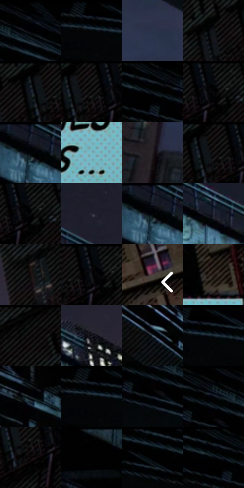

# 电影参考 102

- 状态：条件／活跃；来源世界：miles-home。
- 视角：low-angle；景别：environment-wide；场景：city。
- 时段：night-appearance（外观依据，中置信度；具体时间／晨昏未知）；光照：night-mixed。
- 材质候选：metal, brick, glass, sky（帧级，不是像素分割）。
- 明暗组：very-dark；L* P5/P50/P95：0.27417 / 5.19306 / 38.16039。
- 资格门禁：caption。
- 原截图 SHA-256：`bf28567a1d75f8bcc699e7b7a84b075f90b7ee78c9b45f44f665c0576c9de589`；尺寸：2880 × 1212。
- sRGB 像素 SHA-256：`1df792605d9ec84f9da0752f2f54820634a475d3a600bc1ddca7edf5b7ea16a7`。

## 观察与迁移

高架列车和叙事框，窗光是小面积亮点。

102  /  夜色桥梁下方有另一块浅蓝点阵矩形，补充情节说明。  /  叙事框可放在建筑留白处，黑色边/底让文字在深背景上稳定阅读。

本公开版保存32个128×128原像素色卡上下文；图集格子并非原场景相邻位置。原rect、图集tile和像素SHA见 `data/palette-crops.json`。上下文不足时不得批准替色，不能以小样推断完整构图。

## 实测色卡

颜色比例分母为保留采样像素，不是材料面积；全部 32 色参与全库匹配。表内四舍五入仅用于阅读，原精度在 JSON。

| ID | HEX | Lab | 原图 xy | 像素数 | 比例 | 明度角色 |
| --- | --- | --- | --- | ---: | ---: | --- |
| 102-S01 | #020202 | [0.548347, -3.5e-05, 6.6e-05] | [640, 28] | 13011 | 6.705180% | deep-shadow |
| 102-S02 | #010101 | [0.274173, -1.7e-05, 3.3e-05] | [80, 28] | 12855 | 6.624786% | deep-shadow |
| 102-S03 | #2B354B | [22.187132, 2.360288, -14.874461] | [848, 768] | 12519 | 6.451630% | shadow |
| 102-S04 | #121417 | [6.239582, -0.09546, -2.247372] | [2268, 84] | 12290 | 6.333615% | deep-shadow |
| 102-S05 | #040506 | [1.332346, -0.122543, -0.470397] | [2340, 32] | 8988 | 4.631939% | deep-shadow |
| 102-S06 | #1B191A | [9.015256, 1.224617, -0.34848] | [2392, 28] | 8555 | 4.408794% | deep-shadow |
| 102-S07 | #070C10 | [3.12096, -0.647722, -2.347046] | [492, 28] | 8388 | 4.322731% | deep-shadow |
| 102-S08 | #05080B | [2.078327, -0.363961, -1.421071] | [2452, 44] | 7812 | 4.025891% | deep-shadow |
| 102-S09 | #1A1E2A | [11.381899, 1.795124, -8.669428] | [1152, 40] | 7787 | 4.013007% | deep-shadow |
| 102-S10 | #7DB5BF | [70.292978, -15.693997, -10.895415] | [2336, 988] | 7570 | 3.901177% | light |
| 102-S11 | #262123 | [13.358436, 2.828283, -0.479757] | [452, 1004] | 7421 | 3.824390% | deep-shadow |
| 102-S12 | #090606 | [1.819967, 0.784393, 0.276614] | [2376, 36] | 7240 | 3.731113% | deep-shadow |
| 102-S13 | #0D0D0F | [3.684533, 0.344364, -0.937416] | [2460, 68] | 6792 | 3.500237% | deep-shadow |
| 102-S14 | #252533 | [15.251542, 3.834865, -9.110309] | [1700, 204] | 6648 | 3.426027% | deep-shadow |
| 102-S15 | #1D2331 | [13.738588, 1.591748, -10.075158] | [1152, 32] | 6172 | 3.180722% | deep-shadow |
| 102-S16 | #292B3B | [17.98569, 3.533504, -10.48364] | [1440, 180] | 5996 | 3.090021% | deep-shadow |
| 102-S17 | #150E0E | [4.563735, 2.677048, 0.943816] | [2296, 356] | 5693 | 2.933871% | deep-shadow |
| 102-S18 | #010406 | [0.961341, -0.50648, -1.033131] | [2436, 28] | 5126 | 2.641669% | deep-shadow |
| 102-S19 | #453E39 | [26.751763, 2.008329, 4.169039] | [2820, 592] | 4987 | 2.570036% | shadow |
| 102-S20 | #372E28 | [19.718628, 2.91504, 5.384637] | [2356, 800] | 4637 | 2.389664% | deep-shadow |
| 102-S21 | #040304 | [0.900616, 0.400491, -0.286186] | [2628, 56] | 4486 | 2.311847% | deep-shadow |
| 102-S22 | #1F1E26 | [11.687308, 2.610096, -5.23476] | [1924, 364] | 3928 | 2.024283% | deep-shadow |
| 102-S23 | #4C6170 | [40.007131, -3.969545, -11.047947] | [1308, 492] | 3868 | 1.993362% | midtone |
| 102-S24 | #010103 | [0.313747, 0.27807, -0.756814] | [116, 28] | 3753 | 1.934097% | deep-shadow |
| 102-S25 | #171A21 | [9.24482, 0.643804, -5.306556] | [1456, 412] | 3748 | 1.931521% | deep-shadow |
| 102-S26 | #000000 | [0.0, 0.0, 0.0] | [72, 28] | 3459 | 1.782585% | deep-shadow |
| 102-S27 | #101820 | [7.837566, -0.9734, -6.753434] | [548, 124] | 3109 | 1.602214% | deep-shadow |
| 102-S28 | #000201 | [0.411943, -0.662077, 0.194212] | [552, 28] | 2781 | 1.433180% | deep-shadow |
| 102-S29 | #060102 | [0.585504, 1.446523, 0.082302] | [2392, 112] | 2254 | 1.161592% | deep-shadow |
| 102-S30 | #020101 | [0.332482, 0.261482, 0.092172] | [880, 28] | 944 | 0.486488% | deep-shadow |
| 102-S31 | #010100 | [0.254387, -0.139061, 0.378457] | [380, 28] | 816 | 0.420523% | deep-shadow |
| 102-S32 | #000101 | [0.215865, -0.261517, -0.092106] | [468, 28] | 411 | 0.211808% | deep-shadow |

## 色阶与空间分布

- 采样 ROI：`[0.01, 0.02, 0.98, 0.94]`；步长：4；样本数：194044。
- 排除区：`[]`。
- 深暗、暗、中、亮、高光五段计数：`[163766, 20966, 1963, 7287, 62]`。
- RGB 各 256 箱、L* 100 箱、13×5 色相明度表和 3×3 空间统计全部保存在 [总数据](../film-library.json)。
- [可视化档案](../../references/library.html)按需绘制直方图，不存 2,094 张重复图表图片。

## 纹理特征占比

**这是分块图像特征的面积占比，不是波点／排线／丝网／错版的精确语义覆盖率。** 窗格、发丝、织物也会产生方向或周期特征。
原图 ROI 像素 3115310；已测块覆盖 3115310（100.0000%）；未测 0。

| 特征 | 块覆盖像素 | 占已测面积 | 阈值敏感范围 |
| --- | ---: | ---: | --- |
| low-contrast | 327680 | 10.5184% | 8.4147% ~ 12.0961% |
| directional-structure | 898560 | 28.8434% | 20.4287% ~ 43.2445% |
| periodic-structure | 1839918 | 59.0605% | 47.8149% ~ 59.0605% |
| mixed-detail | 49152 | 1.5778% | 0.5259% ~ 9.3145% |

阈值敏感范围不是统计置信区间。逐块坐标、尺度、对比、方向一致性、频谱集中度、频率与角度见 [全量特征记录](../texture-features.jsonl)，以帧号定位。
四种印刷层的真实像素覆盖仍标为 `null`，不能填 0，也不能拿上表代替。不得据这些代理测量删除唯一证据。

[测量方法与保留策略](../../references/library-retention.md) · [分类索引](../archive/README.md)
