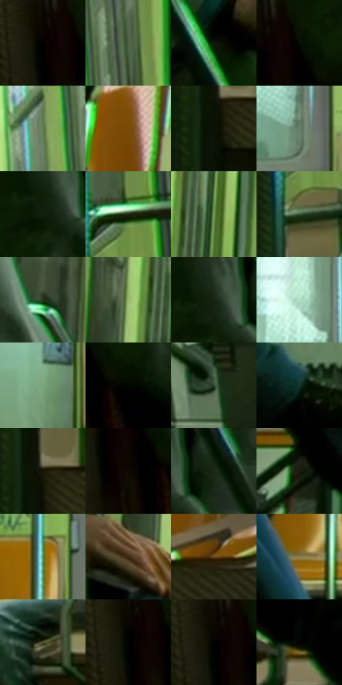

# 电影参考 103

- 状态：常规／活跃；来源世界：miles-home。
- 视角：low-angle；景别：environment-wide；场景：vehicle。
- 时段：interior-time-unknown（外观依据，中置信度；具体时间／晨昏未知）；光照：cool-interior。
- 材质候选：skin, fabric, metal, plastic, glass, screen（帧级，不是像素分割）。
- 明暗组：very-dark；L* P5/P50/P95：0.0 / 18.69592 / 71.02473。
- 资格门禁：无附加门禁。
- 原截图 SHA-256：`c3c8c87d7a65e40563b79536f01d5637ba5fd0214154cca49e489dd0c36cc2ca`；尺寸：2880 × 1204。
- sRGB 像素 SHA-256：`876f9259b0fc7f464d846884a10ea273eaea88d44b775f205c22260ea9dadd11`。

## 观察与迁移

地铁荧光冷暖混合；手机屏、金属杆、车窗分别处理。

103  /  车厢低位广角中，纵向扶杆、座椅、绿光与橙色靠背围住小比例人物。  /  用结构重复和人物尺度表现孤立感；绿光应有环境承载面积。

本公开版保存32个128×128原像素色卡上下文；图集格子并非原场景相邻位置。原rect、图集tile和像素SHA见 `data/palette-crops.json`。上下文不足时不得批准替色，不能以小样推断完整构图。

## 实测色卡

颜色比例分母为保留采样像素，不是材料面积；全部 32 色参与全库匹配。表内四舍五入仅用于阅读，原精度在 JSON。

| ID | HEX | Lab | 原图 xy | 像素数 | 比例 | 明度角色 |
| --- | --- | --- | --- | ---: | ---: | --- |
| 103-S01 | #000000 | [0.0, 0.0, 0.0] | [116, 172] | 13500 | 7.007599% | deep-shadow |
| 103-S02 | #4E6345 | [39.534806, -14.231885, 14.540063] | [2196, 164] | 9303 | 4.829015% | shadow |
| 103-S03 | #0E1708 | [6.536903, -6.411507, 6.388017] | [596, 380] | 8914 | 4.627092% | deep-shadow |
| 103-S04 | #060E04 | [3.265864, -3.670157, 3.181599] | [172, 160] | 8029 | 4.167705% | deep-shadow |
| 103-S05 | #637B53 | [48.813344, -16.639773, 19.105346] | [2100, 204] | 7820 | 4.059217% | midtone |
| 103-S06 | #82510E | [39.008069, 15.311814, 43.614659] | [2668, 28] | 7812 | 4.055064% | shadow |
| 103-S07 | #0B1207 | [4.688927, -4.126098, 4.072793] | [2348, 600] | 7790 | 4.043644% | deep-shadow |
| 103-S08 | #6C826F | [52.175594, -11.952271, 7.665438] | [1520, 548] | 7682 | 3.987584% | midtone |
| 103-S09 | #0F1F0C | [9.860894, -11.644954, 9.536489] | [264, 96] | 7508 | 3.897263% | deep-shadow |
| 103-S10 | #1F2712 | [14.321659, -8.138795, 12.63339] | [2384, 132] | 7453 | 3.868714% | deep-shadow |
| 103-S11 | #759B5B | [59.870264, -25.018474, 29.406739] | [944, 220] | 7248 | 3.762302% | midtone |
| 103-S12 | #375639 | [33.484309, -18.254505, 13.360843] | [2348, 252] | 7064 | 3.666791% | shadow |
| 103-S13 | #26371D | [20.954251, -12.858509, 14.118736] | [592, 112] | 7003 | 3.635127% | shadow |
| 103-S14 | #99B870 | [71.024381, -22.969727, 33.172869] | [864, 248] | 6845 | 3.553112% | light |
| 103-S15 | #142610 | [13.060599, -13.023532, 11.977924] | [276, 64] | 6641 | 3.447220% | deep-shadow |
| 103-S16 | #B3E0C9 | [85.559701, -19.127786, 6.479121] | [1476, 420] | 6123 | 3.178336% | highlight |
| 103-S17 | #7AA67C | [64.051027, -23.415947, 17.082237] | [1520, 740] | 6008 | 3.118641% | light |
| 103-S18 | #020701 | [1.50895, -2.141881, 1.81008] | [232, 224] | 5469 | 2.838856% | deep-shadow |
| 103-S19 | #2E4530 | [26.877735, -14.026553, 9.910112] | [1988, 952] | 5457 | 2.832627% | shadow |
| 103-S20 | #133527 | [19.353856, -16.50628, 5.153937] | [1400, 1028] | 5343 | 2.773452% | deep-shadow |
| 103-S21 | #171403 | [6.224355, -1.432873, 8.06446] | [2360, 560] | 5168 | 2.682613% | deep-shadow |
| 103-S22 | #0F0A01 | [2.898238, 0.248954, 3.934847] | [152, 232] | 4458 | 2.314065% | deep-shadow |
| 103-S23 | #061906 | [6.748463, -10.425703, 7.452347] | [364, 40] | 4392 | 2.279806% | deep-shadow |
| 103-S24 | #1A1F0F | [10.806425, -5.903236, 9.517482] | [1016, 856] | 4358 | 2.262157% | deep-shadow |
| 103-S25 | #4E7F43 | [48.515068, -29.046493, 27.429459] | [1292, 584] | 4065 | 2.110066% | midtone |
| 103-S26 | #3C290D | [18.25806, 5.446025, 20.979273] | [808, 376] | 3791 | 1.967838% | deep-shadow |
| 103-S27 | #674A1D | [33.711681, 7.237407, 30.859866] | [2652, 548] | 3704 | 1.922678% | shadow |
| 103-S28 | #897C4D | [52.141373, -2.058023, 27.436546] | [1236, 768] | 3358 | 1.743075% | midtone |
| 103-S29 | #4C4C2B | [31.532035, -5.781962, 19.616244] | [1784, 780] | 2842 | 1.475229% | shadow |
| 103-S30 | #000300 | [0.588234, -1.201682, 0.858954] | [112, 188] | 2702 | 1.402558% | deep-shadow |
| 103-S31 | #010101 | [0.274173, -1.7e-05, 3.3e-05] | [112, 172] | 2560 | 1.328848% | deep-shadow |
| 103-S32 | #050302 | [0.919351, 0.383903, 0.5628] | [896, 680] | 2238 | 1.161704% | deep-shadow |

## 色阶与空间分布

- 采样 ROI：`[0.01, 0.02, 0.98, 0.94]`；步长：4；样本数：192648。
- 排除区：`[]`。
- 深暗、暗、中、亮、高光五段计数：`[98607, 36277, 36453, 16399, 4912]`。
- RGB 各 256 箱、L* 100 箱、13×5 色相明度表和 3×3 空间统计全部保存在 [总数据](../film-library.json)。
- [可视化档案](../../references/library.html)按需绘制直方图，不存 2,094 张重复图表图片。

## 纹理特征占比

**这是分块图像特征的面积占比，不是波点／排线／丝网／错版的精确语义覆盖率。** 窗格、发丝、织物也会产生方向或周期特征。
原图 ROI 像素 3092958；已测块覆盖 3092958（100.0000%）；未测 0。

| 特征 | 块覆盖像素 | 占已测面积 | 阈值敏感范围 |
| --- | ---: | ---: | --- |
| low-contrast | 160350 | 5.1844% | 3.1493% ~ 6.7735% |
| directional-structure | 1294848 | 41.8644% | 26.0928% ~ 56.4223% |
| periodic-structure | 1545216 | 49.9592% | 39.8986% ~ 60.4335% |
| mixed-detail | 92544 | 2.9921% | 0.5297% ~ 6.7001% |

阈值敏感范围不是统计置信区间。逐块坐标、尺度、对比、方向一致性、频谱集中度、频率与角度见 [全量特征记录](../texture-features.jsonl)，以帧号定位。
四种印刷层的真实像素覆盖仍标为 `null`，不能填 0，也不能拿上表代替。不得据这些代理测量删除唯一证据。

[测量方法与保留策略](../../references/library-retention.md) · [分类索引](../archive/README.md)
