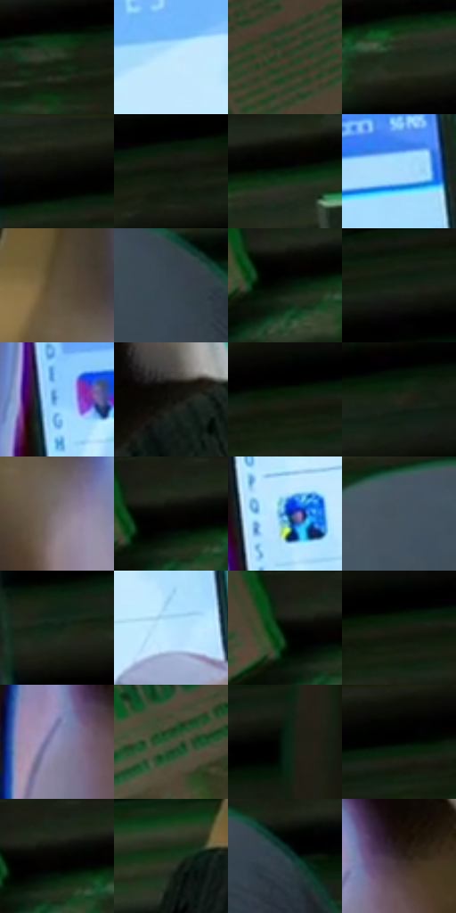

# 电影参考 104

- 状态：常规／活跃；来源世界：miles-home。
- 视角：high-angle；景别：detail；场景：vehicle。
- 时段：interior-time-unknown（外观依据，中置信度；具体时间／晨昏未知）；光照：cool-interior。
- 材质候选：skin, fabric, metal, plastic, glass, screen（帧级，不是像素分割）。
- 明暗组：very-dark；L* P5/P50/P95：1.05849 / 15.42326 / 88.8973。
- 资格门禁：无附加门禁。
- 原截图 SHA-256：`6e11166f3dbadd258992a4e577787a0fa096113a65ebb59bfe2caa17d6e1102a`；尺寸：2880 × 1206。
- sRGB 像素 SHA-256：`214a127b14e154401385b7ffe0af4032aa7afeac6430dc33668e85ffcf068743`。

## 观察与迁移

地铁荧光冷暖混合；手机屏、金属杆、车窗分别处理。

104  /  手持手机近景有明确的手指遮挡、屏幕光和文字行列。  /  屏幕是二次图像；文字若非用户当次指定，不追求逐字复制或新造联系人。

本公开版保存32个128×128原像素色卡上下文；图集格子并非原场景相邻位置。原rect、图集tile和像素SHA见 `data/palette-crops.json`。上下文不足时不得批准替色，不能以小样推断完整构图。

## 实测色卡

颜色比例分母为保留采样像素，不是材料面积；全部 32 色参与全库匹配。表内四舍五入仅用于阅读，原精度在 JSON。

| ID | HEX | Lab | 原图 xy | 像素数 | 比例 | 明度角色 |
| --- | --- | --- | --- | ---: | ---: | --- |
| 104-S01 | #263322 | [19.619082, -9.502393, 9.067218] | [888, 508] | 8593 | 4.444364% | deep-shadow |
| 104-S02 | #C2E9FE | [90.27576, -8.126795, -14.317349] | [1596, 384] | 8288 | 4.286616% | highlight |
| 104-S03 | #3A3D29 | [24.943253, -5.30245, 11.947445] | [596, 84] | 8238 | 4.260755% | shadow |
| 104-S04 | #1C2919 | [14.969218, -9.559716, 8.758059] | [1048, 112] | 7841 | 4.055424% | deep-shadow |
| 104-S05 | #191B12 | [9.273304, -3.078063, 5.629798] | [1800, 40] | 7724 | 3.994911% | deep-shadow |
| 104-S06 | #13180F | [7.462993, -4.255405, 4.637309] | [2308, 56] | 7524 | 3.891469% | deep-shadow |
| 104-S07 | #080905 | [2.330105, -0.817831, 1.421853] | [1104, 36] | 7491 | 3.874401% | deep-shadow |
| 104-S08 | #A7DCFC | [85.213768, -9.519623, -21.044474] | [1664, 184] | 7309 | 3.780270% | highlight |
| 104-S09 | #5B503B | [34.554299, 0.96496, 14.072695] | [1060, 596] | 7068 | 3.655623% | shadow |
| 104-S10 | #384552 | [28.658204, -1.693893, -9.485459] | [580, 976] | 7058 | 3.650450% | shadow |
| 104-S11 | #061007 | [3.835611, -4.295676, 2.791608] | [920, 92] | 6888 | 3.562525% | deep-shadow |
| 104-S12 | #09170A | [6.257642, -7.56331, 5.127353] | [2588, 28] | 6576 | 3.401156% | deep-shadow |
| 104-S13 | #7FBFF8 | [75.168919, -5.246451, -34.468764] | [1220, 456] | 6472 | 3.347367% | light |
| 104-S14 | #12120D | [5.331911, -0.927582, 2.524233] | [2128, 1036] | 6293 | 3.254787% | deep-shadow |
| 104-S15 | #010101 | [0.274173, -1.7e-05, 3.3e-05] | [2160, 28] | 6169 | 3.190653% | deep-shadow |
| 104-S16 | #222419 | [13.662404, -3.393472, 7.071888] | [2152, 216] | 6082 | 3.145656% | deep-shadow |
| 104-S17 | #7F757A | [50.263262, 4.80409, -1.350021] | [1108, 696] | 5795 | 2.997217% | midtone |
| 104-S18 | #192416 | [12.774458, -8.364881, 7.847169] | [928, 32] | 5688 | 2.941876% | deep-shadow |
| 104-S19 | #2970C3 | [46.971479, 7.801742, -49.572367] | [1284, 748] | 5647 | 2.920671% | midtone |
| 104-S20 | #455560 | [35.215221, -3.350709, -8.413014] | [2268, 864] | 5556 | 2.873605% | shadow |
| 104-S21 | #132216 | [11.55506, -9.748333, 6.110492] | [1804, 280] | 5471 | 2.829642% | deep-shadow |
| 104-S22 | #B8E4FE | [88.366639, -8.453499, -17.243369] | [1688, 468] | 5325 | 2.754130% | highlight |
| 104-S23 | #010601 | [1.254563, -2.00282, 1.431623] | [888, 64] | 5318 | 2.750509% | deep-shadow |
| 104-S24 | #121F0F | [10.130299, -9.84393, 8.470135] | [2188, 60] | 5205 | 2.692065% | deep-shadow |
| 104-S25 | #8E8FB3 | [60.47131, 7.421664, -18.907582] | [1860, 800] | 5016 | 2.594313% | light |
| 104-S26 | #444833 | [29.670199, -5.848034, 12.090647] | [188, 36] | 4915 | 2.542075% | shadow |
| 104-S27 | #0A2013 | [10.141575, -12.615223, 6.088141] | [2664, 96] | 4913 | 2.541040% | deep-shadow |
| 104-S28 | #040603 | [1.469063, -0.940235, 0.951192] | [2032, 36] | 4869 | 2.518283% | deep-shadow |
| 104-S29 | #1B2218 | [12.241001, -5.664004, 5.722164] | [944, 28] | 4498 | 2.326399% | deep-shadow |
| 104-S30 | #18341B | [18.924996, -17.204643, 12.609645] | [832, 992] | 3861 | 1.996938% | deep-shadow |
| 104-S31 | #243E42 | [24.364835, -8.706316, -5.593379] | [2516, 876] | 3243 | 1.677304% | shadow |
| 104-S32 | #312425 | [15.739127, 6.362914, 1.711038] | [1920, 756] | 2412 | 1.247504% | deep-shadow |

## 色阶与空间分布

- 采样 ROI：`[0.01, 0.02, 0.98, 0.94]`；步长：4；样本数：193346。
- 排除区：`[]`。
- 深暗、暗、中、亮、高光五段计数：`[110583, 38771, 13379, 8439, 22174]`。
- RGB 各 256 箱、L* 100 箱、13×5 色相明度表和 3×3 空间统计全部保存在 [总数据](../film-library.json)。
- [可视化档案](../../references/library.html)按需绘制直方图，不存 2,094 张重复图表图片。

## 纹理特征占比

**这是分块图像特征的面积占比，不是波点／排线／丝网／错版的精确语义覆盖率。** 窗格、发丝、织物也会产生方向或周期特征。
原图 ROI 像素 3098546；已测块覆盖 3098546（100.0000%）；未测 0。

| 特征 | 块覆盖像素 | 占已测面积 | 阈值敏感范围 |
| --- | ---: | ---: | --- |
| low-contrast | 38144 | 1.2310% | 0.8799% ~ 1.2310% |
| directional-structure | 1851442 | 59.7520% | 46.4544% ~ 69.3523% |
| periodic-structure | 1159808 | 37.4307% | 29.2390% ~ 49.3196% |
| mixed-detail | 49152 | 1.5863% | 0.5288% ~ 2.9950% |

阈值敏感范围不是统计置信区间。逐块坐标、尺度、对比、方向一致性、频谱集中度、频率与角度见 [全量特征记录](../texture-features.jsonl)，以帧号定位。
四种印刷层的真实像素覆盖仍标为 `null`，不能填 0，也不能拿上表代替。不得据这些代理测量删除唯一证据。

[测量方法与保留策略](../../references/library-retention.md) · [分类索引](../archive/README.md)
