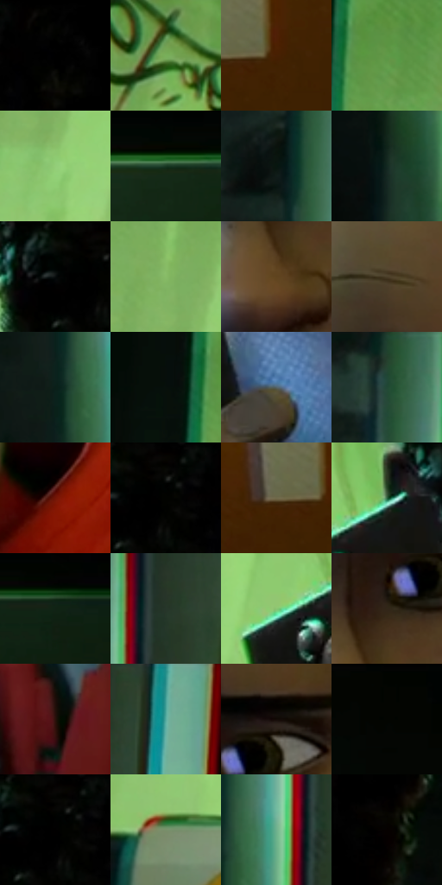

# 电影参考 105

- 状态：常规／活跃；来源世界：miles-home。
- 视角：near-level；景别：close-up；场景：vehicle。
- 时段：interior-time-unknown（外观依据，中置信度；具体时间／晨昏未知）；光照：cool-interior。
- 材质候选：skin, fabric, metal, plastic, glass, screen（帧级，不是像素分割）。
- 明暗组：dark；L* P5/P50/P95：0.27417 / 21.01783 / 74.12407。
- 资格门禁：无附加门禁。
- 原截图 SHA-256：`5ead790ff93c0cb2aad8b35dd8eda9e1bb2d464e43635108ffd55ab163ec63c3`；尺寸：2880 × 1196。
- sRGB 像素 SHA-256：`59c823f17713c8d529009de67f7ffaf55ad451b3a3fe690efc3b51dd53a95b55`。

## 观察与迁移

地铁荧光冷暖混合；手机屏、金属杆、车窗分别处理。

105  /  人脸被冷蓝屏幕光与绿车厢光分割，手和电话贴近脸。  /  情绪由眉眼、口形和手部接触表达，强色散避开五官中心。

本公开版保存32个128×128原像素色卡上下文；图集格子并非原场景相邻位置。原rect、图集tile和像素SHA见 `data/palette-crops.json`。上下文不足时不得批准替色，不能以小样推断完整构图。

## 实测色卡

颜色比例分母为保留采样像素，不是材料面积；全部 32 色参与全库匹配。表内四舍五入仅用于阅读，原精度在 JSON。

| ID | HEX | Lab | 原图 xy | 像素数 | 比例 | 明度角色 |
| --- | --- | --- | --- | ---: | ---: | --- |
| 105-S01 | #010101 | [0.274173, -1.7e-05, 3.3e-05] | [1296, 24] | 12560 | 6.519663% | deep-shadow |
| 105-S02 | #78AF5A | [66.05157, -33.651234, 37.744555] | [900, 68] | 10366 | 5.380798% | light |
| 105-S03 | #472005 | [17.385476, 16.579075, 23.707286] | [2612, 1048] | 9696 | 5.033014% | deep-shadow |
| 105-S04 | #609948 | [57.786085, -34.223585, 36.441518] | [596, 76] | 9061 | 4.703397% | midtone |
| 105-S05 | #93CD78 | [76.812565, -34.141389, 36.44014] | [828, 356] | 8259 | 4.287094% | light |
| 105-S06 | #173722 | [20.163194, -17.650756, 9.651321] | [2512, 324] | 7959 | 4.131369% | shadow |
| 105-S07 | #08160F | [5.960847, -6.307814, 2.349726] | [112, 232] | 7809 | 4.053507% | deep-shadow |
| 105-S08 | #132921 | [14.591036, -11.193265, 2.54076] | [132, 896] | 7686 | 3.989660% | deep-shadow |
| 105-S09 | #040906 | [2.116657, -1.724785, 0.674875] | [1136, 36] | 7166 | 3.719738% | deep-shadow |
| 105-S10 | #87BB67 | [70.642892, -32.237958, 37.076333] | [796, 256] | 7056 | 3.662639% | light |
| 105-S11 | #5F441D | [31.011519, 7.033217, 27.609307] | [1596, 604] | 6714 | 3.485113% | shadow |
| 105-S12 | #4B3D29 | [26.716759, 2.857088, 14.621549] | [1568, 296] | 6527 | 3.388045% | shadow |
| 105-S13 | #0A1F19 | [9.912011, -10.340435, 1.533252] | [120, 580] | 6174 | 3.204809% | deep-shadow |
| 105-S14 | #070F0B | [3.712225, -2.94056, 0.978778] | [504, 80] | 6106 | 3.169511% | deep-shadow |
| 105-S15 | #536267 | [40.497237, -4.509362, -4.750453] | [1316, 596] | 6069 | 3.150305% | midtone |
| 105-S16 | #264330 | [25.682285, -15.897266, 8.183416] | [144, 36] | 6037 | 3.133695% | shadow |
| 105-S17 | #731506 | [24.3075, 39.494168, 33.41469] | [1872, 568] | 5493 | 2.851314% | shadow |
| 105-S18 | #141613 | [6.951337, -1.578158, 1.572852] | [1192, 40] | 5477 | 2.843009% | deep-shadow |
| 105-S19 | #70694A | [44.294078, -2.472965, 18.464809] | [2548, 1048] | 5183 | 2.690399% | midtone |
| 105-S20 | #2D6542 | [38.301715, -27.321796, 14.356573] | [1156, 352] | 5104 | 2.649392% | shadow |
| 105-S21 | #112215 | [11.396087, -10.819299, 6.573945] | [2704, 332] | 5059 | 2.626033% | deep-shadow |
| 105-S22 | #27362A | [20.968189, -9.202149, 5.567886] | [260, 184] | 4858 | 2.521698% | shadow |
| 105-S23 | #8BC573 | [73.9707, -33.890608, 35.247433] | [1056, 404] | 4817 | 2.500415% | light |
| 105-S24 | #322619 | [16.178541, 3.448238, 10.77016] | [1620, 508] | 4733 | 2.456812% | deep-shadow |
| 105-S25 | #28110A | [7.895199, 11.133335, 7.944583] | [1464, 992] | 4492 | 2.331714% | deep-shadow |
| 105-S26 | #359590 | [56.350734, -28.785135, -5.619214] | [364, 24] | 4490 | 2.330676% | midtone |
| 105-S27 | #130B07 | [3.551363, 2.167326, 2.484641] | [1692, 428] | 4115 | 2.136020% | deep-shadow |
| 105-S28 | #010401 | [0.862407, -1.201699, 0.858987] | [2184, 24] | 3970 | 2.060753% | deep-shadow |
| 105-S29 | #040503 | [1.272985, -0.539674, 0.664874] | [1180, 28] | 3286 | 1.705702% | deep-shadow |
| 105-S30 | #78906B | [57.076285, -15.75565, 16.926734] | [716, 748] | 2995 | 1.554649% | midtone |
| 105-S31 | #6FB18F | [67.130834, -28.694026, 10.846013] | [192, 548] | 2303 | 1.195445% | light |
| 105-S32 | #060100 | [0.54593, 1.168435, 0.839149] | [1904, 92] | 1028 | 0.533616% | deep-shadow |

## 色阶与空间分布

- 采样 ROI：`[0.01, 0.02, 0.98, 0.94]`；步长：4；样本数：192648。
- 排除区：`[]`。
- 深暗、暗、中、亮、高光五段计数：`[92927, 40252, 22733, 36045, 691]`。
- RGB 各 256 箱、L* 100 箱、13×5 色相明度表和 3×3 空间统计全部保存在 [总数据](../film-library.json)。
- [可视化档案](../../references/library.html)按需绘制直方图，不存 2,094 张重复图表图片。

## 纹理特征占比

**这是分块图像特征的面积占比，不是波点／排线／丝网／错版的精确语义覆盖率。** 窗格、发丝、织物也会产生方向或周期特征。
原图 ROI 像素 3076194；已测块覆盖 3076194（100.0000%）；未测 0。

| 特征 | 块覆盖像素 | 占已测面积 | 阈值敏感范围 |
| --- | ---: | ---: | --- |
| low-contrast | 354146 | 11.5125% | 10.1269% ~ 15.0285% |
| directional-structure | 1456512 | 47.3479% | 31.6859% ~ 55.7655% |
| periodic-structure | 1249152 | 40.6071% | 33.5750% ~ 50.8348% |
| mixed-detail | 16384 | 0.5326% | 0.5326% ~ 2.4508% |

阈值敏感范围不是统计置信区间。逐块坐标、尺度、对比、方向一致性、频谱集中度、频率与角度见 [全量特征记录](../texture-features.jsonl)，以帧号定位。
四种印刷层的真实像素覆盖仍标为 `null`，不能填 0，也不能拿上表代替。不得据这些代理测量删除唯一证据。

[测量方法与保留策略](../../references/library-retention.md) · [分类索引](../archive/README.md)
