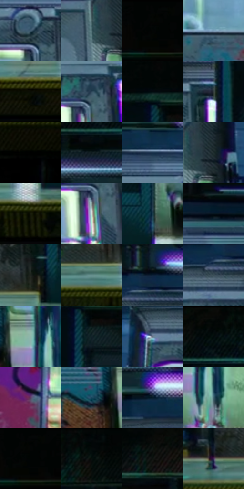

# 电影参考 106

- 状态：常规／活跃；来源世界：miles-home。
- 视角：near-level；景别：environment-wide；场景：vehicle。
- 时段：interior-time-unknown（外观依据，中置信度；具体时间／晨昏未知）；光照：cool-interior。
- 材质候选：skin, fabric, metal, plastic, glass, screen（帧级，不是像素分割）。
- 明暗组：very-dark；L* P5/P50/P95：0.82252 / 18.44414 / 69.10904。
- 资格门禁：无附加门禁。
- 原截图 SHA-256：`b22554f3965bb79ebd3be40aca9cc59f1b3f27be65ad96de266336b05c720874`；尺寸：2880 × 1218。
- sRGB 像素 SHA-256：`d105e57f505ef4f88a52eb2728606d714355acc316aad252a64a2561a43f93b9`。

## 观察与迁移

地铁荧光冷暖混合；手机屏、金属杆、车窗分别处理。

106  /  深色站台的重复柱列和多扇亮门，把小人物锁在中央。  /  以灯光窗口和建筑节奏建立主体，不必把整幅夜景提亮。

本公开版保存32个128×128原像素色卡上下文；图集格子并非原场景相邻位置。原rect、图集tile和像素SHA见 `data/palette-crops.json`。上下文不足时不得批准替色，不能以小样推断完整构图。

## 实测色卡

颜色比例分母为保留采样像素，不是材料面积；全部 32 色参与全库匹配。表内四舍五入仅用于阅读，原精度在 JSON。

| ID | HEX | Lab | 原图 xy | 像素数 | 比例 | 明度角色 |
| --- | --- | --- | --- | ---: | ---: | --- |
| 106-S01 | #3D596C | [36.402634, -4.917224, -14.148008] | [1852, 408] | 9943 | 5.087495% | shadow |
| 106-S02 | #516F75 | [44.80396, -9.266467, -6.84374] | [280, 424] | 8705 | 4.454052% | midtone |
| 106-S03 | #020604 | [1.372232, -1.324189, 0.388491] | [2776, 28] | 8651 | 4.426422% | deep-shadow |
| 106-S04 | #7B9CB9 | [62.918483, -4.293808, -18.691121] | [1148, 652] | 8474 | 4.335858% | light |
| 106-S05 | #0B0D05 | [3.341777, -1.732987, 2.920284] | [1320, 1028] | 7903 | 4.043696% | deep-shadow |
| 106-S06 | #2E475A | [28.966923, -3.710954, -14.241391] | [2444, 416] | 7868 | 4.025788% | shadow |
| 106-S07 | #030D12 | [3.169208, -1.755935, -3.468463] | [2124, 92] | 7730 | 3.955178% | deep-shadow |
| 106-S08 | #323B3C | [24.103744, -3.485568, -1.881699] | [784, 380] | 7722 | 3.951085% | shadow |
| 106-S09 | #000000 | [0.0, 0.0, 0.0] | [76, 1080] | 7662 | 3.920385% | deep-shadow |
| 106-S10 | #0D1A1E | [8.289115, -4.202345, -4.578435] | [1188, 160] | 7654 | 3.916291% | deep-shadow |
| 106-S11 | #132D46 | [17.723778, -0.489557, -18.571751] | [1752, 312] | 7516 | 3.845682% | deep-shadow |
| 106-S12 | #202E30 | [17.802288, -5.265113, -3.195931] | [344, 416] | 7057 | 3.610827% | deep-shadow |
| 106-S13 | #171A0B | [8.525624, -4.667551, 8.152863] | [2000, 1028] | 6126 | 3.134466% | deep-shadow |
| 106-S14 | #CDE2DB | [88.201716, -8.278052, 1.043501] | [2428, 496] | 6096 | 3.119116% | highlight |
| 106-S15 | #183B4B | [23.100564, -6.916777, -13.554038] | [924, 904] | 5859 | 2.997851% | shadow |
| 106-S16 | #05121A | [4.872478, -1.943041, -6.672245] | [2688, 288] | 5843 | 2.989664% | deep-shadow |
| 106-S17 | #1F241F | [13.543293, -3.528705, 2.582366] | [768, 916] | 5841 | 2.988641% | deep-shadow |
| 106-S18 | #67908F | [56.892027, -14.225837, -4.011831] | [1900, 976] | 5781 | 2.957941% | midtone |
| 106-S19 | #0D2238 | [12.703017, 0.329974, -16.754639] | [640, 264] | 5746 | 2.940033% | deep-shadow |
| 106-S20 | #3B4F58 | [32.316068, -5.264015, -7.794299] | [592, 328] | 5719 | 2.926218% | shadow |
| 106-S21 | #8FB6AD | [71.085121, -14.962578, 0.277201] | [1424, 800] | 5535 | 2.832071% | light |
| 106-S22 | #13232A | [12.6562, -4.333368, -6.770398] | [2156, 176] | 5376 | 2.750716% | deep-shadow |
| 106-S23 | #697286 | [47.954556, 1.240561, -12.090501] | [504, 368] | 5358 | 2.741506% | midtone |
| 106-S24 | #040B0C | [2.634762, -1.686197, -1.058349] | [1208, 56] | 5262 | 2.692386% | deep-shadow |
| 106-S25 | #5E3B63 | [30.421011, 22.904971, -17.409518] | [576, 600] | 5073 | 2.595682% | shadow |
| 106-S26 | #19485F | [28.556507, -7.458892, -18.167493] | [1328, 832] | 4547 | 2.326545% | shadow |
| 106-S27 | #061B29 | [8.845471, -2.617526, -11.974127] | [1304, 264] | 4045 | 2.069689% | deep-shadow |
| 106-S28 | #406772 | [41.223572, -10.606183, -10.502016] | [1472, 872] | 4003 | 2.048199% | midtone |
| 106-S29 | #000302 | [0.627807, -0.923594, 0.102107] | [2792, 32] | 3802 | 1.945354% | deep-shadow |
| 106-S30 | #030708 | [1.705766, -0.907075, -0.746747] | [576, 28] | 3784 | 1.936144% | deep-shadow |
| 106-S31 | #0D120F | [4.992108, -2.326835, 0.971939] | [1040, 80] | 2855 | 1.460806% | deep-shadow |
| 106-S32 | #402250 | [19.280041, 23.76895, -22.632862] | [500, 952] | 1904 | 0.974212% | deep-shadow |

## 色阶与空间分布

- 采样 ROI：`[0.01, 0.02, 0.98, 0.94]`；步长：4；样本数：195440。
- 排除区：`[]`。
- 深暗、暗、中、亮、高光五段计数：`[102059, 50717, 22277, 14859, 5528]`。
- RGB 各 256 箱、L* 100 箱、13×5 色相明度表和 3×3 空间统计全部保存在 [总数据](../film-library.json)。
- [可视化档案](../../references/library.html)按需绘制直方图，不存 2,094 张重复图表图片。

## 纹理特征占比

**这是分块图像特征的面积占比，不是波点／排线／丝网／错版的精确语义覆盖率。** 窗格、发丝、织物也会产生方向或周期特征。
原图 ROI 像素 3129280；已测块覆盖 3129280（100.0000%）；未测 0。

| 特征 | 块覆盖像素 | 占已测面积 | 阈值敏感范围 |
| --- | ---: | ---: | --- |
| low-contrast | 0 | 0.0000% | 0.0000% ~ 0.0000% |
| directional-structure | 1296640 | 41.4357% | 23.8143% ~ 57.5355% |
| periodic-structure | 1737152 | 55.5128% | 41.9409% ~ 67.8986% |
| mixed-detail | 95488 | 3.0514% | 0.5236% ~ 8.2871% |

阈值敏感范围不是统计置信区间。逐块坐标、尺度、对比、方向一致性、频谱集中度、频率与角度见 [全量特征记录](../texture-features.jsonl)，以帧号定位。
四种印刷层的真实像素覆盖仍标为 `null`，不能填 0，也不能拿上表代替。不得据这些代理测量删除唯一证据。

[测量方法与保留策略](../../references/library-retention.md) · [分类索引](../archive/README.md)
