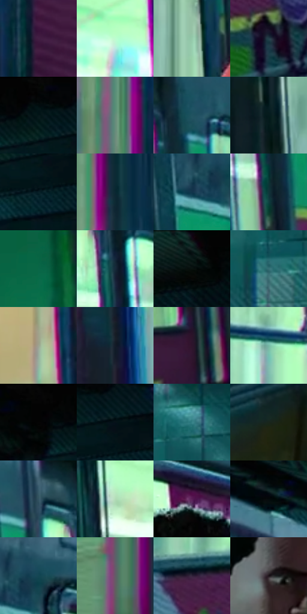

# 电影参考 107

- 状态：常规／活跃；来源世界：miles-home。
- 视角：near-level；景别：medium；场景：vehicle。
- 时段：interior-time-unknown（外观依据，中置信度；具体时间／晨昏未知）；光照：cool-interior。
- 材质候选：skin, fabric, metal, plastic, glass, screen（帧级，不是像素分割）。
- 明暗组：dark；L* P5/P50/P95：2.70958 / 20.39192 / 87.71079。
- 资格门禁：无附加门禁。
- 原截图 SHA-256：`0b5fecbf845062c19283710763108886fcbcbd372aa70116c5939c1854c59866`；尺寸：2880 × 1206。
- sRGB 像素 SHA-256：`12876d0148e67144bd34c685e17c4243470eb98f12095bcdcba9e791677eec06`。

## 观察与迁移

地铁荧光冷暖混合；手机屏、金属杆、车窗分别处理。

107  /  人物走出列车，青绿窗光与窄洋红边界错位，背景车体保持深色。  /  明亮窗框承担局部双彩色散，衣服和脸仍保住主轮廓。

本公开版保存32个128×128原像素色卡上下文；图集格子并非原场景相邻位置。原rect、图集tile和像素SHA见 `data/palette-crops.json`。上下文不足时不得批准替色，不能以小样推断完整构图。

## 实测色卡

颜色比例分母为保留采样像素，不是材料面积；全部 32 色参与全库匹配。表内四舍五入仅用于阅读，原精度在 JSON。

| ID | HEX | Lab | 原图 xy | 像素数 | 比例 | 明度角色 |
| --- | --- | --- | --- | ---: | ---: | --- |
| 107-S01 | #431F44 | [18.324305, 23.735761, -15.919257] | [232, 736] | 10294 | 5.324134% | deep-shadow |
| 107-S02 | #BDFDD0 | [94.150138, -28.708698, 15.166501] | [760, 176] | 8193 | 4.237481% | highlight |
| 107-S03 | #94CAAA | [76.943408, -24.102034, 10.384188] | [1120, 484] | 7834 | 4.051804% | light |
| 107-S04 | #243F49 | [24.985646, -7.097009, -9.293135] | [1728, 964] | 7732 | 3.999048% | shadow |
| 107-S05 | #041719 | [6.401953, -5.808015, -3.649671] | [2160, 64] | 7417 | 3.836128% | deep-shadow |
| 107-S06 | #648D7A | [55.240304, -18.394624, 5.621443] | [104, 732] | 7262 | 3.755961% | midtone |
| 107-S07 | #205360 | [32.563232, -12.483836, -12.620408] | [2036, 336] | 7249 | 3.749237% | shadow |
| 107-S08 | #041B1D | [8.113887, -7.787363, -4.14134] | [976, 476] | 7131 | 3.688207% | deep-shadow |
| 107-S09 | #081E26 | [9.953709, -5.539525, -8.03279] | [2208, 160] | 6956 | 3.597695% | deep-shadow |
| 107-S10 | #0A2732 | [14.091772, -6.382571, -10.338615] | [124, 452] | 6858 | 3.547009% | deep-shadow |
| 107-S11 | #11354B | [20.724049, -4.356338, -17.261949] | [1280, 172] | 6802 | 3.518045% | shadow |
| 107-S12 | #0F3539 | [19.8139, -11.697587, -6.473172] | [1996, 488] | 6748 | 3.490116% | deep-shadow |
| 107-S13 | #096747 | [38.221651, -33.533501, 11.104956] | [468, 108] | 6738 | 3.484944% | shadow |
| 107-S14 | #172939 | [15.815927, -1.809291, -12.552949] | [1900, 384] | 6643 | 3.435809% | deep-shadow |
| 107-S15 | #06100F | [4.008512, -3.08069, -0.515114] | [2692, 60] | 6610 | 3.418742% | deep-shadow |
| 107-S16 | #366E75 | [43.092239, -16.276743, -9.551088] | [2716, 432] | 6486 | 3.354608% | midtone |
| 107-S17 | #9EA491 | [66.4162, -5.655653, 9.136733] | [824, 944] | 6283 | 3.249615% | light |
| 107-S18 | #141B27 | [9.633059, 0.746206, -9.201109] | [604, 620] | 6226 | 3.220134% | deep-shadow |
| 107-S19 | #2E142C | [11.014869, 17.602614, -10.49025] | [2468, 728] | 5745 | 2.971357% | deep-shadow |
| 107-S20 | #76BAA6 | [70.677911, -26.102278, 3.352613] | [1648, 520] | 5316 | 2.749475% | light |
| 107-S21 | #050505 | [1.370867, -8.7e-05, 0.000165] | [2064, 28] | 5086 | 2.630517% | deep-shadow |
| 107-S22 | #051219 | [4.832803, -2.221839, -5.947705] | [2228, 100] | 5013 | 2.592761% | deep-shadow |
| 107-S23 | #378288 | [50.160887, -21.118066, -10.214651] | [2756, 308] | 4732 | 2.447426% | midtone |
| 107-S24 | #19261C | [13.689944, -8.291012, 4.862412] | [2212, 1016] | 4609 | 2.383809% | deep-shadow |
| 107-S25 | #335361 | [33.462892, -7.53135, -11.802563] | [1812, 272] | 4577 | 2.367259% | shadow |
| 107-S26 | #B4DDB8 | [84.419672, -20.452994, 13.810892] | [1012, 256] | 4569 | 2.363121% | highlight |
| 107-S27 | #5A1F58 | [23.198298, 35.171444, -21.537501] | [1464, 228] | 4563 | 2.360018% | shadow |
| 107-S28 | #04090B | [2.216096, -1.02602, -1.226891] | [1784, 68] | 4537 | 2.346570% | deep-shadow |
| 107-S29 | #134654 | [27.181318, -11.36948, -13.205933] | [1340, 132] | 4421 | 2.286574% | shadow |
| 107-S30 | #645D68 | [40.471467, 5.086105, -5.247999] | [92, 1072] | 4006 | 2.071933% | midtone |
| 107-S31 | #31223B | [16.068453, 12.964469, -13.372191] | [1620, 788] | 3828 | 1.979870% | deep-shadow |
| 107-S32 | #1B1217 | [6.571567, 5.384952, -1.649421] | [1428, 472] | 2882 | 1.490592% | deep-shadow |

## 色阶与空间分布

- 采样 ROI：`[0.01, 0.02, 0.98, 0.94]`；步长：4；样本数：193346。
- 排除区：`[]`。
- 深暗、暗、中、亮、高光五段计数：`[94792, 45092, 20741, 18741, 13980]`。
- RGB 各 256 箱、L* 100 箱、13×5 色相明度表和 3×3 空间统计全部保存在 [总数据](../film-library.json)。
- [可视化档案](../../references/library.html)按需绘制直方图，不存 2,094 张重复图表图片。

## 纹理特征占比

**这是分块图像特征的面积占比，不是波点／排线／丝网／错版的精确语义覆盖率。** 窗格、发丝、织物也会产生方向或周期特征。
原图 ROI 像素 3098546；已测块覆盖 3098546（100.0000%）；未测 0。

| 特征 | 块覆盖像素 | 占已测面积 | 阈值敏感范围 |
| --- | ---: | ---: | --- |
| low-contrast | 54528 | 1.7598% | 1.4087% ~ 2.1109% |
| directional-structure | 1447040 | 46.7006% | 34.8943% ~ 57.0033% |
| periodic-structure | 1572530 | 50.7506% | 41.5881% ~ 62.2058% |
| mixed-detail | 24448 | 0.7890% | 0.0000% ~ 0.7890% |

阈值敏感范围不是统计置信区间。逐块坐标、尺度、对比、方向一致性、频谱集中度、频率与角度见 [全量特征记录](../texture-features.jsonl)，以帧号定位。
四种印刷层的真实像素覆盖仍标为 `null`，不能填 0，也不能拿上表代替。不得据这些代理测量删除唯一证据。

[测量方法与保留策略](../../references/library-retention.md) · [分类索引](../archive/README.md)
