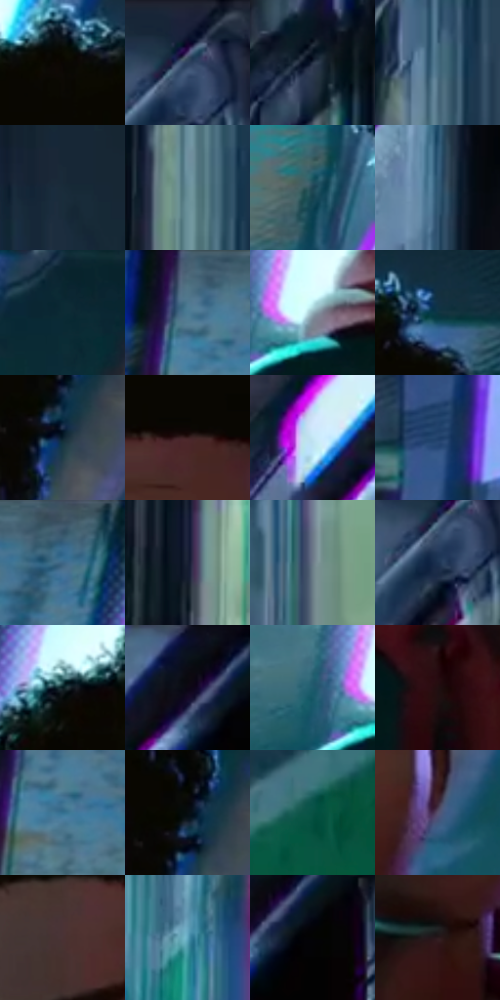

# 电影参考 108

- 状态：常规／活跃；来源世界：miles-home。
- 视角：low-angle；景别：close-up；场景：vehicle。
- 时段：interior-time-unknown（外观依据，中置信度；具体时间／晨昏未知）；光照：cool-interior。
- 材质候选：skin, fabric, metal, plastic, glass, screen（帧级，不是像素分割）。
- 明暗组：dark；L* P5/P50/P95：2.0934 / 25.51467 / 69.88197。
- 资格门禁：无附加门禁。
- 原截图 SHA-256：`6c00ea91a1acd0d6a55c71f4aadfe0c6b61f396baf50dd7eacbb9d1844dba261`；尺寸：2880 × 1206。
- sRGB 像素 SHA-256：`e0d35cc1354b1b47949e88acd20726c4aeaf3d17f09d0ddfcede0f411f6f4f63`。

## 观察与迁移

地铁荧光冷暖混合；手机屏、金属杆、车窗分别处理。

108  /  车门边近景，青色侧光落在脸的一侧，后方灯管与金属边缘有紫色偏移。  /  焦点脸保留结构；色散更适合高反差灯、门框和车身边缘。

本公开版保存32个128×128原像素色卡上下文；图集格子并非原场景相邻位置。原rect、图集tile和像素SHA见 `data/palette-crops.json`。上下文不足时不得批准替色，不能以小样推断完整构图。

## 实测色卡

颜色比例分母为保留采样像素，不是材料面积；全部 32 色参与全库匹配。表内四舍五入仅用于阅读，原精度在 JSON。

| ID | HEX | Lab | 原图 xy | 像素数 | 比例 | 明度角色 |
| --- | --- | --- | --- | ---: | ---: | --- |
| 108-S01 | #0A0702 | [1.995207, 0.089157, 2.168764] | [1136, 136] | 9966 | 5.154490% | deep-shadow |
| 108-S02 | #364A5E | [30.615582, -1.957367, -14.231702] | [2572, 60] | 8619 | 4.457811% | shadow |
| 108-S03 | #2A3548 | [21.966571, 1.052483, -13.211128] | [2180, 580] | 8378 | 4.333164% | shadow |
| 108-S04 | #466D81 | [43.978726, -8.008734, -15.355354] | [2340, 532] | 8329 | 4.307821% | midtone |
| 108-S05 | #192B39 | [16.649173, -2.621903, -11.255491] | [2740, 336] | 8255 | 4.269548% | deep-shadow |
| 108-S06 | #688E98 | [56.639226, -10.602521, -9.546241] | [2316, 696] | 7841 | 4.055424% | midtone |
| 108-S07 | #1E4352 | [26.445437, -8.10157, -12.999322] | [696, 512] | 7767 | 4.017151% | shadow |
| 108-S08 | #335A77 | [36.644545, -4.645899, -20.625723] | [1996, 484] | 7672 | 3.968016% | shadow |
| 108-S09 | #0B2B35 | [15.777185, -7.657995, -9.859702] | [1656, 272] | 7665 | 3.964395% | deep-shadow |
| 108-S10 | #517689 | [47.638436, -7.844882, -14.500017] | [568, 44] | 7504 | 3.881125% | midtone |
| 108-S11 | #90ADB6 | [68.890615, -7.916051, -7.906454] | [676, 968] | 7356 | 3.804578% | light |
| 108-S12 | #0D3542 | [20.143091, -8.654802, -12.101205] | [1336, 140] | 6505 | 3.364435% | shadow |
| 108-S13 | #0A1F2C | [10.749555, -3.254215, -11.194672] | [1372, 484] | 6399 | 3.309611% | deep-shadow |
| 108-S14 | #3D2020 | [16.15337, 14.003316, 6.096192] | [1184, 368] | 6289 | 3.252718% | deep-shadow |
| 108-S15 | #C4E6F4 | [89.326904, -8.15544, -10.487962] | [1988, 196] | 5827 | 3.013768% | highlight |
| 108-S16 | #1F4069 | [26.67049, 2.760301, -27.521397] | [304, 288] | 5654 | 2.924291% | shadow |
| 108-S17 | #40596E | [36.668407, -3.422608, -14.965722] | [764, 28] | 5625 | 2.909292% | shadow |
| 108-S18 | #182033 | [12.391125, 2.775688, -13.629178] | [2100, 960] | 5476 | 2.832228% | deep-shadow |
| 108-S19 | #6D7B89 | [50.946846, -1.94629, -9.33014] | [2512, 908] | 5430 | 2.808437% | midtone |
| 108-S20 | #193150 | [19.972401, 2.017337, -21.772138] | [2556, 112] | 5356 | 2.770163% | deep-shadow |
| 108-S21 | #061A1F | [7.916135, -5.786296, -5.937435] | [880, 176] | 5328 | 2.755682% | deep-shadow |
| 108-S22 | #0A121C | [5.247622, -0.048075, -7.642822] | [2192, 32] | 5069 | 2.621725% | deep-shadow |
| 108-S23 | #1F5A6C | [35.371715, -12.580422, -15.84509] | [592, 964] | 5045 | 2.609312% | shadow |
| 108-S24 | #220F11 | [6.52427, 9.921325, 2.373399] | [948, 1084] | 4966 | 2.568452% | deep-shadow |
| 108-S25 | #337090 | [44.666474, -9.335761, -23.333147] | [596, 112] | 4900 | 2.534317% | midtone |
| 108-S26 | #060D10 | [3.287594, -1.368749, -2.110718] | [1360, 444] | 4474 | 2.313986% | deep-shadow |
| 108-S27 | #095143 | [30.273263, -24.561378, 2.346385] | [2796, 836] | 4314 | 2.231233% | shadow |
| 108-S28 | #595370 | [36.892637, 9.128807, -15.693039] | [1308, 720] | 4133 | 2.137619% | shadow |
| 108-S29 | #4A3234 | [23.622572, 11.220089, 3.095902] | [1040, 424] | 3954 | 2.045038% | shadow |
| 108-S30 | #5EA5BE | [64.165241, -15.396044, -19.731557] | [1684, 1092] | 3900 | 2.017109% | light |
| 108-S31 | #030304 | [0.842307, 0.138992, -0.378325] | [2248, 96] | 2690 | 1.391288% | deep-shadow |
| 108-S32 | #2B191D | [11.259077, 9.724708, 0.937236] | [1144, 928] | 2660 | 1.375772% | deep-shadow |

## 色阶与空间分布

- 采样 ROI：`[0.01, 0.02, 0.98, 0.94]`；步长：4；样本数：193346。
- 排除区：`[]`。
- 深暗、暗、中、亮、高光五段计数：`[76100, 64322, 35868, 11044, 6012]`。
- RGB 各 256 箱、L* 100 箱、13×5 色相明度表和 3×3 空间统计全部保存在 [总数据](../film-library.json)。
- [可视化档案](../../references/library.html)按需绘制直方图，不存 2,094 张重复图表图片。

## 纹理特征占比

**这是分块图像特征的面积占比，不是波点／排线／丝网／错版的精确语义覆盖率。** 窗格、发丝、织物也会产生方向或周期特征。
原图 ROI 像素 3098546；已测块覆盖 3098546（100.0000%）；未测 0。

| 特征 | 块覆盖像素 | 占已测面积 | 阈值敏感范围 |
| --- | ---: | ---: | --- |
| low-contrast | 115122 | 3.7154% | 3.3642% ~ 3.7154% |
| directional-structure | 1634944 | 52.7649% | 36.9970% ~ 66.9506% |
| periodic-structure | 1315712 | 42.4622% | 29.6851% ~ 54.5288% |
| mixed-detail | 32768 | 1.0575% | 0.0000% ~ 4.7589% |

阈值敏感范围不是统计置信区间。逐块坐标、尺度、对比、方向一致性、频谱集中度、频率与角度见 [全量特征记录](../texture-features.jsonl)，以帧号定位。
四种印刷层的真实像素覆盖仍标为 `null`，不能填 0，也不能拿上表代替。不得据这些代理测量删除唯一证据。

[测量方法与保留策略](../../references/library-retention.md) · [分类索引](../archive/README.md)
