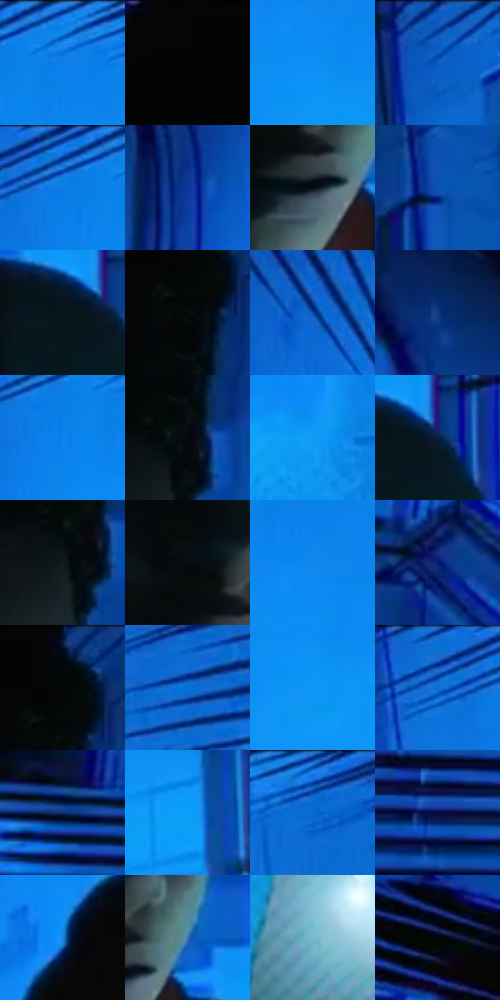

# 电影参考 109

- 状态：条件／活跃；来源世界：miles-home。
- 视角：near-level；景别：medium；场景：industrial。
- 时段：graphic-no-physical-time（外观依据，中置信度；具体时间／晨昏未知）；光照：graphic-field。
- 材质候选：skin, fabric, metal, screen（帧级，不是像素分割）。
- 明暗组：dark；L* P5/P50/P95：1.568 / 34.20791 / 61.21417。
- 资格门禁：sense。
- 原截图 SHA-256：`d7d358bbf58d504d5bf325876a4e9c7e1dccc2693c69471ac0330a7f04bec436`；尺寸：2880 × 1202。
- sRGB 像素 SHA-256：`19a8912d1a5ed7682c0936ac233da01abe34f0516523229271f8de7f1cb27964`。

## 观察与迁移

蓝色空间收紧与线束，感应口令门槛独立于截图。

109  /  人物处在偏暗的中心，原有墙面、阶梯与拱形结构仍可辨；环境变成电蓝色，细线从画幅边缘向中心压入。  /  先保留真实空间的线索，再让边缘方向线制造感知收缩。

本公开版保存32个128×128原像素色卡上下文；图集格子并非原场景相邻位置。原rect、图集tile和像素SHA见 `data/palette-crops.json`。上下文不足时不得批准替色，不能以小样推断完整构图。

## 实测色卡

颜色比例分母为保留采样像素，不是材料面积；全部 32 色参与全库匹配。表内四舍五入仅用于阅读，原精度在 JSON。

| ID | HEX | Lab | 原图 xy | 像素数 | 比例 | 明度角色 |
| --- | --- | --- | --- | ---: | ---: | --- |
| 109-S01 | #0A76E0 | [49.977954, 13.26526, -61.28683] | [2312, 56] | 12423 | 6.448549% | midtone |
| 109-S02 | #040505 | [1.312559, -0.261586, -0.091974] | [1188, 28] | 10127 | 5.256738% | deep-shadow |
| 109-S03 | #0F8FF3 | [58.23934, 5.365248, -58.613822] | [2340, 200] | 10007 | 5.194448% | midtone |
| 109-S04 | #0E5DC3 | [40.992896, 18.030252, -59.230351] | [1684, 44] | 8810 | 4.573107% | midtone |
| 109-S05 | #0A7EE8 | [52.739952, 11.374723, -61.328316] | [2228, 60] | 8603 | 4.465658% | midtone |
| 109-S06 | #0C3798 | [26.951435, 26.256748, -56.517937] | [632, 300] | 8234 | 4.274117% | shadow |
| 109-S07 | #040D16 | [3.356225, -0.589994, -5.837867] | [1408, 580] | 8067 | 4.187430% | deep-shadow |
| 109-S08 | #0D52B1 | [36.54204, 18.038082, -55.906727] | [1996, 112] | 8019 | 4.162514% | shadow |
| 109-S09 | #06151B | [5.9087, -3.306627, -5.907509] | [1544, 656] | 7989 | 4.146942% | deep-shadow |
| 109-S10 | #060A0B | [2.528791, -0.903582, -0.756296] | [1500, 116] | 7182 | 3.728043% | deep-shadow |
| 109-S11 | #0E48A5 | [32.795528, 19.968267, -54.847037] | [884, 88] | 6764 | 3.511067% | shadow |
| 109-S12 | #103A7F | [25.766523, 14.018677, -42.954299] | [444, 128] | 6608 | 3.430090% | shadow |
| 109-S13 | #0D83EE | [54.540665, 10.687459, -61.776417] | [2248, 104] | 6526 | 3.387525% | midtone |
| 109-S14 | #020A0F | [2.388805, -1.294314, -2.90823] | [1508, 200] | 6496 | 3.371953% | deep-shadow |
| 109-S15 | #169DF8 | [62.556248, -0.751365, -54.474816] | [2560, 940] | 6387 | 3.315373% | light |
| 109-S16 | #0A1D3D | [11.134949, 5.792736, -22.804334] | [1588, 652] | 5980 | 3.104107% | deep-shadow |
| 109-S17 | #121A1E | [8.662972, -2.39581, -3.978222] | [1484, 236] | 5932 | 3.079191% | deep-shadow |
| 109-S18 | #0B0D10 | [3.580625, -0.054585, -1.647676] | [1360, 492] | 5484 | 2.846643% | deep-shadow |
| 109-S19 | #0B88EF | [55.995388, 7.949216, -59.996283] | [2340, 140] | 5405 | 2.805635% | midtone |
| 109-S20 | #041B6D | [15.025491, 27.739304, -49.025382] | [604, 644] | 5278 | 2.739712% | deep-shadow |
| 109-S21 | #04080A | [1.999727, -0.768049, -1.125137] | [1508, 40] | 4748 | 2.464599% | deep-shadow |
| 109-S22 | #0B6FD7 | [47.422098, 14.19959, -60.316461] | [2752, 92] | 4740 | 2.460446% | midtone |
| 109-S23 | #0A97F6 | [60.646799, 1.598649, -56.423208] | [2344, 248] | 4492 | 2.331714% | light |
| 109-S24 | #156BCE | [45.809837, 13.638403, -57.777512] | [2144, 48] | 4447 | 2.308355% | midtone |
| 109-S25 | #0F2E69 | [20.34162, 13.156973, -37.702531] | [164, 824] | 4287 | 2.225302% | shadow |
| 109-S26 | #0B9FF7 | [62.993041, -2.658881, -53.2383] | [1932, 600] | 4054 | 2.104356% | light |
| 109-S27 | #0569D1 | [45.27093, 15.485809, -60.373783] | [2612, 60] | 3624 | 1.881151% | midtone |
| 109-S28 | #030D40 | [6.117126, 17.987574, -33.110042] | [332, 1000] | 3474 | 1.803289% | deep-shadow |
| 109-S29 | #1987E1 | [55.038977, 3.783327, -53.718419] | [944, 532] | 3224 | 1.673519% | midtone |
| 109-S30 | #3474AB | [47.182931, -2.085088, -35.30536] | [1476, 540] | 2318 | 1.203231% | midtone |
| 109-S31 | #80B9D0 | [72.120634, -12.682318, -17.445665] | [2136, 976] | 2217 | 1.150804% | light |
| 109-S32 | #010506 | [1.157419, -0.90704, -0.746813] | [144, 104] | 702 | 0.364395% | deep-shadow |

## 色阶与空间分布

- 采样 ROI：`[0.01, 0.02, 0.98, 0.94]`；步长：4；样本数：192648。
- 排除区：`[]`。
- 深暗、暗、中、亮、高光五段计数：`[73119, 34824, 69656, 14514, 535]`。
- RGB 各 256 箱、L* 100 箱、13×5 色相明度表和 3×3 空间统计全部保存在 [总数据](../film-library.json)。
- [可视化档案](../../references/library.html)按需绘制直方图，不存 2,094 张重复图表图片。

## 纹理特征占比

**这是分块图像特征的面积占比，不是波点／排线／丝网／错版的精确语义覆盖率。** 窗格、发丝、织物也会产生方向或周期特征。
原图 ROI 像素 3087370；已测块覆盖 3087370（100.0000%）；未测 0。

| 特征 | 块覆盖像素 | 占已测面积 | 阈值敏感范围 |
| --- | ---: | ---: | --- |
| low-contrast | 449408 | 14.5563% | 11.3723% ~ 17.8814% |
| directional-structure | 1313280 | 42.5372% | 32.1185% ~ 55.6925% |
| periodic-structure | 1195274 | 38.7150% | 32.9352% ~ 41.2274% |
| mixed-detail | 129408 | 4.1915% | 0.0000% ~ 8.7728% |

阈值敏感范围不是统计置信区间。逐块坐标、尺度、对比、方向一致性、频谱集中度、频率与角度见 [全量特征记录](../texture-features.jsonl)，以帧号定位。
四种印刷层的真实像素覆盖仍标为 `null`，不能填 0，也不能拿上表代替。不得据这些代理测量删除唯一证据。

[测量方法与保留策略](../../references/library-retention.md) · [分类索引](../archive/README.md)
