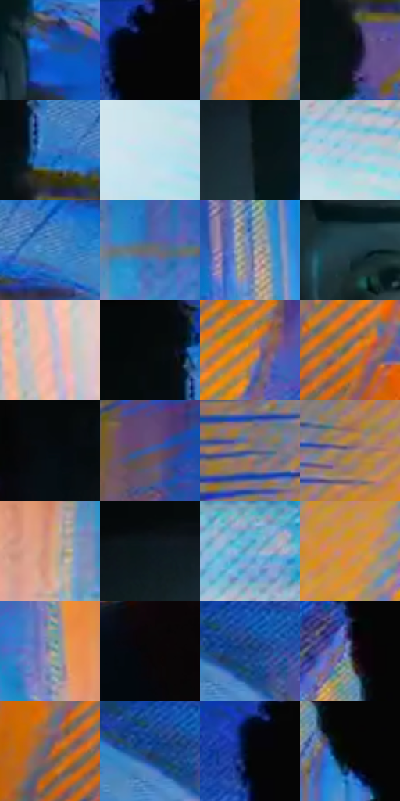

# 电影参考 110

- 状态：条件／活跃；来源世界：miles-home。
- 视角：near-level；景别：close-up；场景：industrial。
- 时段：graphic-no-physical-time（外观依据，中置信度；具体时间／晨昏未知）；光照：graphic-field。
- 材质候选：skin, fabric, metal, screen（帧级，不是像素分割）。
- 明暗组：middle；L* P5/P50/P95：1.568 / 47.02513 / 83.90957。
- 资格门禁：sense。
- 原截图 SHA-256：`ee5d2cc5210ff763f43764e3e16b600b18fecaed02dc759d82423c35d205fbff`；尺寸：2880 × 1202。
- sRGB 像素 SHA-256：`b9866cbec01e7df283e149ac894080f8ad689b846ffa3ab1cde6045e61e6197b`。

## 观察与迁移

蓝色空间收紧与线束，感应口令门槛独立于截图。

110  /  同一中心人物前方仍有暗部；背景的蓝色结构被高纯橙色切开，墙面排线和淡青亮区更强。  /  冷色大面与暖色局部脉冲形成突变，不能把两色等面积平铺。

本公开版保存32个128×128原像素色卡上下文；图集格子并非原场景相邻位置。原rect、图集tile和像素SHA见 `data/palette-crops.json`。上下文不足时不得批准替色，不能以小样推断完整构图。

## 实测色卡

颜色比例分母为保留采样像素，不是材料面积；全部 32 色参与全库匹配。表内四舍五入仅用于阅读，原精度在 JSON。

| ID | HEX | Lab | 原图 xy | 像素数 | 比例 | 明度角色 |
| --- | --- | --- | --- | ---: | ---: | --- |
| 110-S01 | #1C54B1 | [37.408588, 17.673011, -54.48759] | [1692, 524] | 10180 | 5.284249% | shadow |
| 110-S02 | #050505 | [1.370867, -8.7e-05, 0.000165] | [1016, 28] | 9435 | 4.897533% | deep-shadow |
| 110-S03 | #E37A0D | [61.898223, 34.868127, 66.799418] | [300, 816] | 9343 | 4.849778% | light |
| 110-S04 | #081014 | [4.26975, -1.541431, -3.096707] | [1708, 252] | 8759 | 4.546634% | deep-shadow |
| 110-S05 | #3873C3 | [48.310716, 7.828709, -47.405956] | [1732, 144] | 8748 | 4.540924% | midtone |
| 110-S06 | #C0E3EF | [88.1486, -8.893639, -9.64382] | [2788, 996] | 8403 | 4.361841% | highlight |
| 110-S07 | #19272C | [14.621202, -4.357231, -5.193148] | [1608, 376] | 8016 | 4.160957% | deep-shadow |
| 110-S08 | #A0C9DC | [78.70143, -9.20324, -13.859064] | [2804, 740] | 7935 | 4.118911% | light |
| 110-S09 | #4F8FCC | [57.717124, -1.974994, -37.597727] | [1876, 148] | 7553 | 3.920622% | midtone |
| 110-S10 | #6F6C73 | [46.099686, 2.601435, -3.475655] | [2724, 388] | 7510 | 3.898302% | midtone |
| 110-S11 | #6C7BAC | [52.210088, 6.868914, -27.81311] | [2052, 440] | 7500 | 3.893111% | midtone |
| 110-S12 | #223E48 | [24.490585, -7.370139, -9.393888] | [1476, 548] | 7350 | 3.815249% | shadow |
| 110-S13 | #D7BBB5 | [78.06668, 8.998714, 6.71501] | [2216, 948] | 6899 | 3.581143% | light |
| 110-S14 | #060A0B | [2.528791, -0.903582, -0.756296] | [1660, 60] | 6845 | 3.553112% | deep-shadow |
| 110-S15 | #A78056 | [56.414025, 9.659185, 28.53088] | [756, 140] | 6602 | 3.426976% | midtone |
| 110-S16 | #C27B38 | [57.964547, 21.797669, 46.792652] | [392, 996] | 6501 | 3.374548% | midtone |
| 110-S17 | #040B10 | [2.732873, -0.996761, -2.934725] | [1156, 624] | 6321 | 3.281114% | deep-shadow |
| 110-S18 | #435B9F | [39.877951, 12.129721, -39.743305] | [2736, 104] | 6318 | 3.279556% | shadow |
| 110-S19 | #5C5C8B | [40.885563, 11.752301, -26.026357] | [92, 628] | 6054 | 3.142519% | midtone |
| 110-S20 | #967E78 | [54.826914, 8.212182, 6.701987] | [220, 448] | 6025 | 3.127466% | midtone |
| 110-S21 | #D29F7D | [69.456091, 14.535007, 25.089685] | [2616, 476] | 5225 | 2.712200% | light |
| 110-S22 | #0D191D | [7.854006, -3.733161, -4.479788] | [1504, 300] | 5222 | 2.710643% | deep-shadow |
| 110-S23 | #7EB4D3 | [70.718228, -9.763419, -21.223299] | [2728, 596] | 5152 | 2.674308% | light |
| 110-S24 | #DB8E31 | [65.46089, 21.824961, 58.421166] | [444, 504] | 5057 | 2.624995% | light |
| 110-S25 | #95939D | [61.386898, 2.703406, -4.994752] | [2492, 348] | 5016 | 2.603712% | light |
| 110-S26 | #070608 | [1.742923, 0.539483, -0.664511] | [1024, 868] | 3774 | 1.959013% | deep-shadow |
| 110-S27 | #214C8B | [32.602477, 8.433827, -39.3594] | [2148, 148] | 3534 | 1.834434% | shadow |
| 110-S28 | #425172 | [34.51361, 3.429419, -20.761113] | [980, 372] | 2947 | 1.529733% | shadow |
| 110-S29 | #87614D | [44.571086, 12.712247, 17.488786] | [296, 1048] | 2713 | 1.408268% | midtone |
| 110-S30 | #1A4374 | [28.098692, 4.295429, -32.259473] | [2112, 152] | 1385 | 0.718928% | shadow |
| 110-S31 | #030706 | [1.666193, -1.185163, 0.0101] | [976, 80] | 260 | 0.134961% | deep-shadow |
| 110-S32 | #040602 | [1.449276, -1.079278, 1.329615] | [1036, 464] | 66 | 0.034259% | deep-shadow |

## 色阶与空间分布

- 采样 ROI：`[0.01, 0.02, 0.98, 0.94]`；步长：4；样本数：192648。
- 排除区：`[]`。
- 深暗、暗、中、亮、高光五段计数：`[49549, 28583, 59808, 40152, 14556]`。
- RGB 各 256 箱、L* 100 箱、13×5 色相明度表和 3×3 空间统计全部保存在 [总数据](../film-library.json)。
- [可视化档案](../../references/library.html)按需绘制直方图，不存 2,094 张重复图表图片。

## 纹理特征占比

**这是分块图像特征的面积占比，不是波点／排线／丝网／错版的精确语义覆盖率。** 窗格、发丝、织物也会产生方向或周期特征。
原图 ROI 像素 3087370；已测块覆盖 3087370（100.0000%）；未测 0。

| 特征 | 块覆盖像素 | 占已测面积 | 阈值敏感范围 |
| --- | ---: | ---: | --- |
| low-contrast | 379520 | 12.2927% | 10.8955% ~ 14.6600% |
| directional-structure | 583808 | 18.9096% | 11.6749% ~ 32.5123% |
| periodic-structure | 2060170 | 66.7290% | 54.8592% ~ 67.1062% |
| mixed-detail | 63872 | 2.0688% | 1.7330% ~ 6.5589% |

阈值敏感范围不是统计置信区间。逐块坐标、尺度、对比、方向一致性、频谱集中度、频率与角度见 [全量特征记录](../texture-features.jsonl)，以帧号定位。
四种印刷层的真实像素覆盖仍标为 `null`，不能填 0，也不能拿上表代替。不得据这些代理测量删除唯一证据。

[测量方法与保留策略](../../references/library-retention.md) · [分类索引](../archive/README.md)
