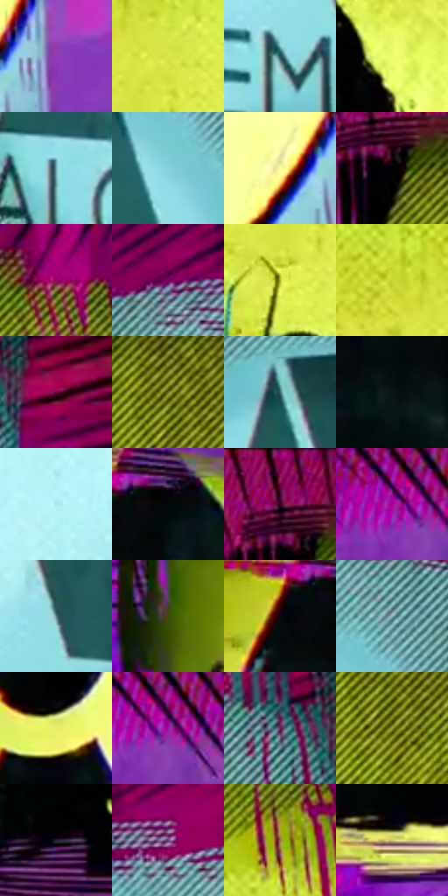

# 电影参考 111

- 状态：条件／活跃；来源世界：miles-home。
- 视角：graphic-nonphysical；景别：graphic-or-multipanel；场景：graphic。
- 时段：graphic-no-physical-time（外观依据，中置信度；具体时间／晨昏未知）；光照：graphic-field。
- 材质候选：paper, paint（帧级，不是像素分割）。
- 明暗组：middle；L* P5/P50/P95：1.29382 / 42.83263 / 95.96607。
- 资格门禁：sense。
- 原截图 SHA-256：`101c0b51aff9d8b51801ef2a25f6d3b579a49f6cc69253d9b3af0fc9059b79cb`；尺寸：2880 × 1206。
- sRGB 像素 SHA-256：`9a25e9149fa006dc10b330cc863c536f3f15c48003bf16968c1cf712fd4cc8a7`。

## 观察与迁移

符号化高彩插帧，不作日常工厂主色。

111  /  洋红底上出现黄、青色的图形化感知碎片与密集墨线。  /  这是短暂的象征性插帧，不是静态改图必须复制的图标、蜘蛛、标志或品牌。

本公开版保存32个128×128原像素色卡上下文；图集格子并非原场景相邻位置。原rect、图集tile和像素SHA见 `data/palette-crops.json`。上下文不足时不得批准替色，不能以小样推断完整构图。

## 实测色卡

颜色比例分母为保留采样像素，不是材料面积；全部 32 色参与全库匹配。表内四舍五入仅用于阅读，原精度在 JSON。

| ID | HEX | Lab | 原图 xy | 像素数 | 比例 | 明度角色 |
| --- | --- | --- | --- | ---: | ---: | --- |
| 111-S01 | #913CB6 | [42.199203, 54.895175, -49.221073] | [960, 872] | 10363 | 5.359821% | midtone |
| 111-S02 | #DBE74C | [88.321323, -22.909248, 70.584813] | [1632, 460] | 9516 | 4.921747% | highlight |
| 111-S03 | #285158 | [31.897968, -12.15029, -8.530743] | [2432, 928] | 8802 | 4.552460% | shadow |
| 111-S04 | #EDFB70 | [95.232639, -22.924112, 63.796599] | [1248, 788] | 8372 | 4.330061% | highlight |
| 111-S05 | #6EA9B3 | [65.70483, -16.532699, -11.202046] | [2148, 888] | 8201 | 4.241619% | light |
| 111-S06 | #86D1DC | [79.51896, -20.45565, -12.776099] | [2508, 332] | 8188 | 4.234895% | light |
| 111-S07 | #FAFCA1 | [97.032383, -13.81258, 43.393794] | [852, 900] | 8169 | 4.225068% | highlight |
| 111-S08 | #010202 | [0.490038, -0.261534, -0.092073] | [1232, 124] | 8129 | 4.204380% | deep-shadow |
| 111-S09 | #930660 | [32.212153, 57.559261, -11.960975] | [1644, 84] | 7910 | 4.091111% | shadow |
| 111-S10 | #7B005D | [26.741415, 52.942932, -18.843159] | [2268, 92] | 7758 | 4.012496% | shadow |
| 111-S11 | #AEB821 | [71.819211, -20.587127, 67.726907] | [1592, 568] | 7724 | 3.994911% | light |
| 111-S12 | #CAD634 | [82.324428, -22.825589, 72.529578] | [1548, 400] | 7590 | 3.925605% | highlight |
| 111-S13 | #6F063E | [23.198122, 45.41232, -3.587422] | [2796, 212] | 7517 | 3.887849% | shadow |
| 111-S14 | #69700F | [45.118227, -14.669886, 47.356118] | [1392, 176] | 7013 | 3.627176% | midtone |
| 111-S15 | #376C70 | [42.317445, -16.421252, -7.688585] | [2272, 228] | 6975 | 3.607522% | midtone |
| 111-S16 | #091414 | [5.49983, -3.673702, -1.293517] | [716, 416] | 6837 | 3.536148% | deep-shadow |
| 111-S17 | #ABE9EF | [88.526209, -18.06378, -9.214712] | [2368, 748] | 6486 | 3.354608% | highlight |
| 111-S18 | #020708 | [1.647458, -1.168575, -0.838885] | [760, 220] | 5638 | 2.916016% | deep-shadow |
| 111-S19 | #3F082E | [12.142431, 29.926492, -9.952299] | [1208, 52] | 5461 | 2.824470% | deep-shadow |
| 111-S20 | #AF0193 | [39.989075, 70.049166, -31.488421] | [848, 84] | 5031 | 2.602071% | shadow |
| 111-S21 | #5B8289 | [51.831136, -11.712987, -8.129557] | [2484, 832] | 4910 | 2.539489% | midtone |
| 111-S22 | #424710 | [28.648503, -10.322482, 30.704631] | [184, 760] | 4340 | 2.244681% | shadow |
| 111-S23 | #11050B | [2.275367, 4.359469, -1.039147] | [680, 244] | 4182 | 2.162962% | deep-shadow |
| 111-S24 | #89B5BB | [70.838059, -13.187447, -7.814431] | [2532, 220] | 4043 | 2.091070% | light |
| 111-S25 | #E7EE67 | [91.288154, -19.731933, 63.128224] | [512, 660] | 3702 | 1.914702% | highlight |
| 111-S26 | #99139F | [37.3761, 65.464093, -43.175694] | [888, 92] | 3663 | 1.894531% | shadow |
| 111-S27 | #6A1E54 | [25.664031, 39.61312, -14.825119] | [2684, 200] | 3560 | 1.841259% | shadow |
| 111-S28 | #979C30 | [62.143307, -15.676211, 53.223938] | [1404, 240] | 3377 | 1.746610% | light |
| 111-S29 | #24202C | [13.168718, 4.995402, -7.298842] | [1224, 1064] | 2941 | 1.521107% | deep-shadow |
| 111-S30 | #6C4173 | [34.410045, 27.61548, -21.223774] | [2412, 108] | 2826 | 1.461628% | shadow |
| 111-S31 | #967737 | [51.786099, 4.54325, 39.034232] | [1752, 248] | 2763 | 1.429044% | midtone |
| 111-S32 | #D1CA79 | [80.279841, -9.052561, 41.222338] | [472, 1088] | 1359 | 0.702885% | highlight |

## 色阶与空间分布

- 采样 ROI：`[0.01, 0.02, 0.98, 0.94]`；步长：4；样本数：193346。
- 排除区：`[]`。
- 深暗、暗、中、亮、高光五段计数：`[35130, 52028, 31673, 27113, 47402]`。
- RGB 各 256 箱、L* 100 箱、13×5 色相明度表和 3×3 空间统计全部保存在 [总数据](../film-library.json)。
- [可视化档案](../../references/library.html)按需绘制直方图，不存 2,094 张重复图表图片。

## 纹理特征占比

**这是分块图像特征的面积占比，不是波点／排线／丝网／错版的精确语义覆盖率。** 窗格、发丝、织物也会产生方向或周期特征。
原图 ROI 像素 3098546；已测块覆盖 3098546（100.0000%）；未测 0。

| 特征 | 块覆盖像素 | 占已测面积 | 阈值敏感范围 |
| --- | ---: | ---: | --- |
| low-contrast | 65536 | 2.1151% | 1.5863% ~ 2.1151% |
| directional-structure | 1381376 | 44.5814% | 33.8326% ~ 60.5492% |
| periodic-structure | 1476914 | 47.6647% | 36.2782% ~ 53.7455% |
| mixed-detail | 174720 | 5.6388% | 1.5863% ~ 10.3068% |

阈值敏感范围不是统计置信区间。逐块坐标、尺度、对比、方向一致性、频谱集中度、频率与角度见 [全量特征记录](../texture-features.jsonl)，以帧号定位。
四种印刷层的真实像素覆盖仍标为 `null`，不能填 0，也不能拿上表代替。不得据这些代理测量删除唯一证据。

[测量方法与保留策略](../../references/library-retention.md) · [分类索引](../archive/README.md)
