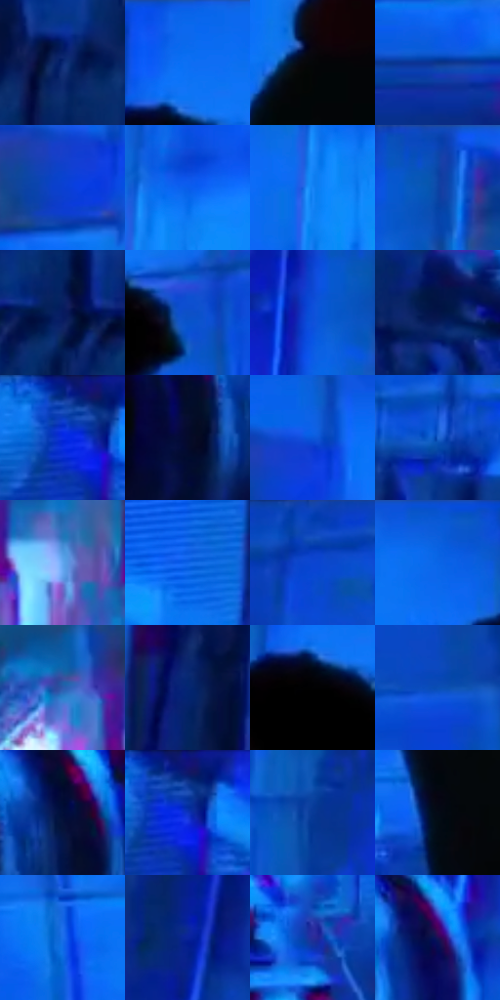

# 电影参考 112

- 状态：常规／活跃；来源世界：miles-home。
- 视角：low-angle；景别：full-body；场景：industrial。
- 时段：interior-time-unknown（外观依据，中置信度；具体时间／晨昏未知）；光照：cool-interior。
- 材质候选：skin, fabric, metal, glass（帧级，不是像素分割）。
- 明暗组：dark；L* P5/P50/P95：1.568 / 31.37317 / 54.12254。
- 资格门禁：无附加门禁。
- 原截图 SHA-256：`bd3fbd2c3d0a7aa98f3bfbf83d526e505c682d4556663d5586177454fe8c10d0`；尺寸：2880 × 1202。
- sRGB 像素 SHA-256：`a4a93956f55d4548c19f1faa4430ec347094923f57d23450f11529d10ad36745`。

## 观察与迁移

冷暗机房与有限白光，结构网格不叫排线。

112  /  机房仍有瓷砖、设备、管线和人物姿态，整体压入冷蓝；物件边缘有窄彩色错版。  /  背景抽象化时保住原空间透视、物件位置与遮挡。

本公开版保存32个128×128原像素色卡上下文；图集格子并非原场景相邻位置。原rect、图集tile和像素SHA见 `data/palette-crops.json`。上下文不足时不得批准替色，不能以小样推断完整构图。

## 实测色卡

颜色比例分母为保留采样像素，不是材料面积；全部 32 色参与全库匹配。表内四舍五入仅用于阅读，原精度在 JSON。

| ID | HEX | Lab | 原图 xy | 像素数 | 比例 | 明度角色 |
| --- | --- | --- | --- | ---: | ---: | --- |
| 112-S01 | #0B2972 | [19.521091, 20.328376, -44.865625] | [1664, 1128] | 14880 | 7.723932% | deep-shadow |
| 112-S02 | #0D6EF3 | [49.136476, 25.826313, -73.306587] | [2152, 56] | 12438 | 6.456335% | midtone |
| 112-S03 | #050608 | [1.626306, 0.016484, -0.848788] | [1908, 264] | 12382 | 6.427266% | deep-shadow |
| 112-S04 | #0B358A | [25.110965, 21.845491, -50.899221] | [2704, 748] | 12279 | 6.373801% | shadow |
| 112-S05 | #0B3FD1 | [34.452175, 42.888498, -78.05451] | [1832, 128] | 9206 | 4.778664% | shadow |
| 112-S06 | #095EEB | [44.316909, 32.900107, -76.687379] | [1576, 300] | 8873 | 4.605810% | midtone |
| 112-S07 | #1784F7 | [55.47826, 13.901662, -65.253696] | [1528, 368] | 8752 | 4.543001% | midtone |
| 112-S08 | #0A42A3 | [30.887785, 23.07207, -56.757226] | [1528, 48] | 8172 | 4.241933% | shadow |
| 112-S09 | #061A5F | [13.250537, 22.799167, -42.717886] | [968, 1088] | 7001 | 3.634089% | deep-shadow |
| 112-S10 | #0D50C7 | [37.742359, 28.186678, -66.847191] | [2256, 172] | 6919 | 3.591524% | shadow |
| 112-S11 | #0E4FDA | [39.147327, 36.2077, -75.503875] | [1460, 100] | 6383 | 3.313297% | shadow |
| 112-S12 | #041448 | [8.939544, 17.060166, -34.124195] | [752, 772] | 6361 | 3.301877% | deep-shadow |
| 112-S13 | #0D42B2 | [32.246275, 29.232154, -63.507497] | [68, 40] | 6153 | 3.193908% | shadow |
| 112-S14 | #040B2C | [4.037015, 8.167562, -21.805448] | [216, 552] | 5736 | 2.977451% | deep-shadow |
| 112-S15 | #0957DA | [41.110851, 30.885011, -72.287364] | [1868, 72] | 5501 | 2.855467% | midtone |
| 112-S16 | #1E66D0 | [44.703132, 18.209438, -60.70344] | [1040, 760] | 5111 | 2.653025% | midtone |
| 112-S17 | #62A7EF | [66.871991, -0.784397, -42.606749] | [2424, 1104] | 4853 | 2.519102% | light |
| 112-S18 | #0F64E8 | [45.68773, 28.055934, -72.754039] | [432, 128] | 4248 | 2.205058% | midtone |
| 112-S19 | #104BBE | [35.709791, 28.084658, -64.91625] | [816, 36] | 4097 | 2.126677% | shadow |
| 112-S20 | #0961DF | [44.135875, 26.325282, -70.194861] | [2012, 44] | 4032 | 2.092936% | midtone |
| 112-S21 | #2E5BAD | [39.712578, 13.499019, -48.377148] | [2304, 1036] | 3883 | 2.015593% | shadow |
| 112-S22 | #042672 | [18.480669, 22.032077, -46.578049] | [524, 896] | 3825 | 1.985486% | deep-shadow |
| 112-S23 | #020203 | [0.568134, 0.139009, -0.378358] | [2136, 144] | 3791 | 1.967838% | deep-shadow |
| 112-S24 | #0A4EB4 | [35.609816, 21.82569, -59.197744] | [2448, 112] | 3508 | 1.820938% | shadow |
| 112-S25 | #020F3A | [5.960789, 13.39375, -29.055503] | [312, 488] | 3485 | 1.808999% | deep-shadow |
| 112-S26 | #062FA9 | [26.548745, 37.981552, -67.504708] | [96, 60] | 3445 | 1.788236% | shadow |
| 112-S27 | #063A97 | [27.567652, 23.490587, -54.901358] | [1296, 244] | 3422 | 1.776297% | shadow |
| 112-S28 | #040B17 | [2.953645, 0.554623, -7.156994] | [1792, 736] | 3418 | 1.774220% | deep-shadow |
| 112-S29 | #196EE9 | [48.559333, 22.446796, -68.638288] | [2560, 436] | 3173 | 1.647045% | midtone |
| 112-S30 | #09239A | [22.274619, 39.952049, -65.456147] | [584, 192] | 3030 | 1.572817% | shadow |
| 112-S31 | #292E99 | [25.934627, 35.021437, -58.75645] | [384, 888] | 2901 | 1.505855% | shadow |
| 112-S32 | #1B1054 | [10.874249, 27.449129, -39.166428] | [528, 512] | 1390 | 0.721523% | deep-shadow |

## 色阶与空间分布

- 采样 ROI：`[0.01, 0.02, 0.98, 0.94]`；步长：4；样本数：192648。
- 排除区：`[]`。
- 深暗、暗、中、亮、高光五段计数：`[55837, 75462, 56747, 4181, 421]`。
- RGB 各 256 箱、L* 100 箱、13×5 色相明度表和 3×3 空间统计全部保存在 [总数据](../film-library.json)。
- [可视化档案](../../references/library.html)按需绘制直方图，不存 2,094 张重复图表图片。

## 纹理特征占比

**这是分块图像特征的面积占比，不是波点／排线／丝网／错版的精确语义覆盖率。** 窗格、发丝、织物也会产生方向或周期特征。
原图 ROI 像素 3087370；已测块覆盖 3087370（100.0000%）；未测 0。

| 特征 | 块覆盖像素 | 占已测面积 | 阈值敏感范围 |
| --- | ---: | ---: | --- |
| low-contrast | 178944 | 5.7960% | 4.3988% ~ 6.0741% |
| directional-structure | 1199488 | 38.8514% | 24.1376% ~ 55.6341% |
| periodic-structure | 1692554 | 54.8219% | 39.9670% ~ 68.1963% |
| mixed-detail | 16384 | 0.5307% | 0.0000% ~ 1.5920% |

阈值敏感范围不是统计置信区间。逐块坐标、尺度、对比、方向一致性、频谱集中度、频率与角度见 [全量特征记录](../texture-features.jsonl)，以帧号定位。
四种印刷层的真实像素覆盖仍标为 `null`，不能填 0，也不能拿上表代替。不得据这些代理测量删除唯一证据。

[测量方法与保留策略](../../references/library-retention.md) · [分类索引](../archive/README.md)
