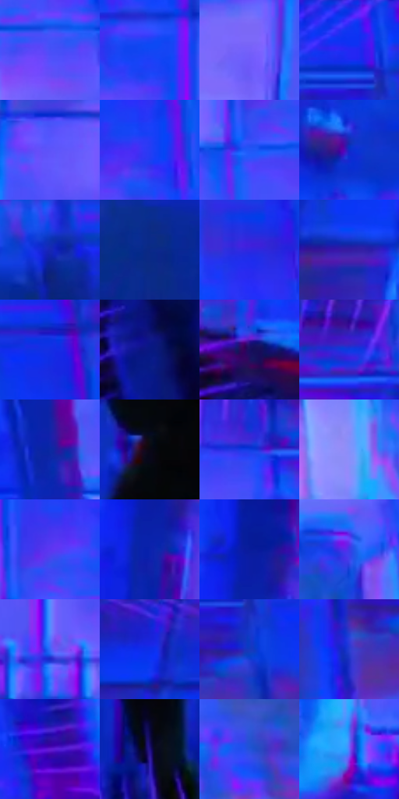

# 电影参考 113

- 状态：条件／活跃；来源世界：miles-home。
- 视角：low-angle；景别：environment-wide；场景：industrial。
- 时段：graphic-no-physical-time（外观依据，中置信度；具体时间／晨昏未知）；光照：graphic-field。
- 材质候选：skin, fabric, metal, glass（帧级，不是像素分割）。
- 明暗组：dark；L* P5/P50/P95：13.16122 / 34.5699 / 53.1304。
- 资格门禁：sense。
- 原截图 SHA-256：`862c3b5bb63daab74cc17208927d28b8e48f414600519a19b56812b6fbc07845`；尺寸：2880 × 1190。
- sRGB 像素 SHA-256：`b05b89d4caabebcd2ce66007fafb9dd02b728aad8ce5363e60a0cb10fd57f103`。

## 观察与迁移

蓝紫感知覆盖、方向线与文字叠加，只作条件图形参考。

113  /  机房远景中人物缩成暗形，蓝色铺满墙面，洋红线束从四周密集指向人物附近。  /  方向线在画幅周边强、主体附近弱；人物不能被线条淹没。

本公开版保存32个128×128原像素色卡上下文；图集格子并非原场景相邻位置。原rect、图集tile和像素SHA见 `data/palette-crops.json`。上下文不足时不得批准替色，不能以小样推断完整构图。

## 实测色卡

颜色比例分母为保留采样像素，不是材料面积；全部 32 色参与全库匹配。表内四舍五入仅用于阅读，原精度在 JSON。

| ID | HEX | Lab | 原图 xy | 像素数 | 比例 | 明度角色 |
| --- | --- | --- | --- | ---: | ---: | --- |
| 113-S01 | #484FF7 | [43.773889, 50.507474, -84.247738] | [1844, 352] | 9886 | 5.169096% | midtone |
| 113-S02 | #1247F4 | [39.854851, 50.698348, -89.091478] | [1372, 144] | 9734 | 5.089620% | shadow |
| 113-S03 | #7561FA | [50.956661, 47.456163, -74.050261] | [1056, 480] | 8715 | 4.556815% | midtone |
| 113-S04 | #1034F2 | [35.934369, 60.38612, -94.462536] | [2308, 40] | 8562 | 4.476816% | shadow |
| 113-S05 | #5D54F9 | [46.318039, 50.789506, -81.140539] | [1172, 372] | 8293 | 4.336164% | midtone |
| 113-S06 | #263BF4 | [37.965645, 58.120852, -92.203278] | [1868, 208] | 7906 | 4.133813% | shadow |
| 113-S07 | #2255F6 | [43.489224, 43.607203, -84.210715] | [1608, 328] | 7635 | 3.992115% | midtone |
| 113-S08 | #0F2BC9 | [29.52442, 51.780928, -81.557241] | [704, 696] | 7497 | 3.919959% | shadow |
| 113-S09 | #1727B4 | [26.525909, 47.212, -74.124813] | [2480, 860] | 7187 | 3.757869% | shadow |
| 113-S10 | #0B2987 | [21.599666, 28.980883, -54.787798] | [2600, 984] | 7016 | 3.668458% | shadow |
| 113-S11 | #3226E1 | [32.915602, 62.875645, -89.775537] | [2464, 400] | 6654 | 3.479179% | shadow |
| 113-S12 | #361CA2 | [24.393809, 49.094066, -66.759192] | [336, 340] | 6270 | 3.278397% | shadow |
| 113-S13 | #152EE2 | [33.139848, 58.438862, -90.007115] | [2444, 116] | 6068 | 3.172777% | shadow |
| 113-S14 | #081881 | [16.937003, 37.392156, -58.716999] | [148, 1012] | 6061 | 3.169117% | deep-shadow |
| 113-S15 | #180F5E | [11.577668, 31.14634, -44.77663] | [72, 792] | 5998 | 3.136176% | deep-shadow |
| 113-S16 | #3D22BF | [29.149559, 55.500567, -76.23707] | [1680, 56] | 5913 | 3.091732% | shadow |
| 113-S17 | #0B29A2 | [24.527187, 39.29261, -66.609524] | [2172, 504] | 5561 | 2.907682% | shadow |
| 113-S18 | #090714 | [2.353353, 2.754124, -5.888084] | [1432, 924] | 5557 | 2.905591% | deep-shadow |
| 113-S19 | #0F3CE1 | [35.531835, 50.448055, -85.470664] | [1544, 100] | 5552 | 2.902976% | shadow |
| 113-S20 | #8691FA | [63.523354, 22.984379, -53.783083] | [2016, 724] | 5431 | 2.839709% | light |
| 113-S21 | #5B35F0 | [39.680541, 63.746437, -87.010226] | [1640, 252] | 5305 | 2.773827% | shadow |
| 113-S22 | #0A22AD | [24.399769, 47.126644, -73.471525] | [768, 408] | 5221 | 2.729906% | shadow |
| 113-S23 | #0A1B9B | [20.881009, 44.773158, -68.383145] | [768, 324] | 5095 | 2.664024% | shadow |
| 113-S24 | #3D3BE8 | [37.741519, 55.74167, -85.751839] | [2360, 640] | 5090 | 2.661410% | shadow |
| 113-S25 | #3768F9 | [48.944693, 34.407022, -76.924999] | [1268, 780] | 5086 | 2.659319% | midtone |
| 113-S26 | #1822D4 | [29.637579, 59.755922, -87.76744] | [168, 44] | 4540 | 2.373831% | shadow |
| 113-S27 | #1639BD | [31.275762, 39.705214, -71.607011] | [2348, 168] | 4215 | 2.203899% | shadow |
| 113-S28 | #273DD1 | [34.74238, 45.398831, -77.551012] | [2252, 224] | 3949 | 2.064815% | shadow |
| 113-S29 | #6119CF | [33.436532, 66.036011, -78.402101] | [2716, 480] | 3187 | 1.666388% | shadow |
| 113-S30 | #221389 | [18.414583, 43.948701, -61.274592] | [1544, 1104] | 3174 | 1.659590% | deep-shadow |
| 113-S31 | #2252D9 | [40.216627, 34.88654, -73.16154] | [2164, 788] | 2895 | 1.513710% | midtone |
| 113-S32 | #5A70FB | [52.646232, 34.47443, -71.944144] | [908, 816] | 1999 | 1.045218% | midtone |

## 色阶与空间分布

- 采样 ROI：`[0.01, 0.02, 0.98, 0.94]`；步长：4；样本数：191252。
- 排除区：`[]`。
- 深暗、暗、中、亮、高光五段计数：`[22694, 112588, 51761, 4051, 158]`。
- RGB 各 256 箱、L* 100 箱、13×5 色相明度表和 3×3 空间统计全部保存在 [总数据](../film-library.json)。
- [可视化档案](../../references/library.html)按需绘制直方图，不存 2,094 张重复图表图片。

## 纹理特征占比

**这是分块图像特征的面积占比，不是波点／排线／丝网／错版的精确语义覆盖率。** 窗格、发丝、织物也会产生方向或周期特征。
原图 ROI 像素 3059430；已测块覆盖 3059430（100.0000%）；未测 0。

| 特征 | 块覆盖像素 | 占已测面积 | 阈值敏感范围 |
| --- | ---: | ---: | --- |
| low-contrast | 60032 | 1.9622% | 0.5941% ~ 3.3303% |
| directional-structure | 743168 | 24.2911% | 10.2335% ~ 38.2984% |
| periodic-structure | 2256230 | 73.7467% | 61.1075% ~ 84.2941% |
| mixed-detail | 0 | 0.0000% | 0.0000% ~ 2.1421% |

阈值敏感范围不是统计置信区间。逐块坐标、尺度、对比、方向一致性、频谱集中度、频率与角度见 [全量特征记录](../texture-features.jsonl)，以帧号定位。
四种印刷层的真实像素覆盖仍标为 `null`，不能填 0，也不能拿上表代替。不得据这些代理测量删除唯一证据。

[测量方法与保留策略](../../references/library-retention.md) · [分类索引](../archive/README.md)
