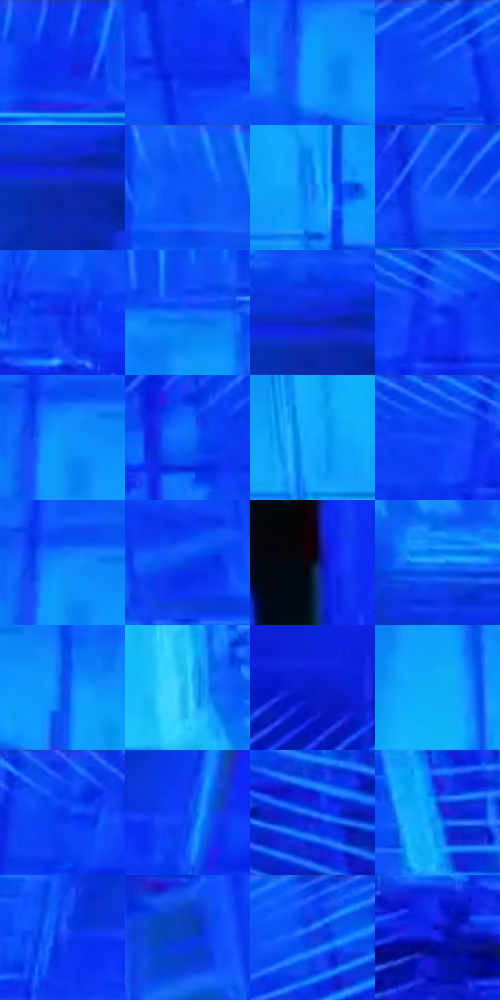

# 电影参考 114

- 状态：条件／活跃；来源世界：miles-home。
- 视角：low-angle；景别：environment-wide；场景：industrial。
- 时段：graphic-no-physical-time（外观依据，中置信度；具体时间／晨昏未知）；光照：graphic-field。
- 材质候选：skin, fabric, metal, glass（帧级，不是像素分割）。
- 明暗组：middle；L* P5/P50/P95：25.45705 / 42.12995 / 66.45762。
- 资格门禁：sense。
- 原截图 SHA-256：`f5939154f40c2324807c5fa7588bba4d61a90d470e85c2c7f271de98a7c866e5`；尺寸：2880 × 1204。
- sRGB 像素 SHA-256：`882b98180305fc246c21cac8b4d86819ab972bea5f9d2a51987b9eaa5a499449`。

## 观察与迁移

蓝紫感知覆盖、方向线与文字叠加，只作条件图形参考。

114  /  更亮的蓝色放射线包围空间，头部周围有少数短黑色锯齿线。  /  头部警觉线是小而局部的感知提示，避开脸、头发结构与手。

本公开版保存32个128×128原像素色卡上下文；图集格子并非原场景相邻位置。原rect、图集tile和像素SHA见 `data/palette-crops.json`。上下文不足时不得批准替色，不能以小样推断完整构图。

## 实测色卡

颜色比例分母为保留采样像素，不是材料面积；全部 32 色参与全库匹配。表内四舍五入仅用于阅读，原精度在 JSON。

| ID | HEX | Lab | 原图 xy | 像素数 | 比例 | 明度角色 |
| --- | --- | --- | --- | ---: | ---: | --- |
| 114-S01 | #0D38F3 | [36.709739, 58.603776, -93.740585] | [1648, 28] | 13003 | 6.749616% | shadow |
| 114-S02 | #0B2EED | [34.266284, 61.662842, -94.407447] | [2592, 112] | 12226 | 6.346290% | shadow |
| 114-S03 | #0E9CFB | [62.364744, 0.652332, -56.425832] | [1140, 192] | 11491 | 5.964765% | light |
| 114-S04 | #1255FA | [43.543053, 44.395466, -86.371324] | [2400, 60] | 11297 | 5.864063% | midtone |
| 114-S05 | #0E2AAB | [25.827442, 42.040449, -69.897205] | [2368, 972] | 8479 | 4.401291% | shadow |
| 114-S06 | #0A56F5 | [43.225929, 41.749649, -84.098013] | [1328, 32] | 8351 | 4.334849% | midtone |
| 114-S07 | #0F7EF5 | [53.61311, 16.550718, -67.15941] | [2056, 516] | 8066 | 4.186911% | midtone |
| 114-S08 | #074BF1 | [40.287591, 47.011397, -86.692336] | [1920, 28] | 7249 | 3.762821% | midtone |
| 114-S09 | #0F27E7 | [32.52367, 63.07488, -93.892783] | [360, 812] | 6470 | 3.358457% | shadow |
| 114-S10 | #106CFB | [49.248671, 30.248292, -77.577541] | [1516, 132] | 6178 | 3.206885% | midtone |
| 114-S11 | #0B27D8 | [30.587421, 58.467201, -88.508887] | [2364, 936] | 6158 | 3.196503% | shadow |
| 114-S12 | #115FFA | [45.910088, 38.133313, -82.482193] | [476, 28] | 5851 | 3.037145% | midtone |
| 114-S13 | #0D92F7 | [59.301241, 5.022709, -59.121045] | [1152, 164] | 5753 | 2.986275% | midtone |
| 114-S14 | #0A6BF7 | [48.625708, 29.19663, -76.370684] | [2116, 92] | 5649 | 2.932291% | midtone |
| 114-S15 | #19A8FC | [65.931759, -5.441921, -51.303223] | [1792, 508] | 5641 | 2.928138% | light |
| 114-S16 | #0B46F7 | [39.854928, 52.15963, -90.780391] | [412, 48] | 5537 | 2.874154% | shadow |
| 114-S17 | #118AFB | [57.325162, 11.504715, -64.491274] | [1152, 144] | 5496 | 2.852872% | midtone |
| 114-S18 | #0540E9 | [37.076959, 50.692401, -87.474882] | [2400, 292] | 5471 | 2.839895% | shadow |
| 114-S19 | #0A0F1F | [4.562226, 2.58775, -11.00668] | [1596, 1036] | 4963 | 2.576201% | deep-shadow |
| 114-S20 | #1C85FC | [56.134156, 15.428115, -66.953932] | [2152, 904] | 4914 | 2.550766% | midtone |
| 114-S21 | #0A56EB | [42.331164, 38.034582, -79.942598] | [1264, 200] | 4862 | 2.523774% | midtone |
| 114-S22 | #27BFF7 | [72.497386, -18.862282, -38.28087] | [2036, 732] | 4833 | 2.508721% | light |
| 114-S23 | #0A1BC6 | [26.516675, 58.208657, -84.806513] | [656, 1104] | 4821 | 2.502492% | shadow |
| 114-S24 | #10ADF8 | [67.104165, -10.037323, -47.280955] | [1540, 268] | 4661 | 2.419439% | light |
| 114-S25 | #1247FA | [40.465738, 52.76677, -91.449397] | [744, 28] | 4198 | 2.179104% | midtone |
| 114-S26 | #0D42EE | [38.11422, 51.414582, -88.588486] | [356, 512] | 3924 | 2.036876% | shadow |
| 114-S27 | #2269FC | [48.844433, 33.309463, -78.78127] | [2820, 896] | 3893 | 2.020784% | midtone |
| 114-S28 | #0A6BEA | [47.646005, 24.182477, -70.692295] | [2760, 496] | 3503 | 1.818342% | midtone |
| 114-S29 | #1843F7 | [39.446852, 54.202969, -91.44911] | [244, 520] | 3084 | 1.600847% | shadow |
| 114-S30 | #093FD2 | [34.526872, 43.204087, -78.510632] | [2280, 264] | 2446 | 1.269673% | shadow |
| 114-S31 | #0F47F4 | [39.809704, 50.621968, -89.167566] | [2764, 36] | 2436 | 1.264482% | shadow |
| 114-S32 | #1B25E4 | [32.157607, 63.291582, -92.781035] | [256, 916] | 1744 | 0.905278% | shadow |

## 色阶与空间分布

- 采样 ROI：`[0.01, 0.02, 0.98, 0.94]`；步长：4；样本数：192648。
- 排除区：`[]`。
- 深暗、暗、中、亮、高光五段计数：`[5837, 73978, 84126, 28177, 530]`。
- RGB 各 256 箱、L* 100 箱、13×5 色相明度表和 3×3 空间统计全部保存在 [总数据](../film-library.json)。
- [可视化档案](../../references/library.html)按需绘制直方图，不存 2,094 张重复图表图片。

## 纹理特征占比

**这是分块图像特征的面积占比，不是波点／排线／丝网／错版的精确语义覆盖率。** 窗格、发丝、织物也会产生方向或周期特征。
原图 ROI 像素 3092958；已测块覆盖 3092958（100.0000%）；未测 0。

| 特征 | 块覆盖像素 | 占已测面积 | 阈值敏感范围 |
| --- | ---: | ---: | --- |
| low-contrast | 0 | 0.0000% | 0.0000% ~ 0.5297% |
| directional-structure | 986496 | 31.8949% | 17.0876% ~ 45.4886% |
| periodic-structure | 2036958 | 65.8579% | 54.5114% ~ 78.0166% |
| mixed-detail | 69504 | 2.2472% | 0.0000% ~ 4.3660% |

阈值敏感范围不是统计置信区间。逐块坐标、尺度、对比、方向一致性、频谱集中度、频率与角度见 [全量特征记录](../texture-features.jsonl)，以帧号定位。
四种印刷层的真实像素覆盖仍标为 `null`，不能填 0，也不能拿上表代替。不得据这些代理测量删除唯一证据。

[测量方法与保留策略](../../references/library-retention.md) · [分类索引](../archive/README.md)
