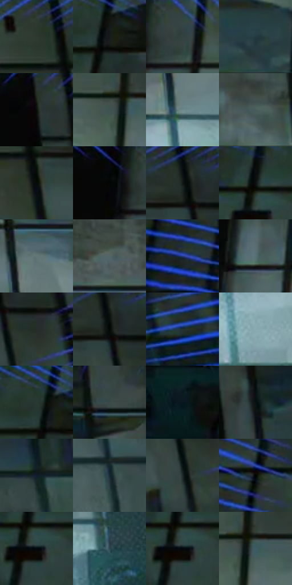

# 电影参考 115

- 状态：常规／活跃；来源世界：miles-home。
- 视角：low-angle；景别：environment-wide；场景：industrial。
- 时段：interior-time-unknown（外观依据，中置信度；具体时间／晨昏未知）；光照：cool-interior。
- 材质候选：skin, fabric, metal, glass（帧级，不是像素分割）。
- 明暗组：very-dark；L* P5/P50/P95：1.64504 / 19.54836 / 53.87647。
- 资格门禁：无附加门禁。
- 原截图 SHA-256：`6e01113613ac828ae31041b97aa369b6653fe01d3e0f344458f9547d4a64806f`；尺寸：2880 × 1202。
- sRGB 像素 SHA-256：`f8f240a7333bdf708e9a52374384374f9cbeef27ac35e509d8b1f2de4c96e8db`。

## 观察与迁移

冷暗机房与有限白光，结构网格不叫排线。

115  /  空间又退回较暗、较少颜色的状态；边框蓝线和头部锯齿线仍在。  /  感应画面可用“暗背景 + 少数高能线”表达，不必永远满屏高饱和。

本公开版保存32个128×128原像素色卡上下文；图集格子并非原场景相邻位置。原rect、图集tile和像素SHA见 `data/palette-crops.json`。上下文不足时不得批准替色，不能以小样推断完整构图。

## 实测色卡

颜色比例分母为保留采样像素，不是材料面积；全部 32 色参与全库匹配。表内四舍五入仅用于阅读，原精度在 JSON。

| ID | HEX | Lab | 原图 xy | 像素数 | 比例 | 明度角色 |
| --- | --- | --- | --- | ---: | ---: | --- |
| 115-S01 | #303C37 | [24.115539, -6.183861, 1.449392] | [2400, 32] | 9221 | 4.786450% | shadow |
| 115-S02 | #151B1A | [9.139299, -3.06743, -0.238979] | [452, 92] | 8967 | 4.654603% | deep-shadow |
| 115-S03 | #354542 | [27.862354, -7.123288, -0.292049] | [932, 36] | 8785 | 4.560130% | shadow |
| 115-S04 | #223941 | [22.47105, -6.476098, -7.788125] | [1036, 272] | 8172 | 4.241933% | shadow |
| 115-S05 | #0B0E0B | [3.697907, -1.379141, 0.986027] | [2136, 64] | 7942 | 4.122545% | deep-shadow |
| 115-S06 | #405351 | [33.711392, -7.807263, -1.24668] | [1092, 140] | 7769 | 4.032744% | shadow |
| 115-S07 | #6F888B | [54.918789, -8.198782, -4.567887] | [1952, 560] | 7390 | 3.836012% | midtone |
| 115-S08 | #4A5C5C | [37.630845, -6.852572, -2.283975] | [1836, 272] | 7388 | 3.834974% | shadow |
| 115-S09 | #060B08 | [2.670004, -1.735032, 0.682241] | [2460, 164] | 7211 | 3.743096% | deep-shadow |
| 115-S10 | #060707 | [1.860906, -0.261621, -0.091908] | [836, 32] | 7164 | 3.718699% | deep-shadow |
| 115-S11 | #0F1714 | [6.908695, -3.987172, 0.810874] | [2552, 76] | 7164 | 3.718699% | deep-shadow |
| 115-S12 | #0C1011 | [4.418937, -1.102742, -0.984765] | [300, 104] | 6827 | 3.543769% | deep-shadow |
| 115-S13 | #627776 | [48.383148, -7.897496, -2.016246] | [1960, 392] | 6537 | 3.393235% | midtone |
| 115-S14 | #556666 | [41.834107, -6.399441, -2.147887] | [1656, 284] | 6413 | 3.328869% | midtone |
| 115-S15 | #273A88 | [27.391931, 20.450413, -45.895658] | [76, 276] | 5970 | 3.098916% | shadow |
| 115-S16 | #577073 | [45.430653, -8.379701, -4.67082] | [876, 320] | 5884 | 3.054275% | midtone |
| 115-S17 | #262D29 | [17.685917, -4.05846, 1.560169] | [2628, 148] | 5774 | 2.997176% | deep-shadow |
| 115-S18 | #030705 | [1.646406, -1.324207, 0.388524] | [2564, 100] | 5561 | 2.886612% | deep-shadow |
| 115-S19 | #203132 | [18.944919, -6.645811, -2.88328] | [2776, 324] | 5526 | 2.868444% | deep-shadow |
| 115-S20 | #89ABB2 | [67.767277, -9.955423, -7.409038] | [1828, 740] | 5411 | 2.808750% | light |
| 115-S21 | #293733 | [21.736204, -6.813598, 0.610793] | [424, 60] | 5266 | 2.733483% | shadow |
| 115-S22 | #3B4A47 | [30.113403, -6.675564, -0.185424] | [1768, 100] | 5265 | 2.732964% | shadow |
| 115-S23 | #08171E | [6.847824, -3.267801, -6.788479] | [752, 688] | 4910 | 2.548690% | deep-shadow |
| 115-S24 | #061010 | [4.034885, -2.895363, -1.019505] | [2216, 208] | 4893 | 2.539865% | deep-shadow |
| 115-S25 | #101D2D | [10.39599, 0.223337, -12.449082] | [2484, 344] | 4822 | 2.503011% | deep-shadow |
| 115-S26 | #15272F | [14.488101, -4.683658, -7.553819] | [2532, 600] | 4767 | 2.474461% | deep-shadow |
| 115-S27 | #1D2728 | [14.764361, -4.060047, -2.09885] | [2580, 212] | 4425 | 2.296935% | deep-shadow |
| 115-S28 | #020302 | [0.744425, -0.400595, 0.286384] | [164, 124] | 4411 | 2.289668% | deep-shadow |
| 115-S29 | #020A0D | [2.339767, -1.638909, -1.970376] | [312, 156] | 3662 | 1.900876% | deep-shadow |
| 115-S30 | #2D4550 | [27.82635, -5.936458, -9.519618] | [2084, 620] | 3403 | 1.766434% | shadow |
| 115-S31 | #02070C | [1.728833, -0.59674, -2.395198] | [308, 156] | 3381 | 1.755014% | deep-shadow |
| 115-S32 | #3C5B65 | [36.709448, -8.507313, -9.341242] | [1132, 136] | 2367 | 1.228666% | shadow |

## 色阶与空间分布

- 采样 ROI：`[0.01, 0.02, 0.98, 0.94]`；步长：4；样本数：192648。
- 排除区：`[]`。
- 深暗、暗、中、亮、高光五段计数：`[97863, 62907, 26410, 5239, 229]`。
- RGB 各 256 箱、L* 100 箱、13×5 色相明度表和 3×3 空间统计全部保存在 [总数据](../film-library.json)。
- [可视化档案](../../references/library.html)按需绘制直方图，不存 2,094 张重复图表图片。

## 纹理特征占比

**这是分块图像特征的面积占比，不是波点／排线／丝网／错版的精确语义覆盖率。** 窗格、发丝、织物也会产生方向或周期特征。
原图 ROI 像素 3087370；已测块覆盖 3087370（100.0000%）；未测 0。

| 特征 | 块覆盖像素 | 占已测面积 | 阈值敏感范围 |
| --- | ---: | ---: | --- |
| low-contrast | 121728 | 3.9428% | 3.2711% ~ 5.8706% |
| directional-structure | 952832 | 30.8623% | 21.9734% ~ 38.9057% |
| periodic-structure | 1938570 | 62.7903% | 57.1516% ~ 66.0905% |
| mixed-detail | 74240 | 2.4046% | 0.6716% ~ 6.0655% |

阈值敏感范围不是统计置信区间。逐块坐标、尺度、对比、方向一致性、频谱集中度、频率与角度见 [全量特征记录](../texture-features.jsonl)，以帧号定位。
四种印刷层的真实像素覆盖仍标为 `null`，不能填 0，也不能拿上表代替。不得据这些代理测量删除唯一证据。

[测量方法与保留策略](../../references/library-retention.md) · [分类索引](../archive/README.md)
