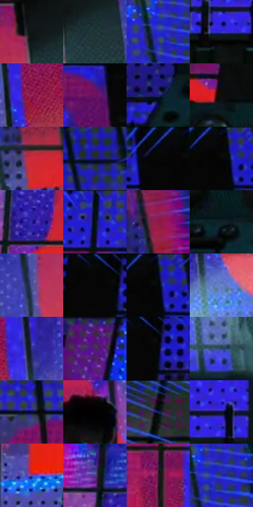

# 电影参考 116

- 状态：条件／活跃；来源世界：miles-home。
- 视角：low-angle；景别：environment-wide；场景：industrial。
- 时段：graphic-no-physical-time（外观依据，中置信度；具体时间／晨昏未知）；光照：graphic-field。
- 材质候选：skin, fabric, metal, glass（帧级，不是像素分割）。
- 明暗组：dark；L* P5/P50/P95：1.49127 / 20.87737 / 46.06423。
- 资格门禁：sense。
- 原截图 SHA-256：`b5e4577e66c7b58ef1bd7e201d37701e1c2ac2eda799f92941b5a668e3633487`；尺寸：2880 × 1220。
- sRGB 像素 SHA-256：`7e0ba1a3affaa9f526013d56f7d22906435ccc3f94937c5f1ff10b817a48a4f3`。

## 观察与迁移

蓝紫感知覆盖、方向线与文字叠加，只作条件图形参考。

116  /  巨大的红色警告字形占据墙后，点阵更显眼，人物仍在前景暗部。  /  文字是这一帧的特殊叙事装置；普通触发不新增大字或从影片抄字。

本公开版保存32个128×128原像素色卡上下文；图集格子并非原场景相邻位置。原rect、图集tile和像素SHA见 `data/palette-crops.json`。上下文不足时不得批准替色，不能以小样推断完整构图。

## 实测色卡

颜色比例分母为保留采样像素，不是材料面积；全部 32 色参与全库匹配。表内四舍五入仅用于阅读，原精度在 JSON。

| ID | HEX | Lab | 原图 xy | 像素数 | 比例 | 明度角色 |
| --- | --- | --- | --- | ---: | ---: | --- |
| 116-S01 | #101515 | [6.328612, -1.997052, -0.702689] | [2076, 408] | 11613 | 5.941977% | deep-shadow |
| 116-S02 | #23373A | [21.561159, -7.062523, -4.430615] | [2136, 460] | 11046 | 5.651862% | shadow |
| 116-S03 | #242CC4 | [29.813259, 50.456517, -78.128023] | [2716, 724] | 10951 | 5.603254% | shadow |
| 116-S04 | #3D32D3 | [33.930008, 53.889265, -80.012233] | [1144, 856] | 9796 | 5.012280% | shadow |
| 116-S05 | #9D265B | [36.577529, 52.223057, -1.997302] | [1820, 508] | 9445 | 4.832685% | shadow |
| 116-S06 | #6E1261 | [25.597629, 46.932424, -23.451242] | [2016, 184] | 9218 | 4.716537% | shadow |
| 116-S07 | #201E79 | [18.433357, 32.592043, -51.107291] | [532, 800] | 8848 | 4.527221% | deep-shadow |
| 116-S08 | #0C0F0D | [4.054546, -1.292942, 0.604322] | [676, 616] | 8217 | 4.204359% | deep-shadow |
| 116-S09 | #CB2C39 | [45.355302, 61.234584, 32.564862] | [2468, 604] | 8063 | 4.125563% | midtone |
| 116-S10 | #202551 | [16.621749, 12.734598, -27.756426] | [2620, 116] | 7737 | 3.958760% | deep-shadow |
| 116-S11 | #050A09 | [2.430404, -1.446714, -0.081939] | [2072, 44] | 7168 | 3.667622% | deep-shadow |
| 116-S12 | #0A0B09 | [2.923025, -0.549991, 0.672372] | [2124, 56] | 6745 | 3.451187% | deep-shadow |
| 116-S13 | #2E209B | [23.603699, 44.297343, -63.813153] | [1144, 536] | 6460 | 3.305362% | shadow |
| 116-S14 | #040C10 | [2.946034, -1.43222, -2.623462] | [1124, 44] | 6191 | 3.167724% | deep-shadow |
| 116-S15 | #8F174C | [31.752043, 51.387123, 0.344484] | [2664, 432] | 5962 | 3.050553% | shadow |
| 116-S16 | #112227 | [12.021553, -5.359589, -5.571094] | [728, 764] | 5842 | 2.989153% | deep-shadow |
| 116-S17 | #4A519C | [37.371933, 19.13215, -41.918857] | [2260, 432] | 5836 | 2.986083% | shadow |
| 116-S18 | #060605 | [1.625254, -0.139148, 0.378622] | [808, 36] | 5684 | 2.908309% | deep-shadow |
| 116-S19 | #040906 | [2.116657, -1.724785, 0.674875] | [2136, 56] | 5175 | 2.647871% | deep-shadow |
| 116-S20 | #6D86CC | [56.741942, 9.890141, -39.018691] | [1820, 656] | 5156 | 2.638150% | midtone |
| 116-S21 | #31337B | [25.107049, 22.167537, -41.424582] | [1936, 472] | 4361 | 2.231375% | shadow |
| 116-S22 | #4D245D | [22.408329, 29.776597, -26.230452] | [388, 184] | 4327 | 2.213979% | shadow |
| 116-S23 | #010504 | [1.117846, -1.185128, 0.010034] | [852, 72] | 3949 | 2.020569% | deep-shadow |
| 116-S24 | #2F4867 | [29.95559, 0.300326, -21.023303] | [2004, 816] | 3520 | 1.801064% | shadow |
| 116-S25 | #070F24 | [4.644138, 3.608082, -14.758176] | [1876, 120] | 3309 | 1.693103% | deep-shadow |
| 116-S26 | #020202 | [0.548347, -3.5e-05, 6.6e-05] | [1552, 456] | 3290 | 1.683381% | deep-shadow |
| 116-S27 | #02060A | [1.490953, -0.489926, -1.88205] | [184, 48] | 3233 | 1.654216% | deep-shadow |
| 116-S28 | #0F1339 | [7.79172, 12.834484, -25.32544] | [1196, 808] | 3176 | 1.625051% | deep-shadow |
| 116-S29 | #7E3683 | [35.426286, 42.515029, -29.417835] | [1328, 684] | 2902 | 1.484855% | shadow |
| 116-S30 | #573791 | [31.353218, 35.08424, -44.847218] | [1096, 316] | 2769 | 1.416803% | shadow |
| 116-S31 | #3B1A30 | [14.85635, 19.682597, -7.314787] | [1256, 400] | 2731 | 1.397360% | deep-shadow |
| 116-S32 | #233495 | [26.684234, 28.974504, -55.086396] | [2752, 716] | 2720 | 1.391731% | shadow |

## 色阶与空间分布

- 采样 ROI：`[0.01, 0.02, 0.98, 0.94]`；步长：4；样本数：195440。
- 排除区：`[]`。
- 深暗、暗、中、亮、高光五段计数：`[94167, 83406, 16230, 1390, 247]`。
- RGB 各 256 箱、L* 100 箱、13×5 色相明度表和 3×3 空间统计全部保存在 [总数据](../film-library.json)。
- [可视化档案](../../references/library.html)按需绘制直方图，不存 2,094 张重复图表图片。

## 纹理特征占比

**这是分块图像特征的面积占比，不是波点／排线／丝网／错版的精确语义覆盖率。** 窗格、发丝、织物也会产生方向或周期特征。
原图 ROI 像素 3134868；已测块覆盖 3134868（100.0000%）；未测 0。

| 特征 | 块覆盖像素 | 占已测面积 | 阈值敏感范围 |
| --- | ---: | ---: | --- |
| low-contrast | 78080 | 2.4907% | 0.0000% ~ 4.4588% |
| directional-structure | 485376 | 15.4831% | 6.6800% ~ 21.7513% |
| periodic-structure | 2402708 | 76.6446% | 76.6446% ~ 77.0529% |
| mixed-detail | 168704 | 5.3815% | 1.4454% ~ 11.8083% |

阈值敏感范围不是统计置信区间。逐块坐标、尺度、对比、方向一致性、频谱集中度、频率与角度见 [全量特征记录](../texture-features.jsonl)，以帧号定位。
四种印刷层的真实像素覆盖仍标为 `null`，不能填 0，也不能拿上表代替。不得据这些代理测量删除唯一证据。

[测量方法与保留策略](../../references/library-retention.md) · [分类索引](../archive/README.md)
