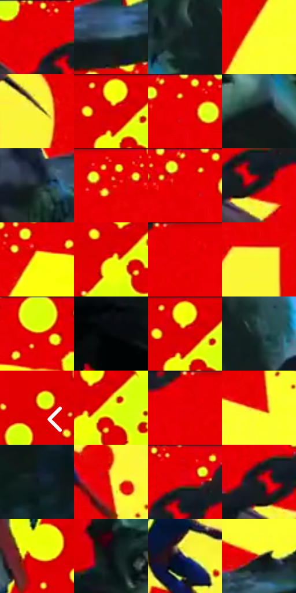

# 电影参考 117

- 状态：条件／活跃；来源世界：miles-home。
- 视角：graphic-nonphysical；景别：graphic-or-multipanel；场景：graphic。
- 时段：graphic-no-physical-time（外观依据，中置信度；具体时间／晨昏未知）；光照：graphic-field。
- 材质候选：fabric, metal（帧级，不是像素分割）。
- 明暗组：middle；L* P5/P50/P95：6.21101 / 48.88452 / 97.00502。
- 资格门禁：impact。
- 原截图 SHA-256：`36c18d8b65071644eb64b2adaccf4063cb6a9eb4ec0f2f1b91dfcd782aefeb8b`；尺寸：2880 × 1206。
- sRGB 像素 SHA-256：`8a95abb54ff2ee6c378112a621c7c14c25dcabdc442f098df6b6d50bfcb22e4b`。

## 观察与迁移

红黄强冲击与巨型字，颜色属于事件图形。

117  /  红色大色面上压入巨大的黄色拟声字形，黄红点阵与斜向黑色前景形成剧烈尺度对比。  /  用一大一小的图形质量与斜向遮挡建立冲击主次；巨字和原片人物不默认复制。

本公开版保存32个128×128原像素色卡上下文；图集格子并非原场景相邻位置。原rect、图集tile和像素SHA见 `data/palette-crops.json`。上下文不足时不得批准替色，不能以小样推断完整构图。

## 实测色卡

颜色比例分母为保留采样像素，不是材料面积；全部 32 色参与全库匹配。表内四舍五入仅用于阅读，原精度在 JSON。

| ID | HEX | Lab | 原图 xy | 像素数 | 比例 | 明度角色 |
| --- | --- | --- | --- | ---: | ---: | --- |
| 117-S01 | #E90102 | [48.704894, 74.744876, 62.200902] | [772, 28] | 10894 | 5.634458% | midtone |
| 117-S02 | #395560 | [34.418406, -7.276436, -9.692604] | [1260, 1000] | 9731 | 5.032946% | shadow |
| 117-S03 | #162021 | [11.36856, -4.127775, -2.132856] | [392, 280] | 9338 | 4.829684% | deep-shadow |
| 117-S04 | #FDFE31 | [96.816598, -21.166008, 87.602354] | [1572, 228] | 8905 | 4.605733% | highlight |
| 117-S05 | #FBF53D | [94.378165, -17.286692, 82.228057] | [1036, 336] | 8856 | 4.580390% | highlight |
| 117-S06 | #FDFF0D | [96.997703, -22.277899, 93.397975] | [2700, 36] | 8104 | 4.191450% | highlight |
| 117-S07 | #DE0202 | [46.42201, 71.978964, 59.923722] | [1416, 36] | 7783 | 4.025426% | midtone |
| 117-S08 | #131A1B | [8.622298, -2.931007, -1.771624] | [312, 396] | 7781 | 4.024392% | deep-shadow |
| 117-S09 | #1B282C | [15.128195, -4.311283, -4.417074] | [772, 992] | 7484 | 3.870781% | deep-shadow |
| 117-S10 | #EC0001 | [49.302703, 75.541483, 63.092774] | [1268, 28] | 7103 | 3.673725% | midtone |
| 117-S11 | #EE0006 | [49.733406, 76.060473, 62.139617] | [1380, 28] | 6820 | 3.527355% | midtone |
| 117-S12 | #0F1817 | [7.376812, -4.013576, -0.616069] | [844, 136] | 6807 | 3.520631% | deep-shadow |
| 117-S13 | #FBFF06 | [96.838786, -23.148936, 93.706668] | [2028, 128] | 6806 | 3.520114% | highlight |
| 117-S14 | #FDFF23 | [97.035282, -21.972324, 90.649749] | [2688, 108] | 6438 | 3.329782% | highlight |
| 117-S15 | #EA0004 | [48.892645, 75.080042, 61.836452] | [1136, 28] | 5945 | 3.074799% | midtone |
| 117-S16 | #FBF736 | [94.865459, -18.488042, 84.612628] | [1276, 260] | 5829 | 3.014802% | highlight |
| 117-S17 | #DBFF0E | [94.57374, -35.97212, 90.410339] | [2120, 28] | 5703 | 2.949634% | highlight |
| 117-S18 | #030406 | [1.077959, 0.016519, -0.848854] | [52, 840] | 5696 | 2.946014% | deep-shadow |
| 117-S19 | #F5FF0A | [96.392281, -25.567141, 92.899206] | [2708, 28] | 5530 | 2.860157% | highlight |
| 117-S20 | #25373A | [21.693463, -6.366504, -4.219245] | [476, 252] | 5402 | 2.793955% | shadow |
| 117-S21 | #C32304 | [42.485803, 60.076353, 54.310949] | [2820, 584] | 5369 | 2.776887% | midtone |
| 117-S22 | #E8FF0A | [95.454673, -30.827385, 91.778958] | [2740, 92] | 5186 | 2.682238% | highlight |
| 117-S23 | #E60001 | [48.046136, 74.088148, 61.861882] | [1088, 28] | 5156 | 2.666722% | midtone |
| 117-S24 | #EB170A | [49.861246, 73.21822, 60.812474] | [1588, 680] | 5025 | 2.598968% | midtone |
| 117-S25 | #0E1B22 | [8.930138, -3.201654, -6.600538] | [108, 572] | 4612 | 2.385361% | deep-shadow |
| 117-S26 | #F8C840 | [82.721268, 4.095951, 70.305679] | [1260, 796] | 4386 | 2.268472% | highlight |
| 117-S27 | #E40106 | [47.667862, 73.559784, 60.014861] | [836, 28] | 3706 | 1.916771% | midtone |
| 117-S28 | #34201B | [14.637295, 8.922445, 7.347036] | [804, 116] | 3637 | 1.881084% | deep-shadow |
| 117-S29 | #F9FF19 | [96.710901, -23.773972, 91.787957] | [2532, 96] | 3152 | 1.630238% | highlight |
| 117-S30 | #0B1111 | [4.62937, -1.946406, -0.685088] | [88, 324] | 2679 | 1.385599% | deep-shadow |
| 117-S31 | #8B8A77 | [57.073549, -3.100487, 10.329473] | [1148, 660] | 2249 | 1.163200% | midtone |
| 117-S32 | #784732 | [35.460773, 18.671491, 21.445569] | [1548, 876] | 1234 | 0.638234% | shadow |

## 色阶与空间分布

- 采样 ROI：`[0.01, 0.02, 0.98, 0.94]`；步长：4；样本数：193346。
- 排除区：`[]`。
- 深暗、暗、中、亮、高光五段计数：`[49218, 13951, 60135, 2828, 67214]`。
- RGB 各 256 箱、L* 100 箱、13×5 色相明度表和 3×3 空间统计全部保存在 [总数据](../film-library.json)。
- [可视化档案](../../references/library.html)按需绘制直方图，不存 2,094 张重复图表图片。

## 纹理特征占比

**这是分块图像特征的面积占比，不是波点／排线／丝网／错版的精确语义覆盖率。** 窗格、发丝、织物也会产生方向或周期特征。
原图 ROI 像素 3098546；已测块覆盖 3098546（100.0000%）；未测 0。

| 特征 | 块覆盖像素 | 占已测面积 | 阈值敏感范围 |
| --- | ---: | ---: | --- |
| low-contrast | 182656 | 5.8949% | 5.8949% ~ 5.8949% |
| directional-structure | 1165824 | 37.6249% | 26.7893% ~ 47.5805% |
| periodic-structure | 1638322 | 52.8739% | 45.4671% ~ 58.2219% |
| mixed-detail | 111744 | 3.6063% | 1.0575% ~ 9.0939% |

阈值敏感范围不是统计置信区间。逐块坐标、尺度、对比、方向一致性、频谱集中度、频率与角度见 [全量特征记录](../texture-features.jsonl)，以帧号定位。
四种印刷层的真实像素覆盖仍标为 `null`，不能填 0，也不能拿上表代替。不得据这些代理测量删除唯一证据。

[测量方法与保留策略](../../references/library-retention.md) · [分类索引](../archive/README.md)
