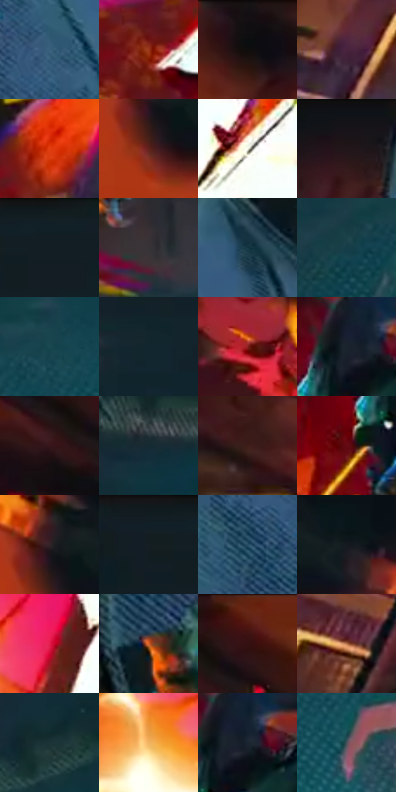

# 电影参考 118

- 状态：条件／活跃；来源世界：miles-home。
- 视角：rolled-or-dutch；景别：full-body；场景：industrial。
- 时段：event-time-unknown（外观依据，中置信度；具体时间／晨昏未知）；光照：event-light。
- 材质候选：fabric, metal, stone（帧级，不是像素分割）。
- 明暗组：dark；L* P5/P50/P95：5.85766 / 22.20513 / 75.31315。
- 资格门禁：impact。
- 原截图 SHA-256：`db47a8e14aab4ea155af03092ad98a9f62aeb1bc137dd2abb18d78da674d2224`；尺寸：2880 × 1206。
- sRGB 像素 SHA-256：`4cee1c53baf8494aa2ad93b341ccdae2d8de6a5388f1ccdf6618c49a43179886`。

## 观察与迁移

接触区高亮与放射碎形，保持原照受力证据。

118  /  画面斜倾，橙红接触区迸出黄白亮部、尖锐碎形和短线；深青暗部托住爆点。  /  有真实碰撞证据时，把接触处组织成局部高反差爆点，周围线和碎形沿原受力方向外散。

本公开版保存32个128×128原像素色卡上下文；图集格子并非原场景相邻位置。原rect、图集tile和像素SHA见 `data/palette-crops.json`。上下文不足时不得批准替色，不能以小样推断完整构图。

## 实测色卡

颜色比例分母为保留采样像素，不是材料面积；全部 32 色参与全库匹配。表内四舍五入仅用于阅读，原精度在 JSON。

| ID | HEX | Lab | 原图 xy | 像素数 | 比例 | 明度角色 |
| --- | --- | --- | --- | ---: | ---: | --- |
| 118-S01 | #39617D | [39.409991, -5.482581, -20.002615] | [1932, 408] | 10157 | 5.253277% | shadow |
| 118-S02 | #9C381C | [37.810596, 40.259858, 38.159042] | [356, 748] | 9866 | 5.102769% | shadow |
| 118-S03 | #120E11 | [4.364283, 1.983752, -1.009902] | [708, 28] | 8403 | 4.346095% | deep-shadow |
| 118-S04 | #673637 | [28.898119, 21.906375, 9.132692] | [36, 1120] | 7931 | 4.101973% | shadow |
| 118-S05 | #E13E10 | [51.261774, 61.042915, 58.955551] | [616, 1016] | 7799 | 4.033701% | midtone |
| 118-S06 | #5F221C | [22.51925, 27.380278, 18.304931] | [1252, 160] | 7403 | 3.828887% | shadow |
| 118-S07 | #F8F8EF | [97.358733, -1.558263, 4.320282] | [1308, 828] | 7375 | 3.814405% | highlight |
| 118-S08 | #1B1517 | [7.508393, 3.454011, -0.281443] | [1636, 52] | 7222 | 3.735273% | deep-shadow |
| 118-S09 | #152024 | [11.413045, -3.570605, -4.272968] | [2256, 28] | 6871 | 3.553733% | deep-shadow |
| 118-S10 | #373438 | [22.137597, 2.231839, -2.040583] | [1852, 1008] | 6811 | 3.522700% | shadow |
| 118-S11 | #133541 | [20.306489, -7.888117, -11.154195] | [1812, 88] | 6688 | 3.459084% | shadow |
| 118-S12 | #153D49 | [23.597302, -9.563571, -11.472259] | [2256, 1016] | 6639 | 3.433741% | shadow |
| 118-S13 | #194751 | [27.591521, -11.990261, -10.615087] | [2528, 936] | 6568 | 3.397019% | shadow |
| 118-S14 | #11262F | [13.888191, -5.18896, -8.489988] | [2416, 264] | 6504 | 3.363918% | deep-shadow |
| 118-S15 | #851F1B | [29.531302, 42.600185, 28.927489] | [1080, 540] | 6102 | 3.156000% | shadow |
| 118-S16 | #1A242C | [13.609708, -1.896781, -6.715067] | [1472, 252] | 5811 | 3.005493% | deep-shadow |
| 118-S17 | #36151B | [11.957186, 17.24327, 3.667425] | [396, 116] | 5753 | 2.975495% | deep-shadow |
| 118-S18 | #172B32 | [16.205776, -5.723582, -7.051132] | [2224, 760] | 5722 | 2.959461% | deep-shadow |
| 118-S19 | #3E1E19 | [15.608145, 14.922479, 10.342576] | [244, 408] | 5678 | 2.936704% | deep-shadow |
| 118-S20 | #660A13 | [20.399971, 38.885871, 22.129608] | [1396, 360] | 5453 | 2.820332% | shadow |
| 118-S21 | #322329 | [15.697635, 8.341527, -1.183027] | [1256, 92] | 5317 | 2.749992% | deep-shadow |
| 118-S22 | #102026 | [11.156366, -4.648502, -6.158365] | [2164, 36] | 5249 | 2.714822% | deep-shadow |
| 118-S23 | #264E65 | [31.34688, -6.425341, -17.629971] | [1776, 384] | 5133 | 2.654826% | shadow |
| 118-S24 | #151A20 | [9.012002, -0.513267, -4.928071] | [1372, 100] | 4997 | 2.584486% | deep-shadow |
| 118-S25 | #E11B4D | [48.676049, 71.88508, 25.572106] | [1136, 872] | 4810 | 2.487768% | midtone |
| 118-S26 | #E1672C | [57.93689, 44.270962, 53.699603] | [1740, 672] | 4441 | 2.296918% | midtone |
| 118-S27 | #391210 | [11.553304, 19.213137, 10.714304] | [476, 56] | 4337 | 2.243129% | deep-shadow |
| 118-S28 | #B4724B | [54.289443, 22.065454, 32.253697] | [192, 1092] | 4235 | 2.190374% | midtone |
| 118-S29 | #1B3336 | [19.502506, -8.377464, -4.834757] | [2560, 652] | 4021 | 2.079691% | deep-shadow |
| 118-S30 | #F0B462 | [77.31288, 13.087335, 49.652618] | [932, 848] | 3832 | 1.981939% | light |
| 118-S31 | #1B2531 | [14.275142, -0.569538, -9.264464] | [1500, 256] | 3448 | 1.783331% | deep-shadow |
| 118-S32 | #4B5058 | [33.852661, -0.125957, -5.367863] | [2664, 1060] | 2770 | 1.432665% | shadow |

## 色阶与空间分布

- 采样 ROI：`[0.01, 0.02, 0.98, 0.94]`；步长：4；样本数：193346。
- 排除区：`[]`。
- 深暗、暗、中、亮、高光五段计数：`[85894, 68866, 23949, 5869, 8768]`。
- RGB 各 256 箱、L* 100 箱、13×5 色相明度表和 3×3 空间统计全部保存在 [总数据](../film-library.json)。
- [可视化档案](../../references/library.html)按需绘制直方图，不存 2,094 张重复图表图片。

## 纹理特征占比

**这是分块图像特征的面积占比，不是波点／排线／丝网／错版的精确语义覆盖率。** 窗格、发丝、织物也会产生方向或周期特征。
原图 ROI 像素 3098546；已测块覆盖 3098546（100.0000%）；未测 0。

| 特征 | 块覆盖像素 | 占已测面积 | 阈值敏感范围 |
| --- | ---: | ---: | --- |
| low-contrast | 349184 | 11.2693% | 9.6830% ~ 14.1734% |
| directional-structure | 436736 | 14.0949% | 4.2301% ~ 27.2190% |
| periodic-structure | 2219826 | 71.6409% | 63.0980% ~ 72.8761% |
| mixed-detail | 92800 | 2.9950% | 0.0000% ~ 8.7205% |

阈值敏感范围不是统计置信区间。逐块坐标、尺度、对比、方向一致性、频谱集中度、频率与角度见 [全量特征记录](../texture-features.jsonl)，以帧号定位。
四种印刷层的真实像素覆盖仍标为 `null`，不能填 0，也不能拿上表代替。不得据这些代理测量删除唯一证据。

[测量方法与保留策略](../../references/library-retention.md) · [分类索引](../archive/README.md)
