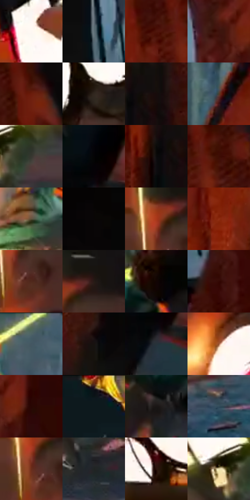

# 电影参考 119

- 状态：条件／活跃；来源世界：miles-home。
- 视角：rolled-or-dutch；景别：full-body；场景：industrial。
- 时段：event-time-unknown（外观依据，中置信度；具体时间／晨昏未知）；光照：event-light。
- 材质候选：fabric, metal, stone（帧级，不是像素分割）。
- 明暗组：very-dark；L* P5/P50/P95：1.64504 / 17.11378 / 93.54433。
- 资格门禁：impact。
- 原截图 SHA-256：`8454c00ae7673cab3ce5aaa9b56c6eb54f7b694994182a4d5471bdb61578040d`；尺寸：2880 × 1206。
- sRGB 像素 SHA-256：`cfe4be97be7d2243074dd1bbeb06f76403536133f49f5f33ee6d0b9cdd8aeea6`。

## 观察与迁移

接触区高亮与放射碎形，保持原照受力证据。

119  /  人物在接触附近仍有清楚姿态，白色巨字、黄光条与环境碎片穿过背景。  /  保持身体受力姿态、接触点和前后遮挡；让冲击图形绕开脸、手和关键肢体。

本公开版保存32个128×128原像素色卡上下文；图集格子并非原场景相邻位置。原rect、图集tile和像素SHA见 `data/palette-crops.json`。上下文不足时不得批准替色，不能以小样推断完整构图。

## 实测色卡

颜色比例分母为保留采样像素，不是材料面积；全部 32 色参与全库匹配。表内四舍五入仅用于阅读，原精度在 JSON。

| ID | HEX | Lab | 原图 xy | 像素数 | 比例 | 明度角色 |
| --- | --- | --- | --- | ---: | ---: | --- |
| 119-S01 | #FDF7F2 | [97.557588, 1.138202, 3.110046] | [496, 240] | 9322 | 4.821408% | highlight |
| 119-S02 | #62737B | [47.349787, -4.418156, -6.514095] | [2040, 420] | 7964 | 4.119040% | midtone |
| 119-S03 | #4F150B | [16.617865, 26.593699, 20.662346] | [2480, 560] | 7821 | 4.045080% | deep-shadow |
| 119-S04 | #3E130D | [12.729854, 20.6252, 14.035448] | [2196, 128] | 7752 | 4.009392% | deep-shadow |
| 119-S05 | #6B1C0C | [23.617939, 34.180986, 29.677995] | [2512, 376] | 7654 | 3.958706% | shadow |
| 119-S06 | #32281F | [16.963601, 2.986925, 7.677762] | [336, 596] | 7201 | 3.724411% | deep-shadow |
| 119-S07 | #170C0B | [4.239148, 4.062935, 1.896691] | [1876, 660] | 7135 | 3.690275% | deep-shadow |
| 119-S08 | #4E3D2E | [27.171075, 4.985877, 12.078866] | [1628, 236] | 6736 | 3.483910% | shadow |
| 119-S09 | #373730 | [22.854801, -1.526109, 4.397391] | [868, 516] | 6688 | 3.459084% | shadow |
| 119-S10 | #040405 | [1.116481, 0.138974, -0.378292] | [1484, 680] | 6684 | 3.457015% | deep-shadow |
| 119-S11 | #0B0B0C | [3.04441, 0.150966, -0.41103] | [1816, 692] | 6649 | 3.438913% | deep-shadow |
| 119-S12 | #3D0D04 | [11.198508, 22.855909, 15.680968] | [2556, 544] | 6620 | 3.423914% | deep-shadow |
| 119-S13 | #62533E | [36.23598, 2.74047, 14.617486] | [1112, 620] | 6601 | 3.414087% | shadow |
| 119-S14 | #090606 | [1.819967, 0.784393, 0.276614] | [2628, 116] | 6375 | 3.297198% | deep-shadow |
| 119-S15 | #C48044 | [59.520463, 20.60326, 42.659403] | [40, 164] | 6350 | 3.284268% | midtone |
| 119-S16 | #8E2E14 | [33.471744, 39.390566, 37.209628] | [1780, 260] | 5810 | 3.004976% | shadow |
| 119-S17 | #50281C | [21.234987, 17.346767, 16.132003] | [100, 244] | 5789 | 2.994114% | shadow |
| 119-S18 | #271B15 | [11.059921, 4.868294, 6.446901] | [136, 132] | 5566 | 2.878777% | deep-shadow |
| 119-S19 | #120403 | [2.005677, 4.026174, 1.846183] | [1228, 316] | 5559 | 2.875156% | deep-shadow |
| 119-S20 | #330803 | [7.987542, 21.14257, 11.204542] | [2144, 560] | 5502 | 2.845676% | deep-shadow |
| 119-S21 | #455A64 | [36.924574, -5.321273, -8.33957] | [1292, 52] | 5458 | 2.822918% | shadow |
| 119-S22 | #171110 | [5.604826, 2.358005, 1.428443] | [1920, 336] | 5449 | 2.818264% | deep-shadow |
| 119-S23 | #273239 | [20.075254, -2.642895, -5.947892] | [1480, 768] | 5427 | 2.806885% | shadow |
| 119-S24 | #985533 | [43.379321, 24.637135, 31.552319] | [80, 384] | 5359 | 2.771715% | midtone |
| 119-S25 | #280603 | [5.312085, 16.095445, 7.023871] | [2288, 136] | 5330 | 2.756716% | deep-shadow |
| 119-S26 | #0A1417 | [5.660664, -2.691752, -3.162168] | [492, 44] | 4946 | 2.558108% | deep-shadow |
| 119-S27 | #1A1615 | [7.656229, 1.746158, 1.354572] | [1136, 416] | 4928 | 2.548799% | deep-shadow |
| 119-S28 | #314C5A | [30.782651, -5.986809, -11.449679] | [600, 1048] | 4806 | 2.485699% | shadow |
| 119-S29 | #6A2C1A | [26.566031, 26.42414, 24.80959] | [64, 216] | 4725 | 2.443805% | shadow |
| 119-S30 | #202425 | [13.840749, -1.547132, -1.286461] | [1048, 908] | 4509 | 2.332089% | deep-shadow |
| 119-S31 | #29120B | [8.379398, 11.058713, 8.254345] | [116, 696] | 3938 | 2.036763% | deep-shadow |
| 119-S32 | #E6D9AA | [86.678345, -2.738719, 24.819546] | [784, 504] | 2693 | 1.392840% | highlight |

## 色阶与空间分布

- 采样 ROI：`[0.01, 0.02, 0.98, 0.94]`；步长：4；样本数：193346。
- 排除区：`[]`。
- 深暗、暗、中、亮、高光五段计数：`[107236, 52828, 18225, 3811, 11246]`。
- RGB 各 256 箱、L* 100 箱、13×5 色相明度表和 3×3 空间统计全部保存在 [总数据](../film-library.json)。
- [可视化档案](../../references/library.html)按需绘制直方图，不存 2,094 张重复图表图片。

## 纹理特征占比

**这是分块图像特征的面积占比，不是波点／排线／丝网／错版的精确语义覆盖率。** 窗格、发丝、织物也会产生方向或周期特征。
原图 ROI 像素 3098546；已测块覆盖 3098546（100.0000%）；未测 0。

| 特征 | 块覆盖像素 | 占已测面积 | 阈值敏感范围 |
| --- | ---: | ---: | --- |
| low-contrast | 112562 | 3.6327% | 2.5793% ~ 3.9839% |
| directional-structure | 709376 | 22.8938% | 12.0624% ~ 39.2814% |
| periodic-structure | 2260224 | 72.9447% | 58.1393% ~ 78.6661% |
| mixed-detail | 16384 | 0.5288% | 0.0000% ~ 5.2876% |

阈值敏感范围不是统计置信区间。逐块坐标、尺度、对比、方向一致性、频谱集中度、频率与角度见 [全量特征记录](../texture-features.jsonl)，以帧号定位。
四种印刷层的真实像素覆盖仍标为 `null`，不能填 0，也不能拿上表代替。不得据这些代理测量删除唯一证据。

[测量方法与保留策略](../../references/library-retention.md) · [分类索引](../archive/README.md)
