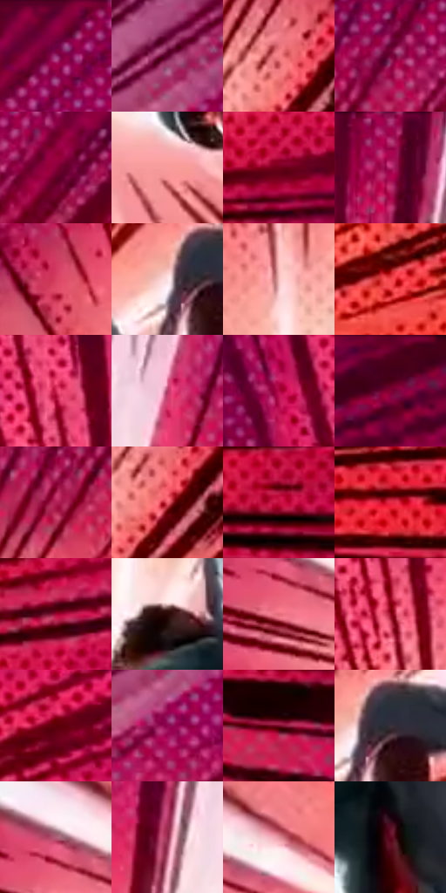

# 电影参考 120

- 状态：条件／活跃；来源世界：miles-home。
- 视角：graphic-nonphysical；景别：graphic-or-multipanel；场景：graphic。
- 时段：graphic-no-physical-time（外观依据，中置信度；具体时间／晨昏未知）；光照：graphic-field。
- 材质候选：fabric（帧级，不是像素分割）。
- 明暗组：dark；L* P5/P50/P95：13.17801 / 36.85987 / 81.76147。
- 资格门禁：motion。
- 原截图 SHA-256：`860fce4a9f99f2f1700727a0d65e5968fdaf6ed65c6d2f82c842aa3107a90504`；尺寸：2880 × 1194。
- sRGB 像素 SHA-256：`f223820899c51b93360cc02d8938d9494a1ac96d4bb92dc2ff698188e44f0990`。

## 观察与迁移

透视速度线与浅亮中心，不能移植角色姿态。

120  /  洋红到粉白的速度场以偏侧亮点为起点，黑色长短放射线和半调点带出坠落方向，人物是清楚的暗形。  /  强运动可用方向统一、疏密有序的线束和大色面抽象环境，不靠摄影式全局模糊。

本公开版保存32个128×128原像素色卡上下文；图集格子并非原场景相邻位置。原rect、图集tile和像素SHA见 `data/palette-crops.json`。上下文不足时不得批准替色，不能以小样推断完整构图。

## 实测色卡

颜色比例分母为保留采样像素，不是材料面积；全部 32 色参与全库匹配。表内四舍五入仅用于阅读，原精度在 JSON。

| ID | HEX | Lab | 原图 xy | 像素数 | 比例 | 明度角色 |
| --- | --- | --- | --- | ---: | ---: | --- |
| 120-S01 | #8F0043 | [30.026437, 54.802456, 3.825606] | [1448, 28] | 10666 | 5.556655% | shadow |
| 120-S02 | #5B0129 | [17.49094, 39.501179, 2.353266] | [1768, 84] | 9016 | 4.697057% | deep-shadow |
| 120-S03 | #F37E84 | [66.249437, 45.274677, 17.499032] | [932, 380] | 8885 | 4.628810% | light |
| 120-S04 | #770239 | [24.51917, 47.786308, 2.008017] | [1044, 140] | 8811 | 4.590258% | shadow |
| 120-S05 | #890039 | [28.420706, 52.606814, 8.103642] | [1164, 160] | 8048 | 4.192759% | shadow |
| 120-S06 | #F99D9C | [73.970687, 34.153638, 15.004702] | [724, 1028] | 7732 | 4.028132% | light |
| 120-S07 | #70011A | [22.096086, 44.173235, 19.989656] | [2016, 764] | 6852 | 3.569680% | shadow |
| 120-S08 | #A1044B | [34.343091, 59.154153, 5.219399] | [652, 44] | 6748 | 3.515499% | shadow |
| 120-S09 | #D64161 | [50.621618, 59.881854, 15.658151] | [324, 408] | 6726 | 3.504038% | midtone |
| 120-S10 | #FCE2E4 | [91.994042, 9.219879, 2.282158] | [884, 664] | 6415 | 3.342016% | highlight |
| 120-S11 | #F7BEBD | [81.989148, 20.29926, 8.429085] | [552, 580] | 6327 | 3.296171% | highlight |
| 120-S12 | #F3474D | [56.190639, 65.265212, 35.649531] | [1488, 576] | 6272 | 3.267518% | midtone |
| 120-S13 | #CC2251 | [45.052755, 65.369613, 17.575232] | [460, 132] | 6211 | 3.235738% | midtone |
| 120-S14 | #B23B66 | [43.587558, 51.649978, 1.773755] | [792, 148] | 6002 | 3.126856% | midtone |
| 120-S15 | #B10546 | [37.663754, 62.539827, 13.612336] | [328, 92] | 5963 | 3.106538% | shadow |
| 120-S16 | #470117 | [12.113757, 32.583331, 7.446177] | [2792, 32] | 5828 | 3.036207% | deep-shadow |
| 120-S17 | #AF1F52 | [39.080575, 58.453191, 7.813624] | [952, 244] | 5826 | 3.035165% | shadow |
| 120-S18 | #EF5D6D | [59.240665, 57.352535, 20.974951] | [948, 424] | 5807 | 3.025267% | midtone |
| 120-S19 | #C50C40 | [42.011159, 66.355795, 23.932623] | [1844, 892] | 5787 | 3.014848% | midtone |
| 120-S20 | #E32945 | [49.919839, 69.223333, 32.020634] | [1532, 860] | 5783 | 3.012764% | midtone |
| 120-S21 | #A40234 | [34.368088, 58.703267, 20.421855] | [2072, 652] | 5700 | 2.969523% | shadow |
| 120-S22 | #290707 | [5.770745, 16.76651, 6.086356] | [676, 740] | 5284 | 2.752800% | deep-shadow |
| 120-S23 | #E36B7A | [60.119036, 47.999244, 14.361209] | [116, 756] | 5284 | 2.752800% | light |
| 120-S24 | #910A1E | [30.236347, 51.68673, 28.606306] | [488, 316] | 4882 | 2.543371% | shadow |
| 120-S25 | #5C0009 | [16.968696, 38.284726, 22.583881] | [1964, 356] | 4734 | 2.466267% | deep-shadow |
| 120-S26 | #8E0A50 | [30.75664, 54.165787, -3.782173] | [1764, 188] | 4569 | 2.380307% | shadow |
| 120-S27 | #77082B | [24.548635, 45.537325, 11.725785] | [1836, 1012] | 4153 | 2.163584% | shadow |
| 120-S28 | #38333A | [21.994575, 3.807184, -3.597191] | [928, 656] | 3973 | 2.069810% | shadow |
| 120-S29 | #AF6077 | [50.468428, 34.677332, 1.382542] | [120, 688] | 3966 | 2.066163% | midtone |
| 120-S30 | #922A4B | [34.552527, 45.863431, 5.111511] | [684, 204] | 3882 | 2.022402% | shadow |
| 120-S31 | #E2909B | [68.37663, 32.408076, 7.256186] | [236, 684] | 3736 | 1.946340% | light |
| 120-S32 | #5D051B | [17.988858, 37.884304, 13.230411] | [760, 888] | 2082 | 1.084657% | deep-shadow |

## 色阶与空间分布

- 采样 ROI：`[0.01, 0.02, 0.98, 0.94]`；步长：4；样本数：191950。
- 排除区：`[]`。
- 深暗、暗、中、亮、高光五段计数：`[28044, 78507, 46769, 27729, 10901]`。
- RGB 各 256 箱、L* 100 箱、13×5 色相明度表和 3×3 空间统计全部保存在 [总数据](../film-library.json)。
- [可视化档案](../../references/library.html)按需绘制直方图，不存 2,094 张重复图表图片。

## 纹理特征占比

**这是分块图像特征的面积占比，不是波点／排线／丝网／错版的精确语义覆盖率。** 窗格、发丝、织物也会产生方向或周期特征。
原图 ROI 像素 3070606；已测块覆盖 3070606（100.0000%）；未测 0。

| 特征 | 块覆盖像素 | 占已测面积 | 阈值敏感范围 |
| --- | ---: | ---: | --- |
| low-contrast | 0 | 0.0000% | 0.0000% ~ 0.5336% |
| directional-structure | 1215232 | 39.5763% | 20.1842% ~ 53.2663% |
| periodic-structure | 1855374 | 60.4237% | 46.7337% ~ 77.1480% |
| mixed-detail | 0 | 0.0000% | 0.0000% ~ 2.1343% |

阈值敏感范围不是统计置信区间。逐块坐标、尺度、对比、方向一致性、频谱集中度、频率与角度见 [全量特征记录](../texture-features.jsonl)，以帧号定位。
四种印刷层的真实像素覆盖仍标为 `null`，不能填 0，也不能拿上表代替。不得据这些代理测量删除唯一证据。

[测量方法与保留策略](../../references/library-retention.md) · [分类索引](../archive/README.md)
