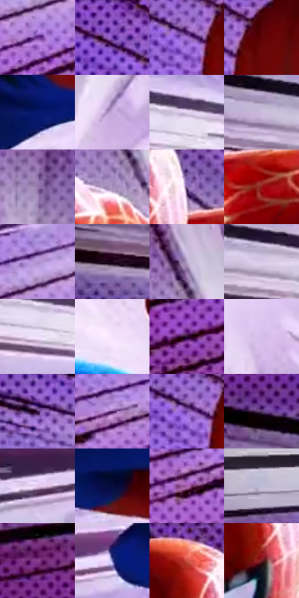

# 电影参考 121

- 状态：条件／活跃；来源世界：miles-home。
- 视角：graphic-nonphysical；景别：full-body；场景：graphic。
- 时段：graphic-no-physical-time（外观依据，中置信度；具体时间／晨昏未知）；光照：graphic-field。
- 材质候选：fabric（帧级，不是像素分割）。
- 明暗组：middle；L* P5/P50/P95：6.20894 / 52.1163 / 89.36574。
- 资格门禁：motion。
- 原截图 SHA-256：`d69abbb5d092c0d9d36a72417b106099baff711509d4579b09eaf4e5417a128b`；尺寸：2880 × 1204。
- sRGB 像素 SHA-256：`ad774eb45b77c2c933e87c7f6f4a011261b4ecc13fa4e5942056b255e581e851`。

## 观察与迁移

透视速度线与浅亮中心，不能移植角色姿态。

121  /  淡紫背景中黑白速度线向右侧亮区收束，近大远小的姿态与留白让主体突出。  /  线条方向服从原照可见的运动轨迹与透视；主体轮廓和肢体不能被线束吞没。

本公开版保存32个128×128原像素色卡上下文；图集格子并非原场景相邻位置。原rect、图集tile和像素SHA见 `data/palette-crops.json`。上下文不足时不得批准替色，不能以小样推断完整构图。

## 实测色卡

颜色比例分母为保留采样像素，不是材料面积；全部 32 色参与全库匹配。表内四舍五入仅用于阅读，原精度在 JSON。

| ID | HEX | Lab | 原图 xy | 像素数 | 比例 | 明度角色 |
| --- | --- | --- | --- | ---: | ---: | --- |
| 121-S01 | #6A348F | [32.926396, 40.83429, -40.965862] | [1420, 1016] | 10205 | 5.297226% | shadow |
| 121-S02 | #8956BD | [46.509103, 41.358121, -46.472563] | [1436, 32] | 9775 | 5.074021% | midtone |
| 121-S03 | #A272D0 | [56.357129, 37.03307, -41.585651] | [1596, 156] | 8678 | 4.504589% | midtone |
| 121-S04 | #5C0507 | [17.459911, 36.749068, 23.997143] | [1672, 132] | 8528 | 4.426726% | deep-shadow |
| 121-S05 | #071769 | [13.694262, 29.010218, -48.604416] | [2012, 672] | 7796 | 4.046759% | deep-shadow |
| 121-S06 | #C5A8DA | [72.850893, 19.787091, -21.34716] | [2700, 424] | 7726 | 4.010423% | light |
| 121-S07 | #E5D4F3 | [87.102791, 11.44849, -13.030146] | [1188, 392] | 7689 | 3.991217% | highlight |
| 121-S08 | #CDBBDE | [78.341341, 12.84337, -15.152653] | [608, 332] | 7675 | 3.983950% | light |
| 121-S09 | #9779AF | [55.430325, 22.151154, -24.272541] | [2608, 184] | 7437 | 3.860409% | midtone |
| 121-S10 | #A68EBB | [62.542174, 17.66192, -20.088447] | [2304, 196] | 7157 | 3.715066% | light |
| 121-S11 | #7F6091 | [45.52754, 22.165018, -22.167285] | [1952, 140] | 7084 | 3.677173% | midtone |
| 121-S12 | #901914 | [31.059938, 47.827177, 35.195448] | [2032, 240] | 6912 | 3.587891% | shadow |
| 121-S13 | #B392D2 | [65.588491, 24.571536, -28.195592] | [1416, 924] | 6882 | 3.572318% | light |
| 121-S14 | #160313 | [2.554042, 8.693733, -4.824506] | [196, 368] | 6828 | 3.544288% | deep-shadow |
| 121-S15 | #B8A4CB | [70.21313, 14.651082, -17.21564] | [2336, 100] | 6556 | 3.403098% | light |
| 121-S16 | #D8CBE7 | [83.484628, 9.648754, -12.179799] | [780, 356] | 6540 | 3.394793% | highlight |
| 121-S17 | #ECDBF7 | [89.49199, 10.812067, -11.511582] | [1144, 440] | 6535 | 3.392197% | highlight |
| 121-S18 | #F4E4FB | [92.435769, 9.479966, -9.158765] | [2400, 516] | 6386 | 3.314854% | highlight |
| 121-S19 | #2C0F31 | [9.789848, 21.212046, -16.102633] | [728, 1092] | 6324 | 3.282671% | deep-shadow |
| 121-S20 | #D5BDEA | [79.887343, 16.764572, -19.217519] | [2652, 704] | 5989 | 3.108779% | light |
| 121-S21 | #401D4C | [17.876095, 25.815945, -22.142219] | [1004, 200] | 5780 | 3.000291% | deep-shadow |
| 121-S22 | #512467 | [23.639841, 33.3114, -30.783913] | [1288, 980] | 5681 | 2.948902% | shadow |
| 121-S23 | #7948A6 | [40.332817, 39.359058, -42.911726] | [1584, 152] | 5225 | 2.712200% | midtone |
| 121-S24 | #5C3F71 | [31.858368, 23.044697, -24.093526] | [168, 196] | 4906 | 2.546614% | shadow |
| 121-S25 | #E4CAEC | [84.376292, 15.087273, -13.406219] | [1124, 804] | 4401 | 2.284477% | highlight |
| 121-S26 | #060C3D | [5.766952, 17.482454, -31.524508] | [1764, 792] | 3546 | 1.840663% | deep-shadow |
| 121-S27 | #A75EAC | [50.920928, 41.7829, -29.373194] | [1100, 1056] | 2934 | 1.522985% | midtone |
| 121-S28 | #BCB8D5 | [75.931585, 7.064426, -14.039169] | [168, 724] | 2850 | 1.479382% | light |
| 121-S29 | #873D90 | [38.729887, 44.104975, -32.099323] | [120, 1016] | 2797 | 1.451871% | shadow |
| 121-S30 | #7175BA | [51.584595, 15.826335, -36.84128] | [1464, 752] | 2745 | 1.424879% | midtone |
| 121-S31 | #C784AF | [63.128734, 32.185368, -12.092359] | [1844, 28] | 2410 | 1.250986% | light |
| 121-S32 | #6C1D24 | [24.306576, 35.27535, 15.750465] | [1872, 232] | 671 | 0.348304% | shadow |

## 色阶与空间分布

- 采样 ROI：`[0.01, 0.02, 0.98, 0.94]`；步长：4；样本数：192648。
- 排除区：`[]`。
- 深暗、暗、中、亮、高光五段计数：`[35018, 35804, 42948, 42840, 36038]`。
- RGB 各 256 箱、L* 100 箱、13×5 色相明度表和 3×3 空间统计全部保存在 [总数据](../film-library.json)。
- [可视化档案](../../references/library.html)按需绘制直方图，不存 2,094 张重复图表图片。

## 纹理特征占比

**这是分块图像特征的面积占比，不是波点／排线／丝网／错版的精确语义覆盖率。** 窗格、发丝、织物也会产生方向或周期特征。
原图 ROI 像素 3092958；已测块覆盖 3092958（100.0000%）；未测 0。

| 特征 | 块覆盖像素 | 占已测面积 | 阈值敏感范围 |
| --- | ---: | ---: | --- |
| low-contrast | 0 | 0.0000% | 0.0000% ~ 0.0000% |
| directional-structure | 1618432 | 52.3263% | 39.3606% ~ 62.4614% |
| periodic-structure | 1474526 | 47.6737% | 37.5386% ~ 60.6394% |
| mixed-detail | 0 | 0.0000% | 0.0000% ~ 0.0000% |

阈值敏感范围不是统计置信区间。逐块坐标、尺度、对比、方向一致性、频谱集中度、频率与角度见 [全量特征记录](../texture-features.jsonl)，以帧号定位。
四种印刷层的真实像素覆盖仍标为 `null`，不能填 0，也不能拿上表代替。不得据这些代理测量删除唯一证据。

[测量方法与保留策略](../../references/library-retention.md) · [分类索引](../archive/README.md)
