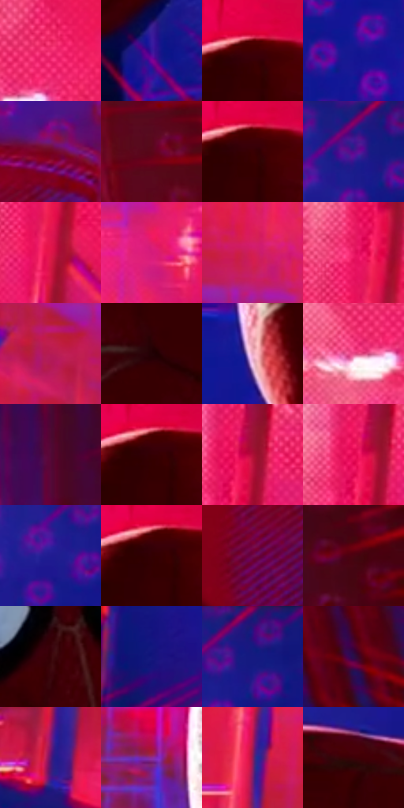

# 电影参考 122

- 状态：条件／活跃；来源世界：miles-home。
- 视角：high-angle；景别：medium；场景：portrait。
- 时段：graphic-no-physical-time（外观依据，中置信度；具体时间／晨昏未知）；光照：graphic-field。
- 材质候选：skin, fabric, metal（帧级，不是像素分割）。
- 明暗组：dark；L* P5/P50/P95：6.39913 / 21.76158 / 56.38813。
- 资格门禁：sense。
- 原截图 SHA-256：`95f282cab3cbd2bbd732d9ee076c42cd7895809652c8f94b64876fbf591e1bb9`；尺寸：2880 × 1198。
- sRGB 像素 SHA-256：`0a03914c4eb6e9ebab49b17936c738753aca5cce37284fe8c973fcb7a988fa5f`。

## 观察与迁移

头周分段感知线与荧光色场，单人截图不改变定制人数规则。

122  /  洋红与深蓝重新分配原有空间的色面；人物周围有稀疏弯折警觉线，边缘另有向内压的细线。  /  借鉴荧光色面与背景侧波浪线，不移植人物服装或建筑。

本公开版保存32个128×128原像素色卡上下文；图集格子并非原场景相邻位置。原rect、图集tile和像素SHA见 `data/palette-crops.json`。上下文不足时不得批准替色，不能以小样推断完整构图。

## 实测色卡

颜色比例分母为保留采样像素，不是材料面积；全部 32 色参与全库匹配。表内四舍五入仅用于阅读，原精度在 JSON。

| ID | HEX | Lab | 原图 xy | 像素数 | 比例 | 明度角色 |
| --- | --- | --- | --- | ---: | ---: | --- |
| 122-S01 | #EE276B | [52.61434, 74.655691, 13.056607] | [672, 152] | 11223 | 5.825651% | midtone |
| 122-S02 | #32199B | [22.789457, 47.994911, -65.150393] | [1812, 1108] | 10910 | 5.663178% | shadow |
| 122-S03 | #3F0003 | [9.511098, 29.592297, 13.786231] | [1420, 176] | 10868 | 5.641377% | deep-shadow |
| 122-S04 | #151792 | [19.41907, 44.200639, -65.246803] | [2196, 412] | 9815 | 5.094784% | deep-shadow |
| 122-S05 | #73051E | [23.163409, 44.305036, 18.70753] | [2376, 756] | 8205 | 4.259063% | shadow |
| 122-S06 | #5A0619 | [17.342594, 36.592477, 13.694007] | [2728, 532] | 8169 | 4.240376% | deep-shadow |
| 122-S07 | #3A0002 | [8.166644, 28.01581, 12.085254] | [1424, 192] | 7896 | 4.098667% | deep-shadow |
| 122-S08 | #520D8D | [23.686415, 51.915519, -54.888135] | [2020, 72] | 7840 | 4.069598% | shadow |
| 122-S09 | #DF1549 | [47.892981, 72.092205, 26.930577] | [236, 292] | 7088 | 3.679249% | midtone |
| 122-S10 | #D51B79 | [47.384511, 72.018855, -3.615051] | [836, 472] | 6955 | 3.610211% | midtone |
| 122-S11 | #D31E53 | [46.185693, 68.148188, 18.096933] | [612, 624] | 6773 | 3.515739% | midtone |
| 122-S12 | #E71662 | [50.037241, 75.267694, 14.756365] | [208, 212] | 6536 | 3.392716% | midtone |
| 122-S13 | #B61B54 | [40.200155, 61.392203, 8.317917] | [528, 732] | 6269 | 3.254122% | midtone |
| 122-S14 | #220205 | [3.564042, 13.675475, 3.536346] | [1808, 660] | 6220 | 3.228687% | deep-shadow |
| 122-S15 | #E8A8C1 | [75.459934, 27.19196, -3.405714] | [872, 1016] | 6187 | 3.211557% | light |
| 122-S16 | #E94A89 | [56.119895, 65.606247, 0.007117] | [612, 208] | 5962 | 3.094764% | midtone |
| 122-S17 | #530736 | [16.785807, 36.971266, -8.240925] | [2632, 168] | 5772 | 2.996138% | deep-shadow |
| 122-S18 | #350003 | [6.898516, 26.291266, 9.671849] | [1408, 192] | 5345 | 2.774490% | deep-shadow |
| 122-S19 | #AF0F37 | [37.361369, 59.977244, 22.772057] | [256, 156] | 5262 | 2.731407% | shadow |
| 122-S20 | #E60B54 | [49.139719, 75.397803, 22.092344] | [228, 160] | 4870 | 2.527927% | midtone |
| 122-S21 | #201B91 | [20.57453, 42.496799, -62.69045] | [1972, 124] | 4786 | 2.484324% | shadow |
| 122-S22 | #330002 | [6.399132, 25.323508, 9.292422] | [1404, 196] | 4759 | 2.470309% | deep-shadow |
| 122-S23 | #6D0D4F | [24.013618, 45.383606, -13.978937] | [2300, 868] | 4622 | 2.399194% | shadow |
| 122-S24 | #460510 | [12.276548, 30.186063, 12.171552] | [2820, 212] | 4580 | 2.377393% | deep-shadow |
| 122-S25 | #370208 | [7.889664, 26.26338, 9.14255] | [1416, 576] | 4431 | 2.300050% | deep-shadow |
| 122-S26 | #13157C | [16.152206, 37.806622, -56.823838] | [624, 1108] | 4384 | 2.275653% | deep-shadow |
| 122-S27 | #261378 | [16.667363, 39.00951, -53.366243] | [2060, 24] | 4381 | 2.274096% | deep-shadow |
| 122-S28 | #290F47 | [11.049394, 26.38059, -29.837432] | [2776, 1100] | 3670 | 1.905029% | deep-shadow |
| 122-S29 | #591873 | [23.72117, 43.629174, -38.342782] | [404, 920] | 3311 | 1.718679% | shadow |
| 122-S30 | #8D2B96 | [37.102439, 54.756525, -38.272316] | [1164, 432] | 2960 | 1.536481% | shadow |
| 122-S31 | #8D1D57 | [32.327364, 50.260798, -6.055341] | [448, 568] | 1745 | 0.905797% | shadow |
| 122-S32 | #3D0108 | [9.252469, 28.715706, 11.309987] | [1720, 540] | 854 | 0.443296% | deep-shadow |

## 色阶与空间分布

- 采样 ROI：`[0.01, 0.02, 0.98, 0.94]`；步长：4；样本数：192648。
- 排除区：`[]`。
- 深暗、暗、中、亮、高光五段计数：`[83729, 46238, 55488, 5406, 1787]`。
- RGB 各 256 箱、L* 100 箱、13×5 色相明度表和 3×3 空间统计全部保存在 [总数据](../film-library.json)。
- [可视化档案](../../references/library.html)按需绘制直方图，不存 2,094 张重复图表图片。

## 纹理特征占比

**这是分块图像特征的面积占比，不是波点／排线／丝网／错版的精确语义覆盖率。** 窗格、发丝、织物也会产生方向或周期特征。
原图 ROI 像素 3081782；已测块覆盖 3081782（100.0000%）；未测 0。

| 特征 | 块覆盖像素 | 占已测面积 | 阈值敏感范围 |
| --- | ---: | ---: | --- |
| low-contrast | 765056 | 24.8251% | 13.3367% ~ 35.4555% |
| directional-structure | 436096 | 14.1508% | 7.4430% ~ 27.0347% |
| periodic-structure | 1765942 | 57.3026% | 50.9253% ~ 58.2372% |
| mixed-detail | 114688 | 3.7215% | 1.3914% ~ 6.1762% |

阈值敏感范围不是统计置信区间。逐块坐标、尺度、对比、方向一致性、频谱集中度、频率与角度见 [全量特征记录](../texture-features.jsonl)，以帧号定位。
四种印刷层的真实像素覆盖仍标为 `null`，不能填 0，也不能拿上表代替。不得据这些代理测量删除唯一证据。

[测量方法与保留策略](../../references/library-retention.md) · [分类索引](../archive/README.md)
