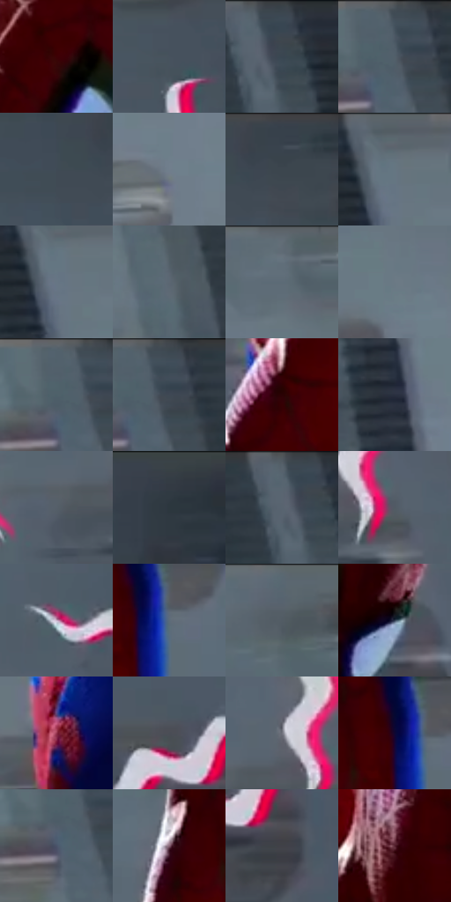

# 电影参考 123

- 状态：条件／活跃；来源世界：miles-home。
- 视角：low-angle；景别：medium；场景：portrait。
- 时段：graphic-no-physical-time（外观依据，中置信度；具体时间／晨昏未知）；光照：graphic-field。
- 材质候选：skin, fabric, metal（帧级，不是像素分割）。
- 明暗组：dark；L* P5/P50/P95：6.83916 / 36.46416 / 52.07045。
- 资格门禁：sense。
- 原截图 SHA-256：`0175e2d42a239207dbee727035678a3f37a23ac4fbc74ae5d7422fe1fc0d1ae7`；尺寸：2880 × 1208。
- sRGB 像素 SHA-256：`fee08ddfc3075a1204e64c84affc3e108400fab08b341c2d8749dfcc8ebb4d38`。

## 观察与迁移

头周分段感知线与荧光色场，单人截图不改变定制人数规则。

123  /  灰色背景仍可识别；白线带红色窄错版，数段独立波浪线绕头部展开。  /  头部图形是分段放射的波浪线，不是遮住脸的完整圆环。

本公开版保存32个128×128原像素色卡上下文；图集格子并非原场景相邻位置。原rect、图集tile和像素SHA见 `data/palette-crops.json`。上下文不足时不得批准替色，不能以小样推断完整构图。

## 实测色卡

颜色比例分母为保留采样像素，不是材料面积；全部 32 色参与全库匹配。表内四舍五入仅用于阅读，原精度在 JSON。

| ID | HEX | Lab | 原图 xy | 像素数 | 比例 | 明度角色 |
| --- | --- | --- | --- | ---: | ---: | --- |
| 123-S01 | #3D0105 | [9.198736, 28.565662, 12.454961] | [1580, 520] | 13242 | 6.848862% | deep-shadow |
| 123-S02 | #47525D | [34.322669, -1.585803, -7.854458] | [1908, 88] | 12921 | 6.682838% | shadow |
| 123-S03 | #3B4651 | [29.169003, -1.55187, -8.043963] | [260, 60] | 11337 | 5.863581% | shadow |
| 123-S04 | #4C5864 | [36.810122, -1.694078, -8.460772] | [92, 48] | 10632 | 5.498950% | shadow |
| 123-S05 | #3F4A55 | [30.902036, -1.565272, -7.977838] | [2088, 80] | 9312 | 4.816236% | shadow |
| 123-S06 | #727E8C | [52.277677, -1.269435, -9.055717] | [608, 560] | 8974 | 4.641420% | midtone |
| 123-S07 | #37414B | [27.019641, -1.447171, -7.408676] | [2176, 28] | 8773 | 4.537461% | shadow |
| 123-S08 | #64727D | [47.267291, -2.662992, -7.812136] | [392, 52] | 8546 | 4.420055% | midtone |
| 123-S09 | #677685 | [48.925208, -2.034517, -10.051498] | [384, 92] | 8171 | 4.226102% | midtone |
| 123-S10 | #5C6772 | [43.048753, -1.613635, -7.576244] | [156, 304] | 8076 | 4.176968% | midtone |
| 123-S11 | #626E78 | [45.776665, -2.207898, -7.067739] | [532, 32] | 7536 | 3.897676% | midtone |
| 123-S12 | #6B7985 | [50.089342, -2.422099, -8.277069] | [552, 200] | 7366 | 3.809750% | midtone |
| 123-S13 | #515F6B | [39.571973, -2.407224, -8.601642] | [60, 40] | 7239 | 3.744065% | shadow |
| 123-S14 | #424D59 | [32.229004, -1.305524, -8.510583] | [112, 44] | 6754 | 3.493219% | shadow |
| 123-S15 | #2B0203 | [5.092294, 19.892866, 6.770646] | [1184, 572] | 6424 | 3.322541% | deep-shadow |
| 123-S16 | #2A3040 | [19.94832, 1.949012, -10.901172] | [484, 764] | 5832 | 3.016354% | deep-shadow |
| 123-S17 | #565F6A | [39.920651, -0.891278, -7.425352] | [1560, 272] | 5820 | 3.010148% | shadow |
| 123-S18 | #343B44 | [24.56126, -0.580043, -6.513129] | [2760, 36] | 5626 | 2.909809% | shadow |
| 123-S19 | #566470 | [41.629966, -2.413176, -8.53333] | [228, 28] | 5490 | 2.839469% | midtone |
| 123-S20 | #515A64 | [37.809278, -1.131313, -6.922818] | [1696, 256] | 5239 | 2.709650% | shadow |
| 123-S21 | #C8AFC8 | [74.260095, 13.421464, -9.352274] | [1944, 640] | 4815 | 2.490354% | light |
| 123-S22 | #5C6B7A | [44.511879, -2.008884, -10.209579] | [1332, 312] | 4006 | 2.071933% | midtone |
| 123-S23 | #586670 | [42.379477, -2.914333, -7.395445] | [752, 28] | 3647 | 1.886256% | midtone |
| 123-S24 | #313D51 | [25.516053, 0.854984, -13.67694] | [1752, 712] | 2850 | 1.474041% | shadow |
| 123-S25 | #92324C | [35.821457, 42.563251, 6.272226] | [1052, 1108] | 2632 | 1.361290% | shadow |
| 123-S26 | #4A4D56 | [32.778209, 0.888923, -5.710936] | [2000, 348] | 2567 | 1.327672% | shadow |
| 123-S27 | #71727D | [48.292616, 1.95787, -6.174814] | [1628, 208] | 2326 | 1.203025% | midtone |
| 123-S28 | #0D0833 | [4.499877, 15.427085, -26.262307] | [1296, 296] | 2236 | 1.156476% | deep-shadow |
| 123-S29 | #495469 | [35.550792, 1.103145, -13.506984] | [64, 104] | 2090 | 1.080964% | shadow |
| 123-S30 | #856172 | [45.291948, 17.438064, -3.820561] | [1188, 316] | 1866 | 0.965109% | midtone |
| 123-S31 | #414148 | [27.770027, 1.629813, -4.233025] | [2076, 428] | 556 | 0.287567% | shadow |
| 123-S32 | #511E2A | [19.414226, 25.178387, 4.108932] | [1436, 708] | 445 | 0.230157% | deep-shadow |

## 色阶与空间分布

- 采样 ROI：`[0.01, 0.02, 0.98, 0.94]`；步长：4；样本数：193346。
- 排除区：`[]`。
- 深暗、暗、中、亮、高光五段计数：`[24913, 92507, 71695, 2185, 2046]`。
- RGB 各 256 箱、L* 100 箱、13×5 色相明度表和 3×3 空间统计全部保存在 [总数据](../film-library.json)。
- [可视化档案](../../references/library.html)按需绘制直方图，不存 2,094 张重复图表图片。

## 纹理特征占比

**这是分块图像特征的面积占比，不是波点／排线／丝网／错版的精确语义覆盖率。** 窗格、发丝、织物也会产生方向或周期特征。
原图 ROI 像素 3104134；已测块覆盖 3104134（100.0000%）；未测 0。

| 特征 | 块覆盖像素 | 占已测面积 | 阈值敏感范围 |
| --- | ---: | ---: | --- |
| low-contrast | 769542 | 24.7909% | 19.6818% ~ 28.4856% |
| directional-structure | 702976 | 22.6464% | 9.2615% ~ 39.7261% |
| periodic-structure | 1615232 | 52.0349% | 40.5921% ~ 61.1974% |
| mixed-detail | 16384 | 0.5278% | 0.0000% ~ 1.0556% |

阈值敏感范围不是统计置信区间。逐块坐标、尺度、对比、方向一致性、频谱集中度、频率与角度见 [全量特征记录](../texture-features.jsonl)，以帧号定位。
四种印刷层的真实像素覆盖仍标为 `null`，不能填 0，也不能拿上表代替。不得据这些代理测量删除唯一证据。

[测量方法与保留策略](../../references/library-retention.md) · [分类索引](../archive/README.md)
