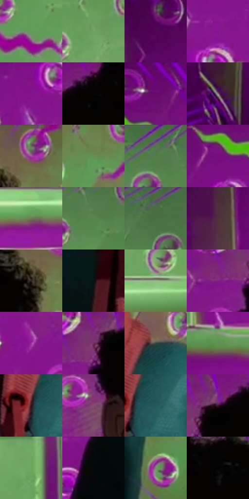

# 电影参考 124

- 状态：条件／活跃；来源世界：miles-home。
- 视角：near-level；景别：medium；场景：portrait。
- 时段：graphic-no-physical-time（外观依据，中置信度；具体时间／晨昏未知）；光照：graphic-field。
- 材质候选：skin, fabric, metal（帧级，不是像素分割）。
- 明暗组：dark；L* P5/P50/P95：1.24115 / 34.46539 / 62.84978。
- 资格门禁：sense。
- 原截图 SHA-256：`a1a413bd53c9eb48b1789e11dd31305494a0e0e8711f7435e36ea201d0071437`；尺寸：2880 × 1204。
- sRGB 像素 SHA-256：`a7caa1ee38f53cdd41623a8d09a783824c99b307fb88b4124b9565d58a4bb18c`。

## 观察与迁移

头周分段感知线与荧光色场，单人截图不改变定制人数规则。

124  /  原有板面结构保持，背景变成紫与荧光绿的对照，头周有少数高纯波浪短线。  /  色相可变，场景物件、透视和遮挡不变。

本公开版保存32个128×128原像素色卡上下文；图集格子并非原场景相邻位置。原rect、图集tile和像素SHA见 `data/palette-crops.json`。上下文不足时不得批准替色，不能以小样推断完整构图。

## 实测色卡

颜色比例分母为保留采样像素，不是材料面积；全部 32 色参与全库匹配。表内四舍五入仅用于阅读，原精度在 JSON。

| ID | HEX | Lab | 原图 xy | 像素数 | 比例 | 明度角色 |
| --- | --- | --- | --- | ---: | ---: | --- |
| 124-S01 | #639D58 | [59.407235, -32.866239, 30.202331] | [2080, 448] | 9348 | 4.852373% | midtone |
| 124-S02 | #70A264 | [61.830542, -28.938711, 27.070996] | [2396, 364] | 9250 | 4.801503% | light |
| 124-S03 | #4F0656 | [17.758018, 41.450291, -28.968049] | [416, 96] | 8979 | 4.660832% | deep-shadow |
| 124-S04 | #881491 | [33.519866, 59.802156, -40.988657] | [772, 356] | 8977 | 4.659794% | shadow |
| 124-S05 | #82138A | [31.914393, 57.690698, -39.298499] | [708, 272] | 8949 | 4.645260% | shadow |
| 124-S06 | #060202 | [0.781582, 1.045962, 0.36862] | [1272, 44] | 8546 | 4.436070% | deep-shadow |
| 124-S07 | #660A6F | [24.289878, 49.552566, -34.733874] | [820, 52] | 8083 | 4.195735% | shadow |
| 124-S08 | #877982 | [52.328417, 7.067002, -2.936797] | [136, 1028] | 7235 | 3.755554% | midtone |
| 124-S09 | #695758 | [38.767863, 7.55798, 2.185235] | [1700, 56] | 7148 | 3.710394% | shadow |
| 124-S10 | #649155 | [55.700742, -27.231346, 27.062496] | [1800, 192] | 7123 | 3.697417% | midtone |
| 124-S11 | #537D48 | [48.226885, -25.519471, 24.365224] | [2188, 64] | 6887 | 3.574914% | midtone |
| 124-S12 | #76107E | [28.718483, 53.985136, -37.036368] | [736, 152] | 6741 | 3.499128% | shadow |
| 124-S13 | #6D7756 | [48.406877, -9.942235, 16.955971] | [2012, 760] | 6699 | 3.477327% | midtone |
| 124-S14 | #57874D | [51.712027, -28.222879, 26.137911] | [2248, 100] | 6671 | 3.462792% | midtone |
| 124-S15 | #4A6C41 | [42.096269, -21.339363, 20.2646] | [2448, 44] | 6656 | 3.455006% | midtone |
| 124-S16 | #522F3C | [24.172415, 18.006825, -1.367827] | [140, 360] | 6305 | 3.272808% | shadow |
| 124-S17 | #302822 | [16.8039, 2.518616, 5.327465] | [1648, 128] | 6161 | 3.198061% | deep-shadow |
| 124-S18 | #0A1414 | [5.558139, -3.412203, -1.201378] | [1128, 860] | 5792 | 3.006520% | deep-shadow |
| 124-S19 | #9DB88D | [71.806606, -17.21102, 18.870664] | [2460, 704] | 5586 | 2.899589% | light |
| 124-S20 | #822483 | [33.236813, 51.408351, -32.838325] | [1080, 140] | 5535 | 2.873116% | shadow |
| 124-S21 | #9D2EA2 | [40.786787, 59.418064, -39.498682] | [872, 604] | 5356 | 2.780200% | midtone |
| 124-S22 | #702E64 | [30.20459, 36.563187, -18.1796] | [1140, 100] | 5084 | 2.639010% | shadow |
| 124-S23 | #3B463D | [28.50373, -6.55233, 3.941933] | [1656, 628] | 4656 | 2.416843% | shadow |
| 124-S24 | #5D934F | [55.845158, -31.552923, 30.388363] | [396, 732] | 4476 | 2.323408% | midtone |
| 124-S25 | #2C1015 | [8.656525, 15.091055, 3.152829] | [1576, 788] | 4395 | 2.281363% | deep-shadow |
| 124-S26 | #854C6A | [39.91025, 28.358545, -6.920527] | [1132, 440] | 3995 | 2.073730% | shadow |
| 124-S27 | #265A5B | [34.961454, -16.852641, -5.836526] | [1624, 788] | 3966 | 2.058677% | shadow |
| 124-S28 | #3D142C | [13.676897, 23.300226, -6.180428] | [1188, 76] | 3541 | 1.838067% | deep-shadow |
| 124-S29 | #6CA75E | [63.038314, -33.582221, 31.772231] | [2668, 604] | 3523 | 1.828724% | light |
| 124-S30 | #040809 | [1.97994, -0.907093, -0.746714] | [836, 928] | 3294 | 1.709854% | deep-shadow |
| 124-S31 | #7B8F70 | [57.10029, -13.225834, 14.168334] | [1860, 1020] | 2009 | 1.042835% | midtone |
| 124-S32 | #010101 | [0.274173, -1.7e-05, 3.3e-05] | [1432, 60] | 1682 | 0.873095% | deep-shadow |

## 色阶与空间分布

- 采样 ROI：`[0.01, 0.02, 0.98, 0.94]`；步长：4；样本数：192648。
- 排除区：`[]`。
- 深暗、暗、中、亮、高光五段计数：`[39199, 71034, 62308, 19479, 628]`。
- RGB 各 256 箱、L* 100 箱、13×5 色相明度表和 3×3 空间统计全部保存在 [总数据](../film-library.json)。
- [可视化档案](../../references/library.html)按需绘制直方图，不存 2,094 张重复图表图片。

## 纹理特征占比

**这是分块图像特征的面积占比，不是波点／排线／丝网／错版的精确语义覆盖率。** 窗格、发丝、织物也会产生方向或周期特征。
原图 ROI 像素 3092958；已测块覆盖 3092958（100.0000%）；未测 0。

| 特征 | 块覆盖像素 | 占已测面积 | 阈值敏感范围 |
| --- | ---: | ---: | --- |
| low-contrast | 27008 | 0.8732% | 0.5297% ~ 0.8732% |
| directional-structure | 814720 | 26.3411% | 16.9262% ~ 36.5631% |
| periodic-structure | 2000606 | 64.6826% | 58.8557% ~ 65.5558% |
| mixed-detail | 250624 | 8.1031% | 4.0515% ~ 16.6448% |

阈值敏感范围不是统计置信区间。逐块坐标、尺度、对比、方向一致性、频谱集中度、频率与角度见 [全量特征记录](../texture-features.jsonl)，以帧号定位。
四种印刷层的真实像素覆盖仍标为 `null`，不能填 0，也不能拿上表代替。不得据这些代理测量删除唯一证据。

[测量方法与保留策略](../../references/library-retention.md) · [分类索引](../archive/README.md)
