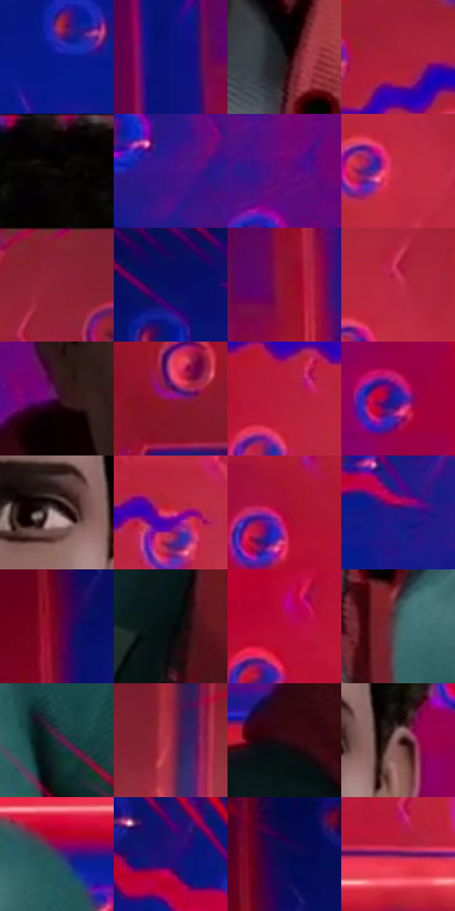

# 电影参考 125

- 状态：条件／活跃；来源世界：miles-home。
- 视角：near-level；景别：medium；场景：portrait。
- 时段：graphic-no-physical-time（外观依据，中置信度；具体时间／晨昏未知）；光照：graphic-field。
- 材质候选：skin, fabric, metal（帧级，不是像素分割）。
- 明暗组：dark；L* P5/P50/P95：2.08814 / 24.28984 / 46.839。
- 资格门禁：sense。
- 原截图 SHA-256：`413256400723f1037752b0edfc73e68ffc4f9a65b63407bb6ef0db22a2ac5c0c`；尺寸：2880 × 1206。
- sRGB 像素 SHA-256：`d92acce3901b50ac2e85f7d3540550dd978010a6ee448a7b5526cc563b32ebea`。

## 观察与迁移

头周分段感知线与荧光色场，单人截图不改变定制人数规则。

125  /  相同空间换为红与深蓝，弯折线沿头周分布，人物面部仍保持安静。  /  同一形态不是固定的紫绿配方，依据原照选荧光组合。

本公开版保存32个128×128原像素色卡上下文；图集格子并非原场景相邻位置。原rect、图集tile和像素SHA见 `data/palette-crops.json`。上下文不足时不得批准替色，不能以小样推断完整构图。

## 实测色卡

颜色比例分母为保留采样像素，不是材料面积；全部 32 色参与全库匹配。表内四舍五入仅用于阅读，原精度在 JSON。

| ID | HEX | Lab | 原图 xy | 像素数 | 比例 | 明度角色 |
| --- | --- | --- | --- | ---: | ---: | --- |
| 125-S01 | #09198E | [18.823503, 41.40784, -63.759598] | [728, 264] | 12204 | 6.312000% | deep-shadow |
| 125-S02 | #09157D | [15.873095, 37.698582, -57.937783] | [172, 496] | 9760 | 5.047945% | deep-shadow |
| 125-S03 | #1F1B1C | [10.251627, 2.181324, 0.017121] | [1604, 836] | 9316 | 4.818305% | deep-shadow |
| 125-S04 | #A91F36 | [37.26917, 54.94706, 23.025928] | [1968, 120] | 8975 | 4.641937% | shadow |
| 125-S05 | #060202 | [0.781582, 1.045962, 0.36862] | [1476, 32] | 8771 | 4.536427% | deep-shadow |
| 125-S06 | #41138A | [21.668085, 47.206841, -56.419312] | [976, 548] | 8267 | 4.275754% | shadow |
| 125-S07 | #691080 | [26.542063, 51.932538, -41.922918] | [1112, 520] | 7714 | 3.989739% | shadow |
| 125-S08 | #C52C46 | [44.401044, 60.157463, 23.265502] | [2236, 308] | 7562 | 3.911123% | midtone |
| 125-S09 | #8A2135 | [31.230076, 44.925174, 14.638647] | [2448, 32] | 7453 | 3.854747% | shadow |
| 125-S10 | #080F65 | [11.500577, 32.482077, -49.600125] | [592, 72] | 6849 | 3.542354% | deep-shadow |
| 125-S11 | #92122A | [31.143747, 50.993043, 22.053524] | [276, 484] | 6821 | 3.527872% | shadow |
| 125-S12 | #B92A41 | [41.774952, 56.993626, 22.515708] | [2252, 232] | 6792 | 3.512873% | midtone |
| 125-S13 | #3F0D35 | [13.241596, 29.047312, -13.33814] | [1232, 596] | 6702 | 3.466325% | deep-shadow |
| 125-S14 | #930F60 | [32.680753, 56.195759, -11.248383] | [2504, 1072] | 6444 | 3.332885% | shadow |
| 125-S15 | #B91E39 | [40.477939, 59.848597, 25.848624] | [2068, 516] | 6420 | 3.320472% | midtone |
| 125-S16 | #161DA3 | [22.627704, 46.793949, -70.357684] | [1740, 584] | 6338 | 3.278061% | shadow |
| 125-S17 | #938082 | [55.332609, 7.59474, 1.591887] | [1564, 476] | 6229 | 3.221685% | midtone |
| 125-S18 | #DA3C64 | [50.759251, 63.069587, 14.148303] | [2196, 456] | 5880 | 3.041180% | midtone |
| 125-S19 | #A70D35 | [35.523916, 58.097826, 21.376295] | [1908, 280] | 5653 | 2.923774% | shadow |
| 125-S20 | #1D1889 | [18.885273, 41.214732, -60.503585] | [968, 196] | 5315 | 2.748958% | deep-shadow |
| 125-S21 | #66072F | [20.761684, 41.391262, 3.087791] | [308, 196] | 5286 | 2.733959% | shadow |
| 125-S22 | #080D0E | [3.352707, -1.207679, -0.941412] | [1220, 1120] | 5068 | 2.621208% | deep-shadow |
| 125-S23 | #BA0A37 | [39.471415, 63.41075, 25.904058] | [1916, 616] | 4997 | 2.584486% | shadow |
| 125-S24 | #486264 | [39.63559, -9.081277, -4.272595] | [1660, 960] | 4950 | 2.560177% | shadow |
| 125-S25 | #2D273B | [17.106351, 7.894382, -11.802857] | [1844, 1084] | 4200 | 2.172271% | deep-shadow |
| 125-S26 | #A22F46 | [38.126067, 48.541725, 13.749308] | [2736, 256] | 4032 | 2.085381% | shadow |
| 125-S27 | #290A13 | [6.644993, 16.864795, 1.475299] | [1128, 748] | 2980 | 1.541278% | deep-shadow |
| 125-S28 | #64403E | [31.17124, 15.419928, 7.690844] | [1648, 472] | 2555 | 1.321465% | shadow |
| 125-S29 | #3C3C64 | [27.052119, 11.03888, -23.581722] | [1856, 808] | 2542 | 1.314741% | shadow |
| 125-S30 | #1F1071 | [14.700001, 37.582328, -52.121914] | [820, 84] | 2466 | 1.275434% | deep-shadow |
| 125-S31 | #0A0B4F | [7.841957, 26.842442, -40.787455] | [336, 80] | 2455 | 1.269744% | deep-shadow |
| 125-S32 | #5D1357 | [21.877311, 40.860686, -22.916806] | [2092, 724] | 2350 | 1.215438% | shadow |

## 色阶与空间分布

- 采样 ROI：`[0.01, 0.02, 0.98, 0.94]`；步长：4；样本数：193346。
- 排除区：`[]`。
- 深暗、暗、中、亮、高光五段计数：`[80235, 79139, 33344, 624, 4]`。
- RGB 各 256 箱、L* 100 箱、13×5 色相明度表和 3×3 空间统计全部保存在 [总数据](../film-library.json)。
- [可视化档案](../../references/library.html)按需绘制直方图，不存 2,094 张重复图表图片。

## 纹理特征占比

**这是分块图像特征的面积占比，不是波点／排线／丝网／错版的精确语义覆盖率。** 窗格、发丝、织物也会产生方向或周期特征。
原图 ROI 像素 3098546；已测块覆盖 3098546（100.0000%）；未测 0。

| 特征 | 块覆盖像素 | 占已测面积 | 阈值敏感范围 |
| --- | ---: | ---: | --- |
| low-contrast | 114560 | 3.6972% | 2.6397% ~ 6.3410% |
| directional-structure | 606642 | 19.5783% | 15.0879% ~ 35.3462% |
| periodic-structure | 1918720 | 61.9232% | 53.9050% ~ 61.9232% |
| mixed-detail | 458624 | 14.8013% | 6.1675% ~ 24.6660% |

阈值敏感范围不是统计置信区间。逐块坐标、尺度、对比、方向一致性、频谱集中度、频率与角度见 [全量特征记录](../texture-features.jsonl)，以帧号定位。
四种印刷层的真实像素覆盖仍标为 `null`，不能填 0，也不能拿上表代替。不得据这些代理测量删除唯一证据。

[测量方法与保留策略](../../references/library-retention.md) · [分类索引](../archive/README.md)
