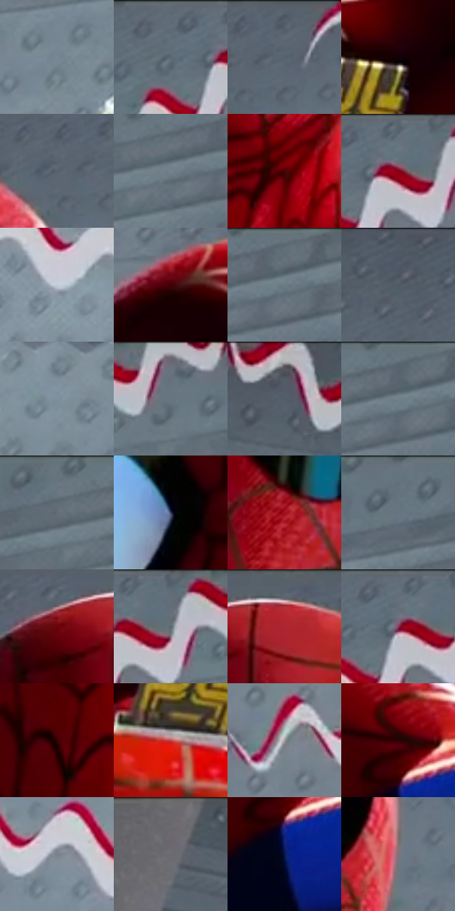

# 电影参考 126

- 状态：条件／活跃；来源世界：miles-home。
- 视角：low-angle；景别：medium；场景：portrait。
- 时段：graphic-no-physical-time（外观依据，中置信度；具体时间／晨昏未知）；光照：graphic-field。
- 材质候选：skin, fabric, metal（帧级，不是像素分割）。
- 明暗组：middle；L* P5/P50/P95：4.69445 / 45.62699 / 62.17957。
- 资格门禁：sense。
- 原截图 SHA-256：`f9b5be2adef4d2437e48e772d0b2ebbc6a7613c223146a663ce02f71f9e20bc0`；尺寸：2880 × 1206。
- sRGB 像素 SHA-256：`9584fa7f5fb1b07a752ccbe69ee57352e3adbffa0ce02e3501b9cf728f24feeb`。

## 观察与迁移

头周分段感知线与荧光色场，单人截图不改变定制人数规则。

126  /  灰色点阵环境中，红白两层短波浪线在头部四周有间隔地出现。  /  多用空隙和局部色版错位，不做发光轮廓或连续光圈。

本公开版保存32个128×128原像素色卡上下文；图集格子并非原场景相邻位置。原rect、图集tile和像素SHA见 `data/palette-crops.json`。上下文不足时不得批准替色，不能以小样推断完整构图。

## 实测色卡

颜色比例分母为保留采样像素，不是材料面积；全部 32 色参与全库匹配。表内四舍五入仅用于阅读，原精度在 JSON。

| ID | HEX | Lab | 原图 xy | 像素数 | 比例 | 明度角色 |
| --- | --- | --- | --- | ---: | ---: | --- |
| 126-S01 | #798894 | [55.897903, -2.756929, -8.235497] | [2304, 244] | 11476 | 5.935473% | midtone |
| 126-S02 | #616D79 | [45.440173, -1.726269, -8.1779] | [2076, 28] | 8548 | 4.421090% | midtone |
| 126-S03 | #5E6974 | [43.862777, -1.614968, -7.552598] | [1732, 40] | 8156 | 4.218344% | midtone |
| 126-S04 | #120106 | [1.476804, 5.644988, -0.148042] | [996, 1004] | 8002 | 4.138694% | deep-shadow |
| 126-S05 | #58626D | [41.078996, -1.253748, -7.513264] | [1676, 72] | 7985 | 4.129902% | midtone |
| 126-S06 | #74828D | [53.600941, -2.652356, -7.646409] | [2680, 80] | 7943 | 4.108179% | midtone |
| 126-S07 | #4D0103 | [13.27022, 33.384366, 19.538005] | [1568, 716] | 7939 | 4.106110% | deep-shadow |
| 126-S08 | #6C7884 | [49.841927, -1.733638, -8.049765] | [2152, 40] | 7804 | 4.036287% | midtone |
| 126-S09 | #C2C9D8 | [80.849777, 0.524169, -8.267119] | [2244, 664] | 7594 | 3.927674% | highlight |
| 126-S10 | #420206 | [10.668993, 29.702993, 14.309477] | [844, 956] | 7042 | 3.642175% | deep-shadow |
| 126-S11 | #6E7C87 | [51.243105, -2.657071, -7.706136] | [2756, 64] | 6980 | 3.610108% | midtone |
| 126-S12 | #4C5561 | [35.783953, -0.615599, -8.130837] | [956, 48] | 6907 | 3.572352% | shadow |
| 126-S13 | #7F919E | [59.187315, -3.522242, -9.01419] | [2492, 832] | 6610 | 3.418742% | midtone |
| 126-S14 | #68737E | [47.893216, -1.619343, -7.440525] | [2312, 32] | 6484 | 3.353573% | midtone |
| 126-S15 | #555C67 | [38.837348, -0.161164, -7.207631] | [596, 48] | 6453 | 3.337540% | shadow |
| 126-S16 | #717F8A | [52.424521, -2.654805, -7.675931] | [2732, 64] | 6365 | 3.292026% | midtone |
| 126-S17 | #697783 | [49.295566, -2.422088, -8.29959] | [2624, 32] | 6289 | 3.252718% | midtone |
| 126-S18 | #313C5A | [25.631284, 4.431254, -19.38981] | [1376, 280] | 6098 | 3.153931% | shadow |
| 126-S19 | #A1141F | [34.352451, 54.343859, 33.397772] | [1556, 456] | 5525 | 2.857571% | shadow |
| 126-S20 | #64727E | [47.300652, -2.421412, -8.357507] | [2492, 28] | 5447 | 2.817229% | midtone |
| 126-S21 | #6B040A | [20.963683, 41.539696, 27.745975] | [1372, 72] | 5447 | 2.817229% | shadow |
| 126-S22 | #636E7A | [45.919554, -1.378067, -8.044028] | [2192, 32] | 5352 | 2.768095% | midtone |
| 126-S23 | #5B6671 | [42.640706, -1.612903, -7.588232] | [1476, 28] | 5308 | 2.745337% | midtone |
| 126-S24 | #65707C | [46.724128, -1.380185, -8.020202] | [2128, 32] | 4612 | 2.385361% | midtone |
| 126-S25 | #350103 | [7.094594, 25.749913, 9.958167] | [1428, 828] | 4519 | 2.337261% | deep-shadow |
| 126-S26 | #BB4748 | [46.368084, 46.843246, 24.221791] | [924, 1120] | 4355 | 2.252439% | midtone |
| 126-S27 | #A1959E | [62.961572, 6.08545, -3.123385] | [480, 692] | 3766 | 1.947803% | light |
| 126-S28 | #2B0203 | [5.092294, 19.892866, 6.770646] | [2212, 1008] | 3431 | 1.774539% | deep-shadow |
| 126-S29 | #7A838E | [54.367843, -0.92649, -7.036793] | [2068, 600] | 3361 | 1.738334% | midtone |
| 126-S30 | #6D6970 | [44.975547, 2.994885, -3.352084] | [216, 56] | 3291 | 1.702130% | midtone |
| 126-S31 | #05184E | [10.81548, 16.790604, -35.204644] | [2216, 1092] | 2562 | 1.325086% | deep-shadow |
| 126-S32 | #80747D | [50.169404, 6.360805, -3.249501] | [1716, 412] | 1695 | 0.876667% | midtone |

## 色阶与空间分布

- 采样 ROI：`[0.01, 0.02, 0.98, 0.94]`；步长：4；样本数：193346。
- 排除区：`[]`。
- 深暗、暗、中、亮、高光五段计数：`[35874, 27317, 117704, 8271, 4180]`。
- RGB 各 256 箱、L* 100 箱、13×5 色相明度表和 3×3 空间统计全部保存在 [总数据](../film-library.json)。
- [可视化档案](../../references/library.html)按需绘制直方图，不存 2,094 张重复图表图片。

## 纹理特征占比

**这是分块图像特征的面积占比，不是波点／排线／丝网／错版的精确语义覆盖率。** 窗格、发丝、织物也会产生方向或周期特征。
原图 ROI 像素 3098546；已测块覆盖 3098546（100.0000%）；未测 0。

| 特征 | 块覆盖像素 | 占已测面积 | 阈值敏感范围 |
| --- | ---: | ---: | --- |
| low-contrast | 163584 | 5.2794% | 3.3420% ~ 6.6880% |
| directional-structure | 521344 | 16.8254% | 11.1867% ~ 28.7185% |
| periodic-structure | 2206130 | 71.1989% | 65.4734% ~ 71.1989% |
| mixed-detail | 207488 | 6.6963% | 2.4662% ~ 14.3593% |

阈值敏感范围不是统计置信区间。逐块坐标、尺度、对比、方向一致性、频谱集中度、频率与角度见 [全量特征记录](../texture-features.jsonl)，以帧号定位。
四种印刷层的真实像素覆盖仍标为 `null`，不能填 0，也不能拿上表代替。不得据这些代理测量删除唯一证据。

[测量方法与保留策略](../../references/library-retention.md) · [分类索引](../archive/README.md)
