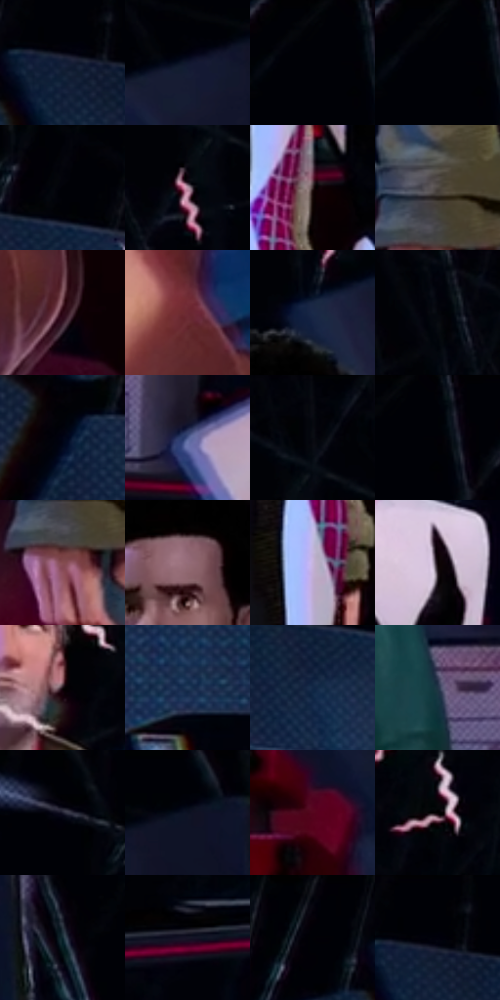

# 电影参考 127

- 状态：条件／活跃；来源世界：miles-home。
- 视角：near-level；景别：medium；场景：interior。
- 时段：interior-time-unknown（外观依据，中置信度；具体时间／晨昏未知）；光照：cool-interior。
- 材质候选：skin, hair, fabric, metal, glass（帧级，不是像素分割）。
- 明暗组：very-dark；L* P5/P50/P95：0.3148 / 9.79111 / 63.5121。
- 资格门禁：sense。
- 原截图 SHA-256：`939b8e4187d547e88c1fc1223f473f6d178c8863f8b6ef76ac9b63dfe27d8c2e`；尺寸：2872 × 1204。
- sRGB 像素 SHA-256：`8490a990849b96713481efef448fc7405926e7179477529b8237f1b0ddd30176`。

## 观察与迁移

多人感应线与实体空间同时存在，人物世界与场景世界分开。

127  /  三位人物各有感应短线，背景仍是可辨的室内空间，线条不会盖住五官。  /  多人时每个可辨人物都要有自己的头周线组，不只标主角。

本公开版保存32个128×128原像素色卡上下文；图集格子并非原场景相邻位置。原rect、图集tile和像素SHA见 `data/palette-crops.json`。上下文不足时不得批准替色，不能以小样推断完整构图。

## 实测色卡

颜色比例分母为保留采样像素，不是材料面积；全部 32 色参与全库匹配。表内四舍五入仅用于阅读，原精度在 JSON。

| ID | HEX | Lab | 原图 xy | 像素数 | 比例 | 明度角色 |
| --- | --- | --- | --- | ---: | ---: | --- |
| 127-S01 | #131E37 | [11.570937, 4.367353, -17.809129] | [556, 80] | 9936 | 5.172414% | deep-shadow |
| 127-S02 | #10162D | [7.889016, 5.635703, -16.398584] | [2292, 100] | 8828 | 4.595619% | deep-shadow |
| 127-S03 | #000106 | [0.314799, 0.433702, -1.984223] | [32, 28] | 8578 | 4.465476% | deep-shadow |
| 127-S04 | #010205 | [0.549399, 0.155597, -1.227343] | [64, 28] | 8375 | 4.359799% | deep-shadow |
| 127-S05 | #02030A | [0.90272, 0.711755, -2.741004] | [740, 28] | 8322 | 4.332209% | deep-shadow |
| 127-S06 | #B68FA4 | [63.566572, 18.179232, -5.401652] | [1728, 152] | 7422 | 3.863693% | light |
| 127-S07 | #382A2A | [18.644491, 6.49087, 2.491828] | [1224, 816] | 7395 | 3.849638% | deep-shadow |
| 127-S08 | #4E4843 | [31.019509, 1.507304, 3.90488] | [804, 960] | 7283 | 3.791333% | shadow |
| 127-S09 | #2E0916 | [7.536184, 20.213341, 0.867431] | [2636, 1052] | 7281 | 3.790292% | deep-shadow |
| 127-S10 | #6B2932 | [26.57124, 30.317494, 9.32983] | [2528, 924] | 7134 | 3.713768% | shadow |
| 127-S11 | #1A2947 | [16.797513, 4.413138, -20.691674] | [1856, 252] | 6460 | 3.362902% | deep-shadow |
| 127-S12 | #01040D | [1.10499, 0.502955, -3.780422] | [1588, 28] | 6431 | 3.347805% | deep-shadow |
| 127-S13 | #010415 | [1.33148, 2.094517, -8.112039] | [356, 396] | 6417 | 3.340517% | deep-shadow |
| 127-S14 | #4B598D | [38.834438, 9.356018, -30.542171] | [2180, 796] | 6409 | 3.336353% | shadow |
| 127-S15 | #090C12 | [3.294118, 0.272589, -3.2441] | [1756, 56] | 6366 | 3.313968% | deep-shadow |
| 127-S16 | #010208 | [0.608759, 0.572729, -2.362614] | [108, 28] | 6284 | 3.271281% | deep-shadow |
| 127-S17 | #844C50 | [38.992709, 24.151667, 7.919416] | [792, 1036] | 5908 | 3.075546% | shadow |
| 127-S18 | #946C78 | [49.95142, 17.831356, -0.371324] | [1812, 380] | 5653 | 2.942799% | midtone |
| 127-S19 | #C5B4DB | [75.839897, 13.417644, -17.362845] | [1172, 940] | 5574 | 2.901674% | light |
| 127-S20 | #0B0205 | [1.133973, 2.777258, -0.303609] | [1428, 636] | 5479 | 2.852220% | deep-shadow |
| 127-S21 | #180C11 | [4.495121, 5.585274, -0.747753] | [1104, 264] | 5402 | 2.812136% | deep-shadow |
| 127-S22 | #243C5B | [24.832985, 1.19808, -21.352857] | [556, 592] | 5224 | 2.719474% | shadow |
| 127-S23 | #122745 | [15.534848, 3.223606, -21.347878] | [704, 160] | 5214 | 2.714268% | deep-shadow |
| 127-S24 | #213446 | [20.90921, -1.77817, -13.548419] | [2036, 720] | 4739 | 2.466996% | shadow |
| 127-S25 | #1D1C2D | [11.142935, 5.436472, -11.202774] | [2708, 332] | 4568 | 2.377978% | deep-shadow |
| 127-S26 | #0B1122 | [5.30675, 2.813601, -12.182961] | [2404, 64] | 4485 | 2.334770% | deep-shadow |
| 127-S27 | #56051D | [16.386516, 35.960134, 9.372206] | [2340, 552] | 4251 | 2.212956% | deep-shadow |
| 127-S28 | #010101 | [0.274173, -1.7e-05, 3.3e-05] | [1244, 164] | 4148 | 2.159337% | deep-shadow |
| 127-S29 | #0E262F | [13.737058, -5.990387, -8.734603] | [2524, 192] | 3791 | 1.973492% | deep-shadow |
| 127-S30 | #151426 | [7.223147, 6.037544, -12.193767] | [104, 844] | 3783 | 1.969328% | deep-shadow |
| 127-S31 | #08050F | [1.758268, 2.277484, -3.786989] | [436, 32] | 2990 | 1.556513% | deep-shadow |
| 127-S32 | #01010C | [0.494057, 1.545124, -4.205244] | [572, 64] | 1966 | 1.023447% | deep-shadow |

## 色阶与空间分布

- 采样 ROI：`[0.01, 0.02, 0.98, 0.94]`；步长：4；样本数：192096。
- 排除区：`[]`。
- 深暗、暗、中、亮、高光五段计数：`[135580, 33302, 11891, 10108, 1215]`。
- RGB 各 256 箱、L* 100 箱、13×5 色相明度表和 3×3 空间统计全部保存在 [总数据](../film-library.json)。
- [可视化档案](../../references/library.html)按需绘制直方图，不存 2,094 张重复图表图片。

## 纹理特征占比

**这是分块图像特征的面积占比，不是波点／排线／丝网／错版的精确语义覆盖率。** 窗格、发丝、织物也会产生方向或周期特征。
原图 ROI 像素 3084102；已测块覆盖 3084102（100.0000%）；未测 0。

| 特征 | 块覆盖像素 | 占已测面积 | 阈值敏感范围 |
| --- | ---: | ---: | --- |
| low-contrast | 187462 | 6.0783% | 3.5466% ~ 7.2985% |
| directional-structure | 660352 | 21.4115% | 12.9407% ~ 38.9466% |
| periodic-structure | 2127360 | 68.9783% | 57.1623% ~ 69.6340% |
| mixed-detail | 108928 | 3.5319% | 0.3445% ~ 10.1268% |

阈值敏感范围不是统计置信区间。逐块坐标、尺度、对比、方向一致性、频谱集中度、频率与角度见 [全量特征记录](../texture-features.jsonl)，以帧号定位。
四种印刷层的真实像素覆盖仍标为 `null`，不能填 0，也不能拿上表代替。不得据这些代理测量删除唯一证据。

[测量方法与保留策略](../../references/library-retention.md) · [分类索引](../archive/README.md)
