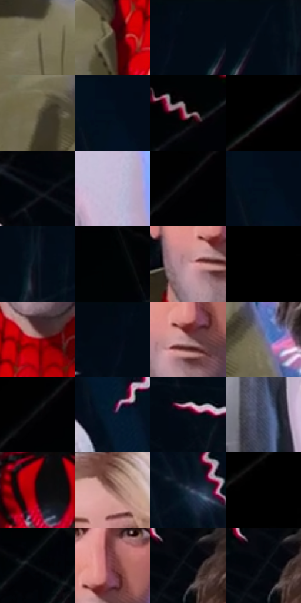

# 电影参考 128

- 状态：条件／活跃；来源世界：miles-home。
- 视角：near-level；景别：medium；场景：interior。
- 时段：interior-time-unknown（外观依据，中置信度；具体时间／晨昏未知）；光照：cool-interior。
- 材质候选：skin, hair, fabric, metal, glass（帧级，不是像素分割）。
- 明暗组：very-dark；L* P5/P50/P95：0.27417 / 4.26482 / 68.77875。
- 资格门禁：sense。
- 原截图 SHA-256：`dc80b5d1a9cfd1f73579efda7d643f67582d90c6b3710a0c04fde80d7bb82f45`；尺寸：2874 × 1200。
- sRGB 像素 SHA-256：`31ab087fecb2afdc37fa4a5215f05203b6ba51c2bc2440aa054caeca2ca0bcfd`。

## 观察与迁移

多人感应线与实体空间同时存在，人物世界与场景世界分开。

128  /  四人头部高度、大小不同，粉红线按各自头围分布，彼此不必同密度。  /  线段尺度随人物远近和空隙调整，避免互相连成一大团。

本公开版保存32个128×128原像素色卡上下文；图集格子并非原场景相邻位置。原rect、图集tile和像素SHA见 `data/palette-crops.json`。上下文不足时不得批准替色，不能以小样推断完整构图。

## 实测色卡

颜色比例分母为保留采样像素，不是材料面积；全部 32 色参与全库匹配。表内四舍五入仅用于阅读，原精度在 JSON。

| ID | HEX | Lab | 原图 xy | 像素数 | 比例 | 明度角色 |
| --- | --- | --- | --- | ---: | ---: | --- |
| 128-S01 | #706950 | [44.415114, -1.6007, 15.087256] | [1552, 620] | 11136 | 5.788784% | midtone |
| 128-S02 | #443529 | [23.456865, 4.67159, 10.119651] | [1208, 600] | 9736 | 5.061028% | shadow |
| 128-S03 | #020B15 | [2.767333, -0.45812, -6.008374] | [1784, 24] | 8948 | 4.651405% | deep-shadow |
| 128-S04 | #020B17 | [2.837027, 0.031625, -7.341271] | [1872, 24] | 8481 | 4.408646% | deep-shadow |
| 128-S05 | #615942 | [37.985222, -0.77164, 14.518935] | [1704, 716] | 7876 | 4.094151% | shadow |
| 128-S06 | #020C19 | [3.125358, 0.12439, -8.4676] | [2328, 24] | 7596 | 3.948600% | deep-shadow |
| 128-S07 | #281B1D | [11.440646, 6.82403, 1.14565] | [404, 524] | 7359 | 3.825401% | deep-shadow |
| 128-S08 | #000204 | [0.471303, -0.244946, -0.941058] | [140, 144] | 7241 | 3.764061% | deep-shadow |
| 128-S09 | #01050A | [1.236567, -0.350865, -2.260507] | [1068, 24] | 7132 | 3.707400% | deep-shadow |
| 128-S10 | #C5BAD5 | [77.156394, 8.948524, -12.130124] | [2584, 1008] | 7094 | 3.687647% | light |
| 128-S11 | #010103 | [0.313747, 0.27807, -0.756814] | [588, 24] | 6926 | 3.600316% | deep-shadow |
| 128-S12 | #020F1C | [3.95952, -0.461586, -9.614246] | [2316, 76] | 6888 | 3.580563% | deep-shadow |
| 128-S13 | #08111D | [4.888496, 0.322997, -8.970313] | [1924, 148] | 6699 | 3.482316% | deep-shadow |
| 128-S14 | #000304 | [0.667381, -0.645506, -0.65474] | [732, 24] | 6556 | 3.407980% | deep-shadow |
| 128-S15 | #CB9BA0 | [68.518178, 18.62444, 4.337442] | [1288, 396] | 6503 | 3.380430% | light |
| 128-S16 | #000000 | [0.0, 0.0, 0.0] | [32, 24] | 6350 | 3.300896% | deep-shadow |
| 128-S17 | #9A0512 | [31.862637, 54.517628, 37.796979] | [1328, 528] | 6085 | 3.163142% | shadow |
| 128-S18 | #040A13 | [2.618535, 0.02354, -4.887242] | [1740, 28] | 5785 | 3.007194% | deep-shadow |
| 128-S19 | #A87C7D | [56.309523, 17.239577, 6.173586] | [1332, 376] | 5469 | 2.842929% | midtone |
| 128-S20 | #727382 | [48.822598, 2.846935, -8.341891] | [1864, 808] | 5420 | 2.817458% | midtone |
| 128-S21 | #040407 | [1.156054, 0.417062, -1.135139] | [576, 64] | 5336 | 2.773792% | deep-shadow |
| 128-S22 | #09192C | [8.438569, 1.01488, -14.818735] | [2504, 468] | 5289 | 2.749361% | deep-shadow |
| 128-S23 | #070E17 | [3.803579, -0.039828, -5.894915] | [1628, 336] | 4854 | 2.523236% | deep-shadow |
| 128-S24 | #434D66 | [32.832071, 2.691184, -15.826913] | [2136, 1092] | 4486 | 2.331940% | shadow |
| 128-S25 | #13080D | [3.081992, 4.249612, -0.750481] | [1276, 904] | 4437 | 2.306469% | deep-shadow |
| 128-S26 | #8F6259 | [46.038902, 17.033679, 12.481169] | [2340, 540] | 4333 | 2.252407% | midtone |
| 128-S27 | #253344 | [20.743663, -0.543272, -12.43009] | [2208, 392] | 4295 | 2.232653% | shadow |
| 128-S28 | #010101 | [0.274173, -1.7e-05, 3.3e-05] | [332, 24] | 3621 | 1.882291% | deep-shadow |
| 128-S29 | #000409 | [0.962393, -0.350848, -2.26054] | [884, 24] | 3334 | 1.733100% | deep-shadow |
| 128-S30 | #74383D | [31.530331, 26.838236, 9.185831] | [1356, 316] | 2557 | 1.329196% | shadow |
| 128-S31 | #03070D | [1.809842, -0.175728, -2.737191] | [1204, 28] | 2511 | 1.305284% | deep-shadow |
| 128-S32 | #02060C | [1.532755, -0.19618, -2.681516] | [1188, 24] | 2039 | 1.059926% | deep-shadow |

## 色阶与空间分布

- 采样 ROI：`[0.01, 0.02, 0.98, 0.94]`；步长：4；样本数：192372。
- 排除区：`[]`。
- 深暗、暗、中、亮、高光五段计数：`[122957, 26060, 28814, 13004, 1537]`。
- RGB 各 256 箱、L* 100 箱、13×5 色相明度表和 3×3 空间统计全部保存在 [总数据](../film-library.json)。
- [可视化档案](../../references/library.html)按需绘制直方图，不存 2,094 张重复图表图片。

## 纹理特征占比

**这是分块图像特征的面积占比，不是波点／排线／丝网／错版的精确语义覆盖率。** 窗格、发丝、织物也会产生方向或周期特征。
原图 ROI 像素 3077952；已测块覆盖 3077952（100.0000%）；未测 0。

| 特征 | 块覆盖像素 | 占已测面积 | 阈值敏感范围 |
| --- | ---: | ---: | --- |
| low-contrast | 421888 | 13.7068% | 12.6422% ~ 17.9652% |
| directional-structure | 848704 | 27.5737% | 16.4619% ~ 42.2286% |
| periodic-structure | 1715200 | 55.7254% | 43.5323% ~ 55.7254% |
| mixed-detail | 92160 | 2.9942% | 1.5969% ~ 10.2468% |

阈值敏感范围不是统计置信区间。逐块坐标、尺度、对比、方向一致性、频谱集中度、频率与角度见 [全量特征记录](../texture-features.jsonl)，以帧号定位。
四种印刷层的真实像素覆盖仍标为 `null`，不能填 0，也不能拿上表代替。不得据这些代理测量删除唯一证据。

[测量方法与保留策略](../../references/library-retention.md) · [分类索引](../archive/README.md)
