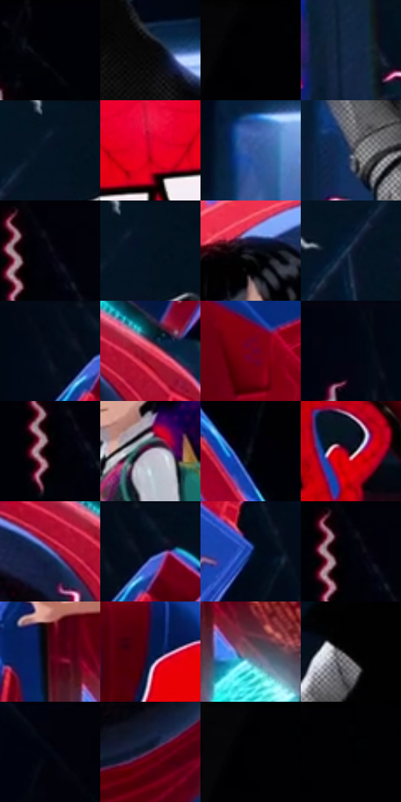

# 电影参考 129

- 状态：条件／活跃；来源世界：miles-home。
- 视角：low-angle；景别：medium；场景：interior。
- 时段：interior-time-unknown（外观依据，中置信度；具体时间／晨昏未知）；光照：cool-interior。
- 材质候选：skin, hair, fabric, metal, glass（帧级，不是像素分割）。
- 明暗组：very-dark；L* P5/P50/P95：0.27523 / 5.82018 / 54.52512。
- 资格门禁：sense。
- 原截图 SHA-256：`f852219fa74767edd53535ef7aaac9e0ddb03d4476c0148868eaa6e74e3665a9`；尺寸：2880 × 1204。
- sRGB 像素 SHA-256：`32741dc6a8397d923c97d866729a12be5b37d9c8909bb73912674a8f2dfdb3d1`。

## 观察与迁移

多人感应线与实体空间同时存在，人物世界与场景世界分开。

129  /  大小人物与道具共处暗背景，短红粉线分散在不同人物附近。  /  不为容纳线条重排原有群像或复制电影道具。

本公开版保存32个128×128原像素色卡上下文；图集格子并非原场景相邻位置。原rect、图集tile和像素SHA见 `data/palette-crops.json`。上下文不足时不得批准替色，不能以小样推断完整构图。

## 实测色卡

颜色比例分母为保留采样像素，不是材料面积；全部 32 色参与全库匹配。表内四舍五入仅用于阅读，原精度在 JSON。

| ID | HEX | Lab | 原图 xy | 像素数 | 比例 | 明度角色 |
| --- | --- | --- | --- | ---: | ---: | --- |
| 129-S01 | #000106 | [0.314799, 0.433702, -1.984223] | [704, 28] | 11518 | 5.978780% | deep-shadow |
| 129-S02 | #080708 | [1.99731, 0.400421, -0.286054] | [2276, 412] | 9415 | 4.887152% | deep-shadow |
| 129-S03 | #010103 | [0.313747, 0.27807, -0.756814] | [180, 28] | 9206 | 4.778664% | deep-shadow |
| 129-S04 | #132747 | [15.717446, 4.273976, -22.431111] | [1652, 708] | 8701 | 4.516528% | deep-shadow |
| 129-S05 | #061425 | [6.074899, 0.812081, -13.30827] | [1916, 52] | 8332 | 4.324987% | deep-shadow |
| 129-S06 | #CF0223 | [43.410825, 68.744874, 43.324322] | [1420, 856] | 8319 | 4.318238% | midtone |
| 129-S07 | #31549A | [36.603721, 11.386235, -42.028893] | [1424, 540] | 8031 | 4.168743% | shadow |
| 129-S08 | #2F3950 | [24.030414, 2.565207, -15.322276] | [1820, 644] | 7890 | 4.095553% | shadow |
| 129-S09 | #010209 | [0.628546, 0.711773, -2.741037] | [940, 28] | 7879 | 4.089843% | deep-shadow |
| 129-S10 | #051220 | [5.140669, -0.058433, -10.92951] | [1944, 28] | 7574 | 3.931523% | deep-shadow |
| 129-S11 | #1B1C26 | [10.582659, 2.39258, -6.94977] | [736, 512] | 7124 | 3.697936% | deep-shadow |
| 129-S12 | #0F1D34 | [10.763064, 2.849838, -16.952347] | [1832, 152] | 6884 | 3.573357% | deep-shadow |
| 129-S13 | #020916 | [2.404348, 0.593328, -7.24181] | [1288, 36] | 6733 | 3.494975% | deep-shadow |
| 129-S14 | #D93D57 | [50.430898, 61.521346, 21.517574] | [1184, 484] | 6637 | 3.445143% | midtone |
| 129-S15 | #790119 | [24.187598, 46.559401, 23.612487] | [1664, 1028] | 6250 | 3.244259% | shadow |
| 129-S16 | #000511 | [1.345803, 0.564992, -5.556956] | [1136, 28] | 6141 | 3.187679% | deep-shadow |
| 129-S17 | #000000 | [0.0, 0.0, 0.0] | [908, 92] | 6110 | 3.171588% | deep-shadow |
| 129-S18 | #C5BACE | [76.947452, 7.574929, -8.648024] | [784, 732] | 6096 | 3.164320% | light |
| 129-S19 | #101117 | [5.175017, 0.991705, -3.821863] | [524, 100] | 6044 | 3.137328% | deep-shadow |
| 129-S20 | #0F0A13 | [3.302972, 3.093058, -3.805706] | [1516, 1128] | 5203 | 2.700781% | deep-shadow |
| 129-S21 | #667FC0 | [53.822434, 8.708553, -36.818666] | [1108, 508] | 5122 | 2.658735% | midtone |
| 129-S22 | #040C1C | [3.365251, 1.513656, -10.487432] | [1344, 52] | 5114 | 2.654582% | deep-shadow |
| 129-S23 | #193586 | [25.178189, 21.319535, -48.280357] | [1340, 292] | 4786 | 2.484324% | shadow |
| 129-S24 | #04050D | [1.475995, 0.886892, -3.217689] | [924, 28] | 4415 | 2.291745% | deep-shadow |
| 129-S25 | #450215 | [11.710275, 31.436559, 8.248584] | [520, 932] | 4323 | 2.243989% | deep-shadow |
| 129-S26 | #0C173E | [9.308932, 11.310846, -26.455221] | [1268, 700] | 4258 | 2.210249% | deep-shadow |
| 129-S27 | #71606D | [42.734317, 9.329152, -4.809642] | [608, 1008] | 3677 | 1.908662% | midtone |
| 129-S28 | #040304 | [0.900616, 0.400491, -0.286186] | [1844, 420] | 3214 | 1.668328% | deep-shadow |
| 129-S29 | #01020C | [0.690135, 1.144563, -3.918926] | [2488, 44] | 3173 | 1.647045% | deep-shadow |
| 129-S30 | #591F41 | [21.89358, 30.808098, -8.053711] | [1016, 996] | 2387 | 1.239047% | shadow |
| 129-S31 | #000002 | [0.039574, 0.278088, -0.756847] | [168, 28] | 1484 | 0.770317% | deep-shadow |
| 129-S32 | #000203 | [0.451516, -0.38399, -0.562635] | [228, 32] | 608 | 0.315602% | deep-shadow |

## 色阶与空间分布

- 采样 ROI：`[0.01, 0.02, 0.98, 0.94]`；步长：4；样本数：192648。
- 排除区：`[]`。
- 深暗、暗、中、亮、高光五段计数：`[138416, 26573, 20418, 5383, 1858]`。
- RGB 各 256 箱、L* 100 箱、13×5 色相明度表和 3×3 空间统计全部保存在 [总数据](../film-library.json)。
- [可视化档案](../../references/library.html)按需绘制直方图，不存 2,094 张重复图表图片。

## 纹理特征占比

**这是分块图像特征的面积占比，不是波点／排线／丝网／错版的精确语义覆盖率。** 窗格、发丝、织物也会产生方向或周期特征。
原图 ROI 像素 3092958；已测块覆盖 3092958（100.0000%）；未测 0。

| 特征 | 块覆盖像素 | 占已测面积 | 阈值敏感范围 |
| --- | ---: | ---: | --- |
| low-contrast | 441600 | 14.2776% | 12.1587% ~ 15.4943% |
| directional-structure | 954496 | 30.8603% | 11.8111% ~ 48.2572% |
| periodic-structure | 1620702 | 52.3997% | 39.0544% ~ 61.2560% |
| mixed-detail | 76160 | 2.4624% | 0.5297% ~ 11.4386% |

阈值敏感范围不是统计置信区间。逐块坐标、尺度、对比、方向一致性、频谱集中度、频率与角度见 [全量特征记录](../texture-features.jsonl)，以帧号定位。
四种印刷层的真实像素覆盖仍标为 `null`，不能填 0，也不能拿上表代替。不得据这些代理测量删除唯一证据。

[测量方法与保留策略](../../references/library-retention.md) · [分类索引](../archive/README.md)
