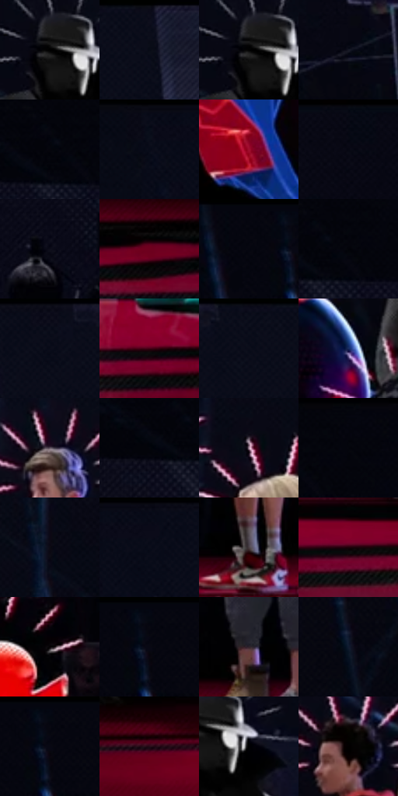

# 电影参考 130

- 状态：条件／活跃；来源世界：miles-home。
- 视角：near-level；景别：environment-wide；场景：interior。
- 时段：interior-time-unknown（外观依据，中置信度；具体时间／晨昏未知）；光照：cool-interior。
- 材质候选：skin, hair, fabric, metal, glass（帧级，不是像素分割）。
- 明暗组：very-dark；L* P5/P50/P95：0.0 / 2.9858 / 38.1076。
- 资格门禁：sense。
- 原截图 SHA-256：`0c8b36b225316405559f76bd6c45df0d839145bb0fff4e1c811a3a05ecc5604a`；尺寸：2880 × 1220。
- sRGB 像素 SHA-256：`213b56c295210a0f31787543a8971726be18467ef543ca8c403501207fc320ae`。

## 观察与迁移

多人感应线与实体空间同时存在，人物世界与场景世界分开。

130  /  更宽的群像中，各人物周围出现疏密不同的短线；有人头部很小，线也随之缩小。  /  第三形态须覆盖所有可辨人物，不能因非主角而漏标。

本公开版保存32个128×128原像素色卡上下文；图集格子并非原场景相邻位置。原rect、图集tile和像素SHA见 `data/palette-crops.json`。上下文不足时不得批准替色，不能以小样推断完整构图。

## 实测色卡

颜色比例分母为保留采样像素，不是材料面积；全部 32 色参与全库匹配。表内四舍五入仅用于阅读，原精度在 JSON。

| ID | HEX | Lab | 原图 xy | 像素数 | 比例 | 明度角色 |
| --- | --- | --- | --- | ---: | ---: | --- |
| 130-S01 | #000000 | [0.0, 0.0, 0.0] | [964, 376] | 10627 | 5.437474% | deep-shadow |
| 130-S02 | #0E0F1D | [4.73047, 3.107665, -9.169084] | [1532, 28] | 10605 | 5.426218% | deep-shadow |
| 130-S03 | #010102 | [0.29396, 0.139026, -0.378391] | [960, 376] | 10532 | 5.388866% | deep-shadow |
| 130-S04 | #171825 | [8.730182, 3.467269, -9.085402] | [1224, 440] | 9864 | 5.047073% | deep-shadow |
| 130-S05 | #05050C | [1.511604, 0.988879, -2.691418] | [112, 84] | 9464 | 4.842407% | deep-shadow |
| 130-S06 | #080B18 | [3.223773, 1.859871, -7.49402] | [928, 28] | 9323 | 4.770262% | deep-shadow |
| 130-S07 | #9D0D2D | [33.238145, 55.077788, 23.216] | [724, 864] | 8787 | 4.496009% | shadow |
| 130-S08 | #080914 | [2.6872, 1.691503, -5.407587] | [2376, 28] | 8745 | 4.474519% | deep-shadow |
| 130-S09 | #010206 | [0.569186, 0.294641, -1.605767] | [44, 356] | 8306 | 4.249898% | deep-shadow |
| 130-S10 | #6E001E | [21.615572, 44.053927, 16.538133] | [2656, 1076] | 8259 | 4.225849% | shadow |
| 130-S11 | #060610 | [1.864101, 1.539253, -4.189339] | [404, 28] | 7977 | 4.081560% | deep-shadow |
| 130-S12 | #020309 | [0.882933, 0.572711, -2.362581] | [148, 88] | 6636 | 3.395415% | deep-shadow |
| 130-S13 | #0C0C19 | [3.715012, 2.768833, -7.535408] | [1320, 28] | 6241 | 3.193307% | deep-shadow |
| 130-S14 | #430115 | [11.060605, 31.283549, 7.273759] | [2112, 1116] | 6195 | 3.169771% | deep-shadow |
| 130-S15 | #0A0B19 | [3.378667, 2.651843, -8.041719] | [1448, 28] | 5945 | 3.041854% | deep-shadow |
| 130-S16 | #192C5F | [19.365911, 11.760763, -32.713951] | [820, 548] | 5835 | 2.985571% | deep-shadow |
| 130-S17 | #625663 | [38.116008, 7.537719, -5.684949] | [1980, 280] | 5655 | 2.893471% | shadow |
| 130-S18 | #03050C | [1.394986, 0.46588, -2.875695] | [72, 112] | 5612 | 2.871470% | deep-shadow |
| 130-S19 | #AC91A3 | [63.066253, 13.255314, -5.684258] | [2136, 324] | 5292 | 2.707736% | light |
| 130-S20 | #05060F | [1.779419, 1.092426, -3.777086] | [200, 28] | 5254 | 2.688293% | deep-shadow |
| 130-S21 | #0B0A13 | [3.028183, 1.860703, -4.239923] | [2260, 144] | 5118 | 2.618707% | deep-shadow |
| 130-S22 | #060A16 | [2.833661, 1.238765, -6.586938] | [1032, 28] | 5048 | 2.582890% | deep-shadow |
| 130-S23 | #473C41 | [26.600633, 5.80343, -1.295037] | [1848, 988] | 4369 | 2.235469% | shadow |
| 130-S24 | #1C0209 | [2.800996, 10.454636, 0.691832] | [2344, 1112] | 4119 | 2.107552% | deep-shadow |
| 130-S25 | #060306 | [1.056807, 1.201577, -0.858756] | [1164, 852] | 4034 | 2.064061% | deep-shadow |
| 130-S26 | #050810 | [2.197949, 0.476633, -3.708841] | [464, 28] | 4000 | 2.046664% | deep-shadow |
| 130-S27 | #31242B | [15.94862, 7.610492, -2.250693] | [1980, 956] | 3659 | 1.872186% | deep-shadow |
| 130-S28 | #101A30 | [9.499629, 3.743707, -16.047851] | [2544, 100] | 3492 | 1.786738% | deep-shadow |
| 130-S29 | #050510 | [1.609715, 1.678314, -4.567795] | [464, 56] | 2036 | 1.041752% | deep-shadow |
| 130-S30 | #240B17 | [6.1095, 14.331148, -2.170164] | [596, 1068] | 2003 | 1.024867% | deep-shadow |
| 130-S31 | #000002 | [0.039574, 0.278088, -0.756847] | [1028, 400] | 1260 | 0.644699% | deep-shadow |
| 130-S32 | #020001 | [0.136404, 0.662042, -0.194147] | [1856, 452] | 1148 | 0.587393% | deep-shadow |

## 色阶与空间分布

- 采样 ROI：`[0.01, 0.02, 0.98, 0.94]`；步长：4；样本数：195440。
- 排除区：`[]`。
- 深暗、暗、中、亮、高光五段计数：`[162053, 24495, 5997, 2483, 412]`。
- RGB 各 256 箱、L* 100 箱、13×5 色相明度表和 3×3 空间统计全部保存在 [总数据](../film-library.json)。
- [可视化档案](../../references/library.html)按需绘制直方图，不存 2,094 张重复图表图片。

## 纹理特征占比

**这是分块图像特征的面积占比，不是波点／排线／丝网／错版的精确语义覆盖率。** 窗格、发丝、织物也会产生方向或周期特征。
原图 ROI 像素 3134868；已测块覆盖 3134868（100.0000%）；未测 0。

| 特征 | 块覆盖像素 | 占已测面积 | 阈值敏感范围 |
| --- | ---: | ---: | --- |
| low-contrast | 552704 | 17.6309% | 14.6175% ~ 21.0443% |
| directional-structure | 624640 | 19.9256% | 9.5626% ~ 31.9428% |
| periodic-structure | 1764756 | 56.2944% | 51.3491% ~ 56.2944% |
| mixed-detail | 192768 | 6.1492% | 2.0906% ~ 13.9887% |

阈值敏感范围不是统计置信区间。逐块坐标、尺度、对比、方向一致性、频谱集中度、频率与角度见 [全量特征记录](../texture-features.jsonl)，以帧号定位。
四种印刷层的真实像素覆盖仍标为 `null`，不能填 0，也不能拿上表代替。不得据这些代理测量删除唯一证据。

[测量方法与保留策略](../../references/library-retention.md) · [分类索引](../archive/README.md)
