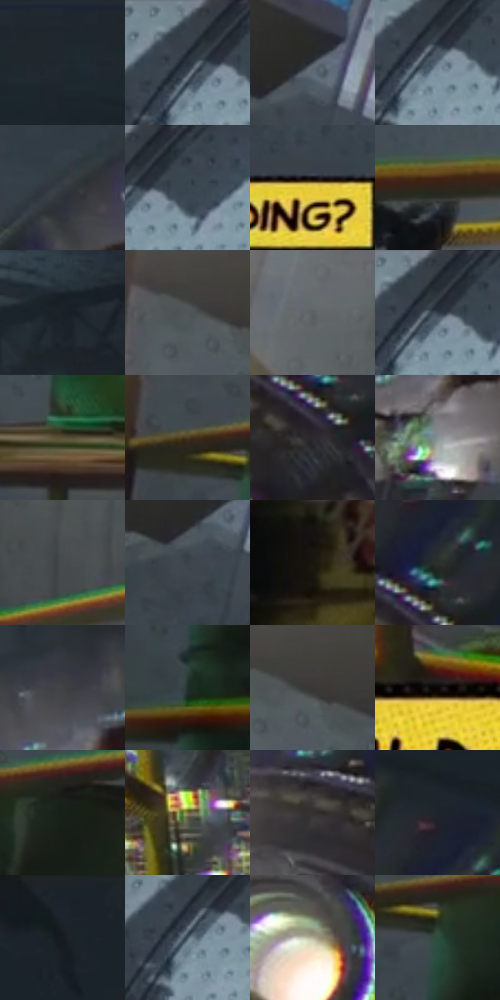

# 电影参考 131

- 状态：条件／活跃；来源世界：miles-home。
- 视角：low-angle；景别：environment-wide；场景：industrial。
- 时段：interior-time-unknown（外观依据，中置信度；具体时间／晨昏未知）；光照：interior-mixed。
- 材质候选：skin, fabric, metal, stone（帧级，不是像素分割）。
- 明暗组：dark；L* P5/P50/P95：10.01671 / 26.84443 / 65.81517。
- 资格门禁：caption。
- 原截图 SHA-256：`5eec80a56d51570e459321da285e186446674abd9117413abb88e2ce6e153af4`；尺寸：2880 × 1204。
- sRGB 像素 SHA-256：`9ccd15c9aa4b1df172131fbe36cc85fdf4ad36e389ea533d06542a9c53119a2e`。

## 观察与迁移

机器隧道、黄栏杆及内心框，工业结构优先。

本公开版保存32个128×128原像素色卡上下文；图集格子并非原场景相邻位置。原rect、图集tile和像素SHA见 `data/palette-crops.json`。上下文不足时不得批准替色，不能以小样推断完整构图。

## 实测色卡

颜色比例分母为保留采样像素，不是材料面积；全部 32 色参与全库匹配。表内四舍五入仅用于阅读，原精度在 JSON。

| ID | HEX | Lab | 原图 xy | 像素数 | 比例 | 明度角色 |
| --- | --- | --- | --- | ---: | ---: | --- |
| 131-S01 | #1F262D | [14.772838, -1.074889, -5.630343] | [2196, 28] | 11383 | 5.908704% | deep-shadow |
| 131-S02 | #374149 | [26.943743, -1.996731, -6.212321] | [1328, 36] | 9796 | 5.084922% | shadow |
| 131-S03 | #414A53 | [30.986435, -1.366703, -6.552938] | [780, 236] | 9318 | 4.836801% | shadow |
| 131-S04 | #647382 | [47.729011, -2.028435, -10.093204] | [1348, 80] | 9156 | 4.752710% | midtone |
| 131-S05 | #363C42 | [24.980709, -0.997855, -4.538575] | [1732, 240] | 9090 | 4.718450% | shadow |
| 131-S06 | #3B454F | [28.773789, -1.459057, -7.343699] | [1400, 28] | 8698 | 4.514970% | shadow |
| 131-S07 | #E4CA3C | [81.326921, -5.56653, 69.745205] | [904, 436] | 8158 | 4.234666% | highlight |
| 131-S08 | #2E2519 | [15.351554, 2.064269, 9.582784] | [1276, 912] | 8023 | 4.164590% | deep-shadow |
| 131-S09 | #1A2329 | [13.118352, -2.158676, -5.300555] | [1984, 60] | 7665 | 3.978759% | deep-shadow |
| 131-S10 | #50565B | [36.207168, -1.226539, -3.71153] | [428, 160] | 7531 | 3.909202% | shadow |
| 131-S11 | #5C6164 | [40.807428, -1.28664, -2.375555] | [260, 80] | 7439 | 3.861447% | midtone |
| 131-S12 | #2D333B | [20.985184, -0.441435, -5.89485] | [1352, 44] | 6784 | 3.521448% | shadow |
| 131-S13 | #5A5035 | [34.330995, -0.335085, 17.441554] | [952, 1112] | 6157 | 3.195984% | shadow |
| 131-S14 | #4C3B22 | [26.099183, 3.780356, 18.268437] | [352, 736] | 5973 | 3.100473% | shadow |
| 131-S15 | #2A292D | [16.833088, 1.431243, -2.442462] | [2260, 368] | 5711 | 2.964474% | deep-shadow |
| 131-S16 | #869194 | [59.394866, -3.339665, -2.947126] | [1912, 336] | 5682 | 2.949421% | midtone |
| 131-S17 | #474B4D | [31.595408, -1.168949, -1.749414] | [48, 588] | 5427 | 2.817055% | shadow |
| 131-S18 | #3B4348 | [27.877385, -2.028253, -4.129995] | [748, 292] | 5361 | 2.782796% | shadow |
| 131-S19 | #18160F | [7.249066, -0.530492, 4.385349] | [732, 1016] | 5269 | 2.735040% | deep-shadow |
| 131-S20 | #2C312C | [19.695827, -3.370955, 2.45449] | [2280, 288] | 5031 | 2.611499% | deep-shadow |
| 131-S21 | #414344 | [28.262014, -0.604749, -0.894041] | [1888, 212] | 4846 | 2.515469% | shadow |
| 131-S22 | #212F2C | [18.090173, -6.679309, 0.014499] | [400, 904] | 4750 | 2.465637% | deep-shadow |
| 131-S23 | #3A3938 | [24.036142, 0.205817, 0.77592] | [464, 160] | 4597 | 2.386217% | shadow |
| 131-S24 | #0A0606 | [1.878276, 1.045893, 0.368752] | [1788, 904] | 4405 | 2.286554% | deep-shadow |
| 131-S25 | #182119 | [11.634848, -6.156529, 4.115742] | [540, 756] | 4180 | 2.169760% | deep-shadow |
| 131-S26 | #7A6C3F | [45.937054, -1.124769, 27.101397] | [2092, 756] | 4126 | 2.141730% | midtone |
| 131-S27 | #333130 | [20.494218, 0.658351, 0.953421] | [2076, 300] | 3946 | 2.048295% | shadow |
| 131-S28 | #1F232A | [13.594014, 0.151596, -5.261148] | [2264, 208] | 3875 | 2.011441% | deep-shadow |
| 131-S29 | #1A2024 | [11.823688, -1.56814, -3.615379] | [2728, 56] | 3789 | 1.966800% | deep-shadow |
| 131-S30 | #445460 | [34.830252, -3.077777, -8.999832] | [1324, 92] | 2668 | 1.384909% | shadow |
| 131-S31 | #B5B199 | [71.939122, -2.714933, 12.808713] | [1848, 508] | 2601 | 1.350131% | light |
| 131-S32 | #2C4E3E | [30.234537, -16.650743, 5.630113] | [412, 784] | 1213 | 0.629646% | shadow |

## 色阶与空间分布

- 采样 ROI：`[0.01, 0.02, 0.98, 0.94]`；步长：4；样本数：192648。
- 排除区：`[]`。
- 深暗、暗、中、亮、高光五段计数：`[65167, 93702, 20288, 6744, 6747]`。
- RGB 各 256 箱、L* 100 箱、13×5 色相明度表和 3×3 空间统计全部保存在 [总数据](../film-library.json)。
- [可视化档案](../../references/library.html)按需绘制直方图，不存 2,094 张重复图表图片。

## 纹理特征占比

**这是分块图像特征的面积占比，不是波点／排线／丝网／错版的精确语义覆盖率。** 窗格、发丝、织物也会产生方向或周期特征。
原图 ROI 像素 3092958；已测块覆盖 3092958（100.0000%）；未测 0。

| 特征 | 块覆盖像素 | 占已测面积 | 阈值敏感范围 |
| --- | ---: | ---: | --- |
| low-contrast | 256862 | 8.3047% | 4.3401% ~ 11.1106% |
| directional-structure | 717312 | 23.1918% | 10.6937% ~ 35.3464% |
| periodic-structure | 2072448 | 67.0054% | 59.7838% ~ 67.4399% |
| mixed-detail | 46336 | 1.4981% | 0.5297% ~ 10.7558% |

阈值敏感范围不是统计置信区间。逐块坐标、尺度、对比、方向一致性、频谱集中度、频率与角度见 [全量特征记录](../texture-features.jsonl)，以帧号定位。
四种印刷层的真实像素覆盖仍标为 `null`，不能填 0，也不能拿上表代替。不得据这些代理测量删除唯一证据。

[测量方法与保留策略](../../references/library-retention.md) · [分类索引](../archive/README.md)
