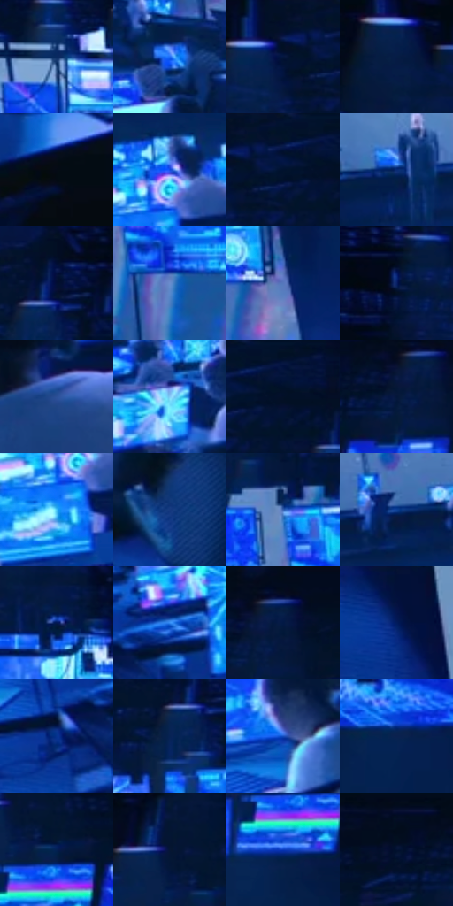

# 电影参考 132

- 状态：常规／活跃；来源世界：miles-home。
- 视角：high-angle；景别：environment-wide；场景：industrial。
- 时段：interior-time-unknown（外观依据，中置信度；具体时间／晨昏未知）；光照：cool-interior。
- 材质候选：skin, fabric, metal, glass, screen, plastic（帧级，不是像素分割）。
- 明暗组：very-dark；L* P5/P50/P95：3.12019 / 16.94912 / 67.12107。
- 资格门禁：无附加门禁。
- 原截图 SHA-256：`b843cd44038021768bbc294e87fa36faf47eeecf7d7dab76da95ea59e14d5fd1`；尺寸：2880 × 1200。
- sRGB 像素 SHA-256：`b4bcff16a24c94be28c8dcaa9bfbcb738011d8e0ac3e539ada21694fe6c3ba1b`。

## 观察与迁移

控制室蓝屏、深暗人物与玻璃隔墙，显示不等于反射。

本公开版保存32个128×128原像素色卡上下文；图集格子并非原场景相邻位置。原rect、图集tile和像素SHA见 `data/palette-crops.json`。上下文不足时不得批准替色，不能以小样推断完整构图。

## 实测色卡

颜色比例分母为保留采样像素，不是材料面积；全部 32 色参与全库匹配。表内四舍五入仅用于阅读，原精度在 JSON。

| ID | HEX | Lab | 原图 xy | 像素数 | 比例 | 明度角色 |
| --- | --- | --- | --- | ---: | ---: | --- |
| 132-S01 | #092961 | [17.948341, 12.772253, -36.35766] | [892, 184] | 11392 | 5.913376% | deep-shadow |
| 132-S02 | #1C69F2 | [47.953144, 29.229374, -74.666715] | [1620, 508] | 10414 | 5.405714% | midtone |
| 132-S03 | #03102B | [5.097006, 5.01298, -19.381473] | [1492, 32] | 9703 | 5.036647% | deep-shadow |
| 132-S04 | #051E49 | [12.231885, 9.807932, -29.444227] | [1048, 52] | 8999 | 4.671214% | deep-shadow |
| 132-S05 | #040B15 | [2.883951, 0.064878, -5.824097] | [1692, 888] | 8831 | 4.584008% | deep-shadow |
| 132-S06 | #174DDF | [39.267294, 39.688589, -78.159414] | [1112, 588] | 8693 | 4.512375% | shadow |
| 132-S07 | #031643 | [8.976654, 13.044408, -30.557484] | [1556, 56] | 8482 | 4.402849% | deep-shadow |
| 132-S08 | #0A2C76 | [20.724833, 19.787802, -45.464371] | [848, 484] | 8404 | 4.362360% | shadow |
| 132-S09 | #020F32 | [5.281814, 8.83029, -24.304995] | [2008, 72] | 7959 | 4.131369% | deep-shadow |
| 132-S10 | #698ECE | [58.792001, 4.815679, -36.948683] | [1576, 320] | 7425 | 3.854180% | midtone |
| 132-S11 | #5677BC | [50.453909, 8.496608, -39.893437] | [1728, 308] | 7247 | 3.761783% | midtone |
| 132-S12 | #020C22 | [3.534428, 2.998963, -14.947455] | [532, 24] | 6925 | 3.594639% | deep-shadow |
| 132-S13 | #2C5097 | [35.015339, 12.07313, -42.776634] | [316, 1108] | 6188 | 3.212076% | shadow |
| 132-S14 | #88CDFB | [79.533067, -9.801552, -29.317226] | [1852, 544] | 6075 | 3.153420% | light |
| 132-S15 | #021339 | [6.990666, 10.321056, -26.661681] | [1608, 44] | 5773 | 2.996657% | deep-shadow |
| 132-S16 | #04163A | [8.173257, 8.915385, -25.458228] | [2716, 88] | 5699 | 2.958245% | deep-shadow |
| 132-S17 | #3DBCF9 | [72.09024, -14.621607, -39.965482] | [1088, 664] | 5247 | 2.723620% | light |
| 132-S18 | #15387F | [25.318924, 15.909669, -43.673228] | [1256, 1096] | 5107 | 2.650949% | shadow |
| 132-S19 | #3966B7 | [43.929941, 11.776156, -47.456511] | [1516, 204] | 5088 | 2.641086% | midtone |
| 132-S20 | #0E4399 | [30.415458, 18.465366, -51.469985] | [1164, 460] | 4894 | 2.540385% | shadow |
| 132-S21 | #03184E | [10.721737, 16.565291, -35.361935] | [1100, 152] | 4607 | 2.391408% | deep-shadow |
| 132-S22 | #338AF1 | [57.297025, 9.981325, -58.984084] | [756, 716] | 4605 | 2.390370% | midtone |
| 132-S23 | #020B1E | [3.124834, 2.054066, -12.439588] | [2752, 24] | 4444 | 2.306798% | deep-shadow |
| 132-S24 | #011C5F | [13.607611, 20.928261, -42.13709] | [344, 276] | 4347 | 2.256447% | deep-shadow |
| 132-S25 | #073390 | [25.030872, 25.528378, -54.752367] | [660, 780] | 4340 | 2.252813% | shadow |
| 132-S26 | #062355 | [14.933477, 11.603567, -33.254851] | [1972, 128] | 4072 | 2.113700% | deep-shadow |
| 132-S27 | #124BBC | [35.576386, 27.391476, -63.959356] | [2184, 632] | 3939 | 2.044662% | shadow |
| 132-S28 | #0A2150 | [14.007896, 11.321093, -31.360295] | [2680, 220] | 3366 | 1.747228% | deep-shadow |
| 132-S29 | #041F53 | [13.41175, 13.542785, -34.380505] | [2524, 124] | 3361 | 1.744633% | deep-shadow |
| 132-S30 | #061632 | [7.612114, 5.452597, -20.55619] | [2476, 72] | 2752 | 1.428512% | deep-shadow |
| 132-S31 | #0C3CBE | [31.86565, 37.770046, -71.230865] | [2500, 204] | 2224 | 1.154437% | shadow |
| 132-S32 | #020C27 | [3.81424, 4.965225, -18.367758] | [2632, 24] | 2046 | 1.062041% | deep-shadow |

## 色阶与空间分布

- 采样 ROI：`[0.01, 0.02, 0.98, 0.94]`；步长：4；样本数：192648。
- 排除区：`[]`。
- 深暗、暗、中、亮、高光五段计数：`[104375, 38893, 33595, 11556, 4229]`。
- RGB 各 256 箱、L* 100 箱、13×5 色相明度表和 3×3 空间统计全部保存在 [总数据](../film-library.json)。
- [可视化档案](../../references/library.html)按需绘制直方图，不存 2,094 张重复图表图片。

## 纹理特征占比

**这是分块图像特征的面积占比，不是波点／排线／丝网／错版的精确语义覆盖率。** 窗格、发丝、织物也会产生方向或周期特征。
原图 ROI 像素 3084576；已测块覆盖 3084576（100.0000%）；未测 0。

| 特征 | 块覆盖像素 | 占已测面积 | 阈值敏感范围 |
| --- | ---: | ---: | --- |
| low-contrast | 294944 | 9.5619% | 7.1717% ~ 10.0931% |
| directional-structure | 586240 | 19.0055% | 9.1625% ~ 30.6661% |
| periodic-structure | 2127616 | 68.9760% | 62.1622% ~ 71.0508% |
| mixed-detail | 75776 | 2.4566% | 0.0000% ~ 9.6936% |

阈值敏感范围不是统计置信区间。逐块坐标、尺度、对比、方向一致性、频谱集中度、频率与角度见 [全量特征记录](../texture-features.jsonl)，以帧号定位。
四种印刷层的真实像素覆盖仍标为 `null`，不能填 0，也不能拿上表代替。不得据这些代理测量删除唯一证据。

[测量方法与保留策略](../../references/library-retention.md) · [分类索引](../archive/README.md)
