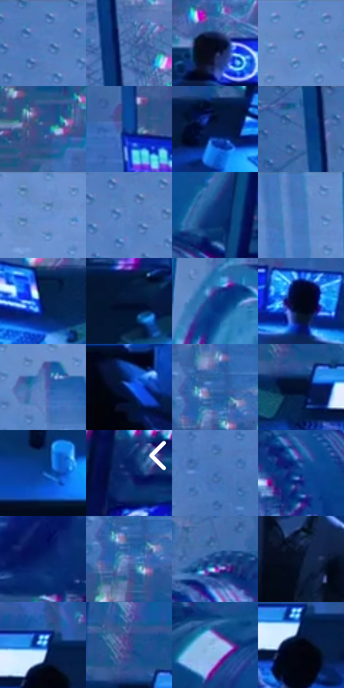

# 电影参考 133

- 状态：常规／活跃；来源世界：miles-home。
- 视角：high-angle；景别：environment-wide；场景：industrial。
- 时段：interior-time-unknown（外观依据，中置信度；具体时间／晨昏未知）；光照：cool-interior。
- 材质候选：skin, fabric, metal, glass, screen, plastic（帧级，不是像素分割）。
- 明暗组：dark；L* P5/P50/P95：2.61106 / 36.6618 / 59.11397。
- 资格门禁：无附加门禁。
- 原截图 SHA-256：`879ab35aa61f9395fd6bf59c0b46124cc24a57bc1fe80d67421fcbc2d427514b`；尺寸：2880 × 1198。
- sRGB 像素 SHA-256：`4a4569fe06aa9aac1dbdf90ec9f8c77ff1e1e379f10f9bbc0befad3bce4bc6ee`。

## 观察与迁移

控制室蓝屏、深暗人物与玻璃隔墙，显示不等于反射。

本公开版保存32个128×128原像素色卡上下文；图集格子并非原场景相邻位置。原rect、图集tile和像素SHA见 `data/palette-crops.json`。上下文不足时不得批准替色，不能以小样推断完整构图。

## 实测色卡

颜色比例分母为保留采样像素，不是材料面积；全部 32 色参与全库匹配。表内四舍五入仅用于阅读，原精度在 JSON。

| ID | HEX | Lab | 原图 xy | 像素数 | 比例 | 明度角色 |
| --- | --- | --- | --- | ---: | ---: | --- |
| 133-S01 | #507CBC | [51.553167, 4.167264, -38.181444] | [844, 28] | 10271 | 5.331485% | midtone |
| 133-S02 | #3B5E9D | [40.194072, 7.845013, -38.073724] | [696, 436] | 9208 | 4.779702% | midtone |
| 133-S03 | #030B1D | [3.137735, 1.996483, -11.624566] | [796, 748] | 9183 | 4.766725% | deep-shadow |
| 133-S04 | #6389C6 | [56.702612, 3.880879, -35.729466] | [1956, 60] | 9160 | 4.754786% | midtone |
| 133-S05 | #285796 | [36.870804, 6.454248, -39.213013] | [1520, 636] | 8597 | 4.462543% | shadow |
| 133-S06 | #12499A | [32.314969, 15.009112, -48.990528] | [1212, 660] | 8003 | 4.154209% | shadow |
| 133-S07 | #061946 | [10.378829, 12.48309, -30.368558] | [2680, 804] | 7481 | 3.883248% | deep-shadow |
| 133-S08 | #436CAB | [45.438024, 5.531469, -38.016411] | [616, 52] | 7180 | 3.727005% | midtone |
| 133-S09 | #6B90CE | [59.458585, 4.130738, -35.898314] | [1492, 32] | 7176 | 3.724928% | midtone |
| 133-S10 | #5885C5 | [54.947491, 3.430286, -37.954909] | [920, 96] | 6695 | 3.475250% | midtone |
| 133-S11 | #0A3476 | [23.093927, 13.989993, -41.605047] | [2796, 84] | 6492 | 3.369877% | shadow |
| 133-S12 | #4477BD | [49.610904, 5.185308, -41.859926] | [1124, 28] | 6450 | 3.348075% | midtone |
| 133-S13 | #092256 | [14.809889, 13.142613, -34.125327] | [516, 804] | 6315 | 3.277999% | deep-shadow |
| 133-S14 | #061738 | [8.454242, 7.520066, -23.558073] | [88, 804] | 6195 | 3.215709% | deep-shadow |
| 133-S15 | #083682 | [24.642066, 17.58779, -46.672075] | [2332, 264] | 6125 | 3.179374% | shadow |
| 133-S16 | #020716 | [2.012192, 1.39445, -7.814446] | [2064, 784] | 6082 | 3.157053% | deep-shadow |
| 133-S17 | #5D7FBC | [53.097047, 5.285893, -35.70753] | [1300, 220] | 5862 | 3.042855% | midtone |
| 133-S18 | #1C5ED1 | [42.541507, 23.657639, -64.78584] | [2812, 960] | 5725 | 2.971741% | midtone |
| 133-S19 | #3064AA | [42.221033, 6.851354, -42.587251] | [1312, 472] | 5608 | 2.911009% | midtone |
| 133-S20 | #04132B | [6.014863, 3.518538, -17.928229] | [2316, 776] | 5575 | 2.893879% | deep-shadow |
| 133-S21 | #1854AC | [36.951626, 15.349284, -52.271607] | [1516, 856] | 5330 | 2.766704% | shadow |
| 133-S22 | #102B6D | [19.808096, 17.172525, -41.162522] | [2804, 628] | 5212 | 2.705452% | deep-shadow |
| 133-S23 | #3B6CB1 | [45.397164, 6.148937, -41.612481] | [956, 408] | 5172 | 2.684689% | midtone |
| 133-S24 | #0B3F8F | [28.401931, 16.902669, -48.627684] | [2588, 232] | 4532 | 2.352477% | shadow |
| 133-S25 | #082366 | [16.565271, 19.356289, -41.905377] | [2628, 640] | 4458 | 2.314065% | deep-shadow |
| 133-S26 | #5B6BAD | [46.652099, 12.277837, -37.177321] | [1308, 512] | 4362 | 2.264233% | midtone |
| 133-S27 | #183F85 | [27.958088, 13.792215, -43.14463] | [2468, 164] | 4064 | 2.109547% | shadow |
| 133-S28 | #030D26 | [4.038417, 4.352071, -17.248867] | [1812, 868] | 4042 | 2.098127% | deep-shadow |
| 133-S29 | #3995ED | [60.316036, 2.607386, -51.947524] | [2500, 764] | 3702 | 1.921639% | light |
| 133-S30 | #424089 | [30.950701, 22.041317, -40.675468] | [2296, 704] | 3379 | 1.753976% | shadow |
| 133-S31 | #9DC0EE | [76.702054, -0.905674, -26.590978] | [180, 164] | 3225 | 1.674038% | light |
| 133-S32 | #010511 | [1.404112, 0.826492, -5.464817] | [2508, 804] | 1787 | 0.927599% | deep-shadow |

## 色阶与空间分布

- 采样 ROI：`[0.01, 0.02, 0.98, 0.94]`；步长：4；样本数：192648。
- 排除区：`[]`。
- 深暗、暗、中、亮、高光五段计数：`[54267, 54146, 76980, 6125, 1130]`。
- RGB 各 256 箱、L* 100 箱、13×5 色相明度表和 3×3 空间统计全部保存在 [总数据](../film-library.json)。
- [可视化档案](../../references/library.html)按需绘制直方图，不存 2,094 张重复图表图片。

## 纹理特征占比

**这是分块图像特征的面积占比，不是波点／排线／丝网／错版的精确语义覆盖率。** 窗格、发丝、织物也会产生方向或周期特征。
原图 ROI 像素 3081782；已测块覆盖 3081782（100.0000%）；未测 0。

| 特征 | 块覆盖像素 | 占已测面积 | 阈值敏感范围 |
| --- | ---: | ---: | --- |
| low-contrast | 105984 | 3.4390% | 2.7828% ~ 4.9551% |
| directional-structure | 422454 | 13.7081% | 7.5883% ~ 20.9476% |
| periodic-structure | 2094592 | 67.9669% | 62.7519% ~ 69.3583% |
| mixed-detail | 458752 | 14.8859% | 6.9113% ~ 24.7047% |

阈值敏感范围不是统计置信区间。逐块坐标、尺度、对比、方向一致性、频谱集中度、频率与角度见 [全量特征记录](../texture-features.jsonl)，以帧号定位。
四种印刷层的真实像素覆盖仍标为 `null`，不能填 0，也不能拿上表代替。不得据这些代理测量删除唯一证据。

[测量方法与保留策略](../../references/library-retention.md) · [分类索引](../archive/README.md)
