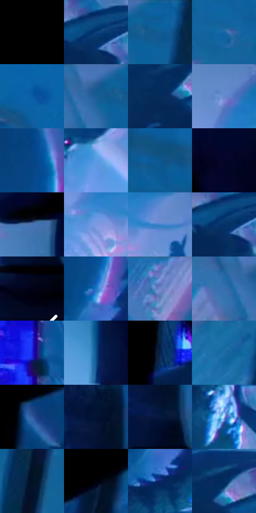

# 电影参考 134

- 状态：常规／活跃；来源世界：miles-home。
- 视角：low-angle；景别：medium；场景：industrial。
- 时段：interior-time-unknown（外观依据，中置信度；具体时间／晨昏未知）；光照：cool-interior。
- 材质候选：skin, fabric, metal, glass, screen, plastic（帧级，不是像素分割）。
- 明暗组：dark；L* P5/P50/P95：0.0 / 26.2783 / 62.23461。
- 资格门禁：无附加门禁。
- 原截图 SHA-256：`4c2c56b2350fd7c6db80950f25664528739af049a39525344d1dc568ac6666fd`；尺寸：2880 × 1206。
- sRGB 像素 SHA-256：`78f01e6d466a19cb7dd0a153282f6a90ebb4b566056f99b7744c06cfbfa8d669`。

## 观察与迁移

控制室蓝屏、深暗人物与玻璃隔墙，显示不等于反射。

本公开版保存32个128×128原像素色卡上下文；图集格子并非原场景相邻位置。原rect、图集tile和像素SHA见 `data/palette-crops.json`。上下文不足时不得批准替色，不能以小样推断完整构图。

## 实测色卡

颜色比例分母为保留采样像素，不是材料面积；全部 32 色参与全库匹配。表内四舍五入仅用于阅读，原精度在 JSON。

| ID | HEX | Lab | 原图 xy | 像素数 | 比例 | 明度角色 |
| --- | --- | --- | --- | ---: | ---: | --- |
| 134-S01 | #000000 | [0.0, 0.0, 0.0] | [32, 28] | 57184 | 29.575993% | deep-shadow |
| 134-S02 | #0B3F77 | [26.612833, 6.667889, -36.555582] | [1492, 272] | 8277 | 4.280926% | shadow |
| 134-S03 | #0D619B | [39.580548, -0.77307, -37.940533] | [1836, 56] | 7109 | 3.676828% | shadow |
| 134-S04 | #1365A3 | [41.356498, 0.288394, -39.873001] | [2276, 176] | 6463 | 3.342712% | midtone |
| 134-S05 | #0C5AA4 | [37.966509, 7.341148, -45.890231] | [2728, 104] | 6296 | 3.256338% | shadow |
| 134-S06 | #195E96 | [38.573274, 0.071967, -36.530737] | [1752, 64] | 6274 | 3.244960% | shadow |
| 134-S07 | #062B5B | [18.015089, 8.290486, -32.282319] | [1340, 264] | 6244 | 3.229444% | deep-shadow |
| 134-S08 | #6388CB | [56.654833, 6.012027, -38.631824] | [2044, 628] | 6125 | 3.167896% | midtone |
| 134-S09 | #064586 | [29.450851, 8.606241, -41.376203] | [1080, 552] | 5959 | 3.082039% | shadow |
| 134-S10 | #589CE3 | [62.839401, -0.257043, -42.366269] | [1628, 688] | 5742 | 2.969805% | light |
| 134-S11 | #0A5692 | [35.584977, 2.457945, -38.888917] | [2532, 132] | 5545 | 2.867916% | shadow |
| 134-S12 | #030527 | [2.477921, 8.07576, -20.447625] | [2612, 748] | 5369 | 2.776887% | deep-shadow |
| 134-S13 | #4672AF | [47.534038, 3.811373, -37.033132] | [2488, 844] | 5328 | 2.755682% | midtone |
| 134-S14 | #7C9AE3 | [64.112376, 8.67306, -40.240844] | [2052, 756] | 4785 | 2.474838% | light |
| 134-S15 | #4384CC | [54.083254, 2.380776, -43.350065] | [2156, 736] | 4680 | 2.420531% | midtone |
| 134-S16 | #053368 | [21.575235, 8.162877, -35.071119] | [1484, 288] | 4677 | 2.418979% | shadow |
| 134-S17 | #020315 | [1.193711, 2.756577, -8.306219] | [2808, 528] | 4630 | 2.394671% | deep-shadow |
| 134-S18 | #1E71C7 | [47.245497, 7.685681, -51.447308] | [1096, 704] | 4571 | 2.364155% | midtone |
| 134-S19 | #5A74BB | [49.79888, 10.915869, -40.337087] | [1480, 28] | 4411 | 2.281402% | midtone |
| 134-S20 | #336FAE | [45.807607, 1.89218, -39.229674] | [1688, 80] | 4033 | 2.085898% | midtone |
| 134-S21 | #1D23DC | [30.945487, 61.836013, -90.207181] | [2148, 1132] | 3879 | 2.006248% | shadow |
| 134-S22 | #14518F | [34.015396, 5.229639, -39.56413] | [2536, 1104] | 3833 | 1.982456% | shadow |
| 134-S23 | #06234B | [14.10791, 6.999359, -27.786918] | [656, 1072] | 3818 | 1.974698% | deep-shadow |
| 134-S24 | #1A6BA6 | [43.48729, -1.711927, -38.255834] | [1760, 316] | 3058 | 1.581621% | midtone |
| 134-S25 | #315BA1 | [39.082609, 9.428754, -42.258429] | [704, 752] | 2750 | 1.422321% | shadow |
| 134-S26 | #021232 | [6.103446, 7.151808, -22.988013] | [2800, 312] | 2606 | 1.347843% | deep-shadow |
| 134-S27 | #04173D | [8.784435, 9.545055, -26.614144] | [2816, 420] | 2581 | 1.334913% | deep-shadow |
| 134-S28 | #A4BBF4 | [76.046335, 5.263819, -30.789665] | [1564, 444] | 2359 | 1.220092% | light |
| 134-S29 | #031025 | [4.728201, 2.421355, -15.412232] | [1888, 252] | 1769 | 0.914940% | deep-shadow |
| 134-S30 | #010106 | [0.373108, 0.695202, -1.892085] | [848, 644] | 1112 | 0.575135% | deep-shadow |
| 134-S31 | #102070 | [17.048566, 26.293937, -47.624899] | [1096, 812] | 999 | 0.516690% | deep-shadow |
| 134-S32 | #022C60 | [18.620085, 9.421353, -34.618767] | [1384, 220] | 880 | 0.455143% | deep-shadow |

## 色阶与空间分布

- 采样 ROI：`[0.01, 0.02, 0.98, 0.94]`；步长：4；样本数：193346。
- 排除区：`[]`。
- 深暗、暗、中、亮、高光五段计数：`[87045, 48832, 44918, 11914, 637]`。
- RGB 各 256 箱、L* 100 箱、13×5 色相明度表和 3×3 空间统计全部保存在 [总数据](../film-library.json)。
- [可视化档案](../../references/library.html)按需绘制直方图，不存 2,094 张重复图表图片。

## 纹理特征占比

**这是分块图像特征的面积占比，不是波点／排线／丝网／错版的精确语义覆盖率。** 窗格、发丝、织物也会产生方向或周期特征。
原图 ROI 像素 3098546；已测块覆盖 3098546（100.0000%）；未测 0。

| 特征 | 块覆盖像素 | 占已测面积 | 阈值敏感范围 |
| --- | ---: | ---: | --- |
| low-contrast | 1021618 | 32.9709% | 32.4421% ~ 35.4329% |
| directional-structure | 554112 | 17.8830% | 10.3068% ~ 25.6368% |
| periodic-structure | 1473664 | 47.5599% | 41.3923% ~ 52.1452% |
| mixed-detail | 49152 | 1.5863% | 0.5288% ~ 2.1151% |

阈值敏感范围不是统计置信区间。逐块坐标、尺度、对比、方向一致性、频谱集中度、频率与角度见 [全量特征记录](../texture-features.jsonl)，以帧号定位。
四种印刷层的真实像素覆盖仍标为 `null`，不能填 0，也不能拿上表代替。不得据这些代理测量删除唯一证据。

[测量方法与保留策略](../../references/library-retention.md) · [分类索引](../archive/README.md)
