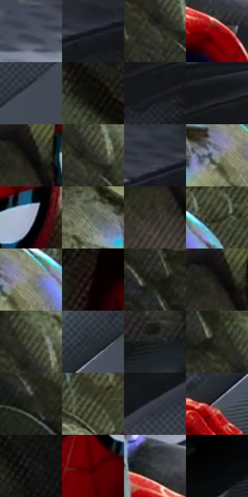

# 电影参考 135

- 状态：常规／活跃；来源世界：miles-home。
- 视角：high-angle；景别：medium；场景：detail。
- 时段：daylight-time-unspecified（外观依据，中置信度；具体时间／晨昏未知）；光照：neutral-day。
- 材质候选：fabric, stone（帧级，不是像素分割）。
- 明暗组：very-dark；L* P5/P50/P95：3.25937 / 19.25192 / 59.77933。
- 资格门禁：无附加门禁。
- 原截图 SHA-256：`9c4a7e6de6e40579fb970e8121bf0acfebbf1f7a5c0f9a9e648f2b0a99d3bf1a`；尺寸：2880 × 1198。
- sRGB 像素 SHA-256：`8f14d47809622f0950e494e0727386049ca3c29ac4580dbf1eab624842722165`。

## 观察与迁移

服装与粗糙起伏表面接触，几何和肌理分开。

本公开版保存32个128×128原像素色卡上下文；图集格子并非原场景相邻位置。原rect、图集tile和像素SHA见 `data/palette-crops.json`。上下文不足时不得批准替色，不能以小样推断完整构图。

## 实测色卡

颜色比例分母为保留采样像素，不是材料面积；全部 32 色参与全库匹配。表内四舍五入仅用于阅读，原精度在 JSON。

| ID | HEX | Lab | 原图 xy | 像素数 | 比例 | 明度角色 |
| --- | --- | --- | --- | ---: | ---: | --- |
| 135-S01 | #464E5A | [32.89488, -0.226451, -8.111962] | [1948, 48] | 10729 | 5.569225% | shadow |
| 135-S02 | #1F2229 | [13.202259, 0.573175, -5.130855] | [2472, 24] | 9012 | 4.677962% | deep-shadow |
| 135-S03 | #3D3E33 | [25.7922, -2.746919, 6.638793] | [636, 320] | 8320 | 4.318758% | shadow |
| 135-S04 | #83030A | [26.488139, 48.4834, 35.112006] | [2012, 420] | 7669 | 3.980836% | shadow |
| 135-S05 | #404955 | [30.666162, -0.567858, -8.325353] | [2780, 484] | 7633 | 3.962149% | shadow |
| 135-S06 | #13120F | [5.469943, -0.183874, 1.727005] | [288, 276] | 7379 | 3.830302% | deep-shadow |
| 135-S07 | #161719 | [7.710005, 0.058254, -1.57406] | [2720, 152] | 7183 | 3.728562% | deep-shadow |
| 135-S08 | #171A1F | [9.155748, 0.024074, -3.943308] | [2764, 40] | 7092 | 3.681326% | deep-shadow |
| 135-S09 | #0D0D0C | [3.612795, -0.159744, 0.434569] | [1160, 408] | 7030 | 3.649142% | deep-shadow |
| 135-S10 | #292823 | [16.056113, -0.675661, 3.458776] | [664, 300] | 6661 | 3.457601% | deep-shadow |
| 135-S11 | #30363F | [22.392584, -0.175248, -6.461541] | [2360, 36] | 6434 | 3.339770% | shadow |
| 135-S12 | #8A8F92 | [59.088311, -1.215362, -2.220821] | [928, 124] | 6338 | 3.289938% | midtone |
| 135-S13 | #A1ACC3 | [70.190937, 0.975732, -13.018544] | [1496, 452] | 6181 | 3.208442% | light |
| 135-S14 | #666D61 | [45.11636, -5.123758, 5.795699] | [740, 156] | 6094 | 3.163282% | midtone |
| 135-S15 | #302E29 | [18.981625, -0.204106, 3.545759] | [1140, 504] | 6060 | 3.145633% | deep-shadow |
| 135-S16 | #363829 | [22.905459, -3.994719, 9.120923] | [1068, 68] | 5998 | 3.113450% | shadow |
| 135-S17 | #807F70 | [52.881541, -2.433563, 8.301622] | [976, 108] | 5882 | 3.053237% | midtone |
| 135-S18 | #0D0403 | [1.616836, 2.282326, 1.231743] | [776, 1016] | 5649 | 2.932291% | deep-shadow |
| 135-S19 | #1D1B16 | [9.821777, -0.175877, 3.821049] | [468, 168] | 5563 | 2.887650% | deep-shadow |
| 135-S20 | #171614 | [7.284969, -0.001802, 1.447684] | [1144, 408] | 5546 | 2.878826% | deep-shadow |
| 135-S21 | #4A4A3B | [31.041766, -2.995355, 8.991483] | [652, 248] | 5472 | 2.840414% | shadow |
| 135-S22 | #272C32 | [17.750135, -0.582886, -4.606127] | [2560, 600] | 5376 | 2.790582% | deep-shadow |
| 135-S23 | #1D1E1F | [11.196076, -0.21178, -0.846355] | [1660, 852] | 5255 | 2.727773% | deep-shadow |
| 135-S24 | #26241E | [14.217011, -0.40234, 4.352223] | [592, 236] | 5169 | 2.683132% | deep-shadow |
| 135-S25 | #22241B | [13.715181, -2.991592, 5.725776] | [252, 60] | 5112 | 2.653544% | deep-shadow |
| 135-S26 | #5A5C49 | [38.391536, -4.491751, 10.700174] | [1196, 148] | 4794 | 2.488476% | shadow |
| 135-S27 | #3A4047 | [26.794978, -0.739659, -5.097012] | [2740, 348] | 4372 | 2.269424% | shadow |
| 135-S28 | #4D545C | [35.382373, -0.883478, -5.590242] | [2388, 784] | 4355 | 2.260600% | shadow |
| 135-S29 | #121315 | [5.857664, 0.052625, -1.370392] | [600, 564] | 4260 | 2.211287% | deep-shadow |
| 135-S30 | #490205 | [12.424474, 31.849551, 17.412829] | [1376, 556] | 4215 | 2.187928% | deep-shadow |
| 135-S31 | #414647 | [29.308795, -1.818147, -1.307405] | [1900, 312] | 3102 | 1.610191% | shadow |
| 135-S32 | #040407 | [1.156054, 0.417062, -1.135139] | [1408, 848] | 2713 | 1.408268% | deep-shadow |

## 色阶与空间分布

- 采样 ROI：`[0.01, 0.02, 0.98, 0.94]`；步长：4；样本数：192648。
- 排除区：`[]`。
- 深暗、暗、中、亮、高光五段计数：`[99186, 67888, 16118, 9039, 417]`。
- RGB 各 256 箱、L* 100 箱、13×5 色相明度表和 3×3 空间统计全部保存在 [总数据](../film-library.json)。
- [可视化档案](../../references/library.html)按需绘制直方图，不存 2,094 张重复图表图片。

## 纹理特征占比

**这是分块图像特征的面积占比，不是波点／排线／丝网／错版的精确语义覆盖率。** 窗格、发丝、织物也会产生方向或周期特征。
原图 ROI 像素 3081782；已测块覆盖 3081782（100.0000%）；未测 0。

| 特征 | 块覆盖像素 | 占已测面积 | 阈值敏感范围 |
| --- | ---: | ---: | --- |
| low-contrast | 102784 | 3.3352% | 2.2719% ~ 4.1036% |
| directional-structure | 689462 | 22.3722% | 13.8327% ~ 33.8648% |
| periodic-structure | 2138240 | 69.3832% | 63.8633% ~ 70.2430% |
| mixed-detail | 151296 | 4.9094% | 0.0000% ~ 11.8207% |

阈值敏感范围不是统计置信区间。逐块坐标、尺度、对比、方向一致性、频谱集中度、频率与角度见 [全量特征记录](../texture-features.jsonl)，以帧号定位。
四种印刷层的真实像素覆盖仍标为 `null`，不能填 0，也不能拿上表代替。不得据这些代理测量删除唯一证据。

[测量方法与保留策略](../../references/library-retention.md) · [分类索引](../archive/README.md)
