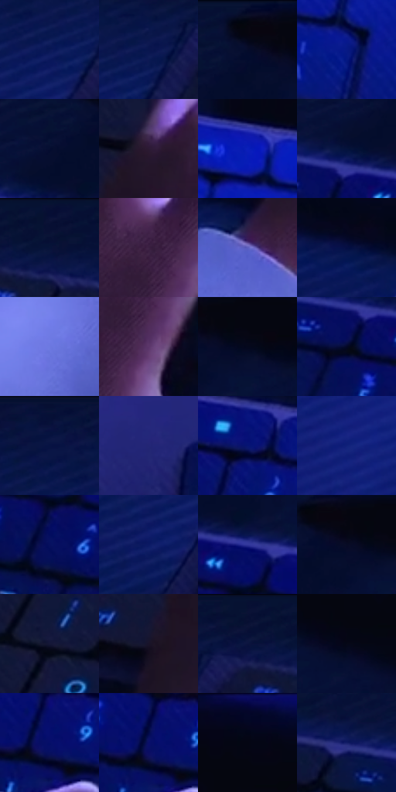

# 电影参考 136

- 状态：常规／活跃；来源世界：miles-home。
- 视角：high-angle；景别：detail；场景：industrial。
- 时段：interior-time-unknown（外观依据，中置信度；具体时间／晨昏未知）；光照：cool-interior。
- 材质候选：skin, fabric, metal, glass, screen, plastic（帧级，不是像素分割）。
- 明暗组：very-dark；L* P5/P50/P95：1.86815 / 11.07259 / 44.30916。
- 资格门禁：无附加门禁。
- 原截图 SHA-256：`1c4f48e7e6410ebdce664d1c3698965eabe94ca6c5ed667c919f70db1db9a9e5`；尺寸：2880 × 1206。
- sRGB 像素 SHA-256：`bc24681c31f5044ae52f90e82a120e9d81bde903b6e227a5b269e598c3375f1f`。

## 观察与迁移

控制室蓝屏、深暗人物与玻璃隔墙，显示不等于反射。

本公开版保存32个128×128原像素色卡上下文；图集格子并非原场景相邻位置。原rect、图集tile和像素SHA见 `data/palette-crops.json`。上下文不足时不得批准替色，不能以小样推断完整构图。

## 实测色卡

颜色比例分母为保留采样像素，不是材料面积；全部 32 色参与全库匹配。表内四舍五入仅用于阅读，原精度在 JSON。

| ID | HEX | Lab | 原图 xy | 像素数 | 比例 | 明度角色 |
| --- | --- | --- | --- | ---: | ---: | --- |
| 136-S01 | #091757 | [11.679841, 21.847044, -39.922694] | [560, 152] | 17359 | 8.978205% | deep-shadow |
| 136-S02 | #09154E | [10.139328, 19.494848, -36.307077] | [612, 112] | 14725 | 7.615880% | deep-shadow |
| 136-S03 | #050610 | [1.805793, 1.277754, -4.281477] | [1400, 28] | 11734 | 6.068913% | deep-shadow |
| 136-S04 | #071985 | [17.613481, 38.207491, -60.125393] | [2332, 656] | 11489 | 5.942197% | deep-shadow |
| 136-S05 | #060D30 | [4.876613, 9.797432, -23.458118] | [1336, 112] | 9574 | 4.951745% | deep-shadow |
| 136-S06 | #2C1A34 | [12.748666, 14.758169, -13.62802] | [744, 436] | 8956 | 4.632110% | deep-shadow |
| 136-S07 | #0A1FBA | [25.527538, 52.833702, -79.365838] | [2336, 380] | 8339 | 4.312993% | shadow |
| 136-S08 | #05123C | [7.144754, 13.135326, -28.564508] | [1304, 160] | 8251 | 4.267479% | deep-shadow |
| 136-S09 | #0D1439 | [7.959436, 11.657246, -25.060227] | [804, 28] | 8054 | 4.165589% | deep-shadow |
| 136-S10 | #3C2144 | [17.763261, 20.026899, -16.872674] | [932, 484] | 7557 | 3.908537% | deep-shadow |
| 136-S11 | #5E5FBE | [44.632612, 25.778885, -50.283365] | [564, 808] | 7171 | 3.708895% | midtone |
| 136-S12 | #040E44 | [6.838417, 19.581409, -34.767455] | [420, 732] | 6239 | 3.226858% | deep-shadow |
| 136-S13 | #6D79E0 | [54.349953, 23.792609, -54.075566] | [472, 1128] | 6120 | 3.165310% | midtone |
| 136-S14 | #5B366A | [29.167013, 26.557102, -23.875701] | [956, 572] | 6050 | 3.129105% | shadow |
| 136-S15 | #04081D | [2.602811, 3.469877, -12.41906] | [1492, 84] | 5685 | 2.940325% | deep-shadow |
| 136-S16 | #030826 | [3.00708, 6.458952, -18.852746] | [1276, 232] | 5525 | 2.857571% | deep-shadow |
| 136-S17 | #0C1645 | [9.652424, 15.186125, -30.840328] | [488, 56] | 5139 | 2.657929% | deep-shadow |
| 136-S18 | #232675 | [20.153282, 26.323415, -45.712518] | [2636, 836] | 5115 | 2.645516% | shadow |
| 136-S19 | #071473 | [14.303136, 34.628438, -54.118385] | [1908, 336] | 4642 | 2.400877% | deep-shadow |
| 136-S20 | #10207A | [18.132967, 30.225491, -52.271812] | [964, 1084] | 4047 | 2.093139% | deep-shadow |
| 136-S21 | #06105F | [10.814261, 29.566495, -46.744834] | [1376, 316] | 3559 | 1.840741% | deep-shadow |
| 136-S22 | #0A1964 | [13.706365, 25.862417, -45.28342] | [504, 252] | 3504 | 1.812295% | deep-shadow |
| 136-S23 | #31379B | [28.775237, 31.008354, -55.302172] | [1392, 200] | 3397 | 1.756954% | shadow |
| 136-S24 | #080B24 | [3.7784, 5.757285, -16.091292] | [1440, 76] | 3332 | 1.723335% | deep-shadow |
| 136-S25 | #151737 | [9.384733, 10.309775, -21.286262] | [800, 244] | 3139 | 1.623514% | deep-shadow |
| 136-S26 | #19132A | [7.583645, 9.758974, -14.597084] | [628, 632] | 2840 | 1.468869% | deep-shadow |
| 136-S27 | #0B133F | [8.08974, 14.740984, -29.153848] | [720, 64] | 2735 | 1.414562% | deep-shadow |
| 136-S28 | #060717 | [2.280951, 2.690077, -8.125289] | [1620, 120] | 2397 | 1.239746% | deep-shadow |
| 136-S29 | #040E69 | [11.684479, 34.276103, -51.942658] | [1760, 396] | 2269 | 1.173544% | deep-shadow |
| 136-S30 | #080F6A | [12.178435, 34.264631, -51.774576] | [1744, 388] | 1803 | 0.932525% | deep-shadow |
| 136-S31 | #020617 | [1.851638, 2.04464, -8.780162] | [1796, 52] | 1369 | 0.708057% | deep-shadow |
| 136-S32 | #141D67 | [15.520296, 25.166119, -44.25847] | [1072, 140] | 1231 | 0.636682% | deep-shadow |

## 色阶与空间分布

- 采样 ROI：`[0.01, 0.02, 0.98, 0.94]`；步长：4；样本数：193346。
- 排除区：`[]`。
- 深暗、暗、中、亮、高光五段计数：`[156915, 24292, 11557, 542, 40]`。
- RGB 各 256 箱、L* 100 箱、13×5 色相明度表和 3×3 空间统计全部保存在 [总数据](../film-library.json)。
- [可视化档案](../../references/library.html)按需绘制直方图，不存 2,094 张重复图表图片。

## 纹理特征占比

**这是分块图像特征的面积占比，不是波点／排线／丝网／错版的精确语义覆盖率。** 窗格、发丝、织物也会产生方向或周期特征。
原图 ROI 像素 3098546；已测块覆盖 3098546（100.0000%）；未测 0。

| 特征 | 块覆盖像素 | 占已测面积 | 阈值敏感范围 |
| --- | ---: | ---: | --- |
| low-contrast | 537728 | 17.3542% | 11.8931% ~ 21.7578% |
| directional-structure | 594816 | 19.1966% | 6.5187% ~ 38.2503% |
| periodic-structure | 1873202 | 60.4542% | 48.9768% ~ 65.2957% |
| mixed-detail | 92800 | 2.9950% | 0.8799% ~ 6.4278% |

阈值敏感范围不是统计置信区间。逐块坐标、尺度、对比、方向一致性、频谱集中度、频率与角度见 [全量特征记录](../texture-features.jsonl)，以帧号定位。
四种印刷层的真实像素覆盖仍标为 `null`，不能填 0，也不能拿上表代替。不得据这些代理测量删除唯一证据。

[测量方法与保留策略](../../references/library-retention.md) · [分类索引](../archive/README.md)
