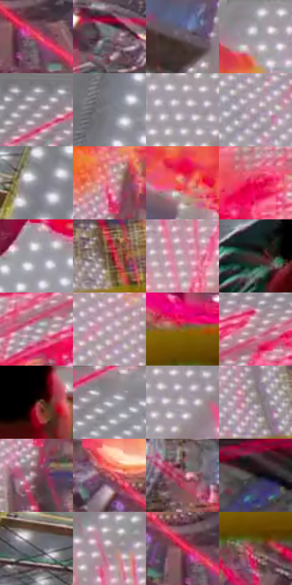

# 电影参考 137

- 状态：条件／活跃；来源世界：miles-home。
- 视角：low-angle；景别：environment-wide；场景：industrial。
- 时段：event-time-unknown（外观依据，中置信度；具体时间／晨昏未知）；光照：event-light。
- 材质候选：metal, glass, fabric（帧级，不是像素分割）。
- 明暗组：middle；L* P5/P50/P95：24.32398 / 56.78469 / 78.19914。
- 资格门禁：energy。
- 原截图 SHA-256：`385b46e5dc2ebe4ca01588ff35211e54f8c50927a3ed40af2aa48e7a4743a8d1`；尺寸：2880 × 1204。
- sRGB 像素 SHA-256：`e8c8f8ff4b3112bcaff95a39a571a57d2bf27d6d24843ff3a45af0675da95f90`。

## 观察与迁移

红橙能量线和点阵墙，非普通灯照参考。

本公开版保存32个128×128原像素色卡上下文；图集格子并非原场景相邻位置。原rect、图集tile和像素SHA见 `data/palette-crops.json`。上下文不足时不得批准替色，不能以小样推断完整构图。

## 实测色卡

颜色比例分母为保留采样像素，不是材料面积；全部 32 色参与全库匹配。表内四舍五入仅用于阅读，原精度在 JSON。

| ID | HEX | Lab | 原图 xy | 像素数 | 比例 | 明度角色 |
| --- | --- | --- | --- | ---: | ---: | --- |
| 137-S01 | #E34458 | [53.140098, 62.098079, 24.813473] | [2292, 908] | 10291 | 5.341867% | midtone |
| 137-S02 | #706C71 | [46.126292, 2.563165, -2.22715] | [2520, 616] | 9720 | 5.045472% | midtone |
| 137-S03 | #655660 | [38.317418, 8.090983, -3.489247] | [1340, 536] | 9410 | 4.884556% | shadow |
| 137-S04 | #A5A3AC | [67.406025, 2.451324, -4.388405] | [1216, 44] | 8594 | 4.460986% | light |
| 137-S05 | #98949D | [61.903237, 3.210887, -4.204212] | [2612, 44] | 7672 | 3.982393% | light |
| 137-S06 | #7E7E86 | [53.035265, 1.637237, -4.322787] | [460, 372] | 7556 | 3.922179% | midtone |
| 137-S07 | #A59BA4 | [65.059743, 5.323784, -3.374405] | [1564, 36] | 7092 | 3.681326% | light |
| 137-S08 | #C1B1BB | [73.785032, 7.490128, -3.009429] | [1556, 936] | 6805 | 3.532349% | light |
| 137-S09 | #8E8C96 | [58.703894, 2.729263, -5.038448] | [220, 320] | 6791 | 3.525082% | midtone |
| 137-S10 | #E1879B | [66.294224, 36.799245, 4.246495] | [1928, 728] | 6716 | 3.486151% | light |
| 137-S11 | #EE6B70 | [61.539612, 50.934567, 22.316535] | [1416, 412] | 6715 | 3.485632% | light |
| 137-S12 | #E80D4D | [49.477858, 75.349296, 26.882442] | [1980, 424] | 6395 | 3.319526% | midtone |
| 137-S13 | #9D9CA5 | [64.693024, 2.119844, -4.551577] | [800, 228] | 6230 | 3.233877% | light |
| 137-S14 | #62402E | [30.547662, 12.517127, 17.008049] | [1964, 1000] | 6144 | 3.189236% | shadow |
| 137-S15 | #BD99A5 | [66.762999, 15.341837, -1.179641] | [1804, 220] | 6063 | 3.147191% | light |
| 137-S16 | #413A39 | [25.09246, 2.835593, 1.729598] | [348, 1028] | 5824 | 3.023130% | shadow |
| 137-S17 | #B7A7B0 | [70.063518, 7.385996, -2.524441] | [2288, 280] | 5802 | 3.011710% | light |
| 137-S18 | #D0C4CE | [80.374002, 5.97125, -3.481217] | [1560, 776] | 5591 | 2.902184% | highlight |
| 137-S19 | #86652A | [45.003144, 6.678799, 37.53665] | [2196, 1044] | 5406 | 2.806154% | midtone |
| 137-S20 | #AD8C97 | [61.546849, 14.293719, -1.101688] | [2372, 204] | 5291 | 2.746460% | light |
| 137-S21 | #582B2A | [23.572522, 20.529507, 10.074802] | [524, 1004] | 5081 | 2.637453% | shadow |
| 137-S22 | #9A99A2 | [63.558034, 2.128054, -4.567578] | [2812, 60] | 5069 | 2.631224% | light |
| 137-S23 | #E6DCE3 | [88.712132, 4.634261, -2.199105] | [1616, 80] | 5040 | 2.616170% | highlight |
| 137-S24 | #8F8386 | [55.880721, 5.080996, 0.02848] | [1836, 1004] | 4921 | 2.554400% | midtone |
| 137-S25 | #8B6A73 | [48.304817, 14.642039, 0.081664] | [1932, 832] | 4864 | 2.524812% | midtone |
| 137-S26 | #C16772 | [54.297135, 36.977173, 10.155993] | [2172, 812] | 4829 | 2.506644% | midtone |
| 137-S27 | #9E485C | [42.274583, 37.80025, 5.653145] | [2592, 860] | 4423 | 2.295897% | midtone |
| 137-S28 | #201C1B | [10.680277, 1.706288, 1.39644] | [2764, 420] | 4415 | 2.291745% | deep-shadow |
| 137-S29 | #505157 | [34.556083, 0.93899, -3.644184] | [128, 764] | 4358 | 2.262157% | shadow |
| 137-S30 | #9C8A8E | [59.157499, 7.467399, 0.34939] | [1780, 96] | 3952 | 2.051410% | midtone |
| 137-S31 | #BE2444 | [42.199857, 60.317167, 21.390898] | [2252, 884] | 2824 | 1.465886% | midtone |
| 137-S32 | #725148 | [37.717966, 12.500986, 10.764816] | [2236, 1124] | 2764 | 1.434741% | shadow |

## 色阶与空间分布

- 采样 ROI：`[0.01, 0.02, 0.98, 0.94]`；步长：4；样本数：192648。
- 排除区：`[]`。
- 深暗、暗、中、亮、高光五段计数：`[6285, 30889, 73268, 74252, 7954]`。
- RGB 各 256 箱、L* 100 箱、13×5 色相明度表和 3×3 空间统计全部保存在 [总数据](../film-library.json)。
- [可视化档案](../../references/library.html)按需绘制直方图，不存 2,094 张重复图表图片。

## 纹理特征占比

**这是分块图像特征的面积占比，不是波点／排线／丝网／错版的精确语义覆盖率。** 窗格、发丝、织物也会产生方向或周期特征。
原图 ROI 像素 3092958；已测块覆盖 3092958（100.0000%）；未测 0。

| 特征 | 块覆盖像素 | 占已测面积 | 阈值敏感范围 |
| --- | ---: | ---: | --- |
| low-contrast | 0 | 0.0000% | 0.0000% ~ 0.0000% |
| directional-structure | 128256 | 4.1467% | 0.0000% ~ 10.1061% |
| periodic-structure | 2872158 | 92.8612% | 88.8345% ~ 93.2999% |
| mixed-detail | 92544 | 2.9921% | 1.0594% ~ 6.7001% |

阈值敏感范围不是统计置信区间。逐块坐标、尺度、对比、方向一致性、频谱集中度、频率与角度见 [全量特征记录](../texture-features.jsonl)，以帧号定位。
四种印刷层的真实像素覆盖仍标为 `null`，不能填 0，也不能拿上表代替。不得据这些代理测量删除唯一证据。

[测量方法与保留策略](../../references/library-retention.md) · [分类索引](../archive/README.md)
