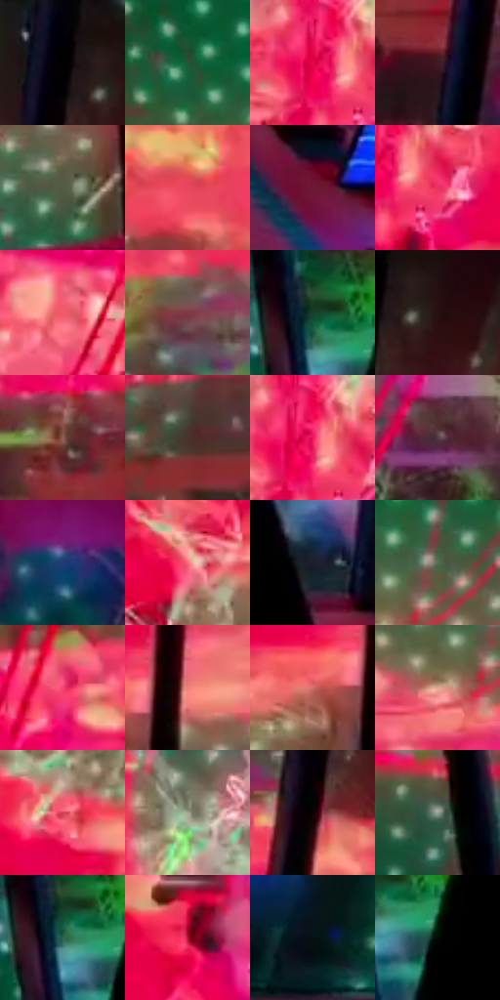

# 电影参考 138

- 状态：条件／活跃；来源世界：miles-home。
- 视角：near-level；景别：environment-wide；场景：industrial。
- 时段：event-time-unknown（外观依据，中置信度；具体时间／晨昏未知）；光照：event-light。
- 材质候选：metal, glass, fabric（帧级，不是像素分割）。
- 明暗组：dark；L* P5/P50/P95：0.0 / 28.25436 / 63.72729。
- 资格门禁：energy。
- 原截图 SHA-256：`b3d022e7c5c88f42398228b29d2d56a3f353637b1349c2a60e4fc314d2942c6b`；尺寸：2880 × 1198。
- sRGB 像素 SHA-256：`37d7851050f315406364cad4d37d4067a581528c398e5fd4d24932c91db08ff5`。

## 观察与迁移

红橙能量线和点阵墙，非普通灯照参考。

本公开版保存32个128×128原像素色卡上下文；图集格子并非原场景相邻位置。原rect、图集tile和像素SHA见 `data/palette-crops.json`。上下文不足时不得批准替色，不能以小样推断完整构图。

## 实测色卡

颜色比例分母为保留采样像素，不是材料面积；全部 32 色参与全库匹配。表内四舍五入仅用于阅读，原精度在 JSON。

| ID | HEX | Lab | 原图 xy | 像素数 | 比例 | 明度角色 |
| --- | --- | --- | --- | ---: | ---: | --- |
| 138-S01 | #000000 | [0.0, 0.0, 0.0] | [2640, 56] | 53730 | 27.890245% | deep-shadow |
| 138-S02 | #1E5837 | [32.986153, -27.438403, 13.716076] | [668, 108] | 7599 | 3.944500% | shadow |
| 138-S03 | #E6034F | [48.832015, 75.767875, 24.753924] | [1416, 212] | 7381 | 3.831340% | midtone |
| 138-S04 | #3D1C25 | [15.256789, 17.337668, 1.239427] | [2508, 696] | 7178 | 3.725967% | deep-shadow |
| 138-S05 | #525A43 | [36.950891, -7.764044, 12.275738] | [1032, 596] | 7041 | 3.654852% | shadow |
| 138-S06 | #E8465B | [54.340313, 63.073593, 24.77537] | [544, 460] | 6533 | 3.391159% | midtone |
| 138-S07 | #6D1735 | [24.070687, 39.391038, 3.839213] | [2644, 1120] | 6086 | 3.159130% | shadow |
| 138-S08 | #ED3062 | [52.955828, 71.732218, 18.925564] | [1480, 240] | 5885 | 3.054794% | midtone |
| 138-S09 | #EF5B6C | [58.900992, 58.132957, 21.097212] | [2232, 432] | 5712 | 2.964993% | midtone |
| 138-S10 | #7F3844 | [33.475629, 31.950027, 7.643695] | [780, 548] | 5709 | 2.963436% | shadow |
| 138-S11 | #15402D | [23.722452, -20.253853, 7.291409] | [416, 832] | 5159 | 2.677941% | shadow |
| 138-S12 | #271112 | [7.912909, 11.592792, 3.904964] | [2704, 92] | 5128 | 2.661850% | deep-shadow |
| 138-S13 | #905E56 | [45.09231, 19.399821, 12.991823] | [2444, 576] | 4973 | 2.581392% | midtone |
| 138-S14 | #47342C | [23.597439, 7.222909, 8.376313] | [476, 616] | 4969 | 2.579316% | shadow |
| 138-S15 | #EA195C | [50.647245, 75.208264, 19.350402] | [1436, 204] | 4619 | 2.397637% | midtone |
| 138-S16 | #563A44 | [27.90529, 14.106574, -1.150095] | [2260, 620] | 4552 | 2.362859% | shadow |
| 138-S17 | #1F3D72 | [26.282964, 8.4035, -33.88147] | [2664, 796] | 4470 | 2.320294% | shadow |
| 138-S18 | #F46C7A | [62.817553, 53.362773, 18.480419] | [1600, 524] | 4446 | 2.307836% | light |
| 138-S19 | #1C1E2F | [11.82792, 4.231935, -11.599333] | [2436, 980] | 4238 | 2.199867% | deep-shadow |
| 138-S20 | #596F55 | [44.445, -13.645237, 11.864896] | [1996, 144] | 4166 | 2.162493% | midtone |
| 138-S21 | #F44471 | [56.649373, 68.77736, 15.22927] | [2396, 280] | 4106 | 2.131348% | midtone |
| 138-S22 | #EF827A | [66.30985, 40.869286, 23.109261] | [1824, 484] | 3999 | 2.075807% | light |
| 138-S23 | #CF6F69 | [57.710565, 37.107698, 20.406887] | [1736, 512] | 3352 | 1.739961% | midtone |
| 138-S24 | #E2A790 | [73.430398, 18.73693, 20.423062] | [1928, 212] | 3333 | 1.730098% | light |
| 138-S25 | #D24155 | [49.668118, 57.799349, 21.482381] | [1648, 232] | 3231 | 1.677152% | midtone |
| 138-S26 | #7B7F69 | [52.297341, -5.629562, 11.480896] | [1508, 56] | 3205 | 1.663656% | midtone |
| 138-S27 | #0F0206 | [1.428549, 4.148657, -0.247815] | [2616, 244] | 3134 | 1.626801% | deep-shadow |
| 138-S28 | #93A297 | [65.182429, -7.471416, 3.91556] | [312, 596] | 2665 | 1.383352% | light |
| 138-S29 | #2D6050 | [36.933918, -21.491607, 3.926385] | [416, 860] | 2497 | 1.296146% | shadow |
| 138-S30 | #B21339 | [38.250573, 60.215607, 22.755063] | [1360, 424] | 1742 | 0.904240% | shadow |
| 138-S31 | #080D18 | [3.661877, 0.964884, -6.854289] | [52, 956] | 1583 | 0.821706% | deep-shadow |
| 138-S32 | #000C02 | [2.414591, -4.57375, 2.711215] | [480, 888] | 227 | 0.117831% | deep-shadow |

## 色阶与空间分布

- 采样 ROI：`[0.01, 0.02, 0.98, 0.94]`；步长：4；样本数：192648。
- 排除区：`[]`。
- 深暗、暗、中、亮、高光五段计数：`[79035, 43991, 53400, 15959, 263]`。
- RGB 各 256 箱、L* 100 箱、13×5 色相明度表和 3×3 空间统计全部保存在 [总数据](../film-library.json)。
- [可视化档案](../../references/library.html)按需绘制直方图，不存 2,094 张重复图表图片。

## 纹理特征占比

**这是分块图像特征的面积占比，不是波点／排线／丝网／错版的精确语义覆盖率。** 窗格、发丝、织物也会产生方向或周期特征。
原图 ROI 像素 3081782；已测块覆盖 3081782（100.0000%）；未测 0。

| 特征 | 块覆盖像素 | 占已测面积 | 阈值敏感范围 |
| --- | ---: | ---: | --- |
| low-contrast | 698624 | 22.6695% | 22.6695% ~ 22.6695% |
| directional-structure | 181248 | 5.8813% | 1.9230% ~ 14.0362% |
| periodic-structure | 2201910 | 71.4492% | 63.2943% ~ 74.3442% |
| mixed-detail | 0 | 0.0000% | 0.0000% ~ 1.0633% |

阈值敏感范围不是统计置信区间。逐块坐标、尺度、对比、方向一致性、频谱集中度、频率与角度见 [全量特征记录](../texture-features.jsonl)，以帧号定位。
四种印刷层的真实像素覆盖仍标为 `null`，不能填 0，也不能拿上表代替。不得据这些代理测量删除唯一证据。

[测量方法与保留策略](../../references/library-retention.md) · [分类索引](../archive/README.md)
