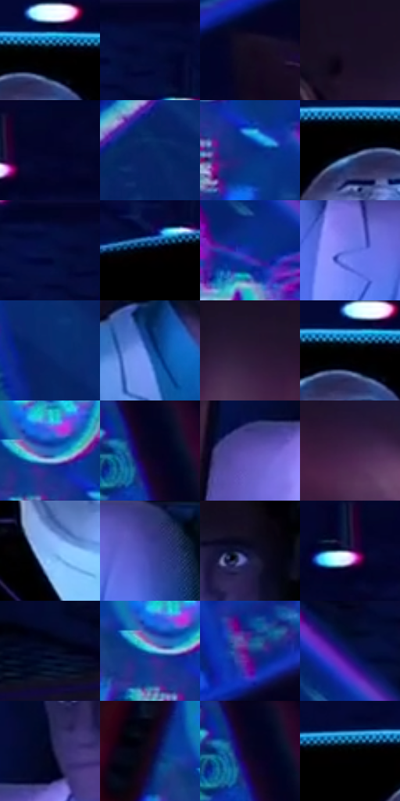

# 电影参考 139

- 状态：常规／活跃；来源世界：miles-home。
- 视角：low-angle；景别：medium；场景：industrial。
- 时段：interior-time-unknown（外观依据，中置信度；具体时间／晨昏未知）；光照：cool-interior。
- 材质候选：skin, fabric, metal, glass, screen, plastic（帧级，不是像素分割）。
- 明暗组：very-dark；L* P5/P50/P95：0.0 / 3.26279 / 48.64394。
- 资格门禁：无附加门禁。
- 原截图 SHA-256：`4eea7d240c6fb931a21c7786cd40cfd9ccd753c121e925136277088b9bd51673`；尺寸：2876 × 1204。
- sRGB 像素 SHA-256：`1dcc973c8a400bf58088fb1c68c00c0f9bb6b1cfb4ba8ee8f956ec1bb6445ee7`。

## 观察与迁移

控制室蓝屏、深暗人物与玻璃隔墙，显示不等于反射。

本公开版保存32个128×128原像素色卡上下文；图集格子并非原场景相邻位置。原rect、图集tile和像素SHA见 `data/palette-crops.json`。上下文不足时不得批准替色，不能以小样推断完整构图。

## 实测色卡

颜色比例分母为保留采样像素，不是材料面积；全部 32 色参与全库匹配。表内四舍五入仅用于阅读，原精度在 JSON。

| ID | HEX | Lab | 原图 xy | 像素数 | 比例 | 明度角色 |
| --- | --- | --- | --- | ---: | ---: | --- |
| 139-S01 | #000000 | [0.0, 0.0, 0.0] | [1476, 216] | 66179 | 34.401576% | deep-shadow |
| 139-S02 | #040933 | [4.156025, 12.60604, -26.843432] | [1008, 40] | 10492 | 5.454016% | deep-shadow |
| 139-S03 | #130B1E | [4.259215, 7.141466, -10.618932] | [2476, 644] | 9186 | 4.775123% | deep-shadow |
| 139-S04 | #1B1027 | [6.775334, 11.515259, -13.597156] | [280, 812] | 7838 | 4.074398% | deep-shadow |
| 139-S05 | #03052A | [2.664676, 9.388108, -22.45701] | [1728, 28] | 7154 | 3.718836% | deep-shadow |
| 139-S06 | #082463 | [16.571422, 17.306914, -39.920815] | [2448, 120] | 6379 | 3.315971% | deep-shadow |
| 139-S07 | #0A2B80 | [21.394568, 24.698969, -50.722165] | [288, 316] | 5944 | 3.089847% | shadow |
| 139-S08 | #040512 | [1.607946, 1.814127, -5.741264] | [1400, 248] | 5822 | 3.026428% | deep-shadow |
| 139-S09 | #040E3D | [6.112181, 16.013025, -30.967004] | [952, 40] | 5627 | 2.925062% | deep-shadow |
| 139-S10 | #020209 | [0.686855, 0.973272, -2.648899] | [932, 244] | 5553 | 2.886595% | deep-shadow |
| 139-S11 | #112CA1 | [25.237266, 37.302507, -64.8229] | [556, 184] | 5242 | 2.724929% | shadow |
| 139-S12 | #6273E2 | [52.227232, 25.804266, -58.639964] | [852, 1024] | 4811 | 2.500884% | midtone |
| 139-S13 | #0C2A6F | [19.561816, 18.396268, -42.863176] | [2336, 348] | 4772 | 2.480610% | deep-shadow |
| 139-S14 | #14499A | [32.359797, 15.158718, -48.915799] | [2260, 1084] | 4274 | 2.221737% | shadow |
| 139-S15 | #2A1835 | [11.97473, 15.684688, -15.579953] | [380, 876] | 3991 | 2.074626% | deep-shadow |
| 139-S16 | #000002 | [0.039574, 0.278088, -0.756847] | [1456, 220] | 3719 | 1.933234% | deep-shadow |
| 139-S17 | #2769C0 | [44.714098, 10.874439, -51.461529] | [228, 236] | 3593 | 1.867735% | midtone |
| 139-S18 | #04041E | [1.863906, 5.391201, -14.323861] | [2748, 48] | 3501 | 1.819911% | deep-shadow |
| 139-S19 | #5E4FB0 | [39.757382, 31.334848, -49.918798] | [556, 992] | 3355 | 1.744017% | shadow |
| 139-S20 | #3E2247 | [18.466878, 20.826557, -17.811533] | [2752, 924] | 3301 | 1.715946% | deep-shadow |
| 139-S21 | #7FB3F3 | [71.704181, -0.110579, -37.140586] | [1348, 464] | 3172 | 1.648889% | light |
| 139-S22 | #3D429E | [32.604438, 26.868779, -50.852448] | [972, 1016] | 2613 | 1.358306% | shadow |
| 139-S23 | #121234 | [7.308142, 12.127468, -22.463713] | [744, 828] | 2424 | 1.260059% | deep-shadow |
| 139-S24 | #4F2B62 | [24.550827, 27.48048, -26.09402] | [1668, 80] | 2196 | 1.141538% | shadow |
| 139-S25 | #060C27 | [4.047475, 6.011222, -17.986455] | [308, 632] | 2056 | 1.068763% | deep-shadow |
| 139-S26 | #36AAD2 | [65.10798, -18.80942, -29.50791] | [204, 248] | 1914 | 0.994947% | light |
| 139-S27 | #262E83 | [23.684917, 26.597312, -48.812483] | [2752, 412] | 1891 | 0.982991% | shadow |
| 139-S28 | #0A1651 | [10.792558, 20.133621, -37.293628] | [588, 72] | 1667 | 0.866550% | deep-shadow |
| 139-S29 | #030523 | [2.250983, 6.481049, -17.69226] | [632, 912] | 1461 | 0.759466% | deep-shadow |
| 139-S30 | #110522 | [3.100001, 10.154244, -15.52947] | [104, 200] | 961 | 0.499553% | deep-shadow |
| 139-S31 | #000320 | [1.529823, 5.414953, -16.444286] | [2744, 28] | 850 | 0.441852% | deep-shadow |
| 139-S32 | #010100 | [0.254387, -0.139061, 0.378457] | [1308, 220] | 434 | 0.225605% | deep-shadow |

## 色阶与空间分布

- 采样 ROI：`[0.01, 0.02, 0.98, 0.94]`；步长：4；样本数：192372。
- 排除区：`[]`。
- 深暗、暗、中、亮、高光五段计数：`[153574, 24539, 9567, 4191, 501]`。
- RGB 各 256 箱、L* 100 箱、13×5 色相明度表和 3×3 空间统计全部保存在 [总数据](../film-library.json)。
- [可视化档案](../../references/library.html)按需绘制直方图，不存 2,094 张重复图表图片。

## 纹理特征占比

**这是分块图像特征的面积占比，不是波点／排线／丝网／错版的精确语义覆盖率。** 窗格、发丝、织物也会产生方向或周期特征。
原图 ROI 像素 3088530；已测块覆盖 3088530（100.0000%）；未测 0。

| 特征 | 块覆盖像素 | 占已测面积 | 阈值敏感范围 |
| --- | ---: | ---: | --- |
| low-contrast | 1117458 | 36.1809% | 33.7849% ~ 38.6468% |
| directional-structure | 699392 | 22.6448% | 10.2863% ~ 34.7470% |
| periodic-structure | 1255296 | 40.6438% | 31.4682% ~ 48.4145% |
| mixed-detail | 16384 | 0.5305% | 0.0000% ~ 2.6524% |

阈值敏感范围不是统计置信区间。逐块坐标、尺度、对比、方向一致性、频谱集中度、频率与角度见 [全量特征记录](../texture-features.jsonl)，以帧号定位。
四种印刷层的真实像素覆盖仍标为 `null`，不能填 0，也不能拿上表代替。不得据这些代理测量删除唯一证据。

[测量方法与保留策略](../../references/library-retention.md) · [分类索引](../archive/README.md)
