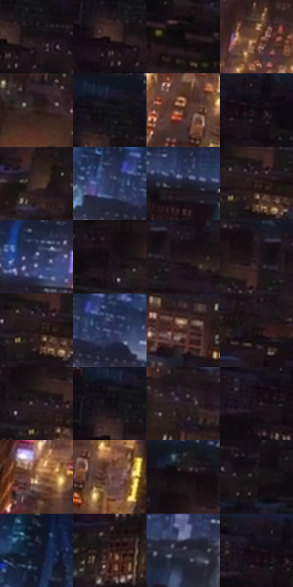

# 电影参考 140

- 状态：常规／活跃；来源世界：miles-home。
- 视角：high-angle；景别：environment-wide；场景：city。
- 时段：night-appearance（外观依据，中置信度；具体时间／晨昏未知）；光照：night-mixed。
- 材质候选：brick, glass, asphalt, sky（帧级，不是像素分割）。
- 明暗组：very-dark；L* P5/P50/P95：3.79493 / 11.47534 / 41.3263。
- 资格门禁：无附加门禁。
- 原截图 SHA-256：`be82610bbf4bc7866dbce2654c0e4dda9217ddd080cd399ac8d380107c03dcb5`；尺寸：2880 × 1204。
- sRGB 像素 SHA-256：`09619c9cd95bf0de593c0754ad5cbd54b3c3afac536e42a791bc1f882f1af7b3`。

## 观察与迁移

夜城鸟瞰，暖小窗与冷天空、道路纵深有主次。

本公开版保存32个128×128原像素色卡上下文；图集格子并非原场景相邻位置。原rect、图集tile和像素SHA见 `data/palette-crops.json`。上下文不足时不得批准替色，不能以小样推断完整构图。

## 实测色卡

颜色比例分母为保留采样像素，不是材料面积；全部 32 色参与全库匹配。表内四舍五入仅用于阅读，原精度在 JSON。

| ID | HEX | Lab | 原图 xy | 像素数 | 比例 | 明度角色 |
| --- | --- | --- | --- | ---: | ---: | --- |
| 140-S01 | #1B1317 | [6.870831, 4.773597, -1.212428] | [348, 132] | 7851 | 4.075308% | deep-shadow |
| 140-S02 | #372523 | [16.781278, 8.198124, 4.721952] | [296, 136] | 7734 | 4.014576% | deep-shadow |
| 140-S03 | #10090C | [2.999762, 2.543202, -0.43394] | [104, 236] | 7630 | 3.960591% | deep-shadow |
| 140-S04 | #714A33 | [35.297702, 13.8002, 20.435601] | [1748, 420] | 7293 | 3.785661% | shadow |
| 140-S05 | #2F201C | [13.950977, 6.5622, 5.572966] | [2172, 540] | 7266 | 3.771646% | deep-shadow |
| 140-S06 | #111019 | [5.057792, 2.444495, -5.525747] | [320, 52] | 7236 | 3.756073% | deep-shadow |
| 140-S07 | #59382A | [27.073497, 12.894246, 14.78093] | [1724, 660] | 7231 | 3.753478% | shadow |
| 140-S08 | #150E12 | [4.67178, 3.436288, -1.122543] | [116, 76] | 7010 | 3.638761% | deep-shadow |
| 140-S09 | #44312A | [22.277344, 7.470471, 7.832858] | [1116, 308] | 6776 | 3.517296% | shadow |
| 140-S10 | #2A3557 | [22.745118, 6.149623, -21.982935] | [1964, 188] | 6701 | 3.478365% | shadow |
| 140-S11 | #1F2031 | [12.897716, 4.532483, -11.358977] | [896, 84] | 6643 | 3.448258% | deep-shadow |
| 140-S12 | #261919 | [10.390983, 6.504155, 2.568554] | [648, 216] | 6636 | 3.444624% | deep-shadow |
| 140-S13 | #1F2740 | [16.066221, 4.614983, -16.995926] | [1124, 28] | 6634 | 3.443586% | deep-shadow |
| 140-S14 | #171114 | [5.723073, 3.188938, -0.833036] | [560, 168] | 6626 | 3.439434% | deep-shadow |
| 140-S15 | #20171B | [8.983398, 5.406271, -1.078009] | [748, 156] | 6539 | 3.394273% | deep-shadow |
| 140-S16 | #241B1F | [10.977823, 5.303975, -1.074328] | [676, 136] | 6426 | 3.335617% | deep-shadow |
| 140-S17 | #221414 | [8.047946, 7.210165, 2.732965] | [636, 224] | 6210 | 3.223496% | deep-shadow |
| 140-S18 | #414B6D | [32.390997, 5.450491, -20.93386] | [2028, 200] | 5864 | 3.043894% | shadow |
| 140-S19 | #44261F | [18.861711, 13.252057, 10.666169] | [752, 376] | 5752 | 2.985756% | deep-shadow |
| 140-S20 | #1D1013 | [6.132056, 6.730417, 0.498447] | [848, 256] | 5631 | 2.922948% | deep-shadow |
| 140-S21 | #271F22 | [12.777688, 4.511124, -0.5907] | [612, 192] | 5622 | 2.918276% | deep-shadow |
| 140-S22 | #100D12 | [3.989672, 1.923628, -2.17198] | [296, 80] | 5410 | 2.808231% | deep-shadow |
| 140-S23 | #2D232A | [15.100287, 6.272681, -2.850922] | [2064, 420] | 5326 | 2.764628% | deep-shadow |
| 140-S24 | #1D1721 | [8.855874, 5.53176, -5.83491] | [32, 92] | 5179 | 2.688323% | deep-shadow |
| 140-S25 | #BA926F | [63.463708, 10.315031, 24.310349] | [1540, 764] | 5118 | 2.656659% | light |
| 140-S26 | #836359 | [44.90103, 11.400399, 10.686589] | [1800, 700] | 4889 | 2.537789% | midtone |
| 140-S27 | #160F11 | [4.992605, 3.175979, -0.046912] | [608, 96] | 4650 | 2.413729% | deep-shadow |
| 140-S28 | #1E1718 | [8.608991, 3.73103, 0.613299] | [444, 164] | 4507 | 2.339500% | deep-shadow |
| 140-S29 | #141726 | [8.141573, 3.441362, -10.76932] | [2152, 28] | 4458 | 2.314065% | deep-shadow |
| 140-S30 | #2F1917 | [11.699646, 10.711096, 6.085016] | [516, 320] | 3967 | 2.059196% | deep-shadow |
| 140-S31 | #302C3B | [18.994321, 5.559304, -8.880572] | [2308, 304] | 3944 | 2.047257% | deep-shadow |
| 140-S32 | #18151D | [7.400004, 3.591672, -5.066152] | [80, 36] | 3889 | 2.018708% | deep-shadow |

## 色阶与空间分布

- 采样 ROI：`[0.01, 0.02, 0.98, 0.94]`；步长：4；样本数：192648。
- 排除区：`[]`。
- 深暗、暗、中、亮、高光五段计数：`[147152, 34980, 8021, 2107, 388]`。
- RGB 各 256 箱、L* 100 箱、13×5 色相明度表和 3×3 空间统计全部保存在 [总数据](../film-library.json)。
- [可视化档案](../../references/library.html)按需绘制直方图，不存 2,094 张重复图表图片。

## 纹理特征占比

**这是分块图像特征的面积占比，不是波点／排线／丝网／错版的精确语义覆盖率。** 窗格、发丝、织物也会产生方向或周期特征。
原图 ROI 像素 3092958；已测块覆盖 3092958（100.0000%）；未测 0。

| 特征 | 块覆盖像素 | 占已测面积 | 阈值敏感范围 |
| --- | ---: | ---: | --- |
| low-contrast | 16384 | 0.5297% | 0.0000% ~ 0.5297% |
| directional-structure | 0 | 0.0000% | 0.0000% ~ 1.7464% |
| periodic-structure | 2315870 | 74.8756% | 57.9535% ~ 90.0553% |
| mixed-detail | 760704 | 24.5947% | 8.1982% ~ 41.5168% |

阈值敏感范围不是统计置信区间。逐块坐标、尺度、对比、方向一致性、频谱集中度、频率与角度见 [全量特征记录](../texture-features.jsonl)，以帧号定位。
四种印刷层的真实像素覆盖仍标为 `null`，不能填 0，也不能拿上表代替。不得据这些代理测量删除唯一证据。

[测量方法与保留策略](../../references/library-retention.md) · [分类索引](../archive/README.md)
