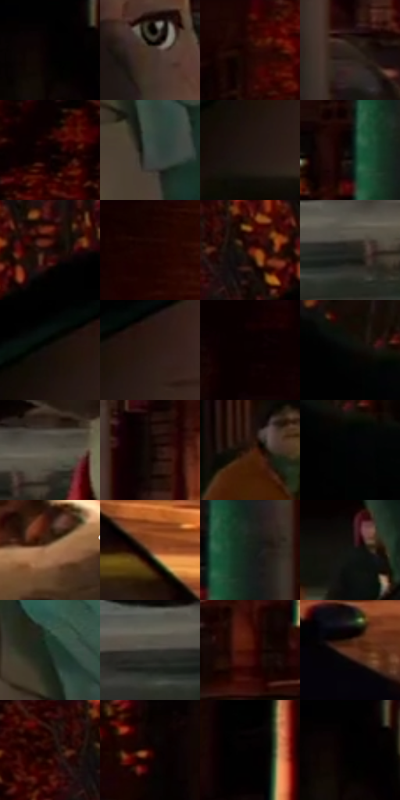

# 电影参考 141

- 状态：常规／活跃；来源世界：miles-home。
- 视角：near-level；景别：close-up；场景：street。
- 时段：night-appearance（外观依据，中置信度；具体时间／晨昏未知）；光照：night-mixed。
- 材质候选：skin, fabric, brick, asphalt（帧级，不是像素分割）。
- 明暗组：very-dark；L* P5/P50/P95：0.27417 / 7.97968 / 37.96617。
- 资格门禁：无附加门禁。
- 原截图 SHA-256：`da063922c5d1609676063aca763834705d53e83fd605caae75ce9defe0d3cc55`；尺寸：2880 × 1204。
- sRGB 像素 SHA-256：`dbfd24101a48769156fee8545a4d88c3bab3d607435e7e7163bea293e2bd8ed3`。

## 观察与迁移

街灯下近景面部，人物暖色与背景暗部保持分离。

本公开版保存32个128×128原像素色卡上下文；图集格子并非原场景相邻位置。原rect、图集tile和像素SHA见 `data/palette-crops.json`。上下文不足时不得批准替色，不能以小样推断完整构图。

## 实测色卡

颜色比例分母为保留采样像素，不是材料面积；全部 32 色参与全库匹配。表内四舍五入仅用于阅读，原精度在 JSON。

| ID | HEX | Lab | 原图 xy | 像素数 | 比例 | 明度角色 |
| --- | --- | --- | --- | ---: | ---: | --- |
| 141-S01 | #010101 | [0.274173, -1.7e-05, 3.3e-05] | [220, 28] | 10974 | 5.696400% | deep-shadow |
| 141-S02 | #443529 | [23.456865, 4.67159, 10.119651] | [1188, 556] | 9617 | 4.992006% | shadow |
| 141-S03 | #2E0703 | [6.680359, 19.285734, 9.162474] | [1676, 32] | 8862 | 4.600100% | deep-shadow |
| 141-S04 | #2E241C | [15.096823, 3.242047, 7.136983] | [1576, 536] | 8850 | 4.593871% | deep-shadow |
| 141-S05 | #0B0101 | [0.858748, 2.621643, 0.923767] | [2004, 32] | 8242 | 4.278269% | deep-shadow |
| 141-S06 | #3E4844 | [29.603706, -4.982628, 1.033586] | [1888, 896] | 7954 | 4.128774% | shadow |
| 141-S07 | #211712 | [8.822467, 4.108976, 5.108545] | [976, 424] | 7588 | 3.938790% | deep-shadow |
| 141-S08 | #090C0A | [3.097665, -1.107906, 0.513073] | [1428, 72] | 7260 | 3.768531% | deep-shadow |
| 141-S09 | #220302 | [3.70076, 12.857783, 4.957935] | [676, 28] | 6930 | 3.597234% | deep-shadow |
| 141-S10 | #180100 | [1.950767, 7.468756, 3.059049] | [2532, 28] | 6871 | 3.566609% | deep-shadow |
| 141-S11 | #571F16 | [20.301307, 25.286635, 19.222663] | [572, 68] | 6401 | 3.322640% | shadow |
| 141-S12 | #22211C | [12.68194, -0.682654, 3.557776] | [644, 908] | 6151 | 3.192870% | deep-shadow |
| 141-S13 | #160F0B | [4.845351, 2.141212, 2.769326] | [964, 352] | 6069 | 3.150305% | deep-shadow |
| 141-S14 | #2A1A12 | [11.098135, 6.731938, 8.512055] | [1040, 348] | 5843 | 3.032993% | deep-shadow |
| 141-S15 | #120101 | [1.37787, 4.949768, 1.744076] | [2336, 36] | 5779 | 2.999772% | deep-shadow |
| 141-S16 | #080705 | [1.93795, -0.01671, 0.849217] | [864, 92] | 5743 | 2.981085% | deep-shadow |
| 141-S17 | #5F5B4E | [38.66487, -0.884362, 8.082595] | [712, 868] | 5636 | 2.925543% | shadow |
| 141-S18 | #130804 | [2.898769, 2.962089, 2.753657] | [1600, 412] | 5480 | 2.844566% | deep-shadow |
| 141-S19 | #3C2012 | [15.683337, 11.91974, 15.106888] | [304, 560] | 5202 | 2.700262% | deep-shadow |
| 141-S20 | #020305 | [0.803785, 0.016536, -0.848887] | [904, 140] | 5145 | 2.670674% | deep-shadow |
| 141-S21 | #A97A57 | [55.117575, 14.001491, 26.347323] | [2772, 616] | 5127 | 2.661331% | midtone |
| 141-S22 | #73462E | [34.443673, 16.662274, 22.439935] | [2328, 736] | 5112 | 2.653544% | shadow |
| 141-S23 | #172019 | [11.172582, -5.932916, 3.451075] | [1488, 64] | 5097 | 2.645758% | deep-shadow |
| 141-S24 | #131512 | [6.489682, -1.515042, 1.509261] | [492, 540] | 4926 | 2.556995% | deep-shadow |
| 141-S25 | #223329 | [19.50624, -9.614462, 4.127423] | [1852, 784] | 4710 | 2.444874% | deep-shadow |
| 141-S26 | #32312C | [20.269201, -0.666042, 3.35222] | [556, 900] | 4562 | 2.368049% | shadow |
| 141-S27 | #400B05 | [11.556769, 25.034555, 15.874412] | [1340, 440] | 4504 | 2.337943% | deep-shadow |
| 141-S28 | #61321D | [26.48252, 19.156966, 22.497816] | [2464, 848] | 4265 | 2.213882% | shadow |
| 141-S29 | #220B06 | [5.35353, 10.199261, 5.742085] | [496, 32] | 4240 | 2.200905% | deep-shadow |
| 141-S30 | #060101 | [0.565717, 1.307479, 0.460726] | [1100, 28] | 4230 | 2.195714% | deep-shadow |
| 141-S31 | #080305 | [1.153638, 1.585532, -0.296056] | [2752, 40] | 3574 | 1.855197% | deep-shadow |
| 141-S32 | #000000 | [0.0, 0.0, 0.0] | [228, 28] | 1704 | 0.884515% | deep-shadow |

## 色阶与空间分布

- 采样 ROI：`[0.01, 0.02, 0.98, 0.94]`；步长：4；样本数：192648。
- 排除区：`[]`。
- 深暗、暗、中、亮、高光五段计数：`[150239, 34476, 6464, 1378, 91]`。
- RGB 各 256 箱、L* 100 箱、13×5 色相明度表和 3×3 空间统计全部保存在 [总数据](../film-library.json)。
- [可视化档案](../../references/library.html)按需绘制直方图，不存 2,094 张重复图表图片。

## 纹理特征占比

**这是分块图像特征的面积占比，不是波点／排线／丝网／错版的精确语义覆盖率。** 窗格、发丝、织物也会产生方向或周期特征。
原图 ROI 像素 3092958；已测块覆盖 3092958（100.0000%）；未测 0。

| 特征 | 块覆盖像素 | 占已测面积 | 阈值敏感范围 |
| --- | ---: | ---: | --- |
| low-contrast | 228480 | 7.3871% | 7.3871% ~ 9.3198% |
| directional-structure | 743646 | 24.0432% | 13.2844% ~ 32.9284% |
| periodic-structure | 2022528 | 65.3914% | 58.0953% ~ 69.9798% |
| mixed-detail | 98304 | 3.1783% | 1.5892% ~ 7.4161% |

阈值敏感范围不是统计置信区间。逐块坐标、尺度、对比、方向一致性、频谱集中度、频率与角度见 [全量特征记录](../texture-features.jsonl)，以帧号定位。
四种印刷层的真实像素覆盖仍标为 `null`，不能填 0，也不能拿上表代替。不得据这些代理测量删除唯一证据。

[测量方法与保留策略](../../references/library-retention.md) · [分类索引](../archive/README.md)
