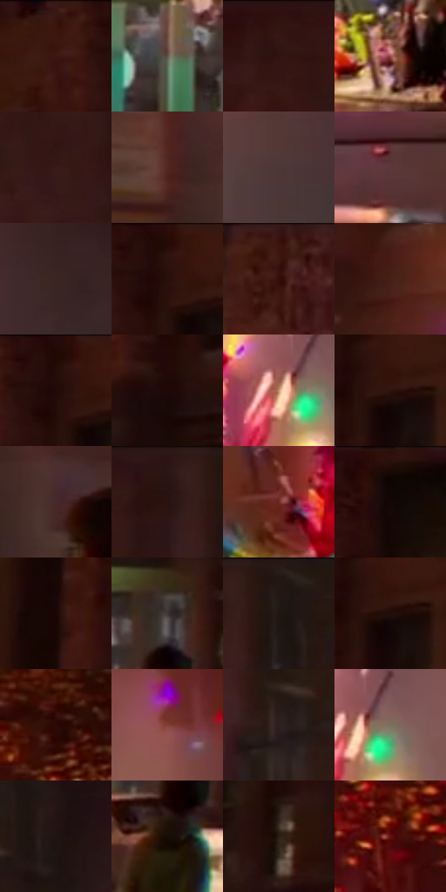

# 电影参考 142

- 状态：条件／活跃；来源世界：miles-home。
- 视角：near-level；景别：environment-wide；场景：city。
- 时段：event-time-unknown（外观依据，中置信度；具体时间／晨昏未知）；光照：event-light。
- 材质候选：brick, glass, metal, asphalt（帧级，不是像素分割）。
- 明暗组：very-dark；L* P5/P50/P95：3.36046 / 13.77593 / 47.58108。
- 资格门禁：glitch。
- 原截图 SHA-256：`58a94b875375f65ff2e2d58086d31546f6aad8c282a177e7b5e3b3c6d4f6bc1c`；尺寸：2880 × 1210。
- sRGB 像素 SHA-256：`c90600a53b7144300a7511b2d76f1fcaab3916d77b6d61636a7258149530f84f`。

## 观察与迁移

建筑局部彩色碎裂；原楼体与事件图形分别记录。

本公开版保存32个128×128原像素色卡上下文；图集格子并非原场景相邻位置。原rect、图集tile和像素SHA见 `data/palette-crops.json`。上下文不足时不得批准替色，不能以小样推断完整构图。

## 实测色卡

颜色比例分母为保留采样像素，不是材料面积；全部 32 色参与全库匹配。表内四舍五入仅用于阅读，原精度在 JSON。

| ID | HEX | Lab | 原图 xy | 像素数 | 比例 | 明度角色 |
| --- | --- | --- | --- | ---: | ---: | --- |
| 142-S01 | #3C150D | [12.774456, 18.563417, 14.026652] | [716, 48] | 9752 | 5.025664% | deep-shadow |
| 142-S02 | #5B5449 | [36.072739, 0.773561, 7.469872] | [1196, 860] | 8642 | 4.453629% | shadow |
| 142-S03 | #341613 | [11.628223, 14.697602, 8.88026] | [2044, 44] | 7820 | 4.030014% | deep-shadow |
| 142-S04 | #954F4B | [41.986275, 28.764484, 15.521012] | [1340, 1032] | 7563 | 3.897570% | midtone |
| 142-S05 | #381B17 | [13.748827, 13.781442, 9.112788] | [2264, 152] | 7451 | 3.839851% | deep-shadow |
| 142-S06 | #532821 | [21.82427, 19.18781, 13.656547] | [2648, 708] | 7449 | 3.838820% | shadow |
| 142-S07 | #4E3634 | [25.279071, 10.425824, 5.526224] | [1900, 640] | 7286 | 3.754818% | shadow |
| 142-S08 | #5C383A | [27.871265, 16.326052, 5.488159] | [2164, 764] | 7113 | 3.665663% | shadow |
| 142-S09 | #3A2622 | [17.466851, 8.811587, 6.444667] | [2076, 520] | 6844 | 3.527035% | deep-shadow |
| 142-S10 | #2A0F0A | [7.731627, 13.502151, 7.750307] | [824, 32] | 6827 | 3.518274% | deep-shadow |
| 142-S11 | #360F0C | [10.203697, 19.299709, 10.761098] | [1448, 52] | 6703 | 3.454371% | deep-shadow |
| 142-S12 | #472017 | [17.62133, 17.699143, 14.62575] | [1176, 296] | 6558 | 3.379646% | deep-shadow |
| 142-S13 | #240D07 | [6.127558, 10.789233, 6.502948] | [812, 40] | 6444 | 3.320896% | deep-shadow |
| 142-S14 | #1E0808 | [4.221011, 9.093211, 3.20428] | [792, 336] | 6218 | 3.204428% | deep-shadow |
| 142-S15 | #CC977B | [66.826767, 16.255248, 22.535892] | [1588, 440] | 6153 | 3.170930% | light |
| 142-S16 | #2E150D | [10.155793, 11.766999, 10.005768] | [856, 88] | 6105 | 3.146194% | deep-shadow |
| 142-S17 | #462A2B | [20.567716, 13.198169, 4.798697] | [2744, 772] | 6102 | 3.144648% | shadow |
| 142-S18 | #2C1615 | [10.285767, 11.020094, 5.477398] | [2364, 28] | 6085 | 3.135887% | deep-shadow |
| 142-S19 | #6D2A22 | [26.801826, 29.241643, 20.232253] | [1352, 440] | 5978 | 3.080745% | shadow |
| 142-S20 | #100403 | [1.839062, 3.278951, 1.5829] | [1184, 44] | 5600 | 2.885943% | deep-shadow |
| 142-S21 | #1A0604 | [3.240015, 7.052323, 3.339931] | [460, 140] | 5495 | 2.831832% | deep-shadow |
| 142-S22 | #3E3636 | [23.434943, 3.52585, 1.294523] | [728, 808] | 5298 | 2.730309% | shadow |
| 142-S23 | #241716 | [9.367733, 6.392348, 3.297912] | [2444, 40] | 5116 | 2.636515% | deep-shadow |
| 142-S24 | #220F0B | [6.377016, 8.972478, 5.189637] | [860, 96] | 4981 | 2.566944% | deep-shadow |
| 142-S25 | #2D0706 | [6.53231, 19.017625, 7.699459] | [64, 492] | 4916 | 2.533446% | deep-shadow |
| 142-S26 | #803E36 | [34.604105, 27.673396, 18.116385] | [1820, 296] | 4828 | 2.488095% | shadow |
| 142-S27 | #2E2020 | [13.933173, 6.769979, 2.647417] | [2452, 364] | 4664 | 2.403579% | deep-shadow |
| 142-S28 | #7C705C | [47.81161, 1.245749, 12.841348] | [1632, 432] | 4593 | 2.366989% | midtone |
| 142-S29 | #211310 | [7.466198, 6.693411, 4.299489] | [2628, 172] | 4585 | 2.362866% | deep-shadow |
| 142-S30 | #190D05 | [4.566379, 3.759028, 4.85538] | [708, 924] | 4193 | 2.160850% | deep-shadow |
| 142-S31 | #2B1D13 | [12.217761, 5.254219, 9.45145] | [676, 544] | 3725 | 1.919668% | deep-shadow |
| 142-S32 | #640F0E | [20.37545, 36.677299, 24.822856] | [80, 720] | 2957 | 1.523881% | shadow |

## 色阶与空间分布

- 采样 ROI：`[0.01, 0.02, 0.98, 0.94]`；步长：4；样本数：194044。
- 排除区：`[]`。
- 深暗、暗、中、亮、高光五段计数：`[125142, 51418, 13156, 3441, 887]`。
- RGB 各 256 箱、L* 100 箱、13×5 色相明度表和 3×3 空间统计全部保存在 [总数据](../film-library.json)。
- [可视化档案](../../references/library.html)按需绘制直方图，不存 2,094 张重复图表图片。

## 纹理特征占比

**这是分块图像特征的面积占比，不是波点／排线／丝网／错版的精确语义覆盖率。** 窗格、发丝、织物也会产生方向或周期特征。
原图 ROI 像素 3109722；已测块覆盖 3109722（100.0000%）；未测 0。

| 特征 | 块覆盖像素 | 占已测面积 | 阈值敏感范围 |
| --- | ---: | ---: | --- |
| low-contrast | 191616 | 6.1618% | 2.4738% ~ 10.1956% |
| directional-structure | 193024 | 6.2071% | 1.7864% ~ 13.4750% |
| periodic-structure | 2594010 | 83.4161% | 74.8464% ~ 83.5244% |
| mixed-detail | 131072 | 4.2149% | 0.5269% ~ 13.1716% |

阈值敏感范围不是统计置信区间。逐块坐标、尺度、对比、方向一致性、频谱集中度、频率与角度见 [全量特征记录](../texture-features.jsonl)，以帧号定位。
四种印刷层的真实像素覆盖仍标为 `null`，不能填 0，也不能拿上表代替。不得据这些代理测量删除唯一证据。

[测量方法与保留策略](../../references/library-retention.md) · [分类索引](../archive/README.md)
