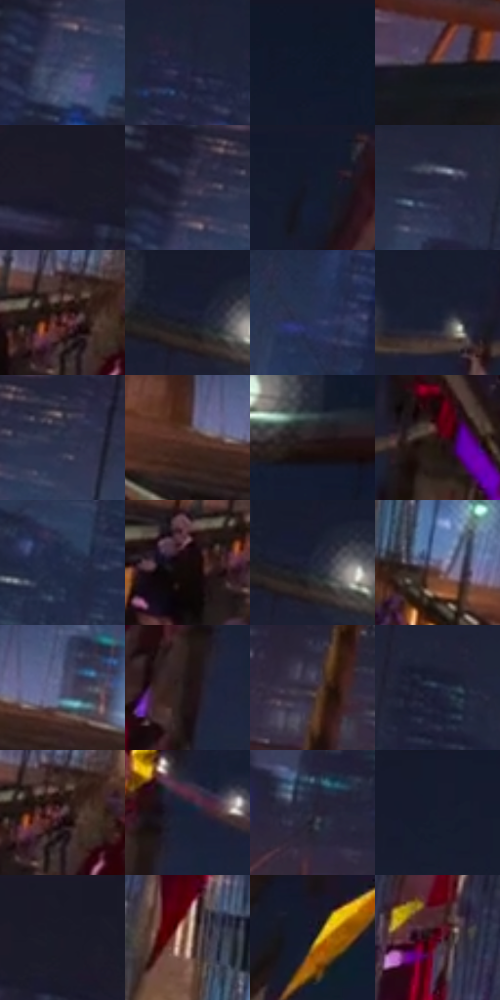

# 电影参考 143

- 状态：条件／活跃；来源世界：miles-home。
- 视角：rolled-or-dutch；景别：environment-wide；场景：city。
- 时段：event-time-unknown（外观依据，中置信度；具体时间／晨昏未知）；光照：event-light。
- 材质候选：brick, glass, metal, asphalt（帧级，不是像素分割）。
- 明暗组：very-dark；L* P5/P50/P95：6.20334 / 15.21547 / 37.12313。
- 资格门禁：glitch。
- 原截图 SHA-256：`ff37abf12dd71b76e237df735478120802f91aad309ff2c79102f1802fe9a295`；尺寸：2880 × 1204。
- sRGB 像素 SHA-256：`2c66859bfc99031ec3c72b5de66a841f9cf5409586890c8195e1404c81fb0935`。

## 观察与迁移

建筑局部彩色碎裂；原楼体与事件图形分别记录。

本公开版保存32个128×128原像素色卡上下文；图集格子并非原场景相邻位置。原rect、图集tile和像素SHA见 `data/palette-crops.json`。上下文不足时不得批准替色，不能以小样推断完整构图。

## 实测色卡

颜色比例分母为保留采样像素，不是材料面积；全部 32 色参与全库匹配。表内四舍五入仅用于阅读，原精度在 JSON。

| ID | HEX | Lab | 原图 xy | 像素数 | 比例 | 明度角色 |
| --- | --- | --- | --- | ---: | ---: | --- |
| 143-S01 | #353F60 | [27.17499, 5.59549, -20.84977] | [152, 440] | 11155 | 5.790353% | shadow |
| 143-S02 | #1F253E | [15.287168, 5.350021, -16.828087] | [968, 312] | 8668 | 4.499398% | deep-shadow |
| 143-S03 | #0F1727 | [7.775272, 2.090302, -12.120943] | [2160, 32] | 8136 | 4.223247% | deep-shadow |
| 143-S04 | #452924 | [19.958548, 12.387837, 8.741785] | [512, 960] | 7833 | 4.065965% | deep-shadow |
| 143-S05 | #1D1C2B | [11.036322, 4.786562, -9.907829] | [36, 84] | 7748 | 4.021843% | deep-shadow |
| 143-S06 | #36344A | [22.77381, 6.570743, -13.221617] | [152, 364] | 7671 | 3.981874% | shadow |
| 143-S07 | #131A2D | [9.534541, 3.425285, -13.782666] | [1684, 44] | 7645 | 3.968378% | deep-shadow |
| 143-S08 | #272A44 | [17.938904, 6.417484, -16.77156] | [588, 360] | 7445 | 3.864561% | deep-shadow |
| 143-S09 | #351B19 | [13.297704, 12.571678, 6.975839] | [1340, 952] | 7386 | 3.833935% | deep-shadow |
| 143-S10 | #1E2033 | [12.909959, 4.833543, -12.78114] | [892, 136] | 7202 | 3.738424% | deep-shadow |
| 143-S11 | #283352 | [21.681356, 5.204615, -20.35227] | [2016, 600] | 7183 | 3.728562% | shadow |
| 143-S12 | #161D31 | [11.070899, 3.633007, -14.26764] | [1176, 176] | 7024 | 3.646028% | deep-shadow |
| 143-S13 | #272F48 | [19.769783, 4.228108, -16.63668] | [240, 368] | 6670 | 3.462273% | deep-shadow |
| 143-S14 | #5A392F | [27.588322, 13.316564, 12.255868] | [1760, 1012] | 6138 | 3.186122% | shadow |
| 143-S15 | #281D21 | [12.219494, 6.21148, -0.663702] | [2676, 388] | 6119 | 3.176259% | deep-shadow |
| 143-S16 | #290F0F | [7.657004, 13.529615, 5.281524] | [1308, 204] | 6058 | 3.144595% | deep-shadow |
| 143-S17 | #202945 | [17.095857, 5.292856, -18.821452] | [908, 568] | 5870 | 3.047008% | deep-shadow |
| 143-S18 | #14090A | [3.306416, 3.812188, 0.91615] | [1268, 984] | 5665 | 2.940596% | deep-shadow |
| 143-S19 | #202438 | [14.703061, 4.305425, -13.527456] | [912, 140] | 5641 | 2.928138% | deep-shadow |
| 143-S20 | #635F7D | [41.716392, 8.429696, -16.211625] | [1548, 940] | 5626 | 2.920352% | midtone |
| 143-S21 | #4A4B6E | [33.164652, 8.599611, -20.304134] | [1840, 996] | 5458 | 2.833146% | shadow |
| 143-S22 | #1E1315 | [7.189752, 5.967187, 0.734551] | [1816, 408] | 5293 | 2.747498% | deep-shadow |
| 143-S23 | #342933 | [18.165582, 7.276863, -4.542072] | [352, 732] | 5013 | 2.602155% | deep-shadow |
| 143-S24 | #1B233A | [14.061542, 4.103845, -15.97071] | [716, 312] | 4791 | 2.486919% | deep-shadow |
| 143-S25 | #594147 | [30.302343, 11.46494, 0.440583] | [1356, 960] | 4541 | 2.357149% | shadow |
| 143-S26 | #171F37 | [12.207394, 4.736199, -16.783667] | [1868, 332] | 4328 | 2.246584% | deep-shadow |
| 143-S27 | #272637 | [15.969678, 5.107, -10.810099] | [592, 720] | 4303 | 2.233607% | deep-shadow |
| 143-S28 | #171C2E | [10.629856, 3.600097, -12.773791] | [1116, 72] | 3633 | 1.885823% | deep-shadow |
| 143-S29 | #181826 | [8.885756, 4.199419, -9.583143] | [124, 28] | 3499 | 1.816266% | deep-shadow |
| 143-S30 | #AE8D77 | [61.117031, 9.201915, 16.456514] | [1468, 824] | 3401 | 1.765396% | light |
| 143-S31 | #16151B | [7.100135, 2.036644, -4.006685] | [1916, 68] | 3196 | 1.658984% | deep-shadow |
| 143-S32 | #5D0522 | [18.15177, 38.346332, 8.41229] | [1508, 596] | 2309 | 1.198559% | deep-shadow |

## 色阶与空间分布

- 采样 ROI：`[0.01, 0.02, 0.98, 0.94]`；步长：4；样本数：192648。
- 排除区：`[]`。
- 深暗、暗、中、亮、高光五段计数：`[134745, 50410, 6043, 1071, 379]`。
- RGB 各 256 箱、L* 100 箱、13×5 色相明度表和 3×3 空间统计全部保存在 [总数据](../film-library.json)。
- [可视化档案](../../references/library.html)按需绘制直方图，不存 2,094 张重复图表图片。

## 纹理特征占比

**这是分块图像特征的面积占比，不是波点／排线／丝网／错版的精确语义覆盖率。** 窗格、发丝、织物也会产生方向或周期特征。
原图 ROI 像素 3092958；已测块覆盖 3092958（100.0000%）；未测 0。

| 特征 | 块覆盖像素 | 占已测面积 | 阈值敏感范围 |
| --- | ---: | ---: | --- |
| low-contrast | 332800 | 10.7599% | 8.7321% ~ 12.8788% |
| directional-structure | 499550 | 16.1512% | 3.7080% ~ 30.1474% |
| periodic-structure | 1980032 | 64.0174% | 59.8086% ~ 65.6427% |
| mixed-detail | 280576 | 9.0714% | 1.3119% ~ 17.7704% |

阈值敏感范围不是统计置信区间。逐块坐标、尺度、对比、方向一致性、频谱集中度、频率与角度见 [全量特征记录](../texture-features.jsonl)，以帧号定位。
四种印刷层的真实像素覆盖仍标为 `null`，不能填 0，也不能拿上表代替。不得据这些代理测量删除唯一证据。

[测量方法与保留策略](../../references/library-retention.md) · [分类索引](../archive/README.md)
