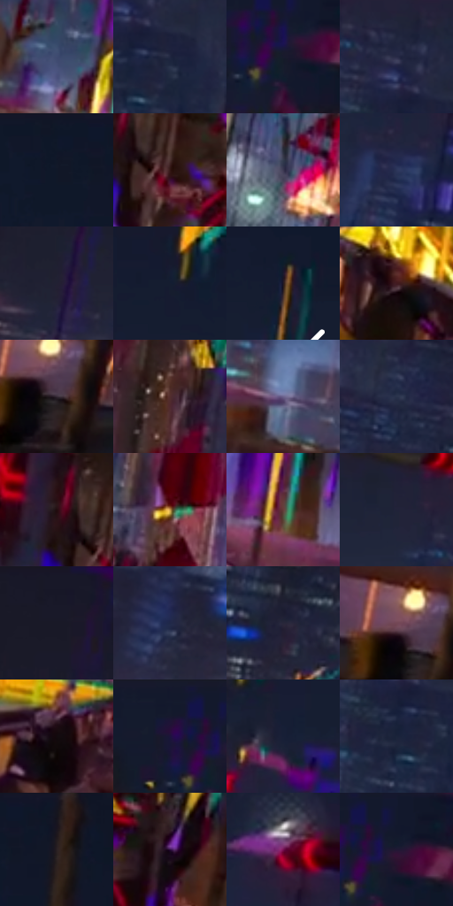

# 电影参考 144

- 状态：条件／活跃；来源世界：miles-home。
- 视角：rolled-or-dutch；景别：environment-wide；场景：city。
- 时段：event-time-unknown（外观依据，中置信度；具体时间／晨昏未知）；光照：event-light。
- 材质候选：brick, glass, metal, asphalt（帧级，不是像素分割）。
- 明暗组：very-dark；L* P5/P50/P95：6.54906 / 15.65478 / 44.14354。
- 资格门禁：glitch。
- 原截图 SHA-256：`92e85d311baa8cb3ce2b608fd107e54d0bab990d05eddf26c0bf6d518b87799d`；尺寸：2880 × 1206。
- sRGB 像素 SHA-256：`272a2c6253d23a4088c31852b7fba7ff7c37d7cbe5b3f7a8f76e4ed83a0fa715`。

## 观察与迁移

建筑局部彩色碎裂；原楼体与事件图形分别记录。

本公开版保存32个128×128原像素色卡上下文；图集格子并非原场景相邻位置。原rect、图集tile和像素SHA见 `data/palette-crops.json`。上下文不足时不得批准替色，不能以小样推断完整构图。

## 实测色卡

颜色比例分母为保留采样像素，不是材料面积；全部 32 色参与全库匹配。表内四舍五入仅用于阅读，原精度在 JSON。

| ID | HEX | Lab | 原图 xy | 像素数 | 比例 | 明度角色 |
| --- | --- | --- | --- | ---: | ---: | --- |
| 144-S01 | #3F4A70 | [32.086983, 6.443275, -23.305913] | [1092, 824] | 10797 | 5.584289% | shadow |
| 144-S02 | #202640 | [15.816166, 5.653905, -17.383119] | [1052, 436] | 9162 | 4.738655% | deep-shadow |
| 144-S03 | #191B2D | [10.408588, 4.702553, -12.376044] | [1688, 96] | 8658 | 4.477982% | deep-shadow |
| 144-S04 | #292B47 | [18.6011, 7.369736, -17.772643] | [1004, 360] | 8407 | 4.348163% | deep-shadow |
| 144-S05 | #0F1727 | [7.775272, 2.090302, -12.120943] | [2268, 52] | 8024 | 4.150073% | deep-shadow |
| 144-S06 | #331614 | [11.472083, 14.328451, 7.988305] | [1296, 340] | 8002 | 4.138694% | deep-shadow |
| 144-S07 | #3B3751 | [24.500857, 8.35651, -15.171547] | [1324, 804] | 7788 | 4.028012% | shadow |
| 144-S08 | #2C365A | [23.377371, 7.075891, -22.951836] | [2084, 512] | 7618 | 3.940087% | shadow |
| 144-S09 | #212033 | [13.201645, 5.934513, -12.30509] | [252, 276] | 7429 | 3.842334% | deep-shadow |
| 144-S10 | #151D31 | [10.991522, 3.316874, -14.397813] | [2004, 168] | 6957 | 3.598213% | deep-shadow |
| 144-S11 | #261B21 | [11.315895, 6.713229, -2.025908] | [2812, 528] | 6835 | 3.535113% | deep-shadow |
| 144-S12 | #421A21 | [15.524688, 20.191945, 4.625622] | [1688, 1108] | 6763 | 3.497874% | deep-shadow |
| 144-S13 | #352A35 | [18.670215, 7.489328, -5.165674] | [232, 948] | 6398 | 3.309094% | deep-shadow |
| 144-S14 | #532E2E | [23.640563, 16.951265, 7.347812] | [1524, 508] | 6339 | 3.278578% | shadow |
| 144-S15 | #6C628E | [44.054922, 13.919171, -22.800573] | [1908, 1044] | 6330 | 3.273923% | midtone |
| 144-S16 | #29334B | [21.382748, 3.092262, -16.134848] | [660, 428] | 6036 | 3.121864% | shadow |
| 144-S17 | #220D0F | [5.984321, 10.622101, 2.69667] | [1232, 292] | 5807 | 3.003424% | deep-shadow |
| 144-S18 | #C4964B | [65.009325, 9.009753, 45.439714] | [1456, 700] | 5792 | 2.995666% | light |
| 144-S19 | #663E3C | [30.871007, 17.256492, 8.601367] | [1692, 964] | 5502 | 2.845676% | shadow |
| 144-S20 | #202339 | [14.425665, 5.380232, -14.665213] | [900, 296] | 5412 | 2.799127% | deep-shadow |
| 144-S21 | #181827 | [8.94058, 4.537029, -10.243165] | [272, 36] | 5354 | 2.769129% | deep-shadow |
| 144-S22 | #202949 | [17.337981, 6.776684, -21.176853] | [96, 540] | 5126 | 2.651206% | deep-shadow |
| 144-S23 | #28273A | [16.540948, 5.689247, -12.021044] | [452, 620] | 4695 | 2.428289% | deep-shadow |
| 144-S24 | #734755 | [35.611724, 20.926144, -0.382634] | [204, 916] | 4633 | 2.396222% | shadow |
| 144-S25 | #120A0E | [3.409061, 3.217372, -0.775688] | [1256, 996] | 4623 | 2.391050% | deep-shadow |
| 144-S26 | #13192D | [9.182382, 4.197595, -14.336624] | [1636, 28] | 4618 | 2.388464% | deep-shadow |
| 144-S27 | #171F37 | [12.207394, 4.736199, -16.783667] | [1956, 324] | 4474 | 2.313986% | deep-shadow |
| 144-S28 | #1A243A | [14.325679, 3.059633, -15.561775] | [1004, 460] | 4244 | 2.195029% | deep-shadow |
| 144-S29 | #17141D | [6.965947, 3.778359, -5.730082] | [2360, 28] | 3271 | 1.691786% | deep-shadow |
| 144-S30 | #300F42 | [11.711834, 26.684984, -25.20387] | [1760, 440] | 3111 | 1.609033% | deep-shadow |
| 144-S31 | #731150 | [25.641122, 46.011543, -12.045191] | [2128, 388] | 3034 | 1.569208% | shadow |
| 144-S32 | #201734 | [10.3174, 12.580902, -17.562661] | [1708, 72] | 2107 | 1.089756% | deep-shadow |

## 色阶与空间分布

- 采样 ROI：`[0.01, 0.02, 0.98, 0.94]`；步长：4；样本数：193346。
- 排除区：`[]`。
- 深暗、暗、中、亮、高光五段计数：`[129123, 51693, 8964, 2649, 917]`。
- RGB 各 256 箱、L* 100 箱、13×5 色相明度表和 3×3 空间统计全部保存在 [总数据](../film-library.json)。
- [可视化档案](../../references/library.html)按需绘制直方图，不存 2,094 张重复图表图片。

## 纹理特征占比

**这是分块图像特征的面积占比，不是波点／排线／丝网／错版的精确语义覆盖率。** 窗格、发丝、织物也会产生方向或周期特征。
原图 ROI 像素 3098546；已测块覆盖 3098546（100.0000%）；未测 0。

| 特征 | 块覆盖像素 | 占已测面积 | 阈值敏感范围 |
| --- | ---: | ---: | --- |
| low-contrast | 286592 | 9.2492% | 6.7831% ~ 11.3643% |
| directional-structure | 576562 | 18.6075% | 4.3995% ~ 34.1978% |
| periodic-structure | 1954304 | 63.0716% | 56.9041% ~ 69.3565% |
| mixed-detail | 281088 | 9.0716% | 2.1151% ~ 14.8798% |

阈值敏感范围不是统计置信区间。逐块坐标、尺度、对比、方向一致性、频谱集中度、频率与角度见 [全量特征记录](../texture-features.jsonl)，以帧号定位。
四种印刷层的真实像素覆盖仍标为 `null`，不能填 0，也不能拿上表代替。不得据这些代理测量删除唯一证据。

[测量方法与保留策略](../../references/library-retention.md) · [分类索引](../archive/README.md)
