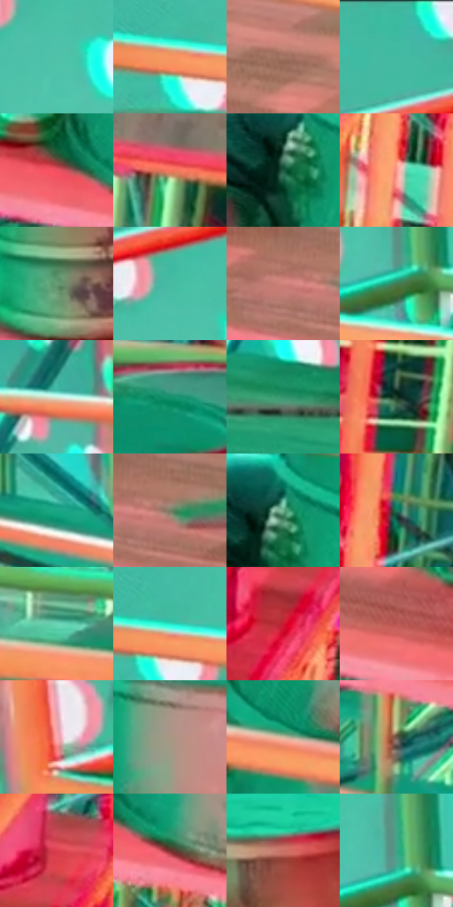

# 电影参考 145

- 状态：条件／活跃；来源世界：miles-home。
- 视角：high-angle；景别：full-body；场景：industrial。
- 时段：event-time-unknown（外观依据，中置信度；具体时间／晨昏未知）；光照：event-light。
- 材质候选：fabric, metal, plastic（帧级，不是像素分割）。
- 明暗组：light；L* P5/P50/P95：30.21588 / 60.6148 / 82.27699。
- 资格门禁：energy。
- 原截图 SHA-256：`0f2acee4910d3657333a09ba114de6c4b19f659c0d5c66a16b9c1990c46aeb4b`；尺寸：2880 × 1204。
- sRGB 像素 SHA-256：`b623ea71beb5a6fb1b92dc2e030535e627130d5b15395adfde7a51167ce6112e`。

## 观察与迁移

荧光绿与橙栏杆由事件状态主导，不作普通灯光基准。

本公开版保存32个128×128原像素色卡上下文；图集格子并非原场景相邻位置。原rect、图集tile和像素SHA见 `data/palette-crops.json`。上下文不足时不得批准替色，不能以小样推断完整构图。

## 实测色卡

颜色比例分母为保留采样像素，不是材料面积；全部 32 色参与全库匹配。表内四舍五入仅用于阅读，原精度在 JSON。

| ID | HEX | Lab | 原图 xy | 像素数 | 比例 | 明度角色 |
| --- | --- | --- | --- | ---: | ---: | --- |
| 145-S01 | #4EC2A8 | [71.573697, -38.950448, 3.366019] | [596, 232] | 10715 | 5.561958% | light |
| 145-S02 | #F69761 | [71.278572, 30.719212, 43.147607] | [364, 304] | 10120 | 5.253104% | light |
| 145-S03 | #A37463 | [53.145585, 16.233314, 16.74204] | [964, 760] | 9427 | 4.893381% | midtone |
| 145-S04 | #3BB9A1 | [68.166443, -39.959683, 2.19394] | [536, 28] | 8586 | 4.456833% | light |
| 145-S05 | #EF5363 | [57.504994, 60.791635, 24.468445] | [1696, 1012] | 7910 | 4.105934% | midtone |
| 145-S06 | #F3765B | [63.976031, 45.931034, 37.347085] | [2816, 744] | 7578 | 3.933599% | light |
| 145-S07 | #1D583F | [33.133575, -25.78013, 8.98732] | [1704, 608] | 7247 | 3.761783% | shadow |
| 145-S08 | #F69989 | [72.352599, 33.068084, 23.137923] | [2348, 1004] | 6831 | 3.545845% | light |
| 145-S09 | #679C74 | [59.816887, -26.296412, 15.495845] | [252, 704] | 6630 | 3.441510% | midtone |
| 145-S10 | #48BBA3 | [69.155019, -38.160005, 2.571004] | [568, 180] | 6606 | 3.429052% | light |
| 145-S11 | #CF827D | [62.265652, 29.099357, 15.221222] | [612, 784] | 6339 | 3.290457% | light |
| 145-S12 | #447B54 | [47.019454, -27.484741, 15.798015] | [776, 292] | 6195 | 3.215709% | midtone |
| 145-S13 | #D2EDE0 | [91.527909, -11.276847, 3.304692] | [1388, 108] | 6136 | 3.185084% | highlight |
| 145-S14 | #16926C | [53.824288, -41.288294, 11.25214] | [2152, 228] | 6064 | 3.147710% | midtone |
| 145-S15 | #35956E | [55.457674, -37.634757, 12.494488] | [1192, 552] | 5982 | 3.105145% | midtone |
| 145-S16 | #1C3928 | [21.305553, -15.659512, 7.275681] | [2756, 284] | 5922 | 3.074000% | shadow |
| 145-S17 | #19A686 | [60.956104, -42.791232, 6.696441] | [1188, 1068] | 5867 | 3.045451% | light |
| 145-S18 | #767D66 | [51.241986, -7.008315, 11.6852] | [676, 784] | 5417 | 2.811864% | midtone |
| 145-S19 | #6CB290 | [67.307757, -29.848139, 10.526941] | [1724, 568] | 5121 | 2.658216% | light |
| 145-S20 | #1D7B59 | [45.835402, -35.375643, 11.051489] | [2460, 928] | 5039 | 2.615651% | midtone |
| 145-S21 | #6BD3B7 | [77.951807, -36.943252, 4.615038] | [1628, 416] | 5039 | 2.615651% | light |
| 145-S22 | #2EE1C6 | [81.018147, -49.067799, 0.891463] | [392, 288] | 4826 | 2.505087% | highlight |
| 145-S23 | #CA1C33 | [43.697746, 64.625743, 34.160006] | [2308, 852] | 4824 | 2.504049% | midtone |
| 145-S24 | #B65652 | [48.526733, 38.527061, 20.923707] | [1440, 956] | 4800 | 2.491591% | midtone |
| 145-S25 | #F27F75 | [66.016582, 43.045328, 25.580317] | [60, 464] | 4763 | 2.472385% | light |
| 145-S26 | #A79784 | [63.355643, 2.742234, 12.168144] | [1868, 356] | 4722 | 2.451103% | light |
| 145-S27 | #CFBCA4 | [77.229051, 2.893256, 14.603043] | [1776, 792] | 4402 | 2.284996% | light |
| 145-S28 | #655746 | [37.88841, 2.821375, 12.007256] | [1524, 1088] | 4369 | 2.267867% | shadow |
| 145-S29 | #DA3E4E | [50.576207, 60.920664, 27.123287] | [2368, 712] | 4194 | 2.177028% | midtone |
| 145-S30 | #70302C | [28.750571, 27.991779, 16.356964] | [1788, 1048] | 3824 | 1.984967% | shadow |
| 145-S31 | #CA7266 | [57.610883, 33.330992, 21.876784] | [312, 448] | 3762 | 1.952784% | midtone |
| 145-S32 | #3DA589 | [61.400205, -36.76009, 5.744249] | [784, 252] | 3391 | 1.760205% | light |

## 色阶与空间分布

- 采样 ROI：`[0.01, 0.02, 0.98, 0.94]`；步长：4；样本数：192648。
- 排除区：`[]`。
- 深暗、暗、中、亮、高光五段计数：`[2935, 18272, 71859, 88488, 11094]`。
- RGB 各 256 箱、L* 100 箱、13×5 色相明度表和 3×3 空间统计全部保存在 [总数据](../film-library.json)。
- [可视化档案](../../references/library.html)按需绘制直方图，不存 2,094 张重复图表图片。

## 纹理特征占比

**这是分块图像特征的面积占比，不是波点／排线／丝网／错版的精确语义覆盖率。** 窗格、发丝、织物也会产生方向或周期特征。
原图 ROI 像素 3092958；已测块覆盖 3092958（100.0000%）；未测 0。

| 特征 | 块覆盖像素 | 占已测面积 | 阈值敏感范围 |
| --- | ---: | ---: | --- |
| low-contrast | 21248 | 0.6870% | 0.6870% ~ 1.7464% |
| directional-structure | 973568 | 31.4769% | 17.9815% ~ 43.7587% |
| periodic-structure | 2032606 | 65.7172% | 55.0246% ~ 77.6235% |
| mixed-detail | 65536 | 2.1189% | 0.5297% ~ 2.6486% |

阈值敏感范围不是统计置信区间。逐块坐标、尺度、对比、方向一致性、频谱集中度、频率与角度见 [全量特征记录](../texture-features.jsonl)，以帧号定位。
四种印刷层的真实像素覆盖仍标为 `null`，不能填 0，也不能拿上表代替。不得据这些代理测量删除唯一证据。

[测量方法与保留策略](../../references/library-retention.md) · [分类索引](../archive/README.md)
