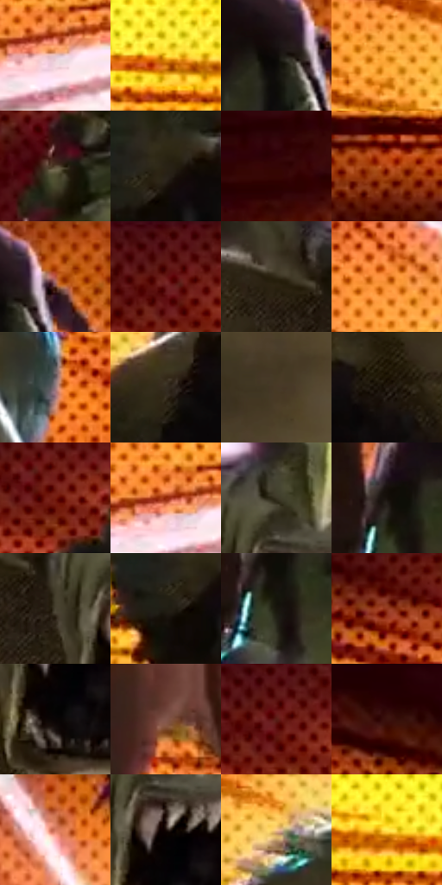

# 电影参考 146

- 状态：条件／活跃；来源世界：miles-home。
- 视角：graphic-nonphysical；景别：medium；场景：graphic。
- 时段：graphic-no-physical-time（外观依据，中置信度；具体时间／晨昏未知）；光照：graphic-field。
- 材质候选：skin（帧级，不是像素分割）。
- 明暗组：dark；L* P5/P50/P95：3.11812 / 26.2691 / 87.43786。
- 资格门禁：impact。
- 原截图 SHA-256：`210bddebc018a79e9825861658081ca9a3b506ace5d61164570213b629c39d6a`；尺寸：2880 × 1204。
- sRGB 像素 SHA-256：`f017e7b8ecce954d583312f5390290fdb00e94ae506c4734821a6fae83e0b579`。

## 观察与迁移

橙白放射插帧与暗主体，动作焦点与皮肤固有色不同。

本公开版保存32个128×128原像素色卡上下文；图集格子并非原场景相邻位置。原rect、图集tile和像素SHA见 `data/palette-crops.json`。上下文不足时不得批准替色，不能以小样推断完整构图。

## 实测色卡

颜色比例分母为保留采样像素，不是材料面积；全部 32 色参与全库匹配。表内四舍五入仅用于阅读，原精度在 JSON。

| ID | HEX | Lab | 原图 xy | 像素数 | 比例 | 明度角色 |
| --- | --- | --- | --- | ---: | ---: | --- |
| 146-S01 | #E6C3C6 | [81.801274, 12.865846, 3.124714] | [1064, 708] | 11210 | 5.818903% | highlight |
| 146-S02 | #FBD531 | [86.167989, -1.824214, 78.395659] | [796, 436] | 9728 | 5.049624% | highlight |
| 146-S03 | #0F0B09 | [3.25761, 0.950531, 1.201076] | [2260, 92] | 9195 | 4.772954% | deep-shadow |
| 146-S04 | #F5A130 | [72.971221, 22.640268, 66.855598] | [1448, 356] | 9111 | 4.729351% | light |
| 146-S05 | #5B4A37 | [32.696076, 4.112013, 14.056848] | [836, 1116] | 9021 | 4.682634% | shadow |
| 146-S06 | #292216 | [13.670881, 1.082716, 9.330183] | [1196, 436] | 8535 | 4.430360% | deep-shadow |
| 146-S07 | #360506 | [8.184341, 24.131127, 10.356814] | [48, 720] | 7954 | 4.128774% | deep-shadow |
| 146-S08 | #B64916 | [45.319115, 41.853917, 49.175567] | [92, 544] | 7783 | 4.040011% | midtone |
| 146-S09 | #D16522 | [55.053916, 38.792441, 54.378084] | [2320, 48] | 7683 | 3.988103% | midtone |
| 146-S10 | #520B06 | [15.731529, 31.647931, 21.744192] | [1024, 52] | 7191 | 3.732715% | deep-shadow |
| 146-S11 | #312917 | [16.992723, 0.591861, 13.158215] | [1968, 384] | 7089 | 3.679768% | deep-shadow |
| 146-S12 | #EA7E29 | [63.8187, 36.175969, 60.738359] | [1524, 204] | 7040 | 3.654333% | light |
| 146-S13 | #987A7F | [54.162094, 12.456157, 1.696722] | [2756, 836] | 6941 | 3.602944% | midtone |
| 146-S14 | #342C1F | [18.498625, 1.258794, 9.802664] | [1552, 572] | 6911 | 3.587372% | deep-shadow |
| 146-S15 | #473926 | [24.970684, 3.091875, 14.16619] | [2344, 692] | 6808 | 3.533906% | shadow |
| 146-S16 | #211910 | [9.449969, 2.305492, 7.172671] | [1716, 552] | 6698 | 3.476807% | deep-shadow |
| 146-S17 | #731B0D | [25.134035, 37.496541, 31.254723] | [1064, 104] | 6607 | 3.429571% | shadow |
| 146-S18 | #942909 | [33.781108, 43.414181, 42.640802] | [1044, 688] | 6088 | 3.160168% | shadow |
| 146-S19 | #393524 | [22.101033, -1.461623, 11.385022] | [2120, 368] | 5714 | 2.966031% | shadow |
| 146-S20 | #16100B | [5.106698, 1.607315, 3.150952] | [2056, 140] | 5546 | 2.878826% | deep-shadow |
| 146-S21 | #4A4333 | [28.66696, 0.02582, 10.820362] | [2044, 444] | 5163 | 2.680017% | shadow |
| 146-S22 | #201E14 | [11.178332, -1.169707, 7.152304] | [1156, 476] | 4955 | 2.572049% | deep-shadow |
| 146-S23 | #18160D | [7.200028, -0.875087, 5.323203] | [2072, 192] | 4617 | 2.396599% | deep-shadow |
| 146-S24 | #94381D | [36.394728, 37.27306, 35.768342] | [720, 176] | 4373 | 2.269943% | shadow |
| 146-S25 | #090505 | [1.604102, 1.04591, 0.368719] | [2124, 544] | 4081 | 2.118371% | deep-shadow |
| 146-S26 | #82574C | [41.350894, 16.346335, 13.622045] | [2764, 536] | 3946 | 2.048295% | midtone |
| 146-S27 | #581F16 | [20.491744, 25.705131, 19.493675] | [1040, 72] | 3920 | 2.034799% | shadow |
| 146-S28 | #3B130D | [12.122307, 19.292756, 13.11065] | [304, 68] | 2505 | 1.300299% | deep-shadow |
| 146-S29 | #D77E61 | [61.856861, 31.602259, 30.577473] | [1776, 60] | 2219 | 1.151842% | light |
| 146-S30 | #180B07 | [4.055054, 4.426245, 3.280565] | [2132, 468] | 1842 | 0.956148% | deep-shadow |
| 146-S31 | #FCCC8F | [84.929038, 9.278876, 36.777519] | [1612, 376] | 1735 | 0.900606% | highlight |
| 146-S32 | #FFEA52 | [92.006229, -9.352612, 72.988483] | [636, 424] | 439 | 0.227877% | highlight |

## 色阶与空间分布

- 采样 ROI：`[0.01, 0.02, 0.98, 0.94]`；步长：4；样本数：192648。
- 排除区：`[]`。
- 深暗、暗、中、亮、高光五段计数：`[77041, 48324, 25431, 25170, 16682]`。
- RGB 各 256 箱、L* 100 箱、13×5 色相明度表和 3×3 空间统计全部保存在 [总数据](../film-library.json)。
- [可视化档案](../../references/library.html)按需绘制直方图，不存 2,094 张重复图表图片。

## 纹理特征占比

**这是分块图像特征的面积占比，不是波点／排线／丝网／错版的精确语义覆盖率。** 窗格、发丝、织物也会产生方向或周期特征。
原图 ROI 像素 3092958；已测块覆盖 3092958（100.0000%）；未测 0。

| 特征 | 块覆盖像素 | 占已测面积 | 阈值敏感范围 |
| --- | ---: | ---: | --- |
| low-contrast | 32768 | 1.0594% | 1.0594% ~ 1.5892% |
| directional-structure | 313344 | 10.1309% | 1.9326% ~ 20.9777% |
| periodic-structure | 2670686 | 86.3473% | 77.9628% ~ 89.7781% |
| mixed-detail | 76160 | 2.4624% | 0.0000% ~ 6.7001% |

阈值敏感范围不是统计置信区间。逐块坐标、尺度、对比、方向一致性、频谱集中度、频率与角度见 [全量特征记录](../texture-features.jsonl)，以帧号定位。
四种印刷层的真实像素覆盖仍标为 `null`，不能填 0，也不能拿上表代替。不得据这些代理测量删除唯一证据。

[测量方法与保留策略](../../references/library-retention.md) · [分类索引](../archive/README.md)
