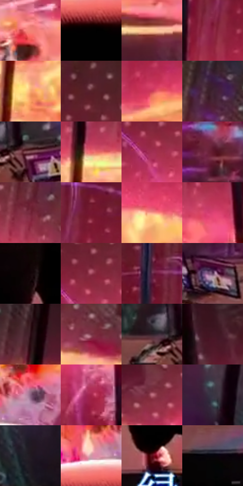

# 电影参考 147

- 状态：条件／活跃；来源世界：miles-home。
- 视角：high-angle；景别：environment-wide；场景：industrial。
- 时段：event-time-unknown（外观依据，中置信度；具体时间／晨昏未知）；光照：event-light。
- 材质候选：glass, metal, screen, fabric（帧级，不是像素分割）。
- 明暗组：dark；L* P5/P50/P95：0.88319 / 32.25186 / 79.01831。
- 资格门禁：energy。
- 原截图 SHA-256：`25ecfce2b7fdf2c97b3be56ead053606acb55a3eb08e78bc408e8415dfbef7bf`；尺寸：2880 × 1220。
- sRGB 像素 SHA-256：`49acc8c1c81f31ac08e924718fbbc3aae2916c6e409cc8d0d3ed961a3358eb1c`。

## 观察与迁移

隔墙后能量带与前方人物黑形，显示和事件光分开。

本公开版保存32个128×128原像素色卡上下文；图集格子并非原场景相邻位置。原rect、图集tile和像素SHA见 `data/palette-crops.json`。上下文不足时不得批准替色，不能以小样推断完整构图。

## 实测色卡

颜色比例分母为保留采样像素，不是材料面积；全部 32 色参与全库匹配。表内四舍五入仅用于阅读，原精度在 JSON。

| ID | HEX | Lab | 原图 xy | 像素数 | 比例 | 明度角色 |
| --- | --- | --- | --- | ---: | ---: | --- |
| 147-S01 | #F28376 | [66.841631, 41.115901, 26.120692] | [1612, 512] | 9461 | 4.840872% | light |
| 147-S02 | #020101 | [0.332482, 0.261482, 0.092172] | [1472, 912] | 9437 | 4.828592% | deep-shadow |
| 147-S03 | #FDCA94 | [84.620372, 11.22595, 33.81929] | [40, 660] | 9012 | 4.611134% | highlight |
| 147-S04 | #881F3F | [30.81825, 45.793246, 7.410345] | [1764, 320] | 8603 | 4.401862% | shadow |
| 147-S05 | #F6AA70 | [75.77157, 21.8662, 40.921712] | [2276, 492] | 8287 | 4.240176% | light |
| 147-S06 | #572129 | [21.111662, 25.807181, 7.34963] | [2060, 116] | 7942 | 4.063651% | shadow |
| 147-S07 | #CA3B57 | [47.464399, 57.721987, 17.071631] | [1840, 444] | 7626 | 3.901965% | midtone |
| 147-S08 | #412433 | [18.473821, 16.287932, -3.899651] | [2396, 136] | 7247 | 3.708043% | deep-shadow |
| 147-S09 | #7E4A53 | [37.768117, 23.284825, 4.187986] | [236, 996] | 7189 | 3.678367% | shadow |
| 147-S10 | #EE656A | [60.364762, 53.239604, 24.181339] | [2264, 348] | 7016 | 3.589849% | light |
| 147-S11 | #A22F52 | [38.420919, 49.555294, 6.530726] | [2096, 296] | 6629 | 3.391834% | shadow |
| 147-S12 | #5F192C | [21.247577, 33.101952, 5.679743] | [1984, 908] | 6559 | 3.356017% | shadow |
| 147-S13 | #742639 | [27.83354, 35.832667, 6.650104] | [2364, 268] | 6516 | 3.334016% | shadow |
| 147-S14 | #751731 | [25.61625, 41.531511, 8.991891] | [1824, 220] | 6422 | 3.285919% | shadow |
| 147-S15 | #FA9C8D | [73.564119, 33.4206, 22.678241] | [892, 416] | 6303 | 3.225031% | light |
| 147-S16 | #DD4273 | [52.409851, 63.047191, 7.499079] | [616, 340] | 6121 | 3.131907% | midtone |
| 147-S17 | #120407 | [2.084825, 4.58235, 0.332488] | [1732, 1020] | 6102 | 3.122186% | deep-shadow |
| 147-S18 | #A3495F | [43.330054, 39.431277, 5.412079] | [2116, 240] | 6092 | 3.117069% | midtone |
| 147-S19 | #5D2543 | [23.855943, 29.362069, -6.386108] | [1716, 160] | 6079 | 3.110418% | shadow |
| 147-S20 | #5C3959 | [29.217672, 21.254075, -12.833559] | [488, 1012] | 5922 | 3.030086% | shadow |
| 147-S21 | #2A0C14 | [7.278901, 16.493703, 1.77493] | [2768, 284] | 5699 | 2.915984% | deep-shadow |
| 147-S22 | #793546 | [31.930377, 31.507102, 4.019766] | [2472, 316] | 5563 | 2.846398% | shadow |
| 147-S23 | #2F2029 | [14.3867, 9.079177, -3.167877] | [152, 980] | 5448 | 2.787556% | deep-shadow |
| 147-S24 | #421725 | [14.980099, 22.47441, 0.950105] | [172, 232] | 5341 | 2.732808% | deep-shadow |
| 147-S25 | #89617F | [46.178199, 21.346008, -10.289098] | [1572, 764] | 5040 | 2.578797% | midtone |
| 147-S26 | #A4244B | [37.233637, 53.424438, 9.385179] | [1160, 780] | 4841 | 2.476975% | shadow |
| 147-S27 | #BE6D7F | [55.50145, 34.249803, 4.192973] | [332, 300] | 4632 | 2.370037% | midtone |
| 147-S28 | #393442 | [22.720421, 5.534685, -7.905635] | [2688, 796] | 4576 | 2.341384% | shadow |
| 147-S29 | #201920 | [9.849982, 5.131598, -3.548665] | [2808, 912] | 4154 | 2.125460% | deep-shadow |
| 147-S30 | #D198A5 | [68.555596, 23.244049, 1.681253] | [1464, 816] | 2906 | 1.486901% | light |
| 147-S31 | #5D0F1A | [18.988491, 34.921807, 15.205647] | [1092, 1100] | 2175 | 1.112874% | deep-shadow |
| 147-S32 | #06040C | [1.373835, 1.650939, -2.885598] | [248, 1144] | 500 | 0.255833% | deep-shadow |

## 色阶与空间分布

- 采样 ROI：`[0.01, 0.02, 0.98, 0.94]`；步长：4；样本数：195440。
- 排除区：`[]`。
- 深暗、暗、中、亮、高光五段计数：`[49453, 71350, 33935, 32452, 8250]`。
- RGB 各 256 箱、L* 100 箱、13×5 色相明度表和 3×3 空间统计全部保存在 [总数据](../film-library.json)。
- [可视化档案](../../references/library.html)按需绘制直方图，不存 2,094 张重复图表图片。

## 纹理特征占比

**这是分块图像特征的面积占比，不是波点／排线／丝网／错版的精确语义覆盖率。** 窗格、发丝、织物也会产生方向或周期特征。
原图 ROI 像素 3134868；已测块覆盖 3134868（100.0000%）；未测 0。

| 特征 | 块覆盖像素 | 占已测面积 | 阈值敏感范围 |
| --- | ---: | ---: | --- |
| low-contrast | 49152 | 1.5679% | 1.5679% ~ 1.5679% |
| directional-structure | 467604 | 14.9162% | 5.0106% ~ 26.7246% |
| periodic-structure | 2536192 | 80.9027% | 71.7075% ~ 85.0593% |
| mixed-detail | 81920 | 2.6132% | 0.0000% ~ 8.3622% |

阈值敏感范围不是统计置信区间。逐块坐标、尺度、对比、方向一致性、频谱集中度、频率与角度见 [全量特征记录](../texture-features.jsonl)，以帧号定位。
四种印刷层的真实像素覆盖仍标为 `null`，不能填 0，也不能拿上表代替。不得据这些代理测量删除唯一证据。

[测量方法与保留策略](../../references/library-retention.md) · [分类索引](../archive/README.md)
