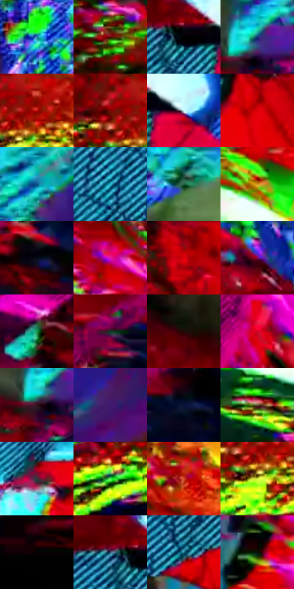

# 电影参考 148

- 状态：条件／活跃；来源世界：miles-home。
- 视角：graphic-nonphysical；景别：graphic-or-multipanel；场景：graphic。
- 时段：graphic-no-physical-time（外观依据，中置信度；具体时间／晨昏未知）；光照：graphic-field。
- 材质候选：fabric（帧级，不是像素分割）。
- 明暗组：dark；L* P5/P50/P95：0.52478 / 33.72116 / 88.05912。
- 资格门禁：glitch。
- 原截图 SHA-256：`6f20eaa8a21fa0d815040715b30c7ac595e55155bc5262f044657d2045f01de8`；尺寸：2880 × 1204。
- sRGB 像素 SHA-256：`f2a9fb98cb61ff05a1ece99fe0b33cf11d1680fc967061b1469888e2b15826e3`。

## 观察与迁移

多色复制图形与碎裂，禁止作为稳定人物造型。

本公开版保存32个128×128原像素色卡上下文；图集格子并非原场景相邻位置。原rect、图集tile和像素SHA见 `data/palette-crops.json`。上下文不足时不得批准替色，不能以小样推断完整构图。

## 实测色卡

颜色比例分母为保留采样像素，不是材料面积；全部 32 色参与全库匹配。表内四舍五入仅用于阅读，原精度在 JSON。

| ID | HEX | Lab | 原图 xy | 像素数 | 比例 | 明度角色 |
| --- | --- | --- | --- | ---: | ---: | --- |
| 148-S01 | #3C84BC | [53.04989, -4.315452, -35.887192] | [1904, 68] | 10800 | 5.606079% | midtone |
| 148-S02 | #500809 | [14.950276, 32.060909, 19.431092] | [480, 800] | 9486 | 4.924006% | deep-shadow |
| 148-S03 | #000001 | [0.019787, 0.139044, -0.378424] | [1188, 284] | 8999 | 4.671214% | deep-shadow |
| 148-S04 | #133674 | [23.79369, 12.500872, -39.185294] | [2408, 352] | 8724 | 4.528466% | shadow |
| 148-S05 | #BA0D09 | [39.156408, 61.843989, 49.896854] | [704, 1000] | 8517 | 4.421017% | shadow |
| 148-S06 | #7E0704 | [25.556766, 46.239222, 36.281308] | [632, 984] | 8336 | 4.327063% | shadow |
| 148-S07 | #BDEFEE | [91.108529, -16.067663, -4.76006] | [1300, 296] | 8328 | 4.322910% | highlight |
| 148-S08 | #E10108 | [47.042806, 72.844111, 58.804503] | [1940, 360] | 8300 | 4.308376% | midtone |
| 148-S09 | #11518C | [33.76614, 3.743182, -38.134938] | [2552, 184] | 8290 | 4.303185% | shadow |
| 148-S10 | #2FB9CF | [69.329403, -28.208087, -21.393012] | [1000, 464] | 7591 | 3.940347% | light |
| 148-S11 | #1A5B3E | [34.08491, -28.08669, 10.909784] | [2248, 92] | 7549 | 3.918546% | shadow |
| 148-S12 | #D3961B | [66.323917, 13.403904, 66.101418] | [592, 484] | 7192 | 3.733234% | light |
| 148-S13 | #060A17 | [2.869185, 1.488395, -7.266335] | [2264, 680] | 7161 | 3.717142% | deep-shadow |
| 148-S14 | #DD16AD | [50.648467, 79.927338, -29.749344] | [608, 180] | 7065 | 3.667310% | midtone |
| 148-S15 | #8A0D16 | [28.774875, 48.966159, 31.466346] | [768, 40] | 6765 | 3.511586% | shadow |
| 148-S16 | #8C0357 | [30.230837, 55.463613, -9.227825] | [1072, 132] | 6070 | 3.150824% | shadow |
| 148-S17 | #19994C | [55.593324, -50.347323, 31.191812] | [2072, 744] | 5892 | 3.058428% | midtone |
| 148-S18 | #133624 | [19.655251, -17.845526, 7.596386] | [2272, 556] | 5651 | 2.933329% | deep-shadow |
| 148-S19 | #220B07 | [5.373316, 10.338304, 5.363662] | [2100, 324] | 5000 | 2.595407% | deep-shadow |
| 148-S20 | #D10326 | [43.893776, 69.217984, 42.291133] | [1900, 1088] | 4946 | 2.567377% | midtone |
| 148-S21 | #341220 | [11.043678, 18.970041, -1.434382] | [2380, 392] | 4889 | 2.537789% | deep-shadow |
| 148-S22 | #411772 | [19.847933, 39.142356, -44.157384] | [2724, 232] | 4844 | 2.514430% | deep-shadow |
| 148-S23 | #091438 | [7.621808, 10.462307, -24.896852] | [2396, 560] | 4839 | 2.511835% | deep-shadow |
| 148-S24 | #5E5636 | [36.559195, -1.993346, 19.81593] | [116, 492] | 4505 | 2.338462% | shadow |
| 148-S25 | #313839 | [22.918889, -2.699432, -1.627267] | [1516, 1028] | 3602 | 1.869731% | shadow |
| 148-S26 | #52EF5E | [84.138222, -68.650231, 56.938377] | [556, 1096] | 3568 | 1.852083% | highlight |
| 148-S27 | #D54B2F | [51.137952, 52.824217, 44.974789] | [724, 872] | 3546 | 1.840663% | midtone |
| 148-S28 | #CFE83B | [87.628356, -29.061364, 75.420705] | [668, 1060] | 2823 | 1.465367% | highlight |
| 148-S29 | #090103 | [0.780217, 2.370065, -0.019706] | [2720, 472] | 2789 | 1.447718% | deep-shadow |
| 148-S30 | #355474 | [34.717291, -1.424708, -21.752247] | [1140, 272] | 2498 | 1.296665% | shadow |
| 148-S31 | #13738A | [44.565904, -17.512474, -19.983086] | [1120, 488] | 2437 | 1.265001% | midtone |
| 148-S32 | #061506 | [5.312935, -7.493114, 5.356152] | [628, 348] | 1646 | 0.854408% | deep-shadow |

## 色阶与空间分布

- 采样 ROI：`[0.01, 0.02, 0.98, 0.94]`；步长：4；样本数：192648。
- 排除区：`[]`。
- 深暗、暗、中、亮、高光五段计数：`[53019, 59430, 49013, 17909, 13277]`。
- RGB 各 256 箱、L* 100 箱、13×5 色相明度表和 3×3 空间统计全部保存在 [总数据](../film-library.json)。
- [可视化档案](../../references/library.html)按需绘制直方图，不存 2,094 张重复图表图片。

## 纹理特征占比

**这是分块图像特征的面积占比，不是波点／排线／丝网／错版的精确语义覆盖率。** 窗格、发丝、织物也会产生方向或周期特征。
原图 ROI 像素 3092958；已测块覆盖 3092958（100.0000%）；未测 0。

| 特征 | 块覆盖像素 | 占已测面积 | 阈值敏感范围 |
| --- | ---: | ---: | --- |
| low-contrast | 54144 | 1.7506% | 1.2208% ~ 2.7190% |
| directional-structure | 936064 | 30.2644% | 12.5312% ~ 58.4719% |
| periodic-structure | 2010206 | 64.9930% | 39.4340% ~ 79.8251% |
| mixed-detail | 92544 | 2.9921% | 0.8732% ~ 4.9247% |

阈值敏感范围不是统计置信区间。逐块坐标、尺度、对比、方向一致性、频谱集中度、频率与角度见 [全量特征记录](../texture-features.jsonl)，以帧号定位。
四种印刷层的真实像素覆盖仍标为 `null`，不能填 0，也不能拿上表代替。不得据这些代理测量删除唯一证据。

[测量方法与保留策略](../../references/library-retention.md) · [分类索引](../archive/README.md)
