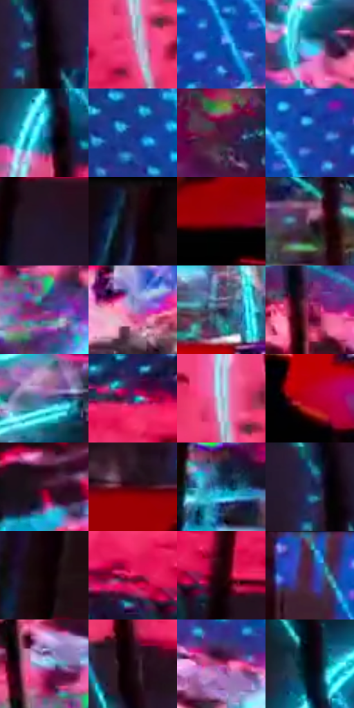

# 电影参考 149

- 状态：条件／活跃；来源世界：miles-home。
- 视角：high-angle；景别：environment-wide；场景：industrial。
- 时段：event-time-unknown（外观依据，中置信度；具体时间／晨昏未知）；光照：event-light。
- 材质候选：glass, metal, screen, fabric（帧级，不是像素分割）。
- 明暗组：dark；L* P5/P50/P95：0.33248 / 28.2153 / 69.80031。
- 资格门禁：energy。
- 原截图 SHA-256：`6ec8b8b4e96a8193b04d8d1c6cacf832c704c441c96a8ad734c23ac954c4f9be`；尺寸：2880 × 1228。
- sRGB 像素 SHA-256：`767db9468c62aacec6bde68a400b6d1a70197919c85f0c05d8bc3ad1823973e1`。

## 观察与迁移

隔墙后能量带与前方人物黑形，显示和事件光分开。

本公开版保存32个128×128原像素色卡上下文；图集格子并非原场景相邻位置。原rect、图集tile和像素SHA见 `data/palette-crops.json`。上下文不足时不得批准替色，不能以小样推断完整构图。

## 实测色卡

颜色比例分母为保留采样像素，不是材料面积；全部 32 色参与全库匹配。表内四舍五入仅用于阅读，原精度在 JSON。

| ID | HEX | Lab | 原图 xy | 像素数 | 比例 | 明度角色 |
| --- | --- | --- | --- | ---: | ---: | --- |
| 149-S01 | #020101 | [0.332482, 0.261482, 0.092172] | [192, 808] | 12221 | 6.208722% | deep-shadow |
| 149-S02 | #EF3975 | [54.623239, 71.136682, 9.884702] | [36, 524] | 10655 | 5.413136% | midtone |
| 149-S03 | #1D55BC | [38.528602, 21.439064, -59.137293] | [1928, 340] | 8604 | 4.371152% | shadow |
| 149-S04 | #37C0E7 | [72.41306, -23.248627, -29.739886] | [968, 592] | 8047 | 4.088175% | light |
| 149-S05 | #2987BE | [53.508218, -7.927587, -36.348132] | [108, 296] | 7580 | 3.850922% | midtone |
| 149-S06 | #1F3389 | [25.150536, 24.573356, -50.18478] | [844, 84] | 7428 | 3.773700% | shadow |
| 149-S07 | #471437 | [16.084802, 28.654392, -10.243063] | [2564, 768] | 7386 | 3.752362% | deep-shadow |
| 149-S08 | #1642A1 | [30.970411, 22.957467, -55.405618] | [2020, 264] | 7336 | 3.726961% | shadow |
| 149-S09 | #21152E | [9.456842, 12.496682, -14.537765] | [2820, 720] | 7197 | 3.656343% | deep-shadow |
| 149-S10 | #1E101C | [6.598342, 9.546927, -5.424842] | [2816, 60] | 7141 | 3.627893% | deep-shadow |
| 149-S11 | #90000F | [29.325882, 52.567476, 36.360629] | [164, 1116] | 7106 | 3.610112% | shadow |
| 149-S12 | #543249 | [25.705499, 19.312724, -7.763696] | [688, 896] | 6894 | 3.502408% | shadow |
| 149-S13 | #5C387C | [30.780804, 30.113105, -32.711139] | [796, 668] | 6746 | 3.427219% | shadow |
| 149-S14 | #B283BF | [61.185301, 28.659954, -24.320049] | [1528, 476] | 6388 | 3.245341% | light |
| 149-S15 | #201E3F | [13.19603, 11.192722, -20.829835] | [2080, 920] | 6226 | 3.163039% | deep-shadow |
| 149-S16 | #851451 | [29.61921, 50.009603, -6.336406] | [704, 400] | 6216 | 3.157959% | shadow |
| 149-S17 | #5F5F96 | [42.48884, 13.914393, -30.112338] | [1312, 572] | 6153 | 3.125953% | midtone |
| 149-S18 | #1F3A64 | [24.440132, 4.912814, -27.840984] | [2464, 352] | 5577 | 2.833323% | shadow |
| 149-S19 | #D7669D | [58.402941, 50.405251, -8.638957] | [52, 448] | 5437 | 2.762198% | midtone |
| 149-S20 | #B50026 | [37.782992, 62.609209, 34.155501] | [2056, 1080] | 5435 | 2.761182% | shadow |
| 149-S21 | #391326 | [12.453036, 21.35022, -3.699696] | [1784, 604] | 5139 | 2.610803% | deep-shadow |
| 149-S22 | #4C0312 | [13.506379, 32.955396, 12.911722] | [52, 968] | 4982 | 2.531041% | deep-shadow |
| 149-S23 | #165D85 | [37.283181, -6.276037, -28.28383] | [2284, 804] | 4964 | 2.521896% | shadow |
| 149-S24 | #212752 | [17.382552, 11.900368, -27.207335] | [160, 792] | 4920 | 2.499543% | deep-shadow |
| 149-S25 | #0E0002 | [0.883187, 4.061471, 0.576217] | [2808, 284] | 4726 | 2.400984% | deep-shadow |
| 149-S26 | #D71556 | [46.52495, 70.834072, 16.832582] | [2676, 608] | 4611 | 2.342559% | midtone |
| 149-S27 | #1B0508 | [3.244162, 8.552059, 1.731243] | [2768, 632] | 4522 | 2.297344% | deep-shadow |
| 149-S28 | #4A1B55 | [19.621456, 31.981535, -25.36501] | [1780, 68] | 4374 | 2.222154% | deep-shadow |
| 149-S29 | #A5CDEF | [80.678444, -5.374588, -21.026545] | [740, 576] | 4336 | 2.202849% | highlight |
| 149-S30 | #1A0612 | [3.555189, 9.26708, -2.687783] | [180, 652] | 4034 | 2.049422% | deep-shadow |
| 149-S31 | #B13672 | [43.067243, 54.652133, -6.440537] | [928, 444] | 4011 | 2.037737% | midtone |
| 149-S32 | #02060D | [1.555455, -0.036667, -3.115648] | [112, 180] | 444 | 0.225568% | deep-shadow |

## 色阶与空间分布

- 采样 ROI：`[0.01, 0.02, 0.98, 0.94]`；步长：4；样本数：196836。
- 排除区：`[]`。
- 深暗、暗、中、亮、高光五段计数：`[70895, 65418, 41733, 14803, 3987]`。
- RGB 各 256 箱、L* 100 箱、13×5 色相明度表和 3×3 空间统计全部保存在 [总数据](../film-library.json)。
- [可视化档案](../../references/library.html)按需绘制直方图，不存 2,094 张重复图表图片。

## 纹理特征占比

**这是分块图像特征的面积占比，不是波点／排线／丝网／错版的精确语义覆盖率。** 窗格、发丝、织物也会产生方向或周期特征。
原图 ROI 像素 3157220；已测块覆盖 3157220（100.0000%）；未测 0。

| 特征 | 块覆盖像素 | 占已测面积 | 阈值敏感范围 |
| --- | ---: | ---: | --- |
| low-contrast | 136192 | 4.3137% | 3.8839% ~ 4.3137% |
| directional-structure | 324836 | 10.2887% | 5.7966% ~ 18.4863% |
| periodic-structure | 2696192 | 85.3977% | 77.6298% ~ 85.7382% |
| mixed-detail | 0 | 0.0000% | 0.0000% ~ 4.1515% |

阈值敏感范围不是统计置信区间。逐块坐标、尺度、对比、方向一致性、频谱集中度、频率与角度见 [全量特征记录](../texture-features.jsonl)，以帧号定位。
四种印刷层的真实像素覆盖仍标为 `null`，不能填 0，也不能拿上表代替。不得据这些代理测量删除唯一证据。

[测量方法与保留策略](../../references/library-retention.md) · [分类索引](../archive/README.md)
