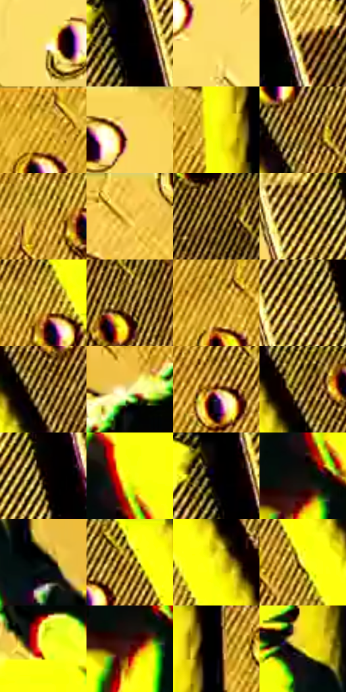

# 电影参考 150

- 状态：条件／活跃；来源世界：miles-home。
- 视角：rolled-or-dutch；景别：medium；场景：industrial。
- 时段：graphic-no-physical-time（外观依据，中置信度；具体时间／晨昏未知）；光照：graphic-field。
- 材质候选：skin, fabric, metal（帧级，不是像素分割）。
- 明暗组：light；L* P5/P50/P95：0.27417 / 67.16697 / 97.14396。
- 资格门禁：energy。
- 原截图 SHA-256：`f9932e9a48ac337082d4992d6815bbe8f880abce2a7bc826eece7c7f087b8e1a`；尺寸：2880 × 1204。
- sRGB 像素 SHA-256：`b241e664ea4ea74a702a1ee2b879a0c2e4e30f624f8645332ca72f3023230e93`。

## 观察与迁移

黄青高反差局部线束，属于异常事件的图形强化。

本公开版保存32个128×128原像素色卡上下文；图集格子并非原场景相邻位置。原rect、图集tile和像素SHA见 `data/palette-crops.json`。上下文不足时不得批准替色，不能以小样推断完整构图。

## 实测色卡

颜色比例分母为保留采样像素，不是材料面积；全部 32 色参与全库匹配。表内四舍五入仅用于阅读，原精度在 JSON。

| ID | HEX | Lab | 原图 xy | 像素数 | 比例 | 明度角色 |
| --- | --- | --- | --- | ---: | ---: | --- |
| 150-S01 | #FBDF73 | [89.170381, -3.366284, 55.753242] | [644, 1060] | 17115 | 8.884079% | highlight |
| 150-S02 | #010101 | [0.274173, -1.7e-05, 3.3e-05] | [704, 76] | 15496 | 8.043686% | deep-shadow |
| 150-S03 | #FBDC68 | [88.3038, -2.661113, 59.781253] | [432, 624] | 8701 | 4.516528% | highlight |
| 150-S04 | #251006 | [7.019939, 9.645974, 8.23312] | [936, 700] | 8443 | 4.382605% | deep-shadow |
| 150-S05 | #ECBD3B | [78.77997, 4.510595, 67.944239] | [1352, 64] | 7418 | 3.850546% | light |
| 150-S06 | #F9D45F | [86.034775, -0.015938, 61.194585] | [52, 48] | 7269 | 3.773203% | highlight |
| 150-S07 | #FDFE0F | [96.740027, -21.786183, 93.036092] | [1500, 104] | 7164 | 3.718699% | highlight |
| 150-S08 | #9D7A27 | [53.205953, 5.077015, 48.1841] | [2208, 300] | 7094 | 3.682364% | midtone |
| 150-S09 | #C39629 | [64.625794, 6.764008, 59.670375] | [2048, 524] | 6927 | 3.595677% | light |
| 150-S10 | #DCAE34 | [73.375831, 5.245898, 64.797518] | [316, 60] | 6829 | 3.544807% | light |
| 150-S11 | #3C2608 | [17.295109, 7.152598, 21.964816] | [2416, 28] | 6812 | 3.535983% | deep-shadow |
| 150-S12 | #785F1E | [41.645289, 2.868946, 39.246147] | [716, 468] | 6417 | 3.330946% | midtone |
| 150-S13 | #F0CA5B | [82.660254, 1.133503, 59.001741] | [2096, 496] | 6254 | 3.246335% | highlight |
| 150-S14 | #684712 | [32.905866, 8.975968, 35.400065] | [2580, 476] | 6061 | 3.146153% | shadow |
| 150-S15 | #EFBF4D | [79.700227, 5.589677, 61.866026] | [1756, 368] | 5912 | 3.068809% | light |
| 150-S16 | #55330A | [24.706615, 11.704084, 30.316139] | [740, 504] | 5856 | 3.039741% | shadow |
| 150-S17 | #A78945 | [58.544271, 3.085551, 40.18228] | [2092, 136] | 5836 | 3.029359% | midtone |
| 150-S18 | #FAEE9F | [93.441188, -7.123212, 39.734163] | [1284, 236] | 5802 | 3.011710% | highlight |
| 150-S19 | #9A5F1B | [45.819061, 18.623913, 45.975978] | [1704, 224] | 5507 | 2.858581% | midtone |
| 150-S20 | #C2A852 | [69.530595, -1.051781, 47.179402] | [2048, 56] | 5263 | 2.731926% | light |
| 150-S21 | #0F0101 | [1.133537, 3.853999, 1.357984] | [784, 452] | 5166 | 2.681575% | deep-shadow |
| 150-S22 | #F8FC07 | [95.828675, -22.951817, 92.785631] | [1460, 880] | 4388 | 2.277729% | highlight |
| 150-S23 | #050101 | [0.507409, 1.04598, 0.368587] | [688, 44] | 4341 | 2.253333% | deep-shadow |
| 150-S24 | #120F0B | [4.466069, 0.44023, 2.16999] | [1436, 960] | 4181 | 2.170279% | deep-shadow |
| 150-S25 | #040C0B | [2.826412, -2.272814, -0.335692] | [1616, 704] | 4040 | 2.097089% | deep-shadow |
| 150-S26 | #DBBC59 | [77.1314, -0.50526, 53.18138] | [1892, 64] | 3502 | 1.817823% | light |
| 150-S27 | #F3ED13 | [91.537955, -17.726396, 88.347946] | [2296, 676] | 3252 | 1.688053% | highlight |
| 150-S28 | #FEFC69 | [96.703383, -17.201783, 68.755301] | [1976, 192] | 3036 | 1.575931% | highlight |
| 150-S29 | #FCFE2F | [96.733236, -21.627723, 87.96323] | [1244, 496] | 2629 | 1.364665% | highlight |
| 150-S30 | #540F13 | [16.864431, 31.458926, 16.959585] | [1424, 1004] | 2458 | 1.275902% | deep-shadow |
| 150-S31 | #020006 | [0.235338, 1.357262, -2.086264] | [1568, 28] | 1980 | 1.027781% | deep-shadow |
| 150-S32 | #F6F045 | [92.727158, -16.59629, 78.056112] | [1508, 608] | 1499 | 0.778103% | highlight |

## 色阶与空间分布

- 采样 ROI：`[0.01, 0.02, 0.98, 0.94]`；步长：4；样本数：192648。
- 排除区：`[]`。
- 深暗、暗、中、亮、高光五段计数：`[51349, 16375, 20363, 33207, 71354]`。
- RGB 各 256 箱、L* 100 箱、13×5 色相明度表和 3×3 空间统计全部保存在 [总数据](../film-library.json)。
- [可视化档案](../../references/library.html)按需绘制直方图，不存 2,094 张重复图表图片。

## 纹理特征占比

**这是分块图像特征的面积占比，不是波点／排线／丝网／错版的精确语义覆盖率。** 窗格、发丝、织物也会产生方向或周期特征。
原图 ROI 像素 3092958；已测块覆盖 3092958（100.0000%）；未测 0。

| 特征 | 块覆盖像素 | 占已测面积 | 阈值敏感范围 |
| --- | ---: | ---: | --- |
| low-contrast | 119774 | 3.8725% | 3.5290% ~ 4.2160% |
| directional-structure | 1358464 | 43.9212% | 23.1256% ~ 57.9794% |
| periodic-structure | 1228160 | 39.7083% | 34.0966% ~ 56.4524% |
| mixed-detail | 386560 | 12.4981% | 4.3950% ~ 16.2061% |

阈值敏感范围不是统计置信区间。逐块坐标、尺度、对比、方向一致性、频谱集中度、频率与角度见 [全量特征记录](../texture-features.jsonl)，以帧号定位。
四种印刷层的真实像素覆盖仍标为 `null`，不能填 0，也不能拿上表代替。不得据这些代理测量删除唯一证据。

[测量方法与保留策略](../../references/library-retention.md) · [分类索引](../archive/README.md)
