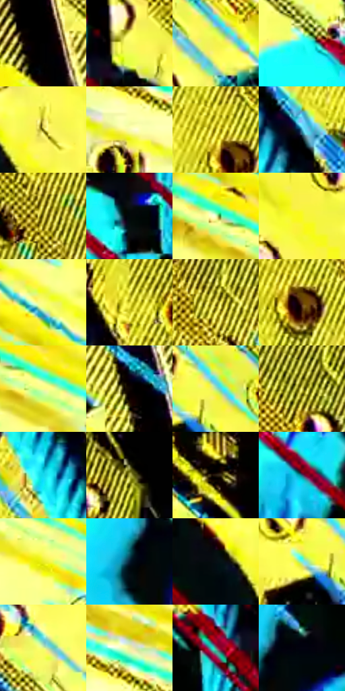

# 电影参考 151

- 状态：条件／活跃；来源世界：miles-home。
- 视角：rolled-or-dutch；景别：medium；场景：industrial。
- 时段：graphic-no-physical-time（外观依据，中置信度；具体时间／晨昏未知）；光照：graphic-field。
- 材质候选：skin, fabric, metal（帧级，不是像素分割）。
- 明暗组：very-light；L* P5/P50/P95：0.33248 / 80.42051 / 97.88822。
- 资格门禁：energy。
- 原截图 SHA-256：`61a543f111e8b7a4eb297863f6071d8491f0d1e99e5b949885d1385ea65b24fe`；尺寸：2880 × 1206。
- sRGB 像素 SHA-256：`f36e25d5d6ccbfd6338b7f7854b0458f740470c5d8d9f88604dfc55ad27a92d2`。

## 观察与迁移

黄青高反差局部线束，属于异常事件的图形强化。

本公开版保存32个128×128原像素色卡上下文；图集格子并非原场景相邻位置。原rect、图集tile和像素SHA见 `data/palette-crops.json`。上下文不足时不得批准替色，不能以小样推断完整构图。

## 实测色卡

颜色比例分母为保留采样像素，不是材料面积；全部 32 色参与全库匹配。表内四舍五入仅用于阅读，原精度在 JSON。

| ID | HEX | Lab | 原图 xy | 像素数 | 比例 | 明度角色 |
| --- | --- | --- | --- | ---: | ---: | --- |
| 151-S01 | #010101 | [0.274173, -1.7e-05, 3.3e-05] | [760, 80] | 14052 | 7.267800% | deep-shadow |
| 151-S02 | #F9FA63 | [95.753298, -18.618931, 70.075812] | [1592, 172] | 11748 | 6.076154% | highlight |
| 151-S03 | #F5F34C | [93.467062, -18.138042, 76.358513] | [1336, 140] | 10130 | 5.239312% | highlight |
| 151-S04 | #21FEFC | [90.884006, -47.538354, -12.897333] | [1240, 408] | 9716 | 5.025188% | highlight |
| 151-S05 | #73680E | [43.62129, -5.45788, 46.728563] | [1752, 600] | 8906 | 4.606250% | midtone |
| 151-S06 | #F9FAB2 | [96.708528, -11.207039, 34.533706] | [76, 784] | 7433 | 3.844403% | highlight |
| 151-S07 | #B4A722 | [67.619137, -9.249476, 64.018559] | [2400, 360] | 7205 | 3.726480% | light |
| 151-S08 | #46A7C5 | [64.13491, -19.104827, -23.756536] | [2268, 504] | 7127 | 3.686138% | light |
| 151-S09 | #988B1C | [57.294611, -7.116526, 55.777796] | [2708, 616] | 7096 | 3.670104% | midtone |
| 151-S10 | #02090A | [2.079187, -1.691608, -1.023096] | [1444, 456] | 6960 | 3.599764% | deep-shadow |
| 151-S11 | #FDFF99 | [97.915177, -14.990769, 48.444003] | [40, 268] | 6621 | 3.424431% | highlight |
| 151-S12 | #F9FA1F | [95.418347, -21.308652, 89.901776] | [1744, 448] | 6599 | 3.413052% | highlight |
| 151-S13 | #FCFD7E | [97.005866, -16.909505, 59.933972] | [80, 148] | 6493 | 3.358228% | highlight |
| 151-S14 | #E0D935 | [84.85976, -15.079892, 75.175722] | [2124, 156] | 6445 | 3.333402% | highlight |
| 151-S15 | #D2C63E | [78.717471, -11.080001, 65.962059] | [2588, 380] | 6126 | 3.168413% | light |
| 151-S16 | #5F3612 | [27.061457, 15.101653, 29.298663] | [2428, 400] | 6034 | 3.120830% | shadow |
| 151-S17 | #FCFE8D | [97.431885, -16.068426, 53.530072] | [136, 312] | 6018 | 3.112555% | highlight |
| 151-S18 | #0D0503 | [1.812914, 1.881766, 1.518061] | [864, 540] | 5854 | 3.027733% | deep-shadow |
| 151-S19 | #B3E5A4 | [86.157026, -27.991428, 26.622303] | [1952, 604] | 5720 | 2.958427% | highlight |
| 151-S20 | #E3E170 | [87.656283, -14.261734, 54.867174] | [2508, 220] | 5626 | 2.909809% | highlight |
| 151-S21 | #16D9EE | [79.593303, -35.579183, -22.553499] | [1960, 128] | 4937 | 2.553453% | light |
| 151-S22 | #B7B548 | [71.94971, -13.278694, 54.225007] | [2816, 464] | 4616 | 2.387430% | light |
| 151-S23 | #261B0F | [10.780516, 3.448217, 9.689943] | [1892, 772] | 4182 | 2.162962% | deep-shadow |
| 151-S24 | #2C5774 | [35.226407, -5.41551, -20.995821] | [1500, 604] | 4160 | 2.151583% | shadow |
| 151-S25 | #EBED29 | [90.958974, -20.631795, 83.931873] | [308, 436] | 4095 | 2.117965% | highlight |
| 151-S26 | #071B32 | [9.475171, 1.728202, -17.575377] | [1380, 976] | 3403 | 1.760057% | deep-shadow |
| 151-S27 | #060E14 | [3.642745, -1.021778, -4.026264] | [1656, 620] | 3347 | 1.731093% | deep-shadow |
| 151-S28 | #72EDE0 | [86.762428, -37.514999, -4.229011] | [1888, 632] | 3335 | 1.724887% | highlight |
| 151-S29 | #E5F786 | [93.840816, -22.182168, 52.04584] | [1112, 188] | 2995 | 1.549036% | highlight |
| 151-S30 | #F2F09B | [93.261582, -11.612955, 41.364487] | [104, 692] | 2224 | 1.150269% | highlight |
| 151-S31 | #5B8881 | [53.40237, -16.997476, -1.14836] | [1496, 220] | 2213 | 1.144580% | midtone |
| 151-S32 | #020210 | [0.846555, 2.095498, -5.703165] | [1444, 936] | 1930 | 0.998210% | deep-shadow |

## 色阶与空间分布

- 采样 ROI：`[0.01, 0.02, 0.98, 0.94]`；步长：4；样本数：193346。
- 排除区：`[]`。
- 深暗、暗、中、亮、高光五段计数：`[40278, 11411, 16486, 27652, 97519]`。
- RGB 各 256 箱、L* 100 箱、13×5 色相明度表和 3×3 空间统计全部保存在 [总数据](../film-library.json)。
- [可视化档案](../../references/library.html)按需绘制直方图，不存 2,094 张重复图表图片。

## 纹理特征占比

**这是分块图像特征的面积占比，不是波点／排线／丝网／错版的精确语义覆盖率。** 窗格、发丝、织物也会产生方向或周期特征。
原图 ROI 像素 3098546；已测块覆盖 3098546（100.0000%）；未测 0。

| 特征 | 块覆盖像素 | 占已测面积 | 阈值敏感范围 |
| --- | ---: | ---: | --- |
| low-contrast | 32768 | 1.0575% | 1.0575% ~ 1.0575% |
| directional-structure | 818560 | 26.4176% | 9.2492% ~ 41.5699% |
| periodic-structure | 2078002 | 67.0638% | 55.0840% ~ 76.6559% |
| mixed-detail | 169216 | 5.4611% | 2.2886% ~ 13.0373% |

阈值敏感范围不是统计置信区间。逐块坐标、尺度、对比、方向一致性、频谱集中度、频率与角度见 [全量特征记录](../texture-features.jsonl)，以帧号定位。
四种印刷层的真实像素覆盖仍标为 `null`，不能填 0，也不能拿上表代替。不得据这些代理测量删除唯一证据。

[测量方法与保留策略](../../references/library-retention.md) · [分类索引](../archive/README.md)
